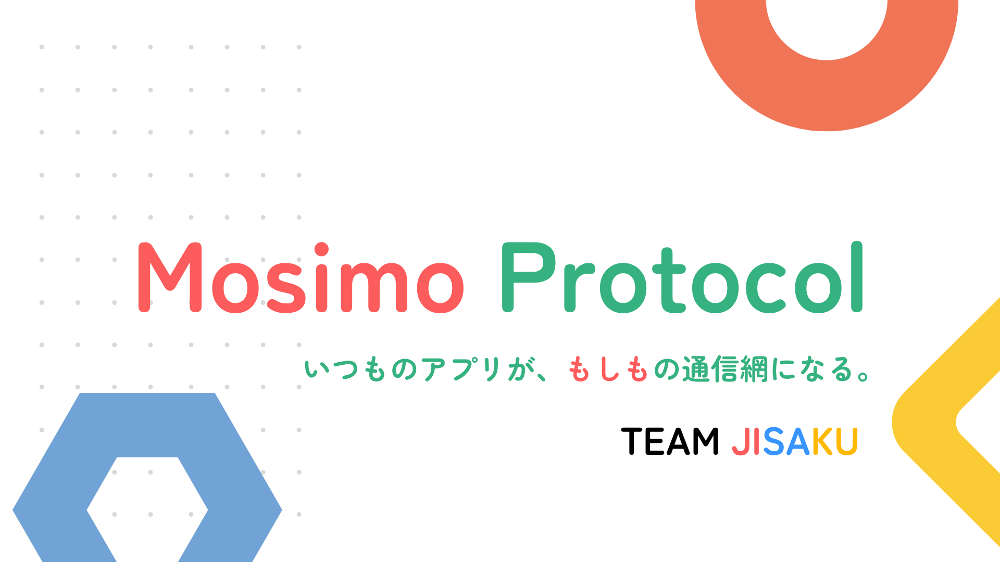

# Moshimo Protocol

## 製品概要
### 背景(製品開発のきっかけ、課題等）

### 製品説明（具体的な製品の説明）

### 特長

#### 2. 通信圏外の壁を越える！

> [!IMPORTANT]
> インターネットがなくても、Bluetoothなどで端末同士が情報を受け渡し、人の移動とともに運びます。

大きな災害が発生した場合、通信インフラが破壊され、スマートフォン同士の通信もできなくなることが過去に何度も発生しています。発電所のトラブルでブラックアウトが置きた事例(北海道胆振東部地震)もあります。

このような状況下では、情報共有が最大の課題になります。能登地震の際も避難所の情報が届かず、混乱が発生しました。Moshimo Protocolは、スマートフォン同士が直接通信することで、通信圏外でも情報を受け渡すことができます。

Moshimo Protocolは、スマートフォン同士が直接通信することで、通信圏外でも情報を受け渡すことができます。これにより、災害時でも情報を共有することができ、混乱を最小限に抑えることができます。

#### 1. アプリの壁を越える！

> [!IMPORTANT]
> 共通のプロトコルを使うことで、異なるアプリ同士が直接情報を交換できます。

メッシュネットワークで情報を共有するというこれまでも広く試みられてきましたが、どれも専用アプリが必要か、高いライセンス料を払ってsdkを買う必要がありました。

Moshimo Protocolは、既存のアプリに組み込むだけで、異なるアプリ同士でも情報を交換できるようになります。
プロトコルもオープンなので、誰でも自分のアプリに組み込むことができます。

これにより過去に類を見ないユーザー密度を実現し、実用的なメッシュネットワークを構築することができます。

#### 3. ネットワークの壁を越える！

> [!IMPORTANT]
> スマートフォン同士の通信だけでなく、既存のメッシュネットワークやインターネットとも接続します。

たとえインターネットに繋がっても、サーバーがダウンしてしまえば、情報を受け取ることはできません。Moshimo Protocolは、既存のメッシュネットワークやインターネットとも接続することで、情報を受け取ることができます。

具体的には、
* At Protocolを用いて各ユーザーの投稿を整理して、複数のサーバーに分散して蓄積できる
* nostrを用いて、専用サーバーに直接アクセスできなくてもリレーを介して情報を送受信できる
* AT ProtocolのAppViewが情報を収集・整理することで、遅い接続でも効率的にデータを受け取れる

### 解決出来ること
### 今後の展望
### 注力したこと（こだわり等）
* ハッカソンで動かしたのはデモ実装ですが、実際には他のアプリにも組み込むため、プロトコルの定義を汎用性のあるものにすることにこだわりました
* 

## 開発技術
### 活用した技術
#### API・データ
* [Nostr](https://nostr.com/)：署名付き投稿をリレーへ送信・購読。独自PDSのリレーに加え、Damus・nos.lolを既定の送信先として利用。
* [AT Protocol](https://atproto.com/)：端末で署名したリポジトリをPDSで復元・検証し、`com.atproto.sync` / `com.atproto.repo` のXRPC APIとfirehoseで公開。
* [PLC Directory](https://plc.directory/)：`did:plc`の登録・解決、署名公開鍵とPDSエンドポイントの確認。
* [Bluesky Jetstream](https://github.com/bluesky-social/jetstream)：登録済み発信元の `app.bsky.feed.post` を購読し、`bsaf:v1` タグ付きのBSAF投稿を収集（発信元DIDの設定時のみ有効）。
* [BSAF JMA Bot](https://github.com/osprey74/bsaf-jma-bot)：気象庁の地震・津波・火山関連情報をBSAF形式でBlueskyへ投稿する非公式Bot。情報取得元として利用し、Jetstream経由で投稿を収集。
* [気象庁防災情報XML](https://xml.kishou.go.jp/)：防災情報の原データ。現在はBSAF JMA Botによる投稿を通じて間接的に取得。
* 独自AppView API `dev.oriom.mosimo.getFeed`：Mosimo投稿と収集済みBSAF投稿を取得し、Webクライアントのタイムラインに表示。

#### フレームワーク・ライブラリ・モジュール

##### Androidアプリ
* Kotlin（Android / JVM）、Jetpack Compose・Material 3：投稿・中継操作・診断画面。
* [Kotlin Coroutines](https://github.com/Kotlin/kotlinx.coroutines)：非同期処理。
* [dtn7-kotlin](https://github.com/jphacks/sd_2607-dtn7-kotlin)（[フォーク元](https://github.com/NodleCode/dtn7-kotlin)）：BPv7のエンコード・デコード。リポジトリ内の固定スナップショットを使用。
* [Jackson Databind](https://github.com/FasterXML/jackson-databind) / [Jackson CBOR](https://github.com/FasterXML/jackson-dataformats-binary)：JSON・CBORの処理。
* [OkHttp](https://square.github.io/okhttp/)：HTTP / WebSocket通信。
* [secp256k1-kmp](https://github.com/ACINQ/secp256k1-kmp)：NostrのBIP-340署名とatprotoのECDSA署名。
* [Android Keystore](https://developer.android.com/privacy-and-security/keystore) / AES-GCM：鍵・投稿・中継状態の暗号化保存。

##### エッジデバイス
* C++ / [Arduino framework（ESP32）](https://github.com/espressif/arduino-esp32) / [PlatformIO](https://platformio.org/)：ESP32向けファームウェア。
* [M5Unified](https://github.com/m5stack/M5Unified) / [M5GFX](https://github.com/m5stack/M5GFX)：M5Stackの画面・ボタン・スピーカー制御。
* [NimBLE-Arduino](https://github.com/h2zero/NimBLE-Arduino)：BLE GATTによるAndroid端末とのBundle交換。
* [ArduinoJson](https://arduinojson.org/) / [LittleFS](https://github.com/littlefs-project/littlefs)：JSON処理と中継データの永続化。
* [mbedTLS](https://github.com/Mbed-TLS/mbedtls)：署名検証・SHA-256ハッシュ計算。
* [AquesTalk ESP32（Small辞書版）](https://www.a-quest.com/)：受信メッセージの音声読み上げ。

##### オンライン時のアップロードサーバー
* Node.js 24 / JavaScript・TypeScript：独自PDSと内蔵Nostrリレー（[`pds/`](./pds/)）。
* [`nostr-tools`](https://github.com/nbd-wtf/nostr-tools) / [`ws`](https://github.com/websockets/ws)：Nostrイベントの署名検証とWebSocket通信。
* [`@atproto/crypto`](https://github.com/bluesky-social/atproto/tree/main/packages/crypto) / [`@atproto/repo`](https://github.com/bluesky-social/atproto/tree/main/packages/repo)：端末署名済みcommitの検証、MSTの再構築、CARの生成。
* [`@ipld/dag-cbor`](https://github.com/ipld/js-dag-cbor) / [`multiformats`](https://github.com/multiformats/js-multiformats)：DAG-CBORとCIDの処理。
* SQLite（[`node:sqlite`](https://nodejs.org/api/sqlite.html)）/ PostgreSQL（[`pg`](https://node-postgres.com/)）：イベント・リポジトリ・配信履歴の保存。標準構成はSQLite、複数物理ノードでDBを共有する構成ではPostgreSQLを使用。

##### ダウンロードサーバー
* [HappyView](https://happyview.dev/) 2.16.0 / SQLite：AT ProtocolのAppViewとして投稿を索引化・配信（[`appview/happyview/`](./appview/happyview/)）。
* Node.js 24 / TypeScript / [`ws`](https://github.com/websockets/ws)：JetstreamからBSAF投稿を収集するサイドカー（[`appview/bsaf/`](./appview/bsaf/)）。
* [`@atproto/lex-cbor`](https://github.com/bluesky-social/atproto/tree/main/packages/lex/lex-cbor) / [`@atproto/lex-data`](https://github.com/bluesky-social/atproto/tree/main/packages/lex/lex-data)：収集したレコードのCID整合性確認。
* Lua：HappyViewのクエリスクリプトでMosimo・BSAFの統合フィードを提供。

##### サーバーの運用・管理 (もともと個人開発していたもの: [github.com/oriom-dev/podman-cluster-config](https://github.com/oriom-dev/podman-cluster-config))
* [NixOS](https://nixos.org/) / [Nix](https://nix.dev/)：OS設定・サービス・パッケージの構成を宣言的に定義。
* [systemd](https://systemd.io/) / [Caddy](https://caddyserver.com/) / [Podman](https://podman.io/)：サービス管理・HTTPS公開・HappyViewコンテナの実行。

##### web上のクライアント
* HTML / CSS / JavaScript：フレームワークを使わないタイムライン画面（[`apps/web/index.html`](./apps/web/index.html)）。
* Fetch API / DOM API：AppViewから5秒間隔で投稿を取得・表示し、PLC Directoryから表示用ハンドルを解決。

##### データ形式
* Nostrイベント（JSON）：本文・タグ・署名を保持し、atprotoレコードと端末署名済みcommitの復元情報を格納。
* [CBOR](https://www.rfc-editor.org/rfc/rfc8949) / [Bundle Protocol Version 7（BPv7）](https://www.rfc-editor.org/rfc/rfc9171)：署名付きイベントをコンパクトに符号化し、オフライン中継用のBundleとして転送。
* [AT Protocol Lexicon](https://atproto.com/specs/lexicon)：独自投稿レコード `dev.oriom.mosimo.post` とフィードAPIを定義。
* [DAG-CBOR](https://ipld.io/specs/codecs/dag-cbor/spec/) / [CID](https://github.com/multiformats/cid) / [MST](https://atproto.com/specs/repository) / [CAR](https://ipld.io/specs/transport/car/)：atprotoリポジトリの内容識別・整合性検証・同期。
* [BSAF（Bluesky Structured Alert Feed）](https://github.com/osprey74/bsaf-protocol)（`bsaf:v1`）：防災情報などを構造化タグ付きのBluesky投稿として扱う規約。原投稿のレコード・タグ・CID・URIを保持して収集。Mosimo形式への変換やメッシュへの再配信は行わない。
* [CAP（Common Alerting Protocol）1.2](https://docs.oasis-open.org/emergency/cap/v1.2/CAP-v1.2-os.html)：警報の内容・対象地域・有効期間・更新取消を表すXML規格。Mosimo投稿への変換と構造化情報の保持を[仕様草案](./protocol/0015-cap.md)で定義（直接取り込みは未実装）。
* [EDXL-DE（Emergency Data Exchange Language Distribution Element）1.0](https://docs.oasis-open.org/emergency/edxl-de/v1.0/EDXL-DE_Spec_v1.0.pdf)：CAPなどの緊急情報を包み、配布先・公開条件・更新取消を表すXML規格。内包情報の取り込みを[仕様草案](./protocol/0016-edxl-de.md)で定義（直接取り込みは未実装）。
* [気象庁防災情報XML](https://xml.kishou.go.jp/)：地震・津波・火山・気象などの防災情報を記述するXML形式。地震関連電文の構造化情報の保持を[緊急地震速報](./protocol/0017-jma-eew.md)・[地震情報](./protocol/0018-jma-earthquake.md)の仕様草案で定義（現在の取得経路はBSAF JMA Bot経由）。

##### ネットワーク
* BLE（Bluetooth Low Energy）GATT：Android端末間、およびAndroid・ESP32間の近距離通信。
* mDNS / DNS-SD（[Android NSD](https://developer.android.com/develop/connectivity/wifi/use-nsd)）＋TCP：同一LAN上のAndroid端末を発見してBundleを交換。
* [DTN](https://www.rfc-editor.org/rfc/rfc4838)（store-carry-forward）：Bundleを保存して持ち運び、後から接触した端末へ中継。
* HTTPS / WebSocket：PLC・XRPC APIへのアクセス、Nostrリレー・atproto firehose・Jetstreamとの通信。
* [NixOS](https://nixos.org/) / [Nix](https://nix.dev/)：サーバーOSにNixOSを採用し、OS設定・サービス・パッケージの構成をNixで宣言的に定義。
* [systemd](https://systemd.io/) / [Caddy](https://caddyserver.com/) / [Podman](https://podman.io/)：サービス管理・HTTPS公開・HappyViewコンテナの実行。

#### デバイス
* Androidスマートフォン（約4台）：投稿の作成・表示と、BLEや同一LAN経由の端末間中継に使用。オンライン時は保持した投稿をNostrリレーへ送信。
* ESP32（M5Stack Basic Development Kit）：BLEで受信したBundleを保存・中継するエッジデバイス。画面でのメッセージ表示と、AquesTalkによる音声読み上げに使用。
* KAGOYAのVPS：独自PDS・Nostrリレーと、投稿を索引化・配信するHappyView（AppView）の稼働環境。オンラインでの投稿の受け取りとWebクライアントへの配信を担当。

### 独自技術
#### ハッカソンで開発した独自機能・技術
* 独自で開発したものの内容をこちらに記載してください
* 特に力を入れた部分をファイルリンク、またはcommit_idを記載してください。
