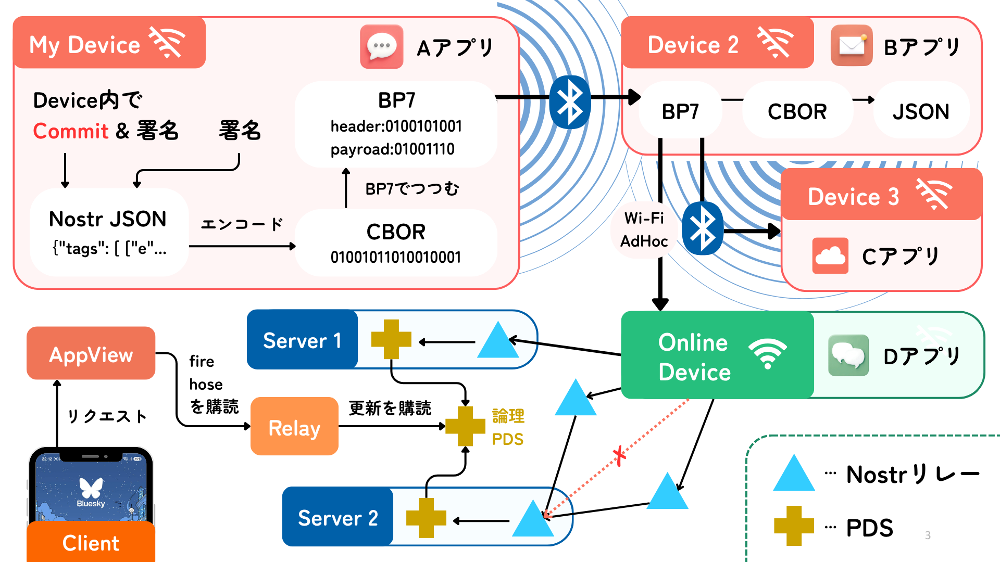
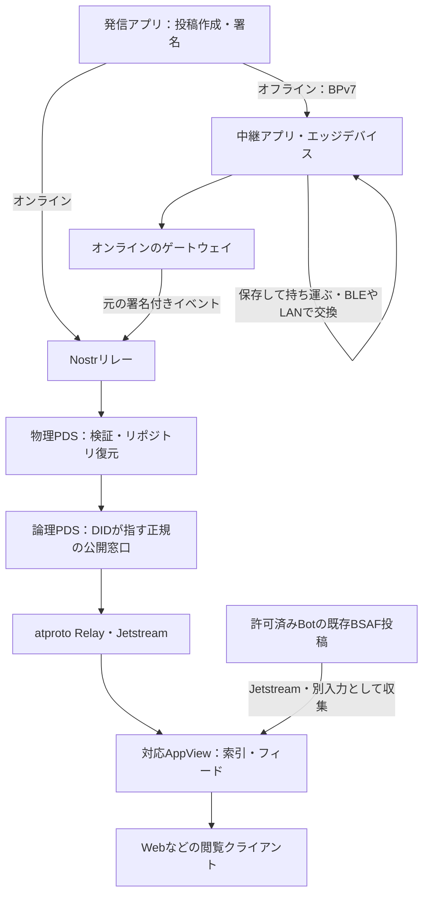
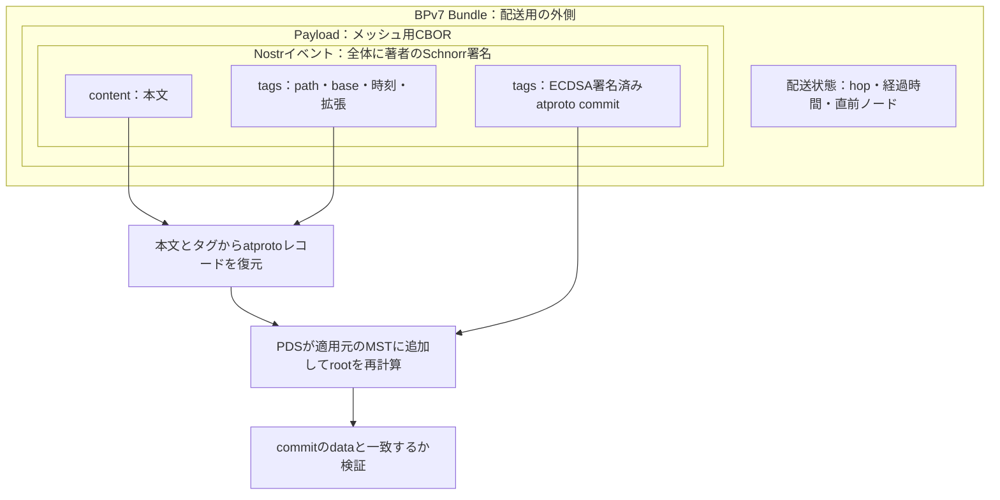
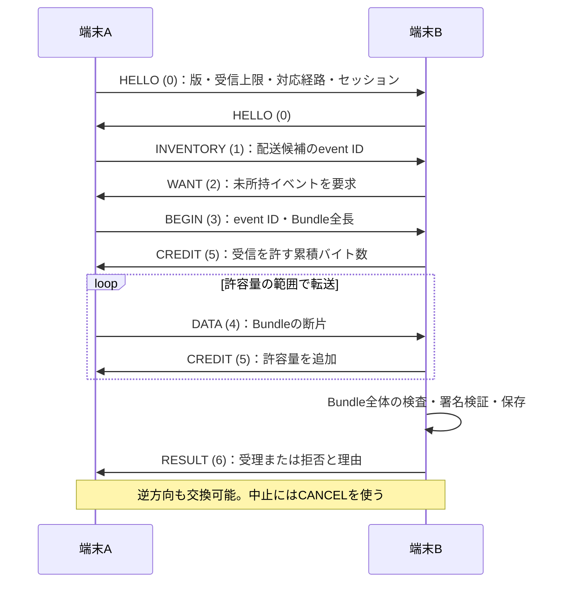

# Mosimo Protocol

## 製品概要
### 背景(製品開発のきっかけ、課題等）

### 製品説明（具体的な製品の説明）

### 特長

#### 2. 通信圏外の壁を越える！

> [!IMPORTANT]
> インターネットがなくても、Bluetoothなどで端末同士が情報を受け渡し、人の移動とともに運びます。

大きな災害が発生した場合、通信インフラが破壊され、スマートフォン同士の通信もできなくなることが過去に何度も発生しています。発電所のトラブルでブラックアウトが置きた事例(北海道胆振東部地震)もあります。

このような状況下では、情報共有が最大の課題になります。能登地震の際も避難所の情報が届かず、混乱が発生しました。Mosimo Protocolは、スマートフォン同士が直接通信することで、通信圏外でも情報を受け渡すことができます。

Mosimo Protocolは、スマートフォン同士が直接通信することで、通信圏外でも情報を受け渡すことができます。これにより、災害時でも情報を共有することができ、混乱を最小限に抑えることができます。

#### 1. アプリの壁を越える！

> [!IMPORTANT]
> 共通のプロトコルを使うことで、異なるアプリ同士が直接情報を交換できます。

メッシュネットワークで情報を共有するというこれまでも広く試みられてきましたが、どれも専用アプリが必要でした。

Mosimo Protocolは、既存のアプリに組み込むだけで、異なるアプリ同士でも情報を交換できるようになります。
プロトコルもオープンなので、誰でも自分のアプリに組み込むことができます。

これにより過去に類を見ないユーザー密度を実現し、実用的なメッシュネットワークを構築することができます。

#### 3. ネットワークの壁を越える！

> [!IMPORTANT]
> スマートフォン同士の通信だけでなく、既存のメッシュネットワークやインターネットとも接続します。

たとえインターネットに繋がっても、サーバーがダウンしてしまえば、情報を受け取ることはできません。Mosimo Protocolは、既存のメッシュネットワークやインターネットとも接続することで、情報を受け取ることができます。

具体的には、
* At Protocolを用いて各ユーザーの投稿を整理して、複数のサーバーに分散して蓄積できる
* nostrを用いて、専用サーバーに直接アクセスできなくてもリレーを介して情報を送受信できる
* AT ProtocolのAppViewが情報を収集・整理することで、遅い接続でも効率的にデータを受け取れる

### 解決出来ること
### 今後の展望
### 注力したこと（こだわり等）
* ハッカソンで動かしたのはデモ実装ですが、実際には他のアプリにも組み込むため、プロトコルの定義を汎用性のあるものにすることにこだわりました
* 

## 開発技術
### 活用した技術
#### API・データ
* [Nostr](https://nostr.com/)：署名付き投稿をリレーへ送信・購読。独自PDSのリレーに加え、Damus・nos.lolを既定の送信先として利用。
* [AT Protocol](https://atproto.com/)：端末で署名したリポジトリをPDSで復元・検証し、`com.atproto.sync` / `com.atproto.repo` のXRPC APIとfirehoseで公開。
* [PLC Directory](https://plc.directory/)：`did:plc`の登録・解決、署名公開鍵とPDSエンドポイントの確認。
* [Bluesky Jetstream](https://github.com/bluesky-social/jetstream)：登録済み発信元の `app.bsky.feed.post` を購読し、`bsaf:v1` タグ付きのBSAF投稿を収集（発信元DIDの設定時のみ有効）。
* [BSAF JMA Bot](https://github.com/osprey74/bsaf-jma-bot)：気象庁の地震・津波・火山関連情報をBSAF形式でBlueskyへ投稿する非公式Bot。情報取得元として利用し、Jetstream経由で投稿を収集。
* [気象庁防災情報XML](https://xml.kishou.go.jp/)：防災情報の原データ。現在はBSAF JMA Botによる投稿を通じて間接的に取得。
* 独自AppView API `dev.oriom.mosimo.getFeed`：Mosimo投稿と収集済みBSAF投稿を取得し、Webクライアントのタイムラインに表示。

#### フレームワーク・ライブラリ・モジュール

##### Androidアプリ
* Kotlin（Android / JVM）、Jetpack Compose・Material 3：投稿・中継操作・診断画面。
* [Kotlin Coroutines](https://github.com/Kotlin/kotlinx.coroutines)：非同期処理。
* [dtn7-kotlin](https://github.com/jphacks/sd_2607-dtn7-kotlin)（[フォーク元](https://github.com/NodleCode/dtn7-kotlin)）：BPv7のエンコード・デコード。リポジトリ内の固定スナップショットを使用。
* [Jackson Databind](https://github.com/FasterXML/jackson-databind) / [Jackson CBOR](https://github.com/FasterXML/jackson-dataformats-binary)：JSON・CBORの処理。
* [OkHttp](https://square.github.io/okhttp/)：HTTP / WebSocket通信。
* [secp256k1-kmp](https://github.com/ACINQ/secp256k1-kmp)：NostrのBIP-340署名とatprotoのECDSA署名。
* [Android Keystore](https://developer.android.com/privacy-and-security/keystore) / AES-GCM：鍵・投稿・中継状態の暗号化保存。

##### エッジデバイス
* C++ / [Arduino framework（ESP32）](https://github.com/espressif/arduino-esp32) / [PlatformIO](https://platformio.org/)：ESP32向けファームウェア。
* [M5Unified](https://github.com/m5stack/M5Unified) / [M5GFX](https://github.com/m5stack/M5GFX)：M5Stackの画面・ボタン・スピーカー制御。
* [NimBLE-Arduino](https://github.com/h2zero/NimBLE-Arduino)：BLE GATTによるAndroid端末とのBundle交換。
* [ArduinoJson](https://arduinojson.org/) / [LittleFS](https://github.com/littlefs-project/littlefs)：JSON処理と中継データの永続化。
* [mbedTLS](https://github.com/Mbed-TLS/mbedtls)：署名検証・SHA-256ハッシュ計算。
* [AquesTalk ESP32（Small辞書版）](https://www.a-quest.com/)：受信メッセージの音声読み上げ。

##### オンライン時のアップロードサーバー
* Node.js 24 / JavaScript・TypeScript：独自PDSと内蔵Nostrリレー（[`pds/`](./pds/)）。
* [`nostr-tools`](https://github.com/nbd-wtf/nostr-tools) / [`ws`](https://github.com/websockets/ws)：Nostrイベントの署名検証とWebSocket通信。
* [`@atproto/crypto`](https://github.com/bluesky-social/atproto/tree/main/packages/crypto) / [`@atproto/repo`](https://github.com/bluesky-social/atproto/tree/main/packages/repo)：端末署名済みcommitの検証、MSTの再構築、CARの生成。
* [`@ipld/dag-cbor`](https://github.com/ipld/js-dag-cbor) / [`multiformats`](https://github.com/multiformats/js-multiformats)：DAG-CBORとCIDの処理。
* SQLite（[`node:sqlite`](https://nodejs.org/api/sqlite.html)）/ PostgreSQL（[`pg`](https://node-postgres.com/)）：イベント・リポジトリ・配信履歴の保存。標準構成はSQLite、複数物理ノードでDBを共有する構成ではPostgreSQLを使用。

##### ダウンロードサーバー
* [HappyView](https://happyview.dev/) 2.16.0 / SQLite：AT ProtocolのAppViewとして投稿を索引化・配信（[`appview/happyview/`](./appview/happyview/)）。
* Node.js 24 / TypeScript / [`ws`](https://github.com/websockets/ws)：JetstreamからBSAF投稿を収集するサイドカー（[`appview/bsaf/`](./appview/bsaf/)）。
* [`@atproto/lex-cbor`](https://github.com/bluesky-social/atproto/tree/main/packages/lex/lex-cbor) / [`@atproto/lex-data`](https://github.com/bluesky-social/atproto/tree/main/packages/lex/lex-data)：収集したレコードのCID整合性確認。
* Lua：HappyViewのクエリスクリプトでMosimo・BSAFの統合フィードを提供。

##### サーバーの運用・管理 (もともと個人開発していたもの: [github.com/oriom-dev/podman-cluster-config](https://github.com/oriom-dev/podman-cluster-config))
* [NixOS](https://nixos.org/) / [Nix](https://nix.dev/)：OS設定・サービス・パッケージの構成を宣言的に定義。
* [systemd](https://systemd.io/) / [Caddy](https://caddyserver.com/) / [Podman](https://podman.io/)：サービス管理・HTTPS公開・HappyViewコンテナの実行。

##### web上のクライアント
* HTML / CSS / JavaScript：フレームワークを使わないタイムライン画面（[`apps/web/index.html`](./apps/web/index.html)）。
* Fetch API / DOM API：AppViewから5秒間隔で投稿を取得・表示し、PLC Directoryから表示用ハンドルを解決。

##### データ形式
* Nostrイベント（JSON）：本文・タグ・署名を保持し、atprotoレコードと端末署名済みcommitの復元情報を格納。
* [CBOR](https://www.rfc-editor.org/rfc/rfc8949) / [Bundle Protocol Version 7（BPv7）](https://www.rfc-editor.org/rfc/rfc9171)：署名付きイベントをコンパクトに符号化し、オフライン中継用のBundleとして転送。
* [AT Protocol Lexicon](https://atproto.com/specs/lexicon)：独自投稿レコード `dev.oriom.mosimo.post` とフィードAPIを定義。
* [DAG-CBOR](https://ipld.io/specs/codecs/dag-cbor/spec/) / [CID](https://github.com/multiformats/cid) / [MST](https://atproto.com/specs/repository) / [CAR](https://ipld.io/specs/transport/car/)：atprotoリポジトリの内容識別・整合性検証・同期。
* [BSAF（Bluesky Structured Alert Feed）](https://github.com/osprey74/bsaf-protocol)（`bsaf:v1`）：防災情報などを構造化タグ付きのBluesky投稿として扱う規約。原投稿のレコード・タグ・CID・URIを保持して収集。Mosimo形式への変換やメッシュへの再配信は行わない。
* [CAP（Common Alerting Protocol）1.2](https://docs.oasis-open.org/emergency/cap/v1.2/CAP-v1.2-os.html)：警報の内容・対象地域・有効期間・更新取消を表すXML規格。Mosimo投稿への変換と構造化情報の保持を[仕様草案](./protocol/0015-cap.md)で定義（直接取り込みは未実装）。
* [EDXL-DE（Emergency Data Exchange Language Distribution Element）1.0](https://docs.oasis-open.org/emergency/edxl-de/v1.0/EDXL-DE_Spec_v1.0.pdf)：CAPなどの緊急情報を包み、配布先・公開条件・更新取消を表すXML規格。内包情報の取り込みを[仕様草案](./protocol/0016-edxl-de.md)で定義（直接取り込みは未実装）。
* [気象庁防災情報XML](https://xml.kishou.go.jp/)：地震・津波・火山・気象などの防災情報を記述するXML形式。地震関連電文の構造化情報の保持を[緊急地震速報](./protocol/0017-jma-eew.md)・[地震情報](./protocol/0018-jma-earthquake.md)の仕様草案で定義（現在の取得経路はBSAF JMA Bot経由）。

##### ネットワーク
* BLE（Bluetooth Low Energy）GATT：Android端末間、およびAndroid・ESP32間の近距離通信。
* mDNS / DNS-SD（[Android NSD](https://developer.android.com/develop/connectivity/wifi/use-nsd)）＋TCP：同一LAN上のAndroid端末を発見してBundleを交換。
* [DTN](https://www.rfc-editor.org/rfc/rfc4838)（store-carry-forward）：Bundleを保存して持ち運び、後から接触した端末へ中継。
* HTTPS / WebSocket：PLC・XRPC APIへのアクセス、Nostrリレー・atproto firehose・Jetstreamとの通信。
* [NixOS](https://nixos.org/) / [Nix](https://nix.dev/)：サーバーOSにNixOSを採用し、OS設定・サービス・パッケージの構成をNixで宣言的に定義。
* [systemd](https://systemd.io/) / [Caddy](https://caddyserver.com/) / [Podman](https://podman.io/)：サービス管理・HTTPS公開・HappyViewコンテナの実行。

#### デバイス
* Androidスマートフォン（約4台）：投稿の作成・表示と、BLEや同一LAN経由の端末間中継に使用。オンライン時は保持した投稿をNostrリレーへ送信。
* ESP32（M5Stack Basic Development Kit）：BLEで受信したBundleを保存・中継するエッジデバイス。画面でのメッセージ表示と、AquesTalkによる音声読み上げに使用。
* KAGOYAのVPS：独自PDS・Nostrリレーと、投稿を索引化・配信するHappyView（AppView）の稼働環境。オンラインでの投稿の受け取りとWebクライアントへの配信を担当。

### 独自技術

#### mosimo protocol：通信が途絶えても署名付きの情報を運ぶ

災害でインターネットが途絶えても、異なるアプリの間で公開情報を端末から端末へ運び、回線が戻ったら Nostr と atproto へ届けるプロトコル群です。**投稿の正本と署名鍵は端末が持ち、中継者やサーバーは著者の署名を変えずに運びます。**

以下は実装紹介に加え、未実装の機能も含む設計の概要です。仕様群は**設計草案**であり、合意済みの方針と、型案・未決定事項を含みます。実装の存在だけで相互運用性や運用時の動作を検証済みとはしません。詳細は[仕様の入口](./protocol/README.md)、[全体概要](./protocol/0000-overview.md)、[用語集](./CONTEXT.md)、[未決事項](./protocol/0003-open-questions.md)を参照してください。

##### 1. 全体の流れと役割

設計上の経路を示します。発信アプリが投稿を作成・署名し、中継アプリは保存・表示・配送、ゲートウェイはインターネットへの送り出しを担います。

物理PDSはNostrリレーを兼ねます。論理PDSは複数の物理PDSを束ねる公開上の単位です。対応AppViewは独自投稿とBSAF投稿を索引化し、一覧・地図などに利用します（現在のWeb実装はタイムライン）。責務の定義は[基本プロトコル](./protocol/0010-core.md)を参照してください。

##### 2. 投稿の正本と二重署名

**1投稿＝1レコード追加＝1署名済みcommit＝1 Nostr `kind:1` イベント**です。バッチcommitは設けません。端末がatprotoリポジトリのMST（内容をCIDで識別する木）を更新し、repository v3 commitにECDSA署名を付け、その復元情報を含むNostrイベント全体にBIP-340 Schnorr署名を付けます。

次の図は、署名済みデータをメッシュ配送用に包む関係です。レコード全体をそのまま格納するのではなく、本文とタグから復元できる形で運びます。

- **サーバーは復元・検証・複製を担当**し、著者の鍵を持たず、commitの再署名や`rev`の振り直しをしません。MSTノード・包含証明はメッシュで運ばず、PDSが適用元の状態から再構築し、同期用のMST・CARを生成します。適用元が欠けていれば保留します。
- commit間の適用順は独自の`base`で表し、標準の`prev`の意味は変えません。変換はNostr → atprotoの一方向で、レコードにNostr署名は持たせません。
- 過去の投稿がなくてもNostr署名で本文を検証・表示できます。**Nostr署名の検証、DIDの認証、atproto状態への包含確認は別の状態**です。
- レコードキーは端末がオフラインで生成する13文字のTID。直前の値を永続化して時計が戻っても単調増加させますが、キー内の時刻を投稿時刻の根拠にはしません。event ID・record CID・atURI・commit CID・Bundleの識別は別物で、本文の一致だけでは同一投稿と扱いません。

詳細：[リポジトリ正本モデル](./protocol/0001-repository-model.md)・[形式ごとの対応](./protocol/0012-bindings.md)。

##### 3. レコードと拡張：読めない情報も壊さず運ぶ

基本レコードのLexiconは[`dev.oriom.mosimo.post`](./lexicons/dev/oriom/mosimo/post.json)。トップレベルを次の5項目に固定し、追加情報はすべて`extensions`に入れます。未知のトップレベル項目を削って基本版1として扱うことはしません。

| 項目 | 役割 |
|---|---|
| `$type` | レコード型 `dev.oriom.mosimo.post` |
| `text` | 必須の本文。拡張非対応のアプリでも読める |
| `createdAt` | 必須の作成時刻。UTC・末尾`Z`で原表記を保持 |
| `deliveryExpiresAt` | 必須のメッシュ配送期限。有効期間や削除とは別 |
| `extensions` | 必須の拡張配列。拡張がなければ空配列 |

`extensions`は`$type`付きオブジェクトのopen union（`refs: []`・`closed: false`）です。誰でも自分の名前空間で定義でき、中央の承認・全実装への専用コード追加・受信時のスキーマ取得を要求しません。未知の型・フィールドも、配列順や同じ型の複数要素を含めて保持・中継します。

公式名前空間は`mosimo.oriom.dev`、Lexiconは`dev.oriom.mosimo.*`、Nostrタグは`mosimo.oriom.dev:*`です。以下の個別拡張は**名前を割り当てた型案であり、個別のLexicon JSONは未実装**です。

| 拡張（`dev.oriom.mosimo.defs#…`） | 表すもの |
|---|---|
| `origin` / `area` | 任意の発信地点 / 情報の影響範囲 |
| `validity` / `annotation` | 情報の有効期間 / 訂正・補足・追認 |
| `source` | 原情報・配布容器・取得URL・変換者・変換規則・原文ダイジェスト |
| `identity` | 身元証明チェーン |
| `cap12` / `edxlDe10` / `jmaEew` / `jmaEarthquake` / `bsafV1` | 公的情報の形式別データ |

Nostrでは本文を`content`へ、それ以外を署名対象のタグへ置きます。通常投稿の基本タグは各1個、拡張は1要素につき1タグです。

| タグ | 内容 |
|---|---|
| `["t", "mosimo.oriom.dev"]` | 識別・標準の`#t`フィルタによる発見 |
| `mosimo.oriom.dev:version` | 基本版`"1"` |
| `mosimo.oriom.dev:commit` | 署名済みcommitのCBOR（通常のBase64、paddingなし） |
| `mosimo.oriom.dev:base` / `mosimo.oriom.dev:path` | 適用元commit CID（初回は空文字列） / `dev.oriom.mosimo.post/<TID>` |
| `mosimo.oriom.dev:created-at` / `mosimo.oriom.dev:delivery-expires-at` | 作成時刻の原表記 / 配送期限 |
| `mosimo.oriom.dev:ext:<$type>` | `$type`以外の全フィールドをatproto CBOR・paddingなしBase64にした値 |

拡張タグの出現順が配列順になるため、PDSは未知の拡張も専用コードなしに復元できます。署名後は本文のUnicode・改行や日時表記を正規化しません。UTC表記・トップレベル固定・path上のTID・サイズ上限などは、Lexicon検査とは別に適用する制約です。

**基本プロトコル・拡張型・メッシュ符号化は独立して版管理**します。拡張の非互換変更は新しい`$type`にし、共通の拡張版フィールドは設けません。拡張の追加だけで他の版は上げません。

詳細：[拡張仕様](./protocol/0011-extensions.md)・[データ表現](./protocol/0012-bindings.md)・[名前空間](./protocol/0014-namespaces.md)・[Lexiconの実装範囲](./lexicons/README.md)。

##### 4. メッシュ配送：接触したときに必要な投稿を交換する

MNDTはBPv7による保存・持ち運び・中継のプロファイルです。共通の基本経路は**BLE GATT**（1サービス・方向別RX/TXの2 characteristic）、追加経路は接続済みWi-Fi LANです。スマホ・汎用ノードはcentral/peripheralの両役に対応し、資源の少ない機器は片役だけでも参加できます。接続後の交換は双方向で、GATTの役割は配送上の親子を意味しません。

**Nearby Connectionsは任意の追加経路で、切替は未実装です。** BLEで能力交換後、双方が対応し、別接続を同じ相手と対応付けられた場合だけ切り替えます。失敗時はGATTで交換を完結させます。相手の対応付け・保護の具体方式には未決定事項があります。

次は**設計上の交換手順**です。現在の実験実装のJSON制御メッセージとは区別します。

- **データ表現と上限**：イベントはCBORの固定7要素配列`[1, pubkey, created_at, kind, tags, content, sig]`にし、BPv7のPayloadに入れます。Base64→bytesや版`"1"`→整数など、元へ完全に戻せる変換だけを使い、未知タグを推測変換しません。日時の原表記も保持します。上限は**イベントpayload全体32 KiB、Bundle全体64 KiB**。署名済みデータを削ったりBPv7の断片化で上限を回避したりせず、運べなければ見送ります。
- **流量制御と受理**：交換メッセージは数値種別を先頭に持つCBOR配列で、event ID・断片はbytesです。GATTはWrite Without Response・Notificationを使い、断片ごとの応答を待たず`CREDIT`で制御します。転送中のBundleは送信方向ごとに1件、制御用には別枠を設けます。GATT操作の成功は受理ではなく、全体の検査・保存後に応答します。切断された転送は次の接触で先頭から再送します。`CANCEL`の番号などは未確定です。
- **配送状態**：宛先EIDは`dtn://mosimo.oriom.dev/~post`。hop・経過時間・直前ノードはBPv7標準拡張ブロックに置き、署名済みの本文・期限・拡張・commitと分離します。著者の`area`などをBPv7側だけに置くことも、経路情報をNostrタグへ追記することもしません。
- **候補と重複**：相手が持たないevent IDを選び、同じイベントはBundleが違っても重複扱いにします。影響範囲内を優先できますが、ゲートウェイへ向けた範囲外中継も許します。地域不明は全世界・最高優先度とはせず、著者の優先度でも資源上限は解除しません。認可済みの更新・取消で置換された公的情報の旧版は候補から外します。
- **再バンドルと搬出**：再バンドルでも著者の配送期限を延長せず、既知イベント記録とローカル上限で再拡散を抑えます。ゲートウェイは公開鍵・時刻・kind・tags・content・署名を変えずにNostr JSONへ戻します。逆向きの投入は信頼する取り込みサーバーの公的情報に限り、方針・期限・地域・資源上限で制御します。

詳細：[MNDT配送仕様](./protocol/mndt.md)。UUID・残りの制御形式・経路切替・資源上限等には未確定事項があり、[Android実装の暫定値](./protocol/mndt.md#9-android-実装の暫定値提案未採用)は共通仕様として採用済みではありません。

##### 5. 時刻・地域・訂正の意味

「いつまで運ぶか」「いつまで有効か」「どこに関係するか」を分けて扱います。

| 項目 | ルール |
|---|---|
| 配送期限 `deliveryExpiresAt` | 必須。作成時にアプリ・運用者の既定期間から絶対時刻として確定し、著者が署名。中継者は延長できず、満了も削除・撤回を意味しない |
| 有効期間 `validity` | 任意。省略は「不明」であり、無期限に有効とは扱わない |
| BPv7 Lifetime・ローカル上限 | ノードの資源管理。配送期間を短縮できる。時計が不明でも期限内と断定せず、ローカル上限内で中継できる（期限の実施はベストエフォート） |
| 時刻表記 | UTC・末尾`Z`のatproto datetime。秒未満と原表記を保持。Nostrの`created_at`だけは秒未満を切り捨てたUnix秒 |
| 発信地点 `origin` | 任意の自己申告。現地にいた証明ではなく、影響範囲の代わりにも使わない |
| 影響範囲 `area` | 円とGeohashセルの和集合。閲覧制限ではなく配送優先度のヒント。省略は地域不明 |

座標は100万分の1度、半径・精度はミリメートルの整数で表します。多角形・行政区域コード・除外領域は持たず、境界データや外部照会なしで判定します。包含は「内／外／不明」の3値で、既知要素のどれかに含まれれば内、未知要素が残れば不明、すべて評価して含まれない場合だけ外です。公的情報の領域を近似する際は、署名前に**全域を覆う**Geohashセルへ変換し、近似と明記します。全域を覆えなければ`area`を省略します。

訂正・補足・追認は元投稿を上書きせず、誰でも自身の新規投稿に`annotation`を付けて、関係と対象（atURI/CIDまたはevent ID）を示します。元著者の訂正と他者の主張を区別し、追認数で真偽を決めません。削除は著者がNIP-09の`kind:5`とMSTから対象を除いた新commitの両方に署名します。過去commitや全コピーの消去は保証しません。

Labelは本人署名の注釈を正本とし、グループのLabelerが**自身のDIDを`src`として**標準Labelを集約発行する設計です。閲覧者が少数のLabelerを選べるようにし、`src`を本人・自治体に偽装しません。

詳細：[基本仕様](./protocol/0010-core.md)・[地理情報](./protocol/0004-geography.md)・[訂正とLabel](./protocol/0008-posts-and-labels.md)。

##### 6. ID・鍵と発信者への信頼

- **インストールごとに独立**した鍵・DID・リポジトリを持ち、人・端末・アカウントと同一視しません。Nostr署名・atproto署名・PLC rotation用にsecp256k1鍵を3本用意し、秘密鍵を共用せず端末内に保持します。
- **DIDは`did:plc`**。平時の初回起動で登録し、既定の論理PDSを指定します。オフライン初回起動では署名済みPLC初期操作をメッシュで運び、オンラインノードが改変せず代理提出します。代理者は鍵を持たず、endpointを書き換えられません。
- **鍵対応宣言**はDID・atproto公開鍵・Nostr公開鍵を両署名で結ぶ独立の宣言です。通常の受信・中継・本文表示には要求しません。
- **公式発信者の身元証明**は、アプリ既定または利用者が選ぶルート鍵から、中間証明者を経て組織名・DID・atproto公開鍵へつなぎます。Nostr鍵は鍵対応宣言で結びます。受信データ内のルートを自動では信頼しません。
- 投稿・他者の証明・再委任の権限を分け、委任の範囲は狭まるだけにします。署名、権限、有効期間、失効、情報不足による判定不能を区別し、**署名の正しさだけで「公式」とせず、身元の確認も内容の真実性とは分けます**。

Androidでは鍵対応宣言の配送は未実装です。身元証明チェーン等も設計を含む説明です。詳細：[IDと正本モデル](./protocol/0001-repository-model.md)・[身元証明](./protocol/0009-identity-attestations.md)。

##### 7. 公的情報：出典と更新・取消を保つ

取り込みサーバーが原XMLを保存し、メッシュには**単独で読める本文と構造化拡張**を流します。手順は、取得 → 安全なXML解析 → 公開可否判定 → 情報単位への分割 → 本文・拡張生成 → 変換者として署名。限定公開・訓練・試験を実情報から外し、更新も差分ではなく単独で読める新規投稿にします。

既定では複数の取り込みサーバーを信頼し、1者の有効な署名で受理します。中継者を変換者として信頼する必要はありません。同じ原情報を複数者が取り込んでも署名・event ID・リポジトリは別々に保ち、配送の重複だけを抑えます。同値性の候補キーは、正規化規則の版・情報源ID・原情報IDと版・正規化内容のハッシュです。

旧版の拡散停止には、平時から持つルート鍵への証明チェーンと、対象を更新・取消する権限の確認が必要です。旧版が未着でも置換関係を記録し、後着した旧版を再拡散しません。

以下は**形式別の仕様草案**です。CAP・EDXL-DE・気象庁XMLの直接取り込みは未実装で、現在の取得経路はBSAF JMA Bot → Jetstream → AppViewです。

| 形式 | 保持する意味・変換上の注意 |
|---|---|
| [CAP 1.2](./protocol/0015-cap.md) | 解釈した`info`ごとに投稿、`info`なしの取消は通知1件。`effective`/`expires`が有効期間で、`onset`を開始としない。自動取り込みは`Actual`・`Public`の`Alert`/`Update`/`Cancel`のみ。置換は`sender`＋`identifier`＋`sent`の原電文単位で認可が必要 |
| [EDXL-DE 1.0](./protocol/0016-edxl-de.md) | 容器と内包情報を分け、`contentObject`ごとに公開可否を評価して形式別規則へ渡す。`targetArea`は配布対象であり影響範囲ではない。容器の取消はその容器由来の投稿だけを止め、内包警報の取消にしない |
| [気象庁・緊急地震速報](./protocol/0017-jma-eew.md) | 府県予報区ごとに投稿し、32 KiB超過時だけ細分区域へ分割。原XML位置を`selection.path`、全国府県一覧を`nationalOverview`に保持。省略は`reduction.omitted`と本文へ明記。情報単位は`Title`＋`Status`＋`EventID`、最新判定は`Control/DateTime`。遅着した速報でカウントダウンしない |
| [気象庁・地震観測情報](./protocol/0018-jma-earthquake.md) | 震度速報・震源・震源震度・長周期地震動を扱う。予測と観測を区別し、未入電を震度0にしない。サイズ超過時は規定順で低優先の詳細から省く |
| [BSAF v1](./protocol/0019-bsaf.md) | 既存投稿のAppView収集、mosimoへの取り込み、BSAF向け別途公開を分離。自動再配信は運用者が明示的に選ぶBot DIDと`type:`の組だけ。`type+value+time+target`一致は表示の折りたたみに使い、重複排除キーにはしない |

既存BSAFの**収集実装は原投稿のまま併置**し、mosimo変換やメッシュ再配信はしません。独自投稿が既存Blueskyクライアントへ自動表示される保証もありません。BSAF向け自動公開・更新削除の連携等は未決定です。

詳細：[取り込みと信頼](./protocol/0002-ingestion-and-trust.md)・[公的情報との対応](./protocol/0013-public-information.md)。

##### 8. オンライン公開：収集と正規公開を分ける

DIDが指すのは**1つの論理PDS（公開HTTPS endpoint）**です。その背後で複数の物理PDSが収集・復元を分担し、物理ノードと論理グループは多対多にできます。同じDIDを複数ホストから同時に正規公開する方式は、Relayの正規ホスト照合と合わないため採りません。

| 論点 | 設計方針 |
|---|---|
| 投稿・取得 | 物理PDSはNIP-01/09/11を提供。独自タグや古い`created_at`だけで拒否せず、一般リレーを介さず直接利用可能。NIP-11に追加情報を掲載 |
| リレー発見 | アプリ同梱・キャッシュ・既知AppViewのレコード・Nostr経由を組み合わせ、一般の著名リレーも併用。候補一覧の発行者への信頼を、内容や論理PDSへの信頼と混同しない |
| 参加権限 | 収集・検証・ミラーは誰でも可能。正規公開系への参加はグループの承認が必要 |
| グループ間共有 | 他グループ向けcommitの存在を小さな通知で伝え、受け手が必要なデータだけ取得・独立検証 |
| 障害切替 | `seq`を再利用せず、保持範囲はcursorから欠落なく再送。再送不能を隠さず、整合しない複製先へ切り替えない |
| 完了の判定 | Nostrの`OK`・PLC登録・リポジトリ検証・Relayへの取り込み・AppView表示を別段階として扱う |

詳細：[論理PDSと分散公開](./protocol/0006-logical-pds.md)・[Nostrリレープロファイル](./protocol/0007-nostr-relay-profile.md)。

##### 9. 保証の範囲と残る設計

対象は公開情報です。個別通信・限定公開・暗号化・メディア本体の配送は対象外で、全端末への配送・内容の真実性・GPSの真正性・全コピーの削除は保証しません。

個別拡張のスキーマ、鍵対応宣言の配送・更新・失効、身元証明やLabel、公的情報の変換・認可、接触時交換の残りのwire形式等は、設計・未確定部分を含みます。欠落履歴の探索、全面的な逆変換、端末状態の巻き戻りへの対応は延期事項です。採用済み方針と残事項の区別は[仕様の入口](./protocol/README.md)・[未決事項](./protocol/0003-open-questions.md)を参照してください。

#### 実装：プロトコルを動かすための工夫

以下はリポジトリ内の実装概要です。上記の設計全体が実装・検証済みという意味ではありません。

##### Androidアプリ

[`apps/android/`](./apps/android/)で投稿・署名・中継・オンライン搬出をまとめています。

- **端末で署名を完結**：TID生成、DAG-CBOR、MST root計算、low-S ECDSA commit署名、PLC genesis作成・DID導出まで行います。CBORの再符号化一致を検査し、NIP-01の署名対象JSONとメッシュCBORの可逆変換も専用処理で生成します。
- **原本を保つ中継**：作成時刻0＋Bundle Ageで時計依存を抑え、CRC32C・受信構造・未知ブロックのフラグを検査します（BPSecは拒否）。転送時はコピーのhop・ageだけを更新。BLEとDNS-SD/TCPによるLAN交換を、1つのアクターで直列管理します。
- **保存と再試行**：128件の保持・作成者ごとの受信制限を設け、自分の投稿はPDS受理まで`base`の連鎖を保ちます。リレーごとのバックオフと回線復帰時の再送、PLC初期操作の代理登録を備えます。鍵・head・送信待ちはKeystoreのAES-256-GCMで保存し、鍵喪失時に別IDを黙って作り直しません。
- **設計との差分**：接触時交換は暫定のJSON `hello → inventory → want → Bundle → ack`、BLEはチャンクごとに応答を待つ方式です。上記のCBOR・CREDIT方式とは異なり、Nearby切替も未実装です。

BPv7ライブラリのフォークでは、処理フラグ・未知ブロック保持・受信バイト列によるCRC検証・ブロック順と番号・構造検査・uint64の`ipn`・Bundle Age/期限計算を修正しました。Rust `bp7 0.10.7`生成Bundleとのバイト一致テストも追加しています。詳細：[Android実装](./apps/android/README.md)・[BPv7監査](./third_party/sd_2607-dtn7-kotlin/BPV7_AUDIT.md)・[修正内容](./third_party/sd_2607-dtn7-kotlin/BPV7_IMPLEMENTATION.md)。

##### Nostrリレー兼PDS・AppView

[`pds/`](./pds/)は著者の鍵を持たない検証・復元専用PDSで、`createAccount`もありません。

1. event ID・Nostr署名・タグの個数・Base64/CBORの正規表記・作成時刻の対応を検査します。
2. PLCからDIDの鍵とendpointを確認し、commit署名・`base`・`rev`・再構築したMST rootを検証します。未登録DID・適用元の欠落・未来の`rev`は書き換えず保留し、条件が整ったら再処理します。
3. 正規公開先が自グループでheadの直接の続きなら、headとfirehoseを同一トランザクションで進めます。headは巻き戻しません。

外部Nostrリレーの購読には`since`を付けず、オフライン中の古い投稿も収集します。firehoseは差分CAR付き`#commit`と、大きい変更向けの`#sync`、初回の`#identity`・`#account`を提供し、cursor省略時はseq 0から再送します。Hostで論理グループを選び、グループごとにサービスDIDと`seq`を分離。複数物理ノード構成では共有PostgreSQLとadvisory lockで採番を直列化し、ノード間は認証付き通知で必要なイベントの取得・再検証を促します。

[HappyView](./appview/happyview/)はJetstream経由で独自投稿を索引化し、[`dev.oriom.mosimo.getFeed`](./lexicons/dev/oriom/mosimo/getFeed.json)を提供します。[BSAFサイドカー](./appview/bsaf/)は許可済みDIDの`bsaf:v1`投稿をCID再計算で確認し、原レコードと出典情報`provenance`を保って統合します。HappyViewをフォークせずDBとクエリへ接続し、[Webクライアント](./apps/web/index.html)が読み取り専用タイムラインとして表示します。

##### ESP32エッジデバイス

[M5Stack Basic](./apps/esp32/)を、スマホなしで保存・中継できるBLEノードにしています。

- **限られたメモリで検証**：申告長によるメモリ確保や再帰を避け、CBOR・UTF-8・整数範囲、BPv7のCRCと構造、event ID・BIP-340署名を検査します。署名対象JSONは構築せず順にハッシュへ流し、mbedTLS上の検証に必要な`lift_x`を補っています。BPSecは拒否し、未知ブロックはフラグに従います。
- **保存後に受理応答**：LittleFSに16件まで保持し、一時保存・flush・サイズ確認・rename・読み戻し一致後にだけ`ack`を返します。転送はhop・ageとCRCだけを更新し、他ブロックを保持。BLEはperipheral専用で、コールバックからキューへ渡し、溢れたら切断して再試行します。
- **時計なしの運用**：単調時計で期限を管理し、同じ投稿の再受信で延長しません。再起動後は電源断の長さが不明なため、保存済み投稿を再検証しても送り出しません。
- **表示と音声**：検証・保存した投稿の冒頭を表示し、AquesTalk ESP32で読み上げます。評価版にはナ行・マ行が「ヌ」になる制限があります。SDKは同梱せず手元から導入し、約2 MBの辞書は専用フラッシュ領域で起動時にSHA-256確認。ボタンはAがテスト、BがBLE切替、Cが音声のみミュートです。

詳細：[ESP32の構成・導入手順](./apps/esp32/README.md)。
