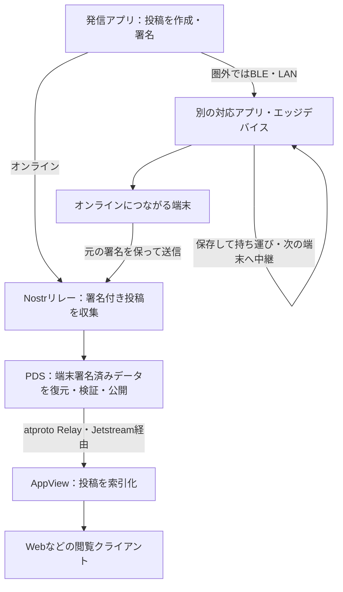
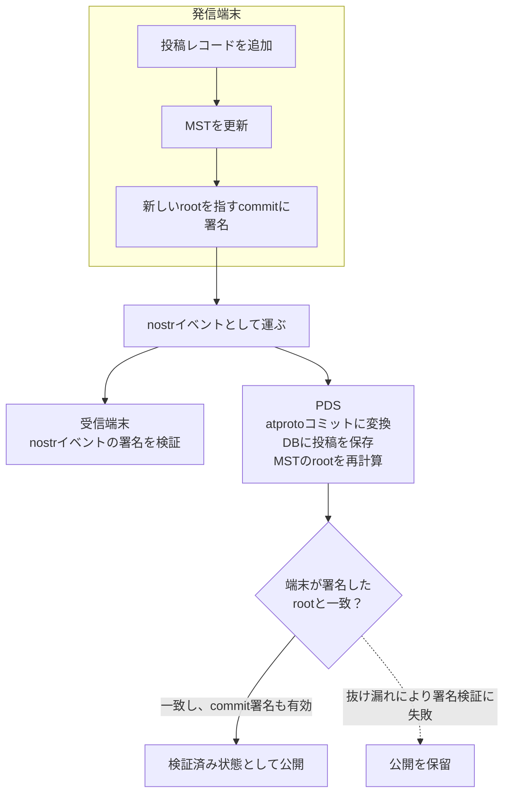
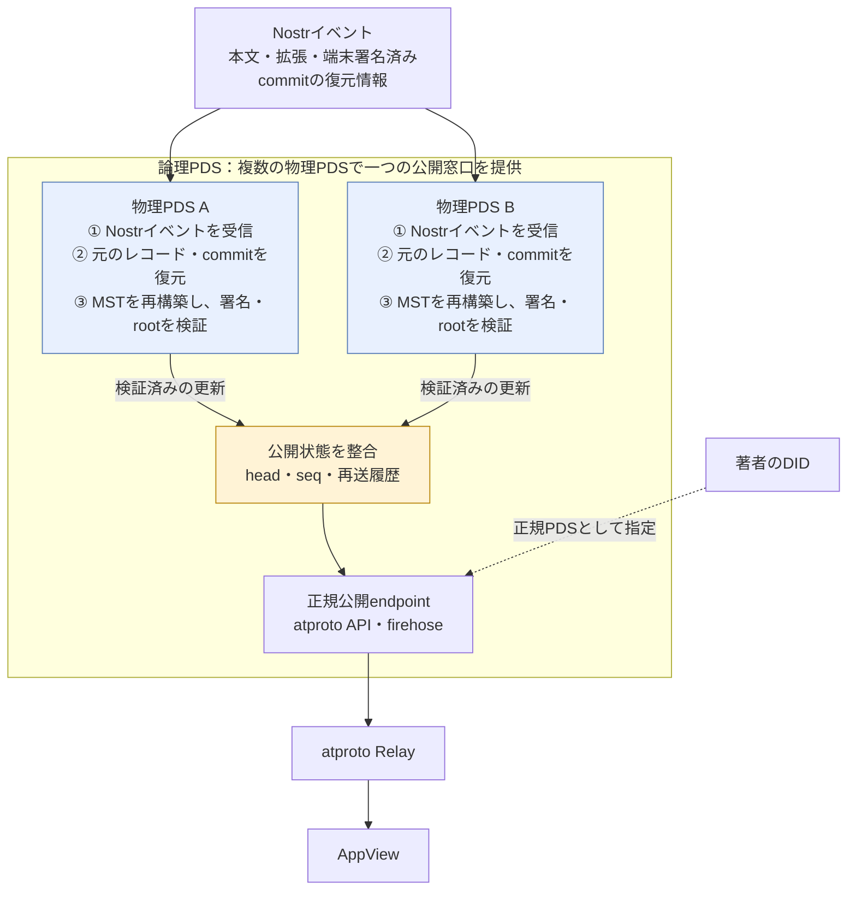

# Mosimo Protocol

## 製品概要
### 背景(製品開発のきっかけ、課題等）

災害によって通信設備が被害を受けると、普段利用しているインターネット経由の連絡や情報共有が難しくなります。Bluetoothなどを使って端末同士で通信する技術は既にありますが、専用アプリを事前にインストールしていなければ利用できないという課題があります。

そこで私たちは、普段使っているアプリに災害時の通信機能を組み込み、日常の利用がそのまま「もしも」の備えになる仕組みを考えました。

### 製品説明（具体的な製品の説明）

Mosimo Protocolは、「いつものアプリが、もしもの通信網になる。」をコンセプトにした、アプリに組み込める共通の通信プロトコルです。

インターネットに接続できない状況でも、Bluetoothなどで近くの端末と情報を交換し、端末から端末へ情報を中継します。同じプロトコルに対応した異なるアプリ同士でも情報を受け渡せるため、普段使っているアプリを通じて通信網に参加できます。

さらに、情報がインターネットに接続できる端末まで届けば、AT Protocolを使ってクライアントで閲覧できるようにするなど、圏外の端末とオンラインのネットワークをつなぐことができます。

### 特長

#### 1. 通信圏外の壁を越える！

> [!IMPORTANT]
> インターネットがなくても、Bluetoothなどで端末同士が情報を受け渡し、人の移動とともに運びます。

大きな災害が発生した場合、通信インフラが破壊され、スマートフォン同士の通信もできなくなることが過去に何度も発生しています。発電所のトラブルでブラックアウトが置きた事例(北海道胆振東部地震)もあります。

このような状況下では、情報共有が最大の課題になります。能登地震の際も避難所の情報が届かず、混乱が発生しました。Mosimo Protocolは、スマートフォン同士が直接通信することで、通信圏外でも情報を受け渡すことができます。

Mosimo Protocolは、スマートフォン同士が直接通信することで、通信圏外でも情報を受け渡すことができます。これにより、災害時でも情報を共有することができ、混乱を最小限に抑えることができます。

#### 2. アプリの壁を越える！

> [!IMPORTANT]
> 共通のプロトコルを使うことで、異なるアプリ同士が直接情報を交換できます。

メッシュネットワークで情報を共有するというこれまでも広く試みられてきましたが、どれも専用アプリが必要でした。

Mosimo Protocolは、既存のアプリに組み込むだけで、異なるアプリ同士でも情報を交換できるようになります。
プロトコルもオープンなので、誰でも自分のアプリに組み込むことができます。

これにより過去に類を見ないユーザー密度を実現し、実用的なメッシュネットワークを構築することができます。

#### 3. ネットワークの壁を越える！

> [!IMPORTANT]
> スマートフォン同士の通信だけでなく、既存のメッシュネットワークやインターネットとも接続します。

たとえインターネットに繋がっても、サーバーがダウンしてしまえば、情報を受け取ることはできません。Mosimo Protocolは、既存のメッシュネットワークやインターネットとも接続することで、情報を受け取ることができます。

具体的には、
* At Protocolを用いて各ユーザーの投稿を整理して、複数のサーバーに分散して蓄積できる
* nostrを用いて、専用サーバーに直接アクセスできなくてもリレーを介して情報を送受信できる
* AT ProtocolのAppViewが情報を収集・整理することで、遅い接続でも効率的にデータを受け取れる

### 解決出来ること

災害でインターネットが途絶えた際にも、近くの端末同士で情報を受け渡すことで、連絡や地域の状況共有を支えます。

この仕組みを日常的に利用されるアプリに組み込むことで、災害用の専用アプリをあらかじめ入れてもらうという導入の壁を下げます。対応するアプリが増えるほど、アプリの違いを越えて情報を中継できる端末が増え、災害時に利用できる通信経路を広げられます。

### 今後の展望

まずは、私たちが開発する東北大生向けアプリ「とんペディア」への実装から始め、日常的に使われるアプリを災害時の通信手段として活用することを目指します。

さらに、自治体のアプリなどにも導入を広げ、地域で利用されるさまざまなアプリが互いに情報を中継できる仕組みへと育てていきます。将来的には、世界中で使われるOSへの組み込みも視野に入れ、災害時にも情報を届けられる強靭なネットワークの実現を目指します。

### 注力したこと（こだわり等）

- **柔軟性と拡張性のあるプロトコル設計**

  さまざまなアプリへの組み込みや、今後の用途・通信手段の広がりを見据え、特定のアプリだけに依存しない、柔軟で拡張性のある仕様づくりに注力しました。

- **プロトコルの特徴が伝わる実装デモ**

  仕様を文章で示すだけでなく、その仕組みや特徴を実際の動作で伝えられるようにデモを作成しました。インターネットに接続していない端末間でBluetoothによって情報を受け渡し、オンラインの端末を通じてクライアントに表示する流れを体験できる形にしました。

## 開発技術

### 活用した技術

**Nostrで署名付き投稿を受け渡し、AT Protocolでオンラインの公開・閲覧につなぎます。圏外では、BPv7を使って端末間で投稿を保存・中継します。**

| 技術 | Mosimoでの役割 |
|---|---|
| **Nostr** | 投稿者の署名付きイベントを保持し、リレーを介して送受信する。 |
| **AT Protocol** | 端末署名済みリポジトリを復元・検証し、投稿の公開・索引化につなぐ。 |
| **CBOR・BPv7** | 署名付きイベントを符号化し、圏外で保存・持ち運び・中継する。 |
| **BLE GATT・mDNS／TCP** | 近くの端末や同一LAN上の端末との通信を担う。 |

#### API・データ

**Nostr・AT Protocolを投稿の送受信・公開に使い、PLC Directoryで公開鍵と公開先を確認します。**

* [Nostr](https://nostr.com/)：署名付き投稿をリレーへ送信・購読。
* [AT Protocol](https://atproto.com/)：端末で署名したリポジトリをPDSで復元・検証し、`com.atproto.sync` / `com.atproto.repo` のXRPC APIとfirehoseで公開。
* [PLC Directory](https://plc.directory/)：`did:plc`の登録・解決、署名公開鍵とPDSエンドポイントの確認。

**防災情報は、気象庁XMLをもとにしたBotのBluesky投稿をJetstream経由で収集します。**

* [Bluesky Jetstream](https://github.com/bluesky-social/jetstream)：登録済み発信元の `app.bsky.feed.post` を購読し、`bsaf:v1` タグ付きのBSAF投稿を収集。
* [BSAF JMA Bot](https://github.com/osprey74/bsaf-jma-bot)：気象庁の地震・津波・火山関連情報をBSAF形式でBlueskyへ投稿する非公式Bot。情報取得元として利用し、Jetstream経由で投稿を収集。
* [気象庁防災情報XML](https://xml.kishou.go.jp/)：防災情報の原データ。現在はBSAF JMA Botによる投稿を通じて間接的に取得。

**閲覧用には、Mosimo投稿と収集済みBSAF投稿を取得できる独自APIを実装しています。**

* 独自AppView API `dev.oriom.mosimo.getFeed`：Webクライアント向けにタイムラインの投稿を提供。

#### フレームワーク・ライブラリ・モジュール

##### データ形式：署名付き投稿を保持し、交換する

**オンラインではNostrイベントとatprotoリポジトリ、圏外の中継ではCBOR・BPv7を使い、元の署名付き投稿を保持します。**

* Nostrイベント（JSON）：本文・タグ・署名を保持し、atprotoレコードと端末署名済みcommitの復元情報を格納。
* [CBOR](https://www.rfc-editor.org/rfc/rfc8949) / [Bundle Protocol Version 7（BPv7）](https://www.rfc-editor.org/rfc/rfc9171)：署名付きイベントをコンパクトに符号化し、オフライン中継用のBundleとして転送。
* [AT Protocol Lexicon](https://atproto.com/specs/lexicon)：独自投稿レコード `dev.oriom.mosimo.post` とフィードAPIを定義。
* [DAG-CBOR](https://ipld.io/specs/codecs/dag-cbor/spec/) / [CID](https://github.com/multiformats/cid) / [MST](https://atproto.com/specs/repository) / [CAR](https://ipld.io/specs/transport/car/)：atprotoリポジトリの内容識別・整合性検証・同期。
* [BSAF（Bluesky Structured Alert Feed）](https://github.com/osprey74/bsaf-protocol)（`bsaf:v1`）：防災情報などを構造化タグ付きのBluesky投稿として扱う規約。原投稿のレコード・タグ・CID・URIを保持して収集。

**仕様草案で扱う防災情報形式**

* [CAP（Common Alerting Protocol）1.2](https://docs.oasis-open.org/emergency/cap/v1.2/CAP-v1.2-os.html)：警報の内容・対象地域・有効期間・更新取消を表すXML規格。Mosimo投稿への変換と構造化情報の保持を[仕様草案](./protocol/0015-cap.md)で定義。
* [EDXL-DE（Emergency Data Exchange Language Distribution Element）1.0](https://docs.oasis-open.org/emergency/edxl-de/v1.0/EDXL-DE_Spec_v1.0.pdf)：CAPなどの緊急情報を包み、配布先・公開条件・更新取消を表すXML規格。内包情報の取り込みを[仕様草案](./protocol/0016-edxl-de.md)で定義。
* [気象庁防災情報XML](https://xml.kishou.go.jp/)：地震・津波・火山・気象などの防災情報を記述するXML形式。地震関連電文の構造化情報の保持を[緊急地震速報](./protocol/0017-jma-eew.md)・[地震情報](./protocol/0018-jma-earthquake.md)の仕様草案で定義。

##### ネットワーク：圏外の端末間通信からオンラインへつなぐ

**BLEや同一LANで端末同士をつなぎ、保存して持ち運ぶ中継と、オンライン時の送受信を組み合わせます。**

* BLE（Bluetooth Low Energy）GATT：Android端末間、およびAndroid・ESP32間の近距離通信。
* mDNS / DNS-SD（[Android NSD](https://developer.android.com/develop/connectivity/wifi/use-nsd)）＋TCP：同一LAN上のAndroid端末を発見してBundleを交換。
* [DTN](https://www.rfc-editor.org/rfc/rfc4838)（store-carry-forward）：Bundleを保存して持ち運び、後から接触した端末へ中継。
* HTTPS / WebSocket：PLC・XRPC APIへのアクセス、Nostrリレー・atproto firehose・Jetstreamとの通信。

##### Androidアプリ：投稿を作成・署名し、中継する

**投稿作成・署名・暗号化保存から、BLE・LANでの中継とオンライン送信までをAndroid端末で担います。**

* Kotlin（Android / JVM）、Jetpack Compose・Material 3：投稿・中継操作・診断画面。
* [Kotlin Coroutines](https://github.com/Kotlin/kotlinx.coroutines)：非同期処理。
* [dtn7-kotlin](https://github.com/jphacks/sd_2607-dtn7-kotlin)（[フォーク元](https://github.com/NodleCode/dtn7-kotlin)）：BPv7のエンコード・デコード。
* [Jackson Databind](https://github.com/FasterXML/jackson-databind) / [Jackson CBOR](https://github.com/FasterXML/jackson-dataformats-binary)：JSON・CBORの処理。
* [OkHttp](https://square.github.io/okhttp/)：HTTP / WebSocket通信。
* [secp256k1-kmp](https://github.com/ACINQ/secp256k1-kmp)：NostrのBIP-340署名とatprotoのECDSA署名。
* [Android Keystore](https://developer.android.com/privacy-and-security/keystore) / AES-GCM：鍵・投稿・中継状態の暗号化保存。

##### ESP32：小型機器で保存・中継し、表示・読み上げる

**Android端末から受け取った投稿を小型機器で検証・保存・中継し、画面と音声でも伝えます。**

* C++ / [Arduino framework（ESP32）](https://github.com/espressif/arduino-esp32) / [PlatformIO](https://platformio.org/)：ESP32向けファームウェア。
* [M5Unified](https://github.com/m5stack/M5Unified) / [M5GFX](https://github.com/m5stack/M5GFX)：M5Stackの画面・ボタン・スピーカー制御。
* [NimBLE-Arduino](https://github.com/h2zero/NimBLE-Arduino)：BLE GATTによるAndroid端末とのBundle交換。
* [ArduinoJson](https://arduinojson.org/) / [LittleFS](https://github.com/littlefs-project/littlefs)：JSON処理と中継データの永続化。
* [mbedTLS](https://github.com/Mbed-TLS/mbedtls)：署名検証・SHA-256ハッシュ計算。
* [AquesTalk ESP32（Small辞書版）](https://www.a-quest.com/)：受信メッセージの音声読み上げ。

##### Nostrリレー兼PDS：投稿を収集・検証・公開する

**Nostrで受け取った投稿から端末署名済みのatprotoデータを復元・検証し、APIとfirehoseで公開します。**

* Node.js 24 / JavaScript・TypeScript：独自PDSと内蔵Nostrリレー（[`pds/`](./pds/)）。
* [`nostr-tools`](https://github.com/nbd-wtf/nostr-tools) / [`ws`](https://github.com/websockets/ws)：Nostrイベントの署名検証とWebSocket通信。
* [`@atproto/crypto`](https://github.com/bluesky-social/atproto/tree/main/packages/crypto) / [`@atproto/repo`](https://github.com/bluesky-social/atproto/tree/main/packages/repo)：端末署名済みcommitの検証、MSTの再構築、CARの生成。
* [`@ipld/dag-cbor`](https://github.com/ipld/js-dag-cbor) / [`multiformats`](https://github.com/multiformats/js-multiformats)：DAG-CBORとCIDの処理。
* SQLite（[`node:sqlite`](https://nodejs.org/api/sqlite.html)）/ PostgreSQL（[`pg`](https://node-postgres.com/)）：イベント・リポジトリ・配信履歴の保存。

##### AppView：投稿を索引化し、フィードを提供する

**HappyViewで投稿を索引化し、Mosimo投稿と収集済みBSAF投稿を同じフィードから取得できるようにします。**

* [HappyView](https://happyview.dev/) 2.16.0 / SQLite：AT ProtocolのAppViewとして投稿を索引化・配信（[`appview/happyview/`](./appview/happyview/)）。
* Node.js 24 / TypeScript / [`ws`](https://github.com/websockets/ws)：JetstreamからBSAF投稿を収集するサイドカー（[`appview/bsaf/`](./appview/bsaf/)）。
* [`@atproto/lex-cbor`](https://github.com/bluesky-social/atproto/tree/main/packages/lex/lex-cbor) / [`@atproto/lex-data`](https://github.com/bluesky-social/atproto/tree/main/packages/lex/lex-data)：収集したレコードのCID整合性確認。
* Lua：HappyViewのクエリスクリプトでMosimo・BSAFの統合フィードを提供。

##### Webクライアント：投稿を取得・表示する

**AppViewのフィードを取得し、投稿と発信者のハンドルをタイムラインに表示します。**

* HTML / CSS / JavaScript：タイムライン画面（[`apps/web/index.html`](./apps/web/index.html)）。
* Fetch API / DOM API：AppViewから投稿を取得・表示し、PLC Directoryから表示用ハンドルを解決。

##### サーバー運用：構成とサービスを管理する

**NixOSでサーバー構成を宣言的に管理し、サービスの実行とHTTPS公開を支えます。**

以前から個人開発していた運用基盤 [podman-cluster-config](https://github.com/oriom-dev/podman-cluster-config) を活用しています。

* [NixOS](https://nixos.org/) / [Nix](https://nix.dev/)：OS設定・サービス・パッケージの構成を宣言的に定義。
* [systemd](https://systemd.io/) / [Caddy](https://caddyserver.com/) / [Podman](https://podman.io/)：サービス管理・HTTPS公開・HappyViewコンテナの実行。

#### デバイス

**Androidスマートフォン・M5Stack・VPSを使い、投稿の作成・圏外中継・オンライン公開・閲覧をつなぐデモを構成しています。**

* Androidスマートフォン（約4台）：投稿の作成・表示、BLE・LAN中継、オンライン時のNostrリレーへの送信。
* ESP32（M5Stack Basic Development Kit）：Bundleの保存・中継、画面表示、AquesTalkによる音声読み上げ。
* KAGOYA VPS：独自PDS・NostrリレーとHappyView（AppView）の稼働環境。投稿の受け取り・索引化・Webクライアントへの配信。

### 独自技術

#### Mosimo Protocol：用途に合わせて拡張できる、共通の通信網

**さまざまなアプリや用途に合わせて拡張できる、柔軟な共通プロトコルを設計しました。**

共通の本文を土台に、位置情報や出典など、各アプリが必要とする情報を追加できる構造にしました。追加情報に未対応のアプリも、本文を読み、元の情報を壊さず中継できます。アプリごとの機能の違いや、今後の用途の広がりを受け止めながら、異なる対応アプリが同じ通信網に参加できることを重視しています。この共通の土台に、投稿者の署名を保ち、通信圏外からオンラインの情報網へつなぐ仕組みを組み合わせています。

##### 1. 知らない情報も、壊さず運べる

**アプリが情報を「理解すること」と「中継すること」を分け、用途の違うアプリも通信網に参加できるようにします。**

あるアプリが避難所の位置情報を付けても、別のアプリがその形式を理解できるとは限りません。そこで、基本投稿には本文・作成時刻・配送期限を持たせ、位置や出典などの追加情報は `extensions` にまとめます。その拡張に未対応のアプリでも本文を読み、追加情報をそのまま次の対応アプリへ渡せる設計です。重要な指示は本文だけでも読めるようにします。

各拡張は `$type` で識別し、アプリ開発者が自分の名前空間で定義できます。受信側は未知の型やフィールドも削除・書換えせず、配列順も保持します。全アプリの同時更新や、受信時のスキーマ取得を求めずに用途を広げられます。

この拡張は著者の署名対象です。Nostrではタグに載せ、PDSは未知の拡張も専用コードなしに元のレコードへ復元します。基本プロトコル・拡張型・メッシュ符号化は独立して版管理し、拡張の非互換変更は新しい型として区別します。

詳細：[拡張仕様](./protocol/0011-extensions.md)・[形式ごとの対応](./protocol/0012-bindings.md)。

##### 2. 投稿者のなりすましを防ぎ、網羅性を検証できる

**投稿者が電子署名をし、圏外でもなりすましを防ぎながら周囲の人と情報を共有できます。**

**誰かがオンラインになれば、集まった情報をインターネットに公開し、離れた家族も状況を検索し確認できるようにします。**

これを実現するため、以下の2つのプロトコルを組み合わせます。

- **nostrのイベント**：本文や拡張を一つのイベントにまとめ、全体にBIP-340 Schnorr署名を付けます。オフラインの端末でもイベント単体で投稿者の署名を確認できます。どこかのサーバーにまとまるわけではないので検索はしにくいです。
- **atprotoのコミット**：過去の投稿からなる木構造「Markle tree (MST)」とあたらしい投稿を合わせてECDSA署名を付けます。最終的にPDSと呼ばれるサーバーに集積され、ヌケモレがないことを検証できます。検索もしやすいです。

**1投稿につき、atprotoにおける投稿である「commit」、nostrにおける投稿である「イベント」を一つずつ作ります。** それぞれに署名をし、まずはnostrイベントとして2つの署名といっしょに送り出します。
経路上の中継者は、nostrイベントの署名を検証することで実際にその人が投稿したことを確認できます。
atprotoのサーバーであるPDSに届くと、サーバーはそれをcommitに変換して署名を検証します。これにより、その人が投稿したメッセージがすべて取得されてヌケモレがないことを保証でき、一箇所にまとまるので検索もできるようになります。

atprotoのコミットは普通はPDS上で署名されるのですが、今回は完全オフラインの端末から投稿するため、**端末の中で署名して配送できる特殊なPDSを作りました**。

署名の検証だけではそれが誰であるか、正しい情報であるかはわかりません。それについてはまた別の仕組みで解決しています。

詳細：[データバンドルと署名のモデル](./protocol/0001-repository-model.md)・[データ表現](./protocol/0012-bindings.md)。

##### 3. つながったときに、足りない投稿を交換する

**常時接続を前提にせず、保存した投稿を持ち運び、接触した相手へ中継します。**

配送には、通信が途切れる環境向けのBundle Protocol v7（BPv7）を採用しました。署名付きイベントをコンパクトなCBOR形式にし、配送用のBundleに包みます。基本の通信経路はBLE GATT、追加経路は同一Wi-Fi LANです。接続時に所持するイベントIDを交換し、互いに不足する投稿だけを要求・転送します。

ここで、**著者が確定する情報と、中継のたびに変わる配送状態を分離**します。本文・拡張・配送期限・署名済みcommitは変更せず、経由回数や経過時間はBPv7側で扱います。同じ投稿を別のBundleで受け取ってもイベントIDで重複を判定し、再中継によって著者の配送期限を延長しません。

受信側はBundle全体の検査・署名検証・保存を終えてから受理を応答します。切断で転送が途切れた場合は、次の接触で先頭から再送します。小型機器も片方の接続役だけで参加でき、常時接続のサーバーがなくても保存・中継を担える設計です。

詳細：[メッシュ配送仕様（MNDT）](./protocol/mndt.md)。

##### 4. 圏外で生まれた投稿を、オンラインへつなぐ

**投稿の到着経路を一つに固定せず、受け取ったサーバーが元の署名を検証して公開につなげます。**

インターネットにつながる端末は、保持したイベントを元のNostr JSONへ戻し、リレーへ送信します。Nostrリレー兼PDSは投稿を収集し、端末署名済みのatprotoデータを復元・検証します。PDSが公開する更新をatproto Relayが集約し、Jetstream経由で対応AppViewが索引化することで、Webなどから閲覧できます。

複数のサーバーで収集・複製しながら、投稿者ごとの正規の公開窓口を**論理PDS**として提供します。例えば、投稿者の公開先がAなのに、先にBが投稿を受け取った場合、BはAへその投稿の到着を知らせます。Aは必要なデータをBから取得し、自ら検証して公開する設計です。

**各物理PDSがNostrから端末署名済みのリポジトリを復元・検証し、元の署名を保ったまま、一つの論理PDSとして公開します。**

図は複数物理ノードで一つの論理PDSを提供する構成例です。現実装では共通PostgreSQLと採番の直列化で公開状態を整合させます。論理PDSは運用グループごとに存在でき、DIDごとに正規公開先を指定します。

詳細：[論理PDSと分散公開](./protocol/0006-logical-pds.md)・[Nostrリレーの役割](./protocol/0007-nostr-relay-profile.md)。

##### 5. 災害情報の「いつ・どこ・何の更新か」を保つ

**遅れて届いても判断を誤らないように、情報の有効期限や更新情報をきちんと扱います。**

**効率的に配信するため、期限や影響範囲(地図上の円やブロック)を使って配送優先度を決めます。**

- **いつまで有効か**：配送期限と情報の有効期間を投稿時に設定できます。配送期限を過ぎた投稿はそれ以上拡散しません。有効期限が近い投稿はその種類などによっては優先的に中継します。

- **どこの情報か**：投稿者の「発信地点」と、避難指示などの「影響範囲(円またはブロック)」を拡張ブロックとして表現できます。影響範囲を転送の優先度に活用し、影響のある地域へ優先的に届けます。

- **訂正・取消**：元投稿を参照する新しい署名付き投稿として情報の修正などを送れます。更新を見つけたら旧版の拡散を止めるなどして、情報の混乱を防ぎフラッディングも抑えます。

**CAP・EDXL-DE・気象庁XMLなどの公的情報も、拡張によって同じ通信網で扱える設計です。** 人が読める本文とともに、原情報の出典・変換者・形式ごとの構造化情報を運びます。よく使うデータの種類は標準化することで、知らない拡張でもできる範囲で最大限解釈できるようになっています。

詳細：[地理情報と配送優先度](./protocol/0004-geography.md)・[公的情報との対応](./protocol/0013-public-information.md)。

##### 6. 「誰の発信か」を証明し、信頼の根拠を示す

**投稿への署名に加え、信頼するルート鍵からの署名チェーンで「その鍵が誰のものか」を確認できるようにします。**

これにより、単に「署名が正しい」と示すだけでなく、次の違いを表示できます。

- **自治体自身の発信**：自治体と投稿用の公開鍵の対応を証明し、自治体本人が署名した情報として表示します。国や自治体の協力が必要ですが、高い信頼性を示せます。

- **公的情報を転送してくれるアカウントの発信**：アカウントの身元と原情報の出典を示します。自治体自身の署名ほどではないですが、信頼できると判断したアカウントにだけルート鍵で署名することで、それなりの信頼性を示せます。自治体の協力がなくても実現でき、すでにBSAF JMA Botのようなアカウントに関連して実装しています。

- **特定のアプリのユーザーによる発信**：組み込み先のアプリ開発元が、そのアプリのアカウントIDと公開鍵の対応に署名します。投稿の署名と合わせて、「どのアプリの、どのユーザーが発信したか」を確認できます。
例えばLINEにこの仕組みを組み込むと、事前にLINEが公開鍵に対し署名することで、災害時の受信者は投稿をどのLINEユーザーが発信したか、もし既に友達ならどの友達かを確認できます。

**信頼の起点を、一つの運営者に集中させません。** ルート鍵は自治体の確認・変換配信者の確認・アプリアカウントの確認など、目的別に用意でき、アプリ開発者が同梱したり、ユーザーが選択・設定したりできます。ルート鍵の運営者を信頼できないと思う人は、別の人が運営するルート鍵を使うこともできます。

証明は拡張ブロックとして運びます。あれば信頼性の判断に使えますし、なければ未確認の通常投稿として扱うだけです。

詳細：[身元証明・アプリアカウントの証明](./protocol/0009-identity-attestations.md)・[身元証明拡張](./protocol/0011-extensions.md#8-身元証明-identity)。証明形式や失効方式は設計草案であり、証明の発行・検証は未実装です。

#### デモ実装：プロトコルをAndroidアプリ・ESP32・Webで具体化

**投稿を作る端末、中継する小型機器、公開・閲覧するサーバーを実装し、プロトコルの流れを具体化しました。**

| 実装 | 担当する部分 | 実現方法・工夫 |
|---|---|---|
| Android | 投稿作成・二重署名・中継・オンライン搬出 | 端末内でレコード・MST・署名済みcommitを生成。BLEとmDNS/TCPによるLAN交換を共通の配送処理へ接続し、Keystoreを使った暗号化保存と回線復帰時の再送を実装。 |
| ESP32（M5Stack Basic） | 小型機器での検証・保存・中継 | 署名対象データを順にハッシュへ流してメモリ使用を抑え、署名検証とLittleFSへの保存後に受理応答。画面表示と音声読み上げも実装。 |
| Nostrリレー兼PDS | 収集・復元・検証・公開 | 著者の鍵を持たず、PLCの公開鍵・commit署名・再構築したMSTを照合。履歴不足は保留し、公開状態と更新配信履歴を同一トランザクションで進める。 |
| AppView・Web | 投稿の索引化・閲覧 | HappyViewとLuaクエリでフィードを提供。許可した発信元のBSAF投稿は別入力として収集し、原投稿と出典情報を保って同じタイムラインに表示。 |

BPv7ライブラリはフォークし、未知ブロックの保持・受信バイト列でのCRC検証・期限計算などを修正しました。

#### 今後の展望

今回のデモで具体化した、署名付き投稿の作成・中継・オンライン公開を土台に、対応アプリ・通信手段・扱える情報を広げていきます。

- **異なるアプリ同士で使える、共通の通信基盤へ**

  拡張データの定義や端末間の交換仕様を整え、異なる実装同士での相互運用を検証します。各アプリが独自の機能を加えながら、同じ通信網に参加できる仕組みを確立していきます。

- **限られた接続時間を、より有効に使う**

  CBOR形式での交換と、受信可能な量に応じた流量制御への対応を進めます。Nearby Connectionsなどの追加経路も検討し、利用できる通信手段を広げます。

- **国内外の防災情報を、圏外にも届ける**

  現在のBSAF投稿の収集・表示から、CAP・EDXL-DE・気象庁XMLなどの直接取り込みとメッシュ配送へ実装を広げます。形式ごとの構造化情報や出典、更新・取消の関係を保ちながら運べるようにします。

- **情報の出どころを、通信が途絶えても確かめられるように**

  鍵の対応を示す宣言や、信頼する起点から発信者へつながる署名チェーンを具体化します。署名の検証に加えて、自治体などの発信元や更新・取消の権限を確認できる仕組みを目指します。
