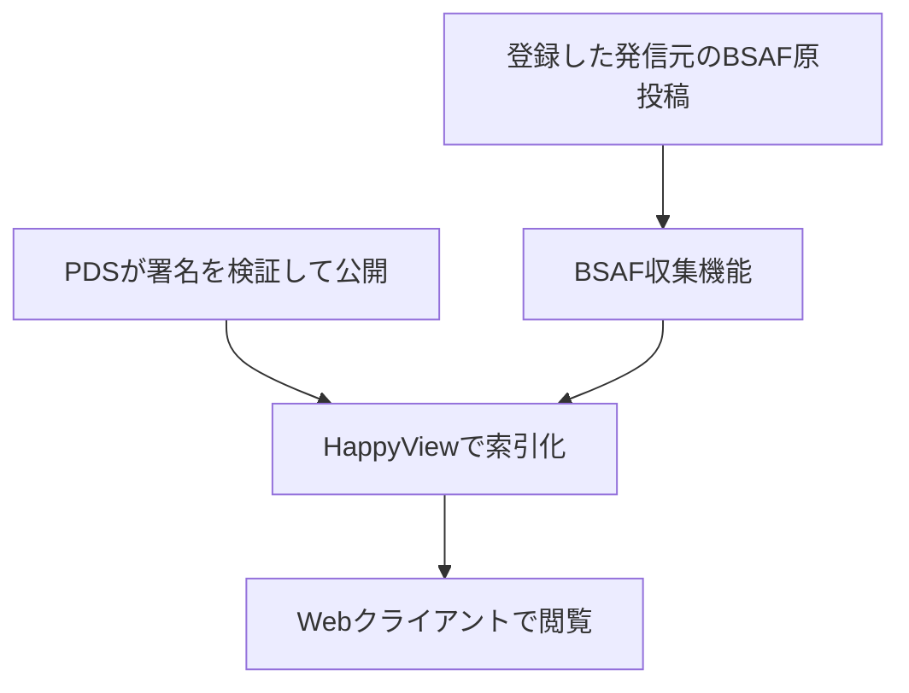

# Mosimo AppView — 投稿を集めて、閲覧できる形にする

PDSから公開された投稿を索引化し、Webクライアントが取得できるAPIを提供する層です。既存のAT Protocol向けソフトウェア **HappyView** を活用しています。このディレクトリには、HappyView本体ではなく、その運用に必要な構成ファイルを置いています。

> AT ProtocolのAppViewとして使用するHappyViewの構成ファイルです。 [@https://github.com/oriom-dev/podman-cluster-config](https://github.com/oriom-dev/podman-cluster-config)のためのNixOSモジュールを含みます。

## システムの中での役割

- **投稿を閲覧用に整理**：通信経路やPDSの処理と切り離し、クライアントへ投稿を提供します。
- **独自プロトコルと接続**：Mosimo用のLexiconとフィード取得APIを登録して利用します。
- **既存の防災情報と併置**：BSAF収集機能と組み合わせ、Mosimo投稿とBSAF原投稿を同じフィードで返します。

## 工夫した点

既存のAppViewを改造せずに活用し、Mosimo固有の定義・収集機能を分離しました。コンテナーの版を固定し、データを永続化するNixOS設定を用意しています。

## 役割の境界

端末署名済みデータの復元・署名検証はPDSが担当します。AppViewへの収集やフィードへの掲載だけで、発信元が公的機関であることや、情報の正しさを保証するものではありません。

## 関連資料

- [PDS](../../pds/README.md) / [Webクライアント](../../apps/web/README.md)
- [Lexicon定義](../../lexicons/README.md) / [BSAF投稿の収集](../bsaf/README.md)
- [運用設定](DEVELOPMENT.md)
