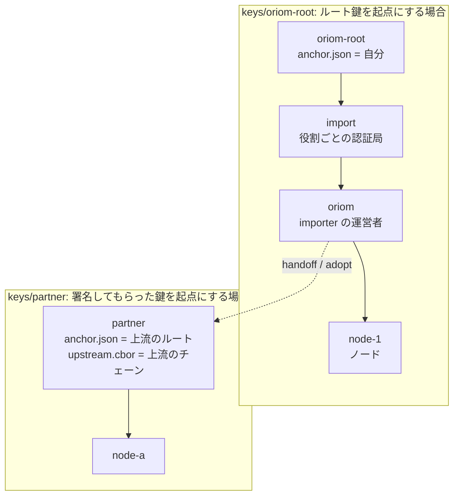

# 認証局（mosimo-ca）

[鍵署名プロトコル `dev.jisaku.mosimo.attest`](../protocol/mosimo/attest/README.md) の発行者側の実装（Rust）と、その鍵を置くディレクトリです。鍵署名と事前発行形の失効通知を発行し、失効通知を作成して失効リストとリレーへ発信します。受信者側の検証規則は [`pds/attest.mjs`](../pds/attest.mjs) と同じで、発行した鍵署名はその場で同じ規則で検証してから保存します。

## ビルド

flake になっています。リポジトリ直下から次のように使います。

```sh
nix develop ./ca                     # cargo・rustc・clippy・rustfmt・rust-analyzer・age の入った開発環境
nix run ./ca -- --help               # ビルドして実行
nix build ./ca                       # ./result/bin/mosimo-ca
```

開発環境では `cargo build --release` の後に `ca/target/release/mosimo-ca` を使います。flake のビルドでは、Git が追跡しているソースだけが Nix ストアにコピーされます。`.gitignore` で除外している `keys/` と `target/` はストアに入りません（ストアは誰でも読めるため、鍵を入れてはいけません）。ツールは実行時にディスク上の鍵ディレクトリを直接読み書きします。`path:./ca` の形で flake を指定すると除外が効かず鍵もストアにコピーされるので、使わないでください。

age による暗号化は `age` クレートで行うため、age CLI は不要です（生成したファイルは age CLI で復号できます）。

## 鍵ディレクトリ

ディレクトリの入れ子は「親の鍵が子の鍵に署名した」という関係だけを表し、階層ごとの役割は決めていません。`keys/` 直下の各ディレクトリが管理の起点です。

子のディレクトリ名は常に、親が発行時に付けた名前（鍵署名の `owner.id`）です。`issue PARENT NAME` の NAME がそのまま `owner.id` になり、`adopt` と `import-legacy` は鍵署名の `owner.id` をディレクトリ名にします。名前は英小文字・数字・`. _ : -` で、DID（`did:plc:...`）も使えます。読み込み時に名前と `owner.id` が一致しないと、ツールはエラーにします。名前を変えたいときは、ディレクトリを変えるのではなく発行し直します。起点がルート鍵の場合だけは親がいないので、`init-root` で自分で名前を付けます。



- 起点はプロトコル上のルート鍵（`init-root`）でも、他の発行者から署名された鍵（`adopt`）でもかまいません。後者は、上流のルートから自分までのチェーンを `upstream.cbor` に持ち、その下の鍵のチェーンは上流のチェーンに続けて組み立てます。
- 子の役割・期間・転載範囲（`importer` ブロック）・`organization`・`maxDepth` は親の範囲に収まる必要があり、`issue` は親の範囲を超える発行を拒否します。
- ルート鍵の `maxDepth` は既定で 16 です。受信者の実装（JS・Kotlin・Swift）が受け付ける上限で、チェーンは最大 8 要素なので実質的な制限はありません。

`ca/keys/` は `.gitignore` で中身を全て除外しています（`.gitignore` 自身だけを追跡）。ディレクトリは 0700、ファイルは 0600 で作ります。鍵ディレクトリは、作業ディレクトリから上にたどって見つけたこのリポジトリの `ca/keys` を使います（`nix run` でビルドしたバイナリでも同じです）。別の場所を使うときは `MOSIMO_CA_KEYS` か `--keys DIR` で指定します。

```text
keys/
  age-recipients.txt            任意。age の既定の受信者
  <起点>/
    anchor.json                 信頼の起点（受信者に配るルート設定 {pubkey, name, roles, maxDepth, enabled}）
    upstream.cbor               adopt した起点だけ。上流のルートから自分までの鍵署名
    public.pem  secret.pem.age
    pre-revocation.cbor         adopt した起点だけ。上流の発行者から受け取った事前発行形の失効通知
    <子>/
      public.pem  secret.pem.age
      attestation.cbor          親が署名した鍵署名
      pre-revocation.cbor       親が発行時に署名した事前発行形の失効通知
      revocation.cbor           作成した失効（発信前もここに置く）
      _revocation-list/         issuerDomain を持つ鍵だけ。entries/<revocationId>.cbor と配信する revocations.cbor
      _importer/                転載サーバーの DID: identity.json、atproto.pem.age、plc-rotation.pem.age
      <孫>/ ...
```

`.` や `_` で始まるディレクトリは子鍵として扱いません。

| ファイル | 形式 |
|---|---|
| `secret.pem` | PKCS#8（`BEGIN PRIVATE KEY`、secp256k1）。`openssl pkey` で読める |
| `secret.pem.age` | 上を age で暗号化したもの（ASCII armor） |
| `public.pem` | SubjectPublicKeyInfo（secp256k1）。x-only 鍵は BIP-340 と同じく偶数 y の点で表す |
| `*.cbor` | プロトコルの署名対象と同じ canonical CBOR。中身は `mosimo-ca inspect` で読む |

公開鍵と秘密鍵を別のファイルにしているのは、外部で生成された鍵（ノードが自分で作った鍵）に署名する場合に、公開鍵だけのディレクトリを同じ形で扱うためです。

## 使い方

以下 `mosimo-ca` は `nix run ./ca --` か、ビルドした `ca/target/release/mosimo-ca` です。鍵は `keys/` からの相対パス（`oriom-root/import/oriom`）か、公開鍵 hex の先頭 8 桁以上で指定します。

```sh
mosimo-ca tree                     # 階層と状態
mosimo-ca verify                   # 全ての鍵のチェーンを検証
mosimo-ca show oriom-root/import   # 鍵署名の内容
```

### 子鍵の作成（issue）

```sh
# ルートから役割ごとの認証局（import 役割、issuer → 運営者 → ノードの 2 段を許す）
mosimo-ca issue oriom-root import --max-depth 2 --domain import.ca.example.org \
  --owner-name 'Oriom Mosimo 転載 CA' --preset jma --preset kikikuru --age-passphrase

# 認証局から運営者
mosimo-ca issue oriom-root/import oriom --max-depth 1 --owner-name Oriom \
  --org-id oriom.dev:mosimo-bsaf-importer --org-name 'Mosimo BSAF importer (not JMA)' --days 1095 --trust-level 2

# 運営者からノード（appview/bsaf/identity-cli.mjs importer-create で作った DID と鍵を使う）
mosimo-ca issue oriom-root/import/oriom bsaf-1 --leaf --owner-name 'BSAF ノード 1' \
  --importer-identity importer-secret.json --days 730
```

省略したパラメーターは、端末から実行していれば対話で尋ねます（`maxDepth` の既定は親より 1 小さい値、役割・転載範囲は親の範囲から選択）。発行前に鍵署名の内容を表示して確認を求めます。`--yes` で確認を省略します。

転載範囲は `--preset`、`--source`、`--feed` で指定します。識別方法は [importer §1.1〜1.3](../protocol/mosimo/attest/importer/README.md#11-情報源の識別) のとおりです。

| 指定 | 範囲 |
|---|---|
| `--source DID=type1,type2` | Bot の転載。原投稿の著者 DID と BSAF の `type:` の値 |
| `--feed FEED` | フィードの転載。フィード ID（フィード定義の NSID）の全ての発表者・全ての種別 |
| `--feed FEED=type1,type2` | そのフィードの全ての発表者の、指定した種別 |
| `--feed FEED@ORIGIN` | 発表者 ID（絶対 URI。警報の発表機関なら WMO Register of Alerting Authorities の OID を推奨）の全ての種別 |
| `--feed FEED@ORIGIN=type1,type2` | その発表者の、指定した種別 |

| プリセット | 範囲 |
|---|---|
| `jma` | JMA Bot（`did:plc:vwi7zhfyamyvrg5v6ycjgzxi`）の 5 種 |
| `kikikuru` | Kikikuru Bot（`did:plc:kxwz5cz7o6g4jlmxh6doyfsm`）の 23 種 |
| `jma-xml` | フィード `dev.jisaku.mosimo.public.jma` の 8 種（[importer/jma-xml](../importer/jma-xml/README.md) が変換する電文の `Control/Title`） |

新しい情報源は、自分が管理するドメインの名前空間でフィード ID を決め、フィード定義（原情報、`origin` と `type` の決め方、投稿の形式拡張）を公開すれば、ツールやアプリの改修なしに `--feed` で発行できます。子の範囲は親に含まれる必要があります。`origin` や種別を省略した（全てを表す）範囲は、親も同じく省略している場合にだけ発行できます。

`feeds` を持つ鍵署名は、`feeds` に未対応の検証器ではチェーンごと不正になります。`feeds` に対応したアプリはルート設定の `maxDepth` も 16 に上げているので、3 段以上のチェーン（ルート → 役割ごとの認証局 → 運営者 → ノード）の認証局には含めてかまいません。現行の 2 段のチェーン（`oriom-mosimo-ca`）には含めないでください。

- ノードが自分で鍵を作る場合は、ノード側で `mosimo-ca keygen DIR` を実行し、`public.pem` だけを受け取って `--subject-public-pem` で署名します。秘密鍵は発行者の手元に残りません。
- 秘密鍵は age で暗号化して保存します。`--age-recipient`・`--age-recipients-file`・`--age-passphrase`、または `keys/age-recipients.txt` を使います。署名に使う鍵（`maxDepth` 1 以上）を平文で保存するには `--plaintext` が必要です。
- 暗号化された親鍵は署名のたびに復号します。受信者指定で暗号化した場合は `MOSIMO_CA_AGE_IDENTITY` に identity ファイルを指定します（`:` 区切りで複数可）。パスフレーズの場合は端末から入力します。
- `--importer-identity` に使った `importer-secret.json` は PLC 管理鍵を平文で含むため、取り込み後に削除してください。

### 署名してもらった鍵を起点にする（keygen / handoff / adopt）

```sh
# 受け取る側: 鍵ペアを作り、public.pem を発行者に渡す
mosimo-ca keygen ./partner-key --age-passphrase
# 発行する側: 署名して、チェーン一式を渡す
mosimo-ca issue oriom-root/import partner --max-depth 1 --subject-public-pem public.pem ...
mosimo-ca handoff oriom-root/import/partner ./bundle
# 受け取る側: 自分の鍵ディレクトリの起点として取り込み、以下の鍵を管理する
mosimo-ca adopt --key-dir ./partner-key --bundle ./bundle   # keys/partner（発行者が付けた名前）になる
mosimo-ca issue partner node-a --leaf ...
```

### 失効通知の作成（revoke / activate）

```sh
# 親（既定）または管理下の祖先、自分自身（--by self）の鍵で即時形の通知を作る
mosimo-ca revoke oriom-root/import/oriom/bsaf-1 --reason compromise --effective-at 2026-11-01
# 発行時の事前発行形の通知を、本人の鍵で活性化する
mosimo-ca activate oriom-root/import/oriom/bsaf-1
```

作った失効は対象の鍵のディレクトリの `revocation.cbor` に保存するだけで、発信はしません。ルート鍵は失効通知の対象外です（アプリの更新で入れ替えます）。adopt した起点の鍵は親を管理していないので、`activate` か `--by self` を使います。

### 失効通知の発信（publish）

```sh
mosimo-ca publish oriom-root/import/oriom/bsaf-1 --dry-run
mosimo-ca publish oriom-root/import/oriom/bsaf-1 --relay wss://relay.example.org
mosimo-ca check-published oriom-root/import
```

`publish` は発信の前に次を確認し、一つでも満たさなければ何も書き込みません。

- 通知と活性化の署名・構造が正しく、対象がそのディレクトリの鍵であること
- 通知の署名者が、対象のチェーン上の祖先または本人であること（受信者が適用する条件）
- 掲載先の失効リスト（管理下のチェーン上で `issuerDomain` を持つ鍵）があり、まだ掲載していないこと
- 祖先が既に失効していないこと

確認結果、影響を受ける子孫の一覧、署名を発行している鍵を失効させる場合の警告を表示した後、対象の公開鍵の先頭 8 桁を入力して初めて発信します（非対話では `--confirm`）。発信すると、掲載先の `_revocation-list/revocations.cbor` を作り直し、その鍵で署名して、再検証してから保存します。`--relay` を付けると kind 8173 の制御イベントを使い捨ての運搬者鍵で署名して送り、`--event-out FILE` でファイルにも書き出します。

`revocations.cbor` を Web サーバーに配置したら、`check-published` で配信中のリストを取得し、publisher・署名・掲載件数が手元と一致することを確かめます。

### その他

| コマンド | 内容 |
|---|---|
| `init-root NAME` | 新しいルート鍵を起点として作る |
| `inspect FILE` | `.cbor`（鍵署名・失効通知・失効・失効リスト・チェーン）や `chain` の Base64 出力を、種類を判別して JSON で表示し、署名を検証する。鍵ディレクトリにある鍵には名前を添える。`--json` で JSON だけを出力 |
| `encrypt KEY` | 平文の秘密鍵を age で暗号化する。復号して一致を確かめてから平文を消す |
| `chain KEY` | チェーン（Base64 の canonical CBOR）を出力する |
| `credentials KEY --out DIR` | 転載サーバー（publisher）に配置する鍵一式（`identity.json`・`chain.cbor`・`nostr.pem`・`atproto.pem`・`roots.json`）を書き出す。配置先と形式は [PUBLISHER.md の Key placement](../appview/bsaf/PUBLISHER.md#key-placement) |
| `trust-export KEY` | 起点の `anchor.json`（アプリの `mosimo-public-trust.json` と PDS の `publicInformation.roots` の要素）を出力する |
| `import-legacy NAME DIR` | 旧 `identity-cli.mjs` の出力（JSON 形式）を取り込む。NAME はルート鍵の名前で、子の名前は鍵署名の `owner.id` |

## テスト

```sh
nix develop ./ca -c cargo test --manifest-path ca/Cargo.toml
```

BIP-340 のテストベクタ、canonical CBOR の拒否条件、発行・失効・発信・adopt の一連の流れ、親の範囲を超える発行の拒否、age の暗号化と復号を確認します。
