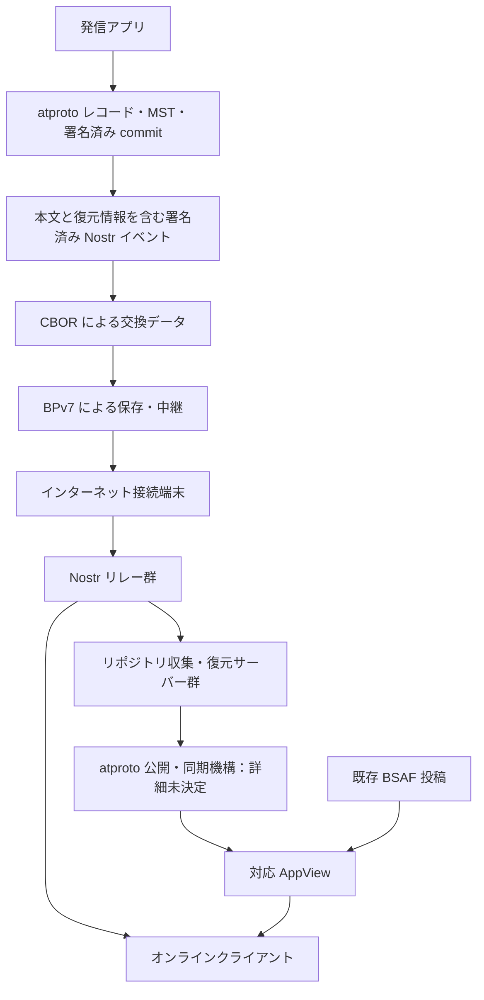

# 0000: 全体概要

状態: draft-00（合意済み方針と未検証の構想を含む）

## 1. 目的

災害等でインターネット接続が途絶した際に、端末間で署名済み情報を保存・中継し、再接続時にはインターネット上の情報網と接続する。

専用の単一アプリを前提にせず、市の防災アプリ等に共通プロトコルを組み込み、異なるアプリ間で情報を共有する。個人による被災状況の報告と、公的な発表を元にした情報の双方を扱う。

## 2. 構成

図は論理的な情報の流れであり、wire format や既存 atproto Relay への接続の成立を保証しない。条件付きのインターネットからメッシュへの配送も提供する。

## 3. 発信と署名

### 3.1 発信者の境界

アプリのインストールごとに独立した鍵・DID・リポジトリを持つ。鍵は初回利用時に生成し、永続化する。別端末への引き継ぎは前提にしない。Nostr 署名・atproto リポジトリ署名・PLC 管理の3用途の鍵を分離し、全て発信端末内に保持する。初期仕様で端末が生成する3用途の鍵の曲線は `secp256k1` に統一するが、秘密鍵は共用しない。Nostr は BIP-340 Schnorr、atproto・PLC は ECDSA を用いる。PLC 初期操作や DID 設定の変更は PLC 管理鍵で署名し、その秘密鍵を PDS や代理登録者には渡さない。atproto 用と Nostr 用の公開鍵の対応を両方の鍵で署名した独立の鍵対応宣言で示す。この宣言だけで DID の認証や実在する発信者の本人確認が成立するとは扱わない。DID は `did:plc` を採用する。端末が生成・署名した初期操作を受け取ったオンラインノードが、発信端末の再接続を待たず PLC Directory への代理登録を試みる。全ノードがオフラインなら登録完了は保証できない。鍵生成・保管、対応付けの具体形式は未決定。OS バックアップ復元等による端末状態の巻き戻りへの対応は [延期課題 §9.5](0003-open-questions.md#95-端末状態の巻き戻りへの対応) とする。

### 3.2 正本

端末で生成・署名した atproto リポジトリを正本とする。収集サーバーは復元・検証・複製を行い、著者の秘密鍵を持たず、著者に代わる commit を作らない。

atproto commit は投稿本文ではなくリポジトリ状態への署名である。復元には commit 以外のレコードと正確な path・変更操作等が必要となり、PDS がそれらから MST を再構築して署名済み root と照合する。本プロトコルのメッシュ・Nostr 配送では MST ノードや包含証明の同梱形式を定義しない。欠落コミットの探索・取得プロトコルは将来課題とし、今回は扱わない。標準 Relay 向けの出力に必要な MST・CAR は PDS 側で構築する。

### 3.3 単独での検証

過去の投稿が欠けていても、本文を含む Nostr イベントの著者署名を検証して表示できることを必須とする。Nostr 署名の検証と、atproto の署名済み状態への包含の検証は別の状態として扱う。

Nostr の `content` は人が読める本文とする。atproto 用の独自 Lexicon にも本文と構造化情報を表現する。初期仕様では、本プロトコルの Nostr 配送データから端末署名済み atproto commit・レコード等を復元する。atproto データだけから Nostr へ逆変換する機能は対象外とし、atproto レコードに Nostr 署名を保持する要件は設けない。Nostr とメッシュ交換データ間では元のイベント ID・署名を維持する。具体的な形式は未決定。

## 4. 内容と拡張

本文を基本とし、任意の構造化拡張を対応クライアントが解釈する。発信地点と影響範囲はそれぞれ任意で、互いに独立している。対応クライアントは地図等の表現を提供できる。初期仕様の影響範囲は円と地域コードに絞り、多角形は対象外とする。地域コードは行政区域ではなく全球グリッドで表現し、境界データの搭載や外部照会なしで領域判定できることを求める。具体方式は Geohash を採用する。詳細は [地理情報](0004-geography.md) を参照する。

「ブロック」は論理的な拡張単位であり、直ちに BPv7 extension block への配置を意味しない。著者が公開した構造化情報は著者署名で保護する。未知の著者拡張は改変せず保持・中継し、既知の本文は表示できるようにする。形式不正や資源上限超過は拒否できる。

発信地点は現地にいたことを証明しない。影響範囲は配送最適化のヒントであり、地理的なアクセス制限ではない。省略・未対応時は地域不明とし、発信地点から勝手に補わない。

初期仕様では画像・動画・音声等のメディア本体の配送は行わない。本文の URL で参照できるが、リンク先のオフライン取得・配送は保証せず、自動取得も要求しない。署名済み commit・レコード等の検証・復元用データは引き続き配送対象とする。メディア配送は [延期課題](0003-open-questions.md#9-延期した課題今回の設計対象外) に記録する。

## 5. 配送

BPv7 を保存・中継の基盤とする。CBOR と重複情報の省略等によってサイズ削減を目指す。CBOR は符号化形式であり、汎用圧縮アルゴリズムの採用を意味しない。追加の圧縮方式とサイズ削減率は未定・未測定。

影響範囲内の配送を優先できる一方、地域外のゲートウェイへ向かう中継を許容する。寿命・hop・保存量・帯域等の上限を別に設ける。著者の署名付き優先度はヒントとし、受信ノードが信頼・地域との関連・資源状況から実効優先度を決める。優先度によって資源上限を解除しない。具体的なリンク、接触時同期、フラッディング抑制アルゴリズムは未決定。

BPv7 の経過時間・hop count 等は可変な配送状態であり、著者署名付きデータと分離する。Bundle 全体の可逆変換は保証しない。

情報の有効期間とメッシュの配送期限は別項目とする。配送期限の満了は削除・撤回を意味せず、不明な情報の有効期間を勝手に補わない。再バンドルで著者署名付き配送期限を延長しない。BPv7 の Lifetime とローカル上限も併せて適用する。通常投稿は著者署名付き配送期限を必須とし、アプリが既定期間から設定できる。各ノードは配送期間を短縮できる。制御データの保持・配送は別途検討する。配送期限の実施はクライアントの実装・時計・資源状態に依存するベストエフォートとする。期限を判定できないノードも、期限内と確認済みにはせず、ローカル上限内で中継できる。受信だけで期限内・最新と保証された扱いにはしない。情報の有効期間の必須・任意、既定期間と時計ずれの具体的な判定規則は未決定である。

## 6. 訂正と削除

投稿内容の上書き更新は初期仕様に設けない。訂正・補足・追認は誰でも対象を参照する自身の新規投稿として発信でき、元著者の訂正と他者の主張を区別する。通常投稿とこれらの注釈は1件につき1レコード追加・1 commit・1 Nostr 投稿を基本単位とする。本人署名付き注釈を正本とし、グループ等の Labeler が自身の DID・鍵で標準 Label を集約発行する。元の注釈著者はレコードで維持し、サービスによる Label と区別する。基本 Label は注釈の存在を示し、元発信者の署名・身元・根拠注釈を参照して信頼を判断できるようにする。自治体等の確認済み発信者による誤情報指摘を強い判断材料にできるが、集約サービスの署名だけで公式見解や真偽の確定とは扱わない。Label の具体値・採用基準・対応付け・配信・信頼設定は未決定。詳細は [投稿と注釈・Label](0008-posts-and-labels.md) を参照する。

削除時は端末が NIP-09 削除要求と、対象レコードを MST から除いた atproto commit をそれぞれ署名・発行する。要求の先行到着と再出現への対処が必要である。削除するのは MST のレコードであり、過去の commit ではない。新しい削除後状態の commit を生成する。削除要求は全コピーの消去を保証しない。

自治体等の身元は、アプリ既定または利用者が選択したルート公開鍵からの多段署名チェーンで、名称と公開鍵の対応を確認する。チェーンは論理的な拡張ブロックとして含め、受信データ内のルートを自動で信頼することはない。具体形式・委任・失効等は未決定。詳細は [身元証明](0009-identity-attestations.md) を参照する。

## 7. オンライン連携

再接続した端末は、配送対象の署名済みイベントを Nostr リレーへ投稿する。物理 PDS 自身も標準 Nostr リレーとして動作し、接続可能なクライアントは直接投稿・取得・購読できる。これらは本プロトコルの独自タグや古い投稿時刻だけで拒否しない方針を提供し、優先的に利用する。具体的な能力・検索・保持・選択規則は [Nostr リレープロファイル](0007-nostr-relay-profile.md) で今後定義する。リレー候補はアプリ同梱・保存済みキャッシュ・既知 AppView のレコード・Nostr 経由の発見を組み合わせる。同梱候補には独自拡張を持たない著名な一般 Nostr リレーも含められる。候補の更新・信頼・障害時の処理と Nostr 経由の具体方式は未決定。「Nostr 標準の単一のブートストラップ手順」が存在する前提では確定しない。

収集サーバー群は Nostr イベントから発信者ごとの署名済みリポジトリを復元・共有する。複数運用者による冗長化を目指す。現行仕様では DID ごとに一つの正規 PDS endpoint を選び、直接購読する PDS のホストと照合する。同じ署名済み commit を複数ホストから流しても、重複排除だけで同時に正規公開元として受理されるとは扱わない。DID ごとに一つの論理 PDS を公開し、その背後で収集・復元サーバーを分散する構成を採用する。複数の運用グループがそれぞれ論理 PDS を提供でき、DID は一つのグループの公開 endpoint を指定する。物理 PDS は複数グループへ同時に所属できる。収集・検証・ミラーは誰でも実施できるが、正規公開系への参加はグループごとの承認・認証を必要とする。この構成では論理 endpoint ごとの firehose の順序・カーソルの継続性も必要となる。詳細は [PDS・Relay 接続調査](0005-pds-relay-research.md) を参照する。初回 DID の PDS はアプリ・運用者が事前設定した既定グループの endpoint を指定する。発信者の事前登録は不要とし、検証後にグループの方針と資源上限の範囲で受け入れる。DID での指定と受け入れ・公開完了は区別する。他の対応グループ宛ての未共有 commit を収集した場合は、正規公開先へ commit や取得元 Nostr リレー情報を共有する。公開名、受け入れ・障害時の処理、単一障害点を避ける具体方式と runtime 相互運用は引き続き設計・検証対象である。

対応 AppView は独自 Lexicon と既存 BSAF 投稿を収集する。オンラインクライアントは対応 AppView と Nostr の双方を情報源にできる。既存 Bluesky AppView やクライアントが独自 Lexicon を表示する保証はない。

## 8. 公的情報の取り込み

CAP、EDXL、気象庁 XML 等から本文と構造化データへの変換を目指す。ただし各形式の対応範囲、欠落項目、訂正・取消・複数言語の扱いは今後定義する。原形式への完全な可逆変換は未合意であり保証しない。

初期運用では受信者が既定の複数の取り込みサーバーを信頼し、そのうち1者の有効な署名で受理できる。将来は発表機関自身の署名を目指す。元情報が同値なら投入者の署名が異なっても配送上の重複として抑制する。詳細は [0002](0002-ingestion-and-trust.md) を参照。

## 9. 公開範囲と保証しないこと

初期仕様は公開情報の共有に限定する。個別通信・限定公開・投稿の暗号化は [延期課題](0003-open-questions.md#9-延期した課題今回の設計対象外) とし、今回は扱わない。本文や公開した位置情報は第三者が取得・保存し得る。影響範囲で閲覧者を制限することはできない。TLS 等の通信路保護は、投稿自体を受信者だけに秘匿するものではない。

- 全端末への配送、正確に一回の配送、通信可能性の保証
- 投稿内容の真実性、GPS の真正性、申告された優先度の正当性
- 全コピーの削除、全端末が最新の訂正・削除を知ること
- Sybil、妨害、悪意ある廃棄、資源枯渇攻撃の完全な防止
- 既存 atproto ネットワークが複数 PDS を自動で統合すること

要救助者の氏名・連絡先・詳細な所在等には別途プライバシー設計が必要であり、本仕様だけで安全な限定共有を提供するとは扱わない。公開鍵・位置情報・接触情報は追跡に利用され得る。位置情報の公開を必須にしない。具体的な資源上限、プライバシー UI、失効・侵害対応は未決定。
