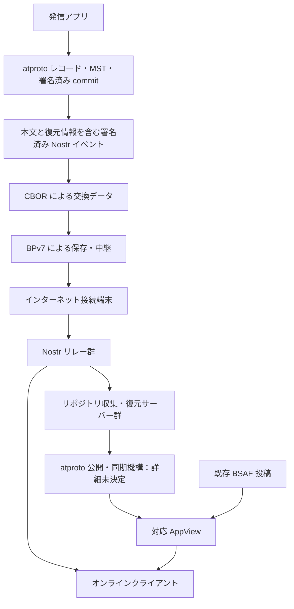

# 0000: 全体概要

状態: draft-00（合意済み方針と未検証の構想を含む）

## 1. 目的

災害等でインターネット接続が途絶した際に、端末間で署名済み情報を保存・中継し、再接続時にはインターネット上の情報網と接続する。

専用の単一アプリを前提にせず、市の防災アプリ等に共通プロトコルを組み込み、異なるアプリ間で情報を共有する。個人による被災状況の報告と、公的な発表を元にした情報の双方を扱う。

## 2. 構成

図は論理的な情報の流れであり、wire format や既存 atproto Relay への接続の成立を保証しない。条件付きのインターネットからメッシュへの配送も提供する。

## 3. 発信と署名

### 3.1 発信者の境界

アプリのインストールごとに独立した鍵・DID・リポジトリを持つ。鍵は初回利用時に生成し、永続化する。別端末への引き継ぎは前提にしない。DID method、鍵の種類・対応付け、バックアップ復元の扱いは未決定。

### 3.2 正本

端末で生成・署名した atproto リポジトリを正本とする。収集サーバーは復元・検証・複製を行い、著者の秘密鍵を持たず、著者に代わる commit を作らない。

atproto commit は投稿本文ではなくリポジトリ状態への署名である。復元には commit 以外のレコードと path 等が必要となる。MST ノードを運ぶか、受信側で再構築するかは未決定。

### 3.3 単独での検証

過去の投稿が欠けていても、本文を含む Nostr イベントの著者署名を検証して表示できることを必須とする。Nostr 署名の検証と、atproto の署名済み状態への包含の検証は別の状態として扱う。

Nostr の `content` は人が読める本文とする。atproto 用の独自 Lexicon にも本文と構造化情報を表現する。両者を署名を壊さず往復変換できる交換データを定義するが、具体的な形式は未決定。

## 4. 内容と拡張

本文を基本とし、任意の構造化拡張を対応クライアントが解釈する。発信地点と影響範囲はそれぞれ任意で、互いに独立している。対応クライアントは地図等の表現を提供できる。初期仕様の影響範囲は円と地域コードに絞り、多角形は対象外とする。地域コードは特定の国や独自の区分に依存しない標準的な方式を選ぶが、具体的な標準は未決定である。

「ブロック」は論理的な拡張単位であり、直ちに BPv7 extension block への配置を意味しない。著者が公開した構造化情報は著者署名で保護する。未知の著者拡張は改変せず保持・中継し、既知の本文は表示できるようにする。形式不正や資源上限超過は拒否できる。

発信地点は現地にいたことを証明しない。影響範囲は配送最適化のヒントであり、地理的なアクセス制限ではない。省略・未対応時は地域不明とし、発信地点から勝手に補わない。

## 5. 配送

BPv7 を保存・中継の基盤とする。CBOR と重複情報の省略等によってサイズ削減を目指す。CBOR は符号化形式であり、汎用圧縮アルゴリズムの採用を意味しない。追加の圧縮方式とサイズ削減率は未定・未測定。

影響範囲内の配送を優先できる一方、地域外のゲートウェイへ向かう中継を許容する。寿命・hop・保存量・帯域等の上限を別に設ける。具体的なリンク、接触時同期、フラッディング抑制アルゴリズムは未決定。

BPv7 の経過時間・hop count 等は可変な配送状態であり、著者署名付きデータと分離する。Bundle 全体の可逆変換は保証しない。

## 6. 訂正と削除

投稿内容の上書き更新は初期仕様に設けない。訂正は元投稿を参照する新規投稿とし、元著者による訂正と他者の主張を区別する。

削除時は端末が NIP-09 削除要求と、対象レコードを MST から除いた atproto commit をそれぞれ署名・発行する。要求の先行到着と再出現への対処が必要である。削除要求は全コピーの消去を保証しない。

## 7. オンライン連携

再接続した端末は、配送対象の署名済みイベントを Nostr リレーへ投稿する構想とする。リレー一覧を既知の対応 AppView のレコード等から取得する案を含むが、発見方式・信頼・障害時の処理は未決定。「Nostr 標準の単一のブートストラップ手順」が存在する前提では確定しない。

収集サーバー群は Nostr イベントから発信者ごとの署名済みリポジトリを復元・共有する。複数運用者による冗長化を目指す。ただし DID の PDS 解決、既存 Relay の同期・重複処理、単一障害点を避ける公開方式は未検証であり、今後の設計対象とする。

対応 AppView は独自 Lexicon と既存 BSAF 投稿を収集する。オンラインクライアントは対応 AppView と Nostr の双方を情報源にできる。既存 Bluesky AppView やクライアントが独自 Lexicon を表示する保証はない。

## 8. 公的情報の取り込み

CAP、EDXL、気象庁 XML 等から本文と構造化データへの変換を目指す。ただし各形式の対応範囲、欠落項目、訂正・取消・複数言語の扱いは今後定義する。原形式への完全な可逆変換は未合意であり保証しない。

初期運用では受信者が既定の複数の取り込みサーバーを信頼し、そのうち1者の有効な署名で受理できる。将来は発表機関自身の署名を目指す。元情報が同値なら投入者の署名が異なっても配送上の重複として抑制する。詳細は [0002](0002-ingestion-and-trust.md) を参照。

## 9. 保証しないこと

- 全端末への配送、正確に一回の配送、通信可能性の保証
- 投稿内容の真実性、GPS の真正性、申告された優先度の正当性
- 全コピーの削除、全端末が最新の訂正・削除を知ること
- Sybil、妨害、悪意ある廃棄、資源枯渇攻撃の完全な防止
- 既存 atproto ネットワークが複数 PDS を自動で統合すること

公開鍵・位置情報・接触情報は追跡に利用され得る。位置情報の公開を必須にしない。具体的な資源上限、プライバシー UI、失効・侵害対応は未決定。
