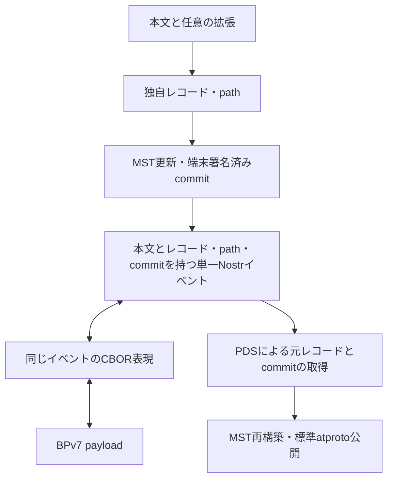

# 0012: atproto・Nostr・CBOR のデータ表現

状態: draft-01 — 投稿単位・署名の責務・変換方向と、項目・拡張ごとに複数の Nostr タグへ分ける方式は合意済み。具体的なタグ名・符号化・NSID・CBOR 配列位置は未確定。

## 要旨

[基本投稿](0010-core.md) と [拡張](0011-extensions.md) が、atproto レコード・署名済み commit・Nostr イベント・メッシュ用 CBOR のどこに入るかを説明する。説明用の中間構造を、新たな署名形式や別配送イベントとして追加するものではない。

## 1. 全体の対応（要件）

| 情報 | atproto | Nostr | メッシュ区間 |
|---|---|---|---|
| 人が読む本文 | 独自 Lexicon の本文フィールド | `content` | CBOR payload の本文 |
| 投稿作成時刻 | UTC・末尾 `Z` の日時文字列 | `created_at` は秒未満を切り捨てた Unix 秒。元の文字列は独自タグで保持 | 元の Nostr 値・タグ文字列を維持 |
| 配送期限・著者拡張 | レコードの項目 | 同じイベントの署名対象タグ | タグを含めて元のイベントを保持 |
| repository path | MST のキー | 同じイベントの署名対象タグ | 同左 |
| 署名済み commit | repository v3 の commit | 同じイベントの署名対象タグ | 同左 |
| 適用元 commit CID | 本プロトコルの変更適用元。標準 `prev` とは別 | 同じイベントの署名対象タグ | 同左 |
| 著者の識別 | commit の DID、DID 情報の署名鍵 | `pubkey`。DID との鍵対応は独立宣言 | 元の Nostr 公開鍵 |
| 著者署名 | atproto commit の ECDSA | イベント全体の BIP-340 | 元の両署名を維持 |
| hop・経過時間 | レコードへ入れない | 元イベントへ追記しない | BPv7 の可変な配送状態 |

一投稿の本文・レコード・path・commit・適用元 CID は同じ Nostr イベントにまとめる。初回適用元なしを明示し、後続は端末が直前に確定した commit の CID を指定する。標準 atproto commit の `prev` の意味を変更しない。

## 2. atproto 表現（配置案）

### 2.1 独自レコード

```ts
type PostRecord = {
  $type: string; // 正式な独自Lexicon NSIDは未決定
  text: Text;
  createdAt: Timestamp;
  deliveryExpiresAt: Timestamp;
  extensions: Extension[];
};
```

拡張一覧 `extensions` は、Lexicon の open union を要素とする配列とする方式を採用済み。各要素は `$type` 付きオブジェクトとし、既知の拡張は参照先の型として定義し、未知の型もそのまま保持する。Lexicon の `union.closed` は `false`（省略時も open）とする。拡張本体を一律に bytes に包む方式は採用しない。

個別の型識別子・名前空間・版管理・フィールド・上限は未確定である。型付き表示データを再出力して未知の型・フィールドを落とさず、元データを保持する。具体例は [0011](0011-extensions.md) に示す。

レコードを標準の atproto CBOR で符号化して record CID を得る。repository path は `<独自collection>/<record-key>`。本文投稿ごとに新しい path へ追加し、既存投稿の更新には使わない。NSID・record key の生成方式・上限は未決定である。

現行 Data Model は DRISL（DAG-CBOR の後継として説明される正規化 CBOR）を規定する。任意の CBOR エンコーダーの出力や JSON のキー整列を、そのまま同じ CID を作る手段とはしない。一般の deterministic CBOR と atproto の符号化制約を区別する。

### 2.2 commit と操作

標準 repository v3 commit の構造は次のとおり。これは本プロトコルが新設する型ではない。

```ts
type AtprotoCommitV3 = {
  did: Did;
  version: 3;
  data: CidLink; // MST root
  rev: string;   // TID。単調増加するrepository revision
  prev: CidLink | null;
  sig: Bytes;
};
```

`CidLink` は標準 CID link。`sig` を含めた commit の符号化バイト列を保持する。`rev` は投稿 ID でもメッシュ hop 数でもなく、`data` は投稿レコード CID ではない。

配送する変更情報の論理構造は次のように表せる。

```ts
type CreateRecordChange = {
  baseCommit: Cid | null;
  commit: Bytes;         // 元の署名済みcommitのatproto CBOR
  action: "create";
  path: RepositoryPath;
  record: PostRecord;
};
```

`record` と `commit` の CID は元のバイト列から得られるため、重複配送が必須な追加項目とはしない。DID も commit に含まれる。MST ノード・包含証明はこの構造へ加えない。削除操作は `action: "delete"` と対象 path を使う方向で別途具体化し、上記の追加レコード型と混同しない。

PDS はこれらの操作から MST を再構築する。入力側のこの独自表現と、標準同期に用いる MST ノードを含む CAR 出力は別である。

## 3. Nostr 表現

### 3.1 標準フィールド（要件）

| フィールド | 内容 |
|---|---|
| `kind` | 通常投稿・訂正・補足・追認は `1`。削除要求は NIP-09 の `5` |
| `content` | `Post.text` そのもの。XML・CBOR・CAR の Base64 を本文の代わりにしない |
| `tags` | 検索用 `t` タグ、投稿の構造化情報と commit 等。並び順・文字列を署名後に変えない |
| `created_at` | `createdAt` の秒未満を切り捨てた Unix 秒整数。元の `createdAt` は独自タグに保持 |
| `pubkey`・`id`・`sig` | 標準 Nostr の値・符号化 |

Nostr のタグは文字列配列の配列であり、JSON object や生バイト列を直接入れられない。通常リレーへ送る JSON では追加データの文字列表現が必要となる。署名対象外のトップレベル独自フィールドへ commit を置く案は採用しない。

### 3.2 項目・拡張ごとのタグ配置（方式合意済み）

本文以外のデータを一括 CBOR にまとめて一つのタグへ格納する方式は採用しない。基本項目と各拡張を複数のタグへ分け、拡張ごとの独立した実装と検索への利用を優先する。これは一つの Nostr イベント内の配置であり、投稿を複数イベントに分けるものではない。

```text
Nostrイベント
├─ content = 元レコードのtext
└─ tags
   ├─ プロトコル識別
   ├─ 署名済みcommit・適用元CID・repository path等の基本項目
   ├─ レコードの型・正確な作成時刻・配送期限等
   ├─ 発信地点の拡張が定めるタグ
   ├─ 影響範囲の拡張が定めるタグ
   └─ その他の拡張がそれぞれ定めるタグ
```

拡張の意味を知らなくても元レコードを構成できるよう、§3.2.1 の共通の運び方を採用する。各拡張仕様はオブジェクトの意味・固有フィールドを定義し、PDS や中継者への専用コード追加を参加条件にしない。他の任意拡張の展開や一括データの展開も前提にしない。本文・commit・path 等の共通項目は基本仕様が担当する。拡張の有無・解釈不能を理由に本文の利用を拒否しない。

| 情報 | 配置方針 | 今後固定すること |
|---|---|---|
| 本文 | `content`。重複格納を避ける | レコードの `text` との正確な対応 |
| 署名済み commit | 基本仕様のタグ。通常の Base64・paddingなしで bytes を表す | 具体的なタグ名 |
| 適用元 CID・path・操作 | 基本仕様のタグ | 初回の適用元なし・追加／削除の表現 |
| レコードの型・正確な作成時刻・配送期限 | 基本仕様のタグ。時刻は共通 `Timestamp` の文字列をそのまま保持 | 具体的な項目別のタグ名 |
| 各著者拡張 | 原則1オブジェクト＝1自己完結タグ。共通接頭辞と `$type`、全フィールドの CBOR を保持 | 接頭辞・区切り・wire 版の正式表現 |
| 未知の型・未知フィールド | 元イベント内で保持し、既知項目だけに縮めない | 元レコードを失わず再構成するための保持表現 |
| 標準タグと独自タグ | 意味が正確に一致する標準タグだけ再利用し、それ以外は衝突しにくい独自名 | 適用する NIP と意味の対応、独自名の名前空間 |

### 3.2.1 自己完結した拡張タグ（合意済み）

既定の運び方は、1拡張オブジェクトを1つの独立タグにする。次は構造の説明であり、具体的な接頭辞・区切り文字の確定ではない。

```text
タグ名 = 共通の識別用接頭辞 + 拡張の完全修飾$type
タグ値 = Base64（paddingなし）で表した、$type以外の全フィールドのatproto CBOR
```

タグ名から元の `$type` 文字列をそのまま取り出し、値のオブジェクトへ戻す。内側のオブジェクトに同じ `$type` を重複格納することは要求しない。全ての他のフィールド、未知フィールド、配列順、bytes・CID link・null 等の型、省略と null の区別を保持する。符号化には atproto データモデルの正規化 CBOR を使い、拡張固有のスキーマを知っていることを条件にしない。共通接頭辞の識別・区切り・版の具体的な wire 表現は未決定である。

これは atproto レコードを bytes の袋へ変える決定ではない。レコード内では open union の `$type` 付きオブジェクトのまま、Nostr に載せる際だけ拡張ごとに独立して符号化する。投稿全体・全拡張を一括 CBOR とする方式も採用しない。従来の「拡張ごとに専用のタグ変換コードを用意する」案を、この共通方式に改める。

### 3.2.2 任意実装・自由な定義と配列順

- 拡張は任意とし、存在するものだけを扱う。全クライアントによる全拡張の実装は要求しない。
- 誰でも自身の衝突しない Lexicon 名前空間で拡張を定義できる。共通管理者の承認・全実装への型一覧追加・受信時のオンラインスキーマ取得を要求しない。
- 本文のみのクライアントは拡張を解釈せず本文を扱える。対応クライアントは対象の `$type` のタグだけを展開できる。
- PDS は共通接頭辞と CBOR のデータ型だけで未知の拡張を元のオブジェクトへ戻せる。意味の解釈・拡張固有の処理と、運搬・再構成を分離する。
- 共通の拡張タグを Nostr のタグ一覧に現れた順に取り出して、元の `extensions` 配列を構成する。基本項目等の非拡張タグは配列要素として数えない。位置番号・別の順序リストは持たせない。
- 同じ `$type` が複数あってもそれぞれ独立した要素として保持し、統合・上書き・重複削除しない。既知型の意味上の多重性の制約とは区別する。

標準タグへの直接対応は §3.3 の条件に加え、型・全フィールド・元の配列位置を欠落なく構成できる共通の対応規則がある場合に限る。定義者が独自に標準タグを宣言しただけで、PDS に専用コードを要求する経路にはしない。その対応が未定義の場合や未知フィールドを保持できない場合は、自己完結した独自タグを使う。標準タグと同じ拡張を二重格納して検索用索引とすることは要求しない。個別の直接対応の wire 規則は未決定である。

### 3.2.3 共通の値の型

作成時刻・配送期限等の基本項目を直接タグの値にする場合、[0010 §3.1](0010-core.md#31-共通時刻型合意済み) の `Timestamp` 文字列を保持する。`created_at` だけから元の精度を推定しない。

自己完結タグの内部では、時刻は同じ日時文字列、座標・距離は [0010 §3.2](0010-core.md#32-座標距離の整数表現合意済み) の固定単位の整数として格納する。これらを一度十進文字列へ変えてから CBOR に入れる必要はない。基本項目や標準タグとの直接対応で整数を文字列として扱う場合は、その整数の十進文字列とする。

### 3.3 タグの保持とリレー検索

NIP-01 の標準的なタグ検索は、英字一文字のタグ名と、その最初の値に対する一致を対象とする。複数文字の独自タグは保持できても、一般リレーで同じように検索できるとは仮定しない。タグを分けるだけで、全ての値・数値範囲・地理的包含を検索できるようになるわけではない。

標準のタグは、定義元 NIP の対象 kind・文脈・値の意味が正確に一致する場合だけ再利用する。似た型の値を格納できることや、一文字で検索できることだけを理由に標準タグへ押し込まない。標準に一致しない基本項目・拡張は、衝突を避けやすい名前空間付きの独自タグとする。独自名の具体的な接頭辞・命名規則は未決定である。

独自タグが一般リレーで検索できなくても許容する。検索性を得るためだけの新しい一文字タグの割当て、標準タグの意味の流用、別名タグ・重複索引の追加は行わない。独自タグの保持と、対応 AppView・クライアントが取得後に行う索引・絞り込みは別である。

プロトコル識別には合意済みの `t` タグを使う方針を維持する。地理情報等の個別の標準タグへの適合は各拡張で確認し、意味が一致しなければ独自タグにする。全てのタグは著者が署名時点で含め、中継者が追加・修正しない。レコード内へ Nostr 署名や自分自身の event ID を埋め込むことも要求しない。

### 3.4 制御データ

| データ | 配送単位 | 未確定部分 |
|---|---|---|
| PLC 初期操作 | 通常投稿とは独立した制御イベント。未登録時の例外経路 | kind・符号化・期限 |
| DID を含む両鍵署名の鍵対応宣言 | 独立した制御イベント。毎投稿の同梱は不要 | kind・参照・取得・更新 |
| NIP-09 削除要求と削除 commit | 著者が双方を発行する制御処理 | 一つの kind 5 への具体配置、複数対象の単位 |

これらが未取得でも、通常の Nostr 署名付き本文を扱える。一方、申告 DID や公式機関への帰属まで確認済みとはしない。

### 3.5 独自タグのバイト列（合意済み）

本プロトコルの独自タグで新たに定義するバイト列項目は、RFC 4648 §4 の通常の Base64 で表し、末尾の `=` padding を省略する。アルファベットは大文字・小文字の英字、数字、`+`、`/` とし、Base64url の `-`・`_` は使わない。改行・空白・padding を付けず、RFC 4648 の正規な符号化から末尾の `=` を除いた一意の表現とする。

この規則は bytes 型の文字列表現を定めるものであり、整数・時刻・通常の文字列を全て Base64 にする規則ではない。

| 場所・項目 | 表現 |
|---|---|
| 本プロトコルが定義する独自タグの bytes 項目 | 通常の Base64、末尾 `=` なし |
| 対応するメッシュ用 CBOR の変換済み値 | 生バイト列（byte string） |
| Nostr 標準の `id`・`pubkey`・`sig` | 標準どおり小文字 hex。今回の規則で変更しない |
| CID の文字列表現 | atproto 等の既存規則。今回の規則で変更しない |
| atproto JSON の bytes | 標準の `{"$bytes":"..."}` 表現。元レコード内は bytes 型 |

例えば生バイト列 `01 02` は `AQI`、`fb ff` は `+/8` と表す。32バイトは43文字になる。長さや内容の要件は各項目の仕様が別途定める。

メッシュ側で bytes にした値は、Nostr へ戻す際にこの表現を生成する。既知の独自タグでも、この表記に合わない元の値は、正規化して置き換えず文字列のまま保持する。未知タグ・既存標準タグを Base64 らしいという理由だけで変換しない。

## 4. メッシュ用 CBOR（配置案）

### 4.1 既知タグの可逆な型変換（合意済み）

メッシュでは、共通の拡張タグ形式、または基本項目・標準タグの既知の対応規則に従って、値を文字列から整数・バイト列へ置き換える。全拡張を一括データにまとめず、タグごとの独立性を維持する。

自己完結した拡張タグは、内側の `$type` が未知でも共通の運び方は既知である。その値の Base64 を生バイト列へ戻す処理に、拡張固有のコードは不要となる。内部 CBOR はそのまま保持し、拡張固有フィールドを解析・再整形して最適化しない。内部の座標・距離は既に整数であり、日時文字列は原表記のままである。

| Nostr タグ内の値 | メッシュ用 CBOR | 条件 |
|---|---|---|
| 座標・距離等の既知の整数文字列 | CBOR integer | 元の文字列へ完全に戻る表記であること |
| commit 等の既知の符号化文字列・共通拡張タグの値 | CBOR byte string | 元の符号化文字列へ完全に戻せること。拡張の意味が未知でも共通形式なら処理可能 |
| 日時文字列 | CBOR text string | 秒未満・末尾ゼロ等の原表記を保持する |
| 運び方も未知のタグ・未対応の表現 | 元の文字列 | 数字・Base64らしく見えても推測変換しない |
| 既知タグでも変換条件に合わない値 | 元の文字列 | 型変換のための正規化・補修を行わない |

例えば `"001"` を整数 `1` に置き換えると元の文字列が分からなくなるため、そのような変換は行わない。バイト列の文字列表現についても、文字種・padding・大文字小文字等が異なる表現を、同じ bytes に潰してから勝手に整形し直さない。タグの各値は、完全に復元できるものだけ変換する。

### 4.2 payload の構造案

```cddl
compact-event = [
  version: uint,
  pubkey: bstr .size 32,
  created-at: uint,
  kind: 0..65535,
  tags: [* compact-tag],
  content: tstr,
  sig: bstr .size 64
]
compact-tag = [name: tstr, * (tstr / int / bstr)]
```

型変換の方式は合意済みだが、この CDDL の配列位置・版の値・変換規則の識別方法までは確定していない。`compact-tag` はメッシュ専用であり、整数や bytes をそのまま Nostr リレーへ送る形式ではない。タグ名は文字列のまま保持する。

共通拡張タグの接頭辞と構文は基本仕様で固定し、内側の型が未知でも識別できるようにする。その他の直接表現を型変換する場合は、タグ名・値の位置・整数の表記を共通の対応規則で固定する必要がある。独自タグの bytes 項目の文字列符号化は §3.5 に従う。対応規則とその版を送受信側が一意に特定できる wire 表現は未決定であり、受信側が推測してはいけない。CBOR の `int`・`bstr`・`tstr` の区別だけで、未対応のタグを解釈済みとはしない。

### 4.3 元イベントの保持

Nostr event ID は標準の署名対象から再計算できるため配送時には省略できる。公開鍵・署名を hex のまま運ばず bytes にする。タグ一覧の順序、各タグ内の値の順序・要素数、本文、その他の元の署名対象フィールドは維持する。元の Nostr JSON へ戻す際に、整数・bytes を対応規則どおりの元の文字列へ復元し、元の event ID・署名を維持する。

未知のタグと、変換条件に合わない元の文字列はそのまま運べる。対応規則が不明な型変換済みタグを、推測で文字列化して元イベントとして扱わない。この場合は元の署名対象を復元できた状態と区別する。未対応データの保持は、サイズ上限・対応プロトコル版等の既存の条件の範囲で行う。

CBOR 符号化・可逆な型変換だけで汎用圧縮をしたとは表現しない。DEFLATE 等の追加圧縮、辞書、サイズ削減率は未採用・未測定。型変換後も著者署名や CID の元の対象バイト列は変わらない。

## 5. 変換方向と保持するもの



- Nostr とメッシュ用 CBOR の間では元の event ID・署名・署名対象フィールドを維持する。
- Nostr から atproto へは元の record CID・commit CID・署名を維持する。
- atproto データだけから元の Nostr イベントを逆生成する機能は延期。レコードへの Nostr 署名保存は要求しない。
- BPv7 全体は可逆変換対象ではない。ゲートウェイが持つ経路ごとの hop・経過時間まで Nostr へ移さない。

## 6. BSAF との表現上の境界

本プロトコルは独自 Lexicon、BSAF は既存 `app.bsky.feed.post.tags` を使う。ここでの「タグ」は Nostr の `tags: string[][]` とは型が異なる。BSAF の文字列タグをそのまま Nostr タグと呼ばない。

独自レコードを BSAF 投稿に偽装せず、BSAF 投稿へ本書の commit・配送期限の同梱を要求しない。対応 AppView での収集と表示の対応は [0013 §6.4](0013-public-information.md#64-bsaf-appviewの別入力) に記す。

## 7. 参照

- [atproto Data Model](https://atproto.com/specs/data-model)（2026-10-17 確認）
- [atproto Repository](https://atproto.com/specs/repository)（2026-10-17 確認）
- [atproto Lexicon](https://atproto.com/specs/lexicon)（2026-10-17 確認）
- [NIP-01](https://github.com/nostr-protocol/nips/blob/master/01.md)（2026-10-17 確認）
- [RFC 8949 — CBOR](https://www.rfc-editor.org/rfc/rfc8949.html)
- [RFC 4648 — Base Encodings](https://www.rfc-editor.org/rfc/rfc4648.html)
