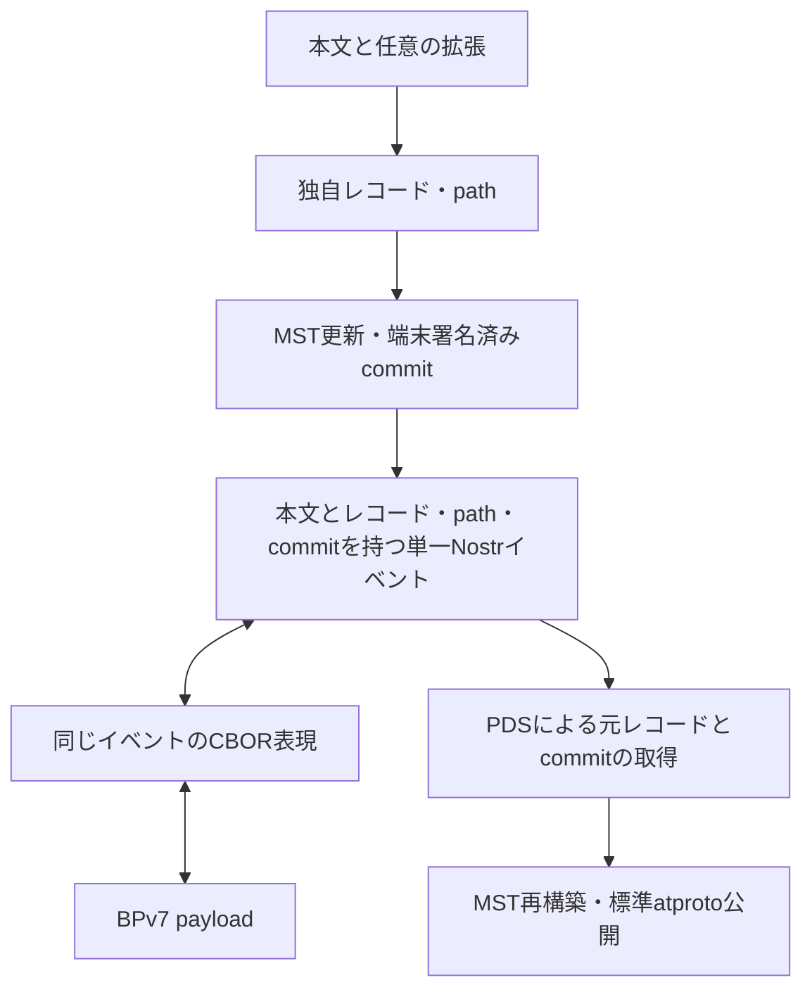

# 0012: atproto・Nostr・CBOR のデータ表現

状態: draft-01 — 投稿単位・署名の責務・変換方向と、項目・拡張ごとに複数の Nostr タグへ分ける方式は合意済み。具体的なタグ名・符号化・NSID・CBOR 配列位置は未確定。

## 要旨

[基本投稿](0010-core.md) と [拡張](0011-extensions.md) が、atproto レコード・署名済み commit・Nostr イベント・メッシュ用 CBOR のどこに入るかを説明する。説明用の中間構造を、新たな署名形式や別配送イベントとして追加するものではない。

## 1. 全体の対応（要件）

| 情報 | atproto | Nostr | メッシュ区間 |
|---|---|---|---|
| 人が読む本文 | 独自 Lexicon の本文フィールド | `content` | CBOR payload の本文 |
| 投稿作成時刻 | レコードの日時 | `created_at` は Unix 秒。精度差の扱いは配置案に記載 | 元の Nostr 値を維持 |
| 配送期限・著者拡張 | レコードの項目 | 同じイベントの署名対象タグ | タグを含めて元のイベントを保持 |
| repository path | MST のキー | 同じイベントの署名対象タグ | 同左 |
| 署名済み commit | repository v3 の commit | 同じイベントの署名対象タグ | 同左 |
| 適用元 commit CID | 本プロトコルの変更適用元。標準 `prev` とは別 | 同じイベントの署名対象タグ | 同左 |
| 著者の識別 | commit の DID、DID 情報の署名鍵 | `pubkey`。DID との鍵対応は独立宣言 | 元の Nostr 公開鍵 |
| 著者署名 | atproto commit の ECDSA | イベント全体の BIP-340 | 元の両署名を維持 |
| hop・経過時間 | レコードへ入れない | 元イベントへ追記しない | BPv7 の可変な配送状態 |

一投稿の本文・レコード・path・commit・適用元 CID は同じ Nostr イベントにまとめる。初回適用元なしを明示し、後続は端末が直前に確定した commit の CID を指定する。標準 atproto commit の `prev` の意味を変更しない。

## 2. atproto 表現（配置案）

### 2.1 独自レコード

```ts
type PostRecord = {
  $type: string; // 正式な独自Lexicon NSIDは未決定
  text: Text;
  createdAt: Timestamp;
  deliveryExpiresAt: Timestamp;
  extensions: Extension[];
};
```

拡張一覧 `extensions` は、Lexicon の open union を要素とする配列とする方式を採用済み。各要素は `$type` 付きオブジェクトとし、既知の拡張は参照先の型として定義し、未知の型もそのまま保持する。Lexicon の `union.closed` は `false`（省略時も open）とする。拡張本体を一律に bytes に包む方式は採用しない。

個別の型識別子・名前空間・版管理・フィールド・上限は未確定である。型付き表示データを再出力して未知の型・フィールドを落とさず、元データを保持する。具体例は [0011](0011-extensions.md) に示す。

レコードを標準の atproto CBOR で符号化して record CID を得る。repository path は `<独自collection>/<record-key>`。本文投稿ごとに新しい path へ追加し、既存投稿の更新には使わない。NSID・record key の生成方式・上限は未決定である。

現行 Data Model は DRISL（DAG-CBOR の後継として説明される正規化 CBOR）を規定する。任意の CBOR エンコーダーの出力や JSON のキー整列を、そのまま同じ CID を作る手段とはしない。一般の deterministic CBOR と atproto の符号化制約を区別する。

### 2.2 commit と操作

標準 repository v3 commit の構造は次のとおり。これは本プロトコルが新設する型ではない。

```ts
type AtprotoCommitV3 = {
  did: Did;
  version: 3;
  data: CidLink; // MST root
  rev: string;   // TID。単調増加するrepository revision
  prev: CidLink | null;
  sig: Bytes;
};
```

`CidLink` は標準 CID link。`sig` を含めた commit の符号化バイト列を保持する。`rev` は投稿 ID でもメッシュ hop 数でもなく、`data` は投稿レコード CID ではない。

配送する変更情報の論理構造は次のように表せる。

```ts
type CreateRecordChange = {
  baseCommit: Cid | null;
  commit: Bytes;         // 元の署名済みcommitのatproto CBOR
  action: "create";
  path: RepositoryPath;
  record: PostRecord;
};
```

`record` と `commit` の CID は元のバイト列から得られるため、重複配送が必須な追加項目とはしない。DID も commit に含まれる。MST ノード・包含証明はこの構造へ加えない。削除操作は `action: "delete"` と対象 path を使う方向で別途具体化し、上記の追加レコード型と混同しない。

PDS はこれらの操作から MST を再構築する。入力側のこの独自表現と、標準同期に用いる MST ノードを含む CAR 出力は別である。

## 3. Nostr 表現

### 3.1 標準フィールド（要件）

| フィールド | 内容 |
|---|---|
| `kind` | 通常投稿・訂正・補足・追認は `1`。削除要求は NIP-09 の `5` |
| `content` | `Post.text` そのもの。XML・CBOR・CAR の Base64 を本文の代わりにしない |
| `tags` | 検索用 `t` タグ、投稿の構造化情報と commit 等。並び順・文字列を署名後に変えない |
| `created_at` | Nostr の Unix 秒整数 |
| `pubkey`・`id`・`sig` | 標準 Nostr の値・符号化 |

Nostr のタグは文字列配列の配列であり、JSON object や生バイト列を直接入れられない。通常リレーへ送る JSON では追加データの文字列表現が必要となる。署名対象外のトップレベル独自フィールドへ commit を置く案は採用しない。

### 3.2 項目・拡張ごとのタグ配置（方式合意済み）

本文以外のデータを一括 CBOR にまとめて一つのタグへ格納する方式は採用しない。基本項目と各拡張を複数のタグへ分け、拡張ごとの独立した実装と検索への利用を優先する。これは一つの Nostr イベント内の配置であり、投稿を複数イベントに分けるものではない。

```text
Nostrイベント
├─ content = 元レコードのtext
└─ tags
   ├─ プロトコル識別
   ├─ 署名済みcommit・適用元CID・repository path等の基本項目
   ├─ レコードの型・正確な作成時刻・配送期限等
   ├─ 発信地点の拡張が定めるタグ
   ├─ 影響範囲の拡張が定めるタグ
   └─ その他の拡張がそれぞれ定めるタグ
```

各拡張仕様は、自身の atproto オブジェクトと Nostr タグの対応を定義する。他の任意拡張のタグの展開や一括データの展開を前提にせず、その拡張だけを解釈できる構成とする。本文・commit・path 等の共通項目は基本仕様が担当する。拡張の有無・解釈不能を理由に本文の利用を拒否しない。

| 情報 | 配置方針 | 今後固定すること |
|---|---|---|
| 本文 | `content`。重複格納を避ける | レコードの `text` との正確な対応 |
| 署名済み commit | 基本仕様のタグ | bytes の文字列符号化・タグ名 |
| 適用元 CID・path・操作 | 基本仕様のタグ | 初回の適用元なし・追加／削除の表現 |
| レコードの型・正確な作成時刻・配送期限 | 基本仕様のタグ | 項目別のタグ・`created_at` との精度差 |
| 各著者拡張 | 各拡張仕様が定める一つまたは複数のタグ | `$type` との対応・値の順序・複数要素の表現 |
| 未知の型・未知フィールド | 元イベント内で保持し、既知項目だけに縮めない | 元レコードを失わず再構成するための保持表現 |
| 検索用タグ | 各拡張が必要に応じて定める | 索引対象・単一文字名・値と原データとの対応 |

atproto レコードの `extensions` は open union の配列のままである。Nostr タグへ変換することで、型・配列順・省略と null の区別・未知項目を失わない対応が必要となる。拡張の出現順や複数タグの所属の表し方は未確定。PDS は本文と各タグから元レコードを構成するが、未対応のデータを削ったレコードで代用しない。

拡張ごとの文字列表現は今後決める。全拡張に CBOR／Base64 を一律に要求せず、文字列や複数の値で表せる項目はその形式を検討する。バイト列や複雑な構造に符号化が必要な場合も、その拡張内で定義し、他の拡張まで一緒に包まない。

### 3.3 タグの保持とリレー検索

NIP-01 の標準的なタグ検索は、英字一文字のタグ名と、その最初の値に対する一致を対象とする。複数文字の独自タグは保持できても、一般リレーで同じように検索できるとは仮定しない。タグを分けるだけで、全ての値・数値範囲・地理的包含を検索できるようになるわけではない。

プロトコル識別には合意済みの `t` タグを使う。地理情報等の検索に用いる名前・値・補助索引は、各拡張の必要性と既存 Nostr 規約との衝突を考慮して決める。全拡張に固有の一文字を割り当てることや、任意の独自タグ検索を一般リレーへ要求することは、現時点では採用していない。

検索用の表現を正確なデータとは別に持つ場合、同じ意味に対応する規則を各拡張で定義する。全てのタグは著者が署名時点で含め、中継者が追加・修正しない。レコード内へ Nostr 署名や自分自身の event ID を埋め込むことも要求しない。

### 3.4 制御データ

| データ | 配送単位 | 未確定部分 |
|---|---|---|
| PLC 初期操作 | 通常投稿とは独立した制御イベント。未登録時の例外経路 | kind・符号化・期限 |
| DID を含む両鍵署名の鍵対応宣言 | 独立した制御イベント。毎投稿の同梱は不要 | kind・参照・取得・更新 |
| NIP-09 削除要求と削除 commit | 著者が双方を発行する制御処理 | 一つの kind 5 への具体配置、複数対象の単位 |

これらが未取得でも、通常の Nostr 署名付き本文を扱える。一方、申告 DID や公式機関への帰属まで確認済みとはしない。

## 4. メッシュ用 CBOR（配置案）

まず元イベントを変更しない単純な表現を基準として説明する。

```cddl
compact-event = [
  version: uint,
  pubkey: bstr .size 32,
  created-at: uint,
  kind: 0..65535,
  tags: [* [tstr, * tstr]],
  content: tstr,
  sig: bstr .size 64
]
```

この CDDL は配列の候補であり、版の値・採用を確定するものではない。Nostr event ID は標準の署名対象から再計算できるため、配送時には省略できる。公開鍵・署名を hex のまま運ばず bytes にする。タグの文字列・順序・本文はそのまま保持する。

この単純案では、各タグの文字列がそのまま残る。commit 等のバイト列を Base64 等で表したタグには文字列符号化のオーバーヘッドが残るが、全拡張を一括 CBOR とすることは前提にしない。将来、固定された基本項目・拡張タグに限り、その文字列表現を元どおり再生成できる規則を定めれば、該当データだけを bytes 等にする最適化が可能である。未知のタグはそのまま保持し、拡張ごとの独立性を維持する。

CBOR 符号化だけで汎用圧縮をしたとは表現しない。DEFLATE 等の追加圧縮、辞書、サイズ削減率は未採用・未測定。圧縮方式を追加しても著者署名や CID の元の対象バイト列は変わらない。

## 5. 変換方向と保持するもの



- Nostr とメッシュ用 CBOR の間では元の event ID・署名・署名対象フィールドを維持する。
- Nostr から atproto へは元の record CID・commit CID・署名を維持する。
- atproto データだけから元の Nostr イベントを逆生成する機能は延期。レコードへの Nostr 署名保存は要求しない。
- BPv7 全体は可逆変換対象ではない。ゲートウェイが持つ経路ごとの hop・経過時間まで Nostr へ移さない。

## 6. BSAF との表現上の境界

本プロトコルは独自 Lexicon、BSAF は既存 `app.bsky.feed.post.tags` を使う。ここでの「タグ」は Nostr の `tags: string[][]` とは型が異なる。BSAF の文字列タグをそのまま Nostr タグと呼ばない。

独自レコードを BSAF 投稿に偽装せず、BSAF 投稿へ本書の commit・配送期限の同梱を要求しない。対応 AppView での収集と表示の対応は [0013 §6.4](0013-public-information.md#64-bsaf-appviewの別入力) に記す。

## 7. 参照

- [atproto Data Model](https://atproto.com/specs/data-model)（2026-10-17 確認）
- [atproto Repository](https://atproto.com/specs/repository)（2026-10-17 確認）
- [atproto Lexicon](https://atproto.com/specs/lexicon)（2026-10-17 確認）
- [NIP-01](https://github.com/nostr-protocol/nips/blob/master/01.md)（2026-10-17 確認）
- [RFC 8949 — CBOR](https://www.rfc-editor.org/rfc/rfc8949.html)
- [RFC 4648 — Base Encodings](https://www.rfc-editor.org/rfc/rfc4648.html)
