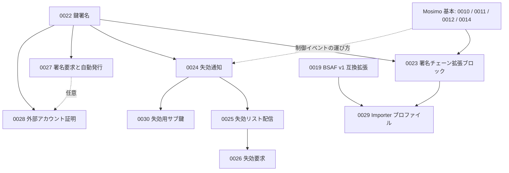
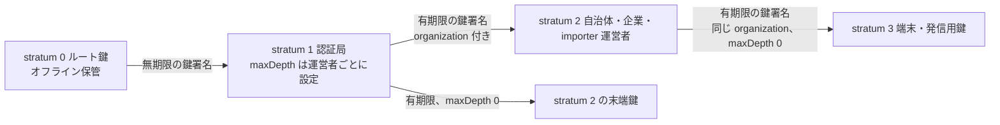
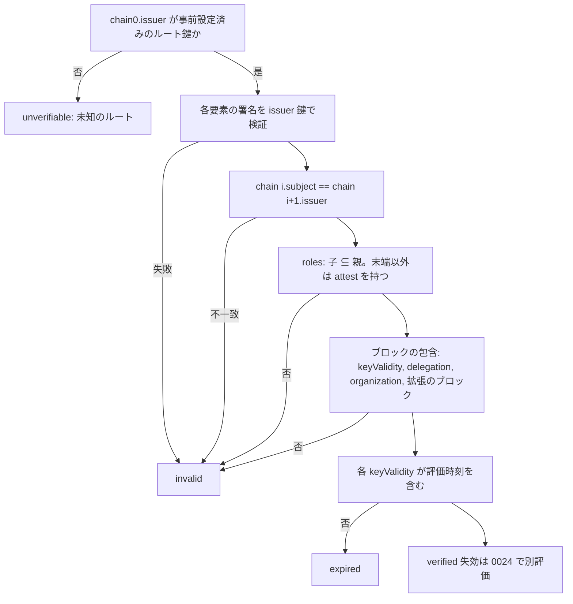
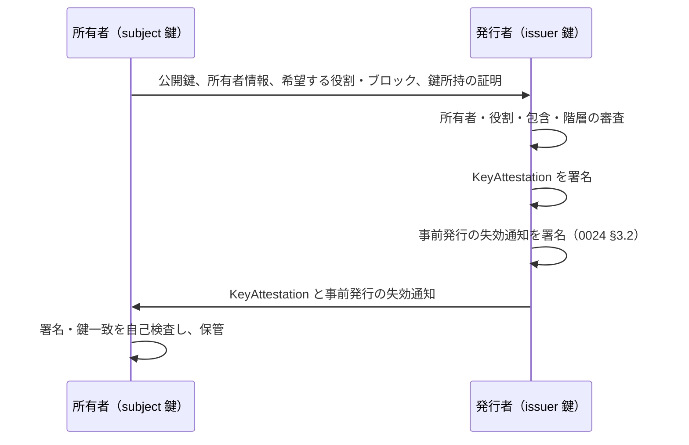

# 0022: 鍵署名（Key Attestation）

状態: draft-01 — 発信者証明拡張群の基盤。本書の型は提案であり、正式 Lexicon・相互運用試験の完了を意味しない。本書は [0009](0009-identity-attestations.md) の信頼モデルを具体化し、[0020](0020-wire-v1.md) の BSAF importer 専用証明書を置き換える。

## 要旨

ある鍵が別の鍵の所有者と役割に署名する「鍵署名」の形式、鍵の階層（stratum）、および事前に信頼したルート鍵からの署名チェーンをオフラインで検証する規則を定義する。本書は Mosimo の投稿やネットワークに依存せず、単独で運用できる。投稿への同梱は [0023](0023-attestation-chain-extension.md)、失効は [0024](0024-revocation-notice.md) 以降、importer は [0029](0029-importer-profile.md) が本書の拡張として定義する。

## 1. 位置付けと拡張群の構成

発信者証明拡張群は、Mosimo Protocol に対する拡張プロトコルである。基本投稿の表示・中継は本群に依存しない。



| 文書 | 前提 | 単独で運用できる範囲 |
|---|---|---|
| 0022 鍵署名 | なし（共通符号化のみ） | 鍵の発行・チェーン検証。失効なし |
| 0023 署名チェーン拡張ブロック | 0022、Mosimo 基本 | 投稿への同梱と発信者の確認 |
| 0024 失効通知 | 0022 | 失効通知の生成・検証。配送経路は問わない |
| 0025 失効リスト配信 | 0024 | 認証局のエンドポイントによる公開・購読・再掲 |
| 0026 失効要求 | 0025 | 所有者・第三者・他の認証局からの要求と認証局の判断 |
| 0027 署名要求と自動発行 | 0022 | 認証局の署名要求エンドポイント。NIP-05 プロファイル |
| 0028 外部アカウント証明 | 0022 | NIP-39 に基づく個人アカウントの証明プロファイル |
| 0029 Importer プロファイル | 0023、0019 | 外部情報を転載するサーバーの認証と、受信者の自動投入の認可 |
| 0030 失効用サブ鍵 | 0024 | 主鍵を失った所有者による事前発行形の活性化 |

各拡張は、前提文書が定める対象だけに意味を持つ。前提文書を実装しない受信者は、その拡張のオブジェクトを未知の型として保持・中継できるが、解釈済みとは扱わない。

## 2. 共通符号化と署名

符号化と署名は [0020 §2.1](0020-wire-v1.md#21-canonical-cbornode--kotlin--esp32-共通) の canonical CBOR と同一とし、一つの実装で両者を扱えるようにする。鍵と署名は hex 文字列ではなく `Bytes` で表す。

| 記法 | 定義 |
|---|---|
| `C(x)` | atproto deterministic CBOR。definite length、最短整数、map key は UTF-8 長さ昇順・辞書順 |
| `H(x)` | `SHA-256(C(x))` |
| `PublicKey` | `Bytes`。長さ 32 は BIP-340 x-only 公開鍵、長さ 33 は SEC1 compressed secp256k1 公開鍵（02/03 prefix）。他の長さは不正 |
| `Signature` | `Bytes`、64 バイト。署名者の鍵が 32 バイトなら BIP-340 Schnorr、33 バイトなら低 S の compact ECDSA。DER を拒否 |
| `Signed<T>` | `{ body: T, sig: Signature }`。`sig` は `H(body)` への署名 |
| `attestationId` 等 | `H(body)`。署名は ID に含めない |

長さで署名方式を決めるため、同じ曲線を使う Nostr 鍵（32 バイト）と atproto・PLC 鍵（33 バイト）の両方を、変換なしに署名者・被署名者にできる。鍵の長さと署名方式が一致しない署名は不正とする。

署名対象オブジェクトは `$type` を含む。これにより鍵署名・失効通知・失効要求の署名を同じ鍵で生成しても互いに流用できない。JSON で運ぶ場合、`Bytes` は [0012 §3.5](0012-bindings.md#35-独自タグのバイト列合意済み) の通常 Base64・padding なしとし、重複 key・不正 UTF-8・float を拒否してから `C(x)` を得る。JSON 自体は署名対象ではない。

## 3. 鍵署名の構造

```ts
type KeyAttestationBody = {
  $type: "dev.oriom.mosimo.attest#keyAttestation";
  issuer: PublicKey;          // 署名する鍵
  subject: PublicKey;         // 署名される鍵
  owner: Owner;               // subject の所有者（運用者）
  roles: Text[];              // subject が行使または付与できる役割
  blocks: Block[];            // 任意の追加ブロック（open union）
};
type Owner = { id: Text; name: Text };
type Block = { $type: string; [field: string]: DataValue };
type KeyAttestation = Signed<KeyAttestationBody>;
```

- `owner` は鍵を運用する主体である。`owner.id` は発行者の名前空間で安定した不透明 ID で、完全一致で比較する。`owner.name` は表示専用であり、同一性判定に使わない。鍵が代表する組織は `owner` ではなく §3.2 の `organization` ブロックで表す。
- `roles` は UTF-8 辞書順・重複なしの文字列配列である。値は §3.1 の登録値と、各拡張が定義する値を用いる。
- `blocks` は `$type` 付きオブジェクトの配列であり、[0011 §2](0011-extensions.md#2-共通構造合意済み) と同じ open union である。同じ `$type` のブロックを複数持たせない。未知のブロックは保持し、§6 の包含判定には参加させない。
- `issuer == subject` の自己署名はチェーンの要素として不正とする。

### 3.1 役割

役割は 0020 の `role` に相当し、鍵が何をしてよいかを表す。子の `roles` は親の `roles` の部分集合でなければならない。したがって認証局は、自身が行使しない役割であっても、付与するためには保持する。

| 役割 | 意味 | 定義 |
|---|---|---|
| `attest` | 他の鍵に鍵署名を発行できる。§3.2 の `delegation` と併用する | 本書 |
| `identity` | 組織または所有者の発信として表示してよい | [0023 §4.1](0023-attestation-chain-extension.md#41-役割と投稿の扱い) |
| `public-information` | 当該組織の公的情報の更新・取消による旧版の拡散停止を認可できる | [0009 §5.1](0009-identity-attestations.md#51-公的情報の更新取消の認可合意済み)、0023 §4.1 |
| `import` | 外部情報を転載し、受信者の自動投入の対象になれる | [0029](0029-importer-profile.md) |

受信者は自分が解釈できる役割だけを扱い、未知の役割は保持する。ワイルドカードは定義しない。

### 3.2 追加ブロック

| `$type` | フィールド | 省略時 | 包含規則（§6.2） |
|---|---|---|---|
| `dev.oriom.mosimo.attest#keyValidity` | `notBefore?: Timestamp`、`notAfter?: Timestamp` | 無期限。§4 の制約に従う | 子の期間は親の期間に含まれる |
| `dev.oriom.mosimo.attest#delegation` | `maxDepth: integer` | `0`。subject は他の鍵を署名できない | 子は親より小さい |
| `dev.oriom.mosimo.attest#organization` | `orgId: Text`、`orgName: Text` | 鍵は特定の組織を代表しない | 親にあれば子の `orgId` は親と同じ |
| `dev.oriom.mosimo.attest#issuerDomain` | `domain: Text` | 発行者はエンドポイントを持たない | なし |
| `dev.oriom.mosimo.attest#subjectDomain` | `domain: Text`、`method: Text` | 所有者のドメインは未確認 | なし |
| `dev.oriom.mosimo.attest#trustLevel` | `level: integer`、`method?: Text` | 信頼度の表明なし | なし |
| `dev.oriom.mosimo.attest#revocationKey` | `key: PublicKey` | 主鍵なしの失効はできない | なし。[0030](0030-revocation-subkey.md) |

- `keyValidity` の境界は `notBefore <= t < notAfter`。`Timestamp` は [0010 §3.1](0010-core.md#31-共通時刻型合意済み) に従い、秒精度を推奨する。有効期間の上限は定めない。子の期間は親に含まれなければならないため、親より長い鍵は発行できず、上限は階層を下るごとに自然に定まる。
- `delegation.maxDepth` は subject の下に作れる鍵の階層数である。`0` は末端、`1` は末端だけを署名できる認証局を表す。チェーン長の上限は定めず、ルート鍵の運用者が各認証局の目的に応じて設定する。
- `organization` は鍵が代表する組織である。`orgId` は発行者の名前空間で安定した不透明 ID、`orgName` は表示名である。`identity` 役割の表示では、このブロックがあれば `orgName` を、なければ `owner.name` を用いる。
- `issuerDomain.domain` は発行者が運用するエンドポイントの発見に用いる（§3.3）。小文字の正規化済み DNS 名とし、URL・パス・ポートを含めない。
- `subjectDomain.method` は所有者のドメイン確認の方法で、初期値は `nip05`（[0027 §4](0027-signing-request.md#4-nip-05-ドメイン検証プロファイル)）と `manual`。
- `trustLevel.level` は発行者が所有者の確認過程について表明する序数で、§5 に定める。独立した拡張として切り出してもよい任意のブロックである。

ブロックは発行者の表明であり、受信者が検証できるのは署名とチェーン上の整合性だけである。各拡張は独自のブロックと包含規則を追加できる（例: [0029 §2](0029-importer-profile.md#2-役割とブロック) の `importScope`）。

### 3.3 ドメインとエンドポイントの発見

`issuerDomain.domain` を `D` とすると、発行者のエンドポイントは `https://D/.well-known/mosimo/attest/` 以下に置く。個別のパスは各拡張が定める（[0025 §1](0025-revocation-list-endpoint.md#1-エンドポイント)、[0026 §2](0026-revocation-request.md#2-エンドポイント)、[0027 §2](0027-signing-request.md#2-エンドポイント)）。全エンドポイントに共通して、HTTPS のみとし、redirect を追わず、応答サイズと時間に上限を設け、本文は `application/cbor` の canonical CBOR を基本とし `application/json` を任意とする。ドメインは発見のためだけに使い、ドメインの所有や TLS の成立を鍵の信頼に代用しない。

## 4. 階層（stratum）

stratum は信頼の起点からの距離であり、鍵署名に符号化せずチェーン上の位置から導く。



| stratum | 保管 | `keyValidity` | `delegation` |
|---|---|---|---|
| 0 ルート鍵 | 完全にオフライン。耐タンパ性のあるハードウェアを推奨 | 受信者のローカル設定で扱う | ローカル設定の上限 |
| 1 認証局 | オンラインでよい | 省略できる（無期限）。発行者がルート鍵の場合に限る | 運営者に応じて設定 |
| 2 以降 | 所有者の運用に従う | `notAfter` を必須とする | 親より小さい値 |

ルート鍵は複数存在してよい。受信者はアプリ・運用者設定として、信頼するルート鍵ごとに公開鍵・認める `roles`・認める `maxDepth` を事前に保持し、どのルートを信頼するかを自分で決める（[0009 §2](0009-identity-attestations.md#2-信頼の起点)）。受信データからルートを追加しない。ルート鍵の失効は本書で定義せず、ルート鍵の入れ替えはアプリ・OS の更新等の帯域外の手段で行う。

stratum 1 を無期限とするのは、ルート鍵をオンライン操作から切り離すためである。stratum 1 の鍵の無効化は失効通知（0024）だけで行う。stratum 2 以降に期限を必須とするのは、失効通知が届かない受信者に対する被害の上限を定めるためである。

## 5. 信頼度

`trustLevel.level` は所有者の確認過程の強さを表す序数で、内容の真実性や鍵の安全性を意味しない。

| level | 確認過程 | 例 |
|---|---|---|
| 0 | 鍵の所持のみ | 自動発行で他の確認なし |
| 1 | 自動化された外部検証 | NIP-05 のドメイン検証、NIP-39 のアカウント検証 |
| 2 | 発行者による手動確認 | 書類・既知の連絡先による確認 |
| 3 | 対面または法的根拠に基づく確認 | 公的機関への発行 |

どの確認過程をどの段階に置くかは認証局の方針とする。受信者は、チェーン上の各信頼度をそのまま加算・平均せず、末端の信頼度と、それを表明した発行者がどの信頼度で証明されているかを併せて示す。全アプリ共通の信頼順位は定めない（[0009 §5](0009-identity-attestations.md#5-label-と信頼判断)）。

## 6. チェーンの検証

チェーンは、信頼するルート鍵が署名した鍵署名から末端の鍵署名へ並べた配列である。



### 6.1 時刻

評価時刻 `t` は検証対象に応じて決める。投稿の発信者確認では投稿の作成時刻を用い、受信者が信頼できる時計を持つ場合は現在時刻での有効性も別状態として求める（[0023 §4](0023-attestation-chain-extension.md#4-検証)）。時計を確信できない受信者は `keyValidity` の判定を unknown とし、verified と表示しない。これは [0009 §6](0009-identity-attestations.md#6-オフライン時と未決事項) の状態区分に従う。

### 6.2 役割とブロックの包含

- `chain[i].roles ⊆ chain[i-1].roles`。`chain[-1]` はルート鍵のローカル設定とする。末端以外の全要素は `attest` を持つ。
- `keyValidity`: 子の `notBefore` は親の `notBefore` 以上、子の `notAfter` は親の `notAfter` 以下。親が無期限なら子に制約を課さない。
- `delegation`: `d_i <= d_{i-1} - 1`（省略は 0、`d_{-1}` はローカル設定）。末端以外は `d_i >= 1`。
- `organization`: 親にあれば、子にも同じ `orgId` のブロックが必要。親になければ子は任意。
- 拡張が定義するブロックは、その拡張の包含規則に従う。受信者が解釈しないブロックは判定に参加せず、そのブロックに依存する役割を認めない。

### 6.3 結果の状態

検証結果は少なくとも `verified`・`expired`・`invalid`・`unverifiable`・`unknown-time` を区別し、失効の状態は [0024 §6](0024-revocation-notice.md#6-受信者の状態) の値を併記する。`verified` は署名・役割・包含・期間の検証を意味し、失効していないことの保証ではない。

## 7. 発行



- 発行者は subject 鍵の所持を確認する。確認方法は発行者の方針とし、[0027 §3](0027-signing-request.md#3-署名要求) が自動発行向けの一方式を定める。
- 発行者は発行内容を永続記録する。同じ subject へ複数の鍵署名を発行してよく、別の認証局が同じ鍵に鍵署名を発行してもよい。受信者は提示されたチェーンをそれぞれ独立に検証する。
- [0024](0024-revocation-notice.md) を実装する発行者は、鍵署名と同時に事前発行の失効通知を渡す。これは所有者がオフラインでも自己の鍵を失効させるためである。
- オンラインの発行 API は必須ではない。オフライン発行とファイルの受け渡しでよい。

## 8. 資源上限

`C(KeyAttestation)` は 4,096 バイト以下、`owner.id`・`owner.name`・`orgId`・`orgName`・各 `Text` は 256 UTF-8 バイト以下、`roles` は 32 要素以下、`blocks` は 16 要素以下を推奨する。超過をどう扱うかは各拡張の資源上限に従い、途中を削って受理しない。

## 9. 参照

- [0009: 署名チェーンによる発信者の身元証明](0009-identity-attestations.md)
- [0020: Experimental wire-v1 §2](0020-wire-v1.md)（共通符号化の原典）
- [BIP-340 Schnorr Signatures for secp256k1](https://github.com/bitcoin/bips/blob/master/bip-0340.mediawiki)
- [atproto Data Model — deterministic CBOR](https://atproto.com/specs/data-model)
