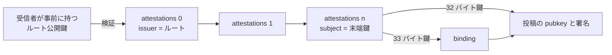

# 0023: 署名チェーン拡張ブロック

状態: draft-01 — [0022](0022-key-attestation.md) の鍵署名チェーンを Mosimo 投稿に同梱する拡張。型は提案であり、正式 Lexicon ではない。0020 の `identity` 拡張を置き換える。

## 要旨

投稿の著者鍵が、受信者の信頼するルート鍵からどの鍵署名を経て証明されているかを、投稿自身の `extensions` に載せる。受信者は投稿とチェーンだけでオフラインに発信者を確認できる。本書は [0011](0011-extensions.md) の拡張ブロック、[0012](0012-bindings.md) の運び方、[0014](0014-namespaces.md) の名前を前提とし、失効の評価は [0024](0024-revocation-notice.md) に委ねる。

## 1. 構造

```ts
type AttestationChainExtension = {
  $type: "dev.oriom.mosimo.attest#chain";
  attestations: KeyAttestation[];   // ルート直下 → 末端。0022 §6 の順序
  binding?: Binding;                // 末端鍵が 33 バイト鍵のときに必須。0020 §4 と同一形式
};
```

- 末端の `subject` が 32 バイト鍵なら、投稿の Nostr `pubkey` と一致しなければならない。`binding` は置かない。
- 末端の `subject` が 33 バイト鍵なら、それは著者の atproto リポジトリ署名鍵であり、[0020 §4](0020-wire-v1.md#4-reciprocal-binding--既存-android-との互換性) の相互署名 `binding` を通じて Nostr `pubkey` へ接続する。`binding.declaration.atprotoPubkey` と末端 `subject`、`binding.declaration.nostrPubkey` と `pubkey`、`binding.declaration.did` と commit の DID を一致させ、両署名を検証する。
- 一つの投稿に本拡張を複数置いてよい。異なるルートに至るチェーンを提示する場合に用い、各要素は独立に検証する。中継者は要素を統合・並べ替え・削除しない。
- チェーンは著者の署名対象であり、中継者やリレーが付け足さない。



## 2. 運び方

Nostr では [0012 §3.2.1](0012-bindings.md#321-自己完結した拡張タグ合意済み) の自己完結タグとする。

```text
["mosimo.oriom.dev:ext:dev.oriom.mosimo.attest#chain", B64(C({attestations, binding}))]
```

atproto レコードでは `extensions` の要素として同じオブジェクトを置く。メッシュ符号化 v1 では共通接頭辞の規則でタグ値が `bstr` になり、追加の対応表は不要である。拡張全体の `C` は 16,384 バイト以下を推奨し、超過時に要素を削って収めない。

## 3. 省略時と未対応時

本拡張がない、未対応、または検証できない投稿は「発信者未確認」として扱い、通常の本文表示・著者署名の検証・中継を妨げない（[0011 §8](0011-extensions.md#8-身元証明-identity)）。未対応の端末は未知拡張として保持・中継する。

## 4. 検証

受信者は投稿ごとに次を行い、結果と最初に観測した時刻を投稿に紐付けて保持する。

| 手順 | 内容 | 失敗時の状態 |
|---|---|---|
| 1 | 投稿の Nostr 署名と基本タグを検証（[0012](0012-bindings.md)） | 投稿自体が不正 |
| 2 | 末端鍵と `pubkey` の対応（§1）。`binding` があれば両署名 | `invalid` |
| 3 | [0022 §6](0022-key-attestation.md#6-チェーンの検証) のチェーン検証。評価時刻 `t` は投稿の `created_at` | `invalid` / `expired` / `unverifiable` |
| 4 | 受信者が信頼できる時計を持つ場合、現在時刻でも `keyValidity` を評価 | `expired-now` を併記 |
| 5 | [0024 §6](0024-revocation-notice.md#6-受信者の状態) の失効状態を、チェーン上の全鍵について評価 | `revoked` / `unknown` |
| 6 | 末端の `roles` から、投稿に認められる扱いを決める | 該当する扱いだけを無効化 |

手順 3 は投稿の作成時刻で評価する。発信者が数週間オフラインでも、作成時に有効だった鍵署名は作成時刻において有効であり、受信者はそれを確認できる。手順 4 は「現在も有効な発信者か」という別の問いであり、両者を同じ状態として表示しない。

### 4.1 役割と投稿の扱い

| 末端の `roles` | 認められる扱い |
|---|---|
| `identity` | 発信者名として、`organization.orgName`（なければ `owner.name`）を `trustLevel` と確認状態を添えて表示する |
| `public-information` | 組織が自らの名で公的情報を発信する。訂正・取消の対象が、同じ `organization.orgId` を持つ検証済みチェーンの投稿であるとき、旧版の拡散停止を認可する（[0009 §5.1](0009-identity-attestations.md#51-公的情報の更新取消の認可合意済み)）。`organization` のない鍵には認めない。範囲のブロックは持たない。取り込んだ公的情報の更新・取消は [0029 §4](0029-importer-profile.md#4-受信者の認可) に従う |
| `import` | [0029 §4](0029-importer-profile.md#4-受信者の認可) に従う |
| `attest` | 投稿には効果を持たない |

`identity` のない鍵の投稿を組織名や所有者名で表示しない。`public-information` のない鍵の訂正・取消は、主張として保持できるが他の投稿の拡散停止の根拠にしない。

### 4.2 失効と拡散

手順 5 で `revoked` となった投稿は、その受信者で新たな広告・転送の対象から外す。削除ではなく、既に保持した本文の表示は失効状態を添えて続けてよい。失効の判定には投稿の `created_at` と、受信者がその投稿を最初に観測した時刻の両方を用いる（[0024 §6](0024-revocation-notice.md#6-受信者の状態)）。

### 4.3 表示

表示は少なくとも次を区別する。

- 発信者確認済み（`verified`、失効なし、現在も有効）
- 作成時点で確認済み（`verified`、現在は期限切れまたは時計不明）
- 失効情報の確認時点（最後に失効情報を得た時刻。[0025 §5](0025-revocation-list-endpoint.md#5-クライアントと-mosimo-サーバーの確認) に従う）
- 失効（`revoked`）
- 未確認（拡張なし、未知のルート、検証失敗）

## 5. 参照

- [0022: 鍵署名](0022-key-attestation.md)
- [0024: 失効通知](0024-revocation-notice.md)
- [0029: Importer プロファイル](0029-importer-profile.md)
- [0011 §8](0011-extensions.md#8-身元証明-identity)、[0012 §3.2.1](0012-bindings.md#321-自己完結した拡張タグ合意済み)、[0014 §3.2](0014-namespaces.md#32-自己完結した拡張タグ)
