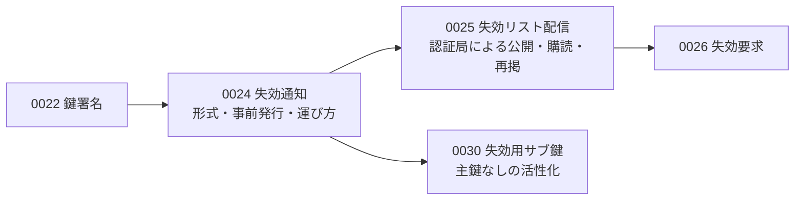
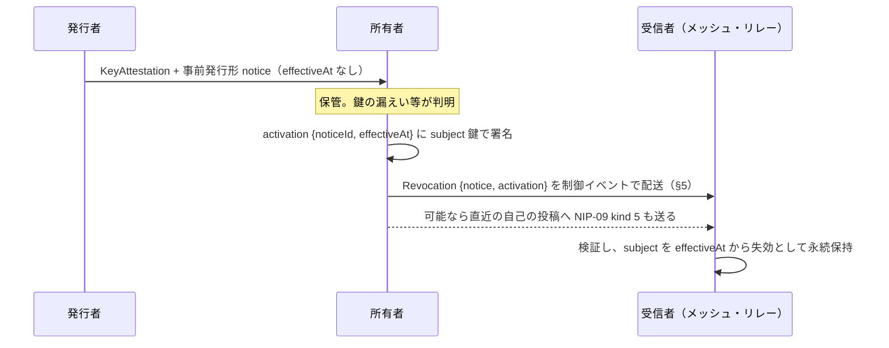

# 0024: 失効通知

状態: draft-01 — [0022](0022-key-attestation.md) の拡張。失効通知の形式、事前発行、制御イベントとしての運び方、受信者の状態を定義する。型は提案であり、正式 Lexicon ではない。

## 要旨

失効通知は「鍵 S を時刻 T から無効とする」という署名付きの永続的な事実である。定期的な「異常なし」の通知を前提とせず、失効が起きたときにだけ生成・配送する。したがって受信者はインターネットなしでも、手元に届いた通知だけで失効を適用でき、届いていない失効は未確認として扱う。この設計上の帰結と上限は §7 に述べる。

## 1. 位置付け



本書だけを実装する受信者は、通知が届く経路を問わず適用できる。認証局による公開と購読は 0025 が定める。

## 2. 構造

```ts
type RevocationNoticeBody = {
  $type: "dev.oriom.mosimo.attest#revocationNotice";
  issuer: PublicKey;         // 通知に署名する鍵。§3.1 の条件を満たすこと
  subject: PublicKey;        // 失効させる鍵
  issuedAt: Timestamp;       // 署名時刻
  effectiveAt?: Timestamp;   // 失効の効力開始。即時形では必須、事前発行形では省略
  blocks: Block[];           // 任意。#reason 等
};
type RevocationNotice = Signed<RevocationNoticeBody>;

type RevocationActivationBody = {
  $type: "dev.oriom.mosimo.attest#revocationActivation";
  noticeId: Bytes;           // H(notice.body)
  effectiveAt: Timestamp;
};
type RevocationActivation = Signed<RevocationActivationBody>;  // subject 鍵が署名（0030 では副鍵でもよい）

type Revocation = {
  $type: "dev.oriom.mosimo.attest#revocation";
  notice: RevocationNotice;
  activation?: RevocationActivation;   // 署名者は subject 鍵。0030 では副鍵でもよい
};
```

| `$type` | フィールド | 意味 |
|---|---|---|
| `dev.oriom.mosimo.attest#reason` | `code: Text`、`text?: Text` | `compromise`・`superseded`・`ceased`・`unspecified` を初期値とする |

`Revocation` が運搬・保存の単位である。`revocationId = H(notice.body)` とし、`activation` の有無で ID を変えない。

## 3. 二つの形式

| 形式 | `effectiveAt` | 成立条件 | 用途 |
|---|---|---|---|
| 即時形 | `notice.body` に必須 | `notice.sig` の検証 | 親が失効させる。失効要求への応答 |
| 事前発行形 | `notice.body` では省略、`activation.body` に必須 | `notice.sig` と、`subject` 鍵による `activation.sig` の検証。`activation.noticeId == H(notice.body)` | 所有者が自ら、親と通信せずに失効させる |

`effectiveAt` のない `notice` 単体は失効として適用しない。`activation` の `effectiveAt` は `notice.issuedAt` 以降でなければならない。

### 3.1 受信者が受け入れる通知

認証局は任意の鍵に対して通知を発行できる。しかし受信者は、評価中のチェーンにおいて `notice.issuer` が `subject` の祖先（ルート鍵、または `subject` より前の位置の `issuer`）であるか、`subject` 自身である場合にだけ、その通知をそのチェーンに適用する。チェーンの外にある鍵の通知は無視する。この判定は評価中のチェーンの鍵だけで行える。

ある鍵が複数の認証局から鍵署名を受けている場合、一つの認証局の通知はその認証局を含むチェーンにだけ効く。鍵を全ての経路で無効にしたい認証局は、他の認証局へ失効要求を送る（[0026 §3](0026-revocation-request.md#3-認証局の判断)）。自己署名の通知は `subject` を含む全てのチェーンに効く。

### 3.2 事前発行

発行者は鍵署名を発行するとき、同じ `subject` に対する事前発行形の `notice` を署名し、鍵署名と一緒に所有者へ渡す（[0022 §7](0022-key-attestation.md#7-発行)）。所有者はこれを鍵と別に保管し、必要になったとき `activation` を署名して `Revocation` を完成させる。親との通信は要らない。



所有者は、失効通知と併せて、失効させる鍵で署名した直近の投稿に対する NIP-09 の削除要求（`kind: 5`）を同じ鍵で発行することを推奨する。本群に未対応のリレー・クライアントも、削除要求には対応している可能性がある。

## 4. ルート鍵

ルート鍵の失効は本書で定義しない。ルート鍵の入れ替えは、HTTPS の信頼ストアと同様に、アプリ・OS の更新等の帯域外の手段で行う（[0022 §4](0022-key-attestation.md#4-階層stratum)）。

## 5. 制御イベントとしての運び方

`Revocation` は Mosimo の投稿ではなく、独立した制御イベントとして運ぶ。

| 項目 | 値 |
|---|---|
| Nostr `kind` | `9024` |
| `content` | 空文字列、または人が読める説明 |
| タグ | `["t", "mosimo.oriom.dev"]`、`["mosimo.oriom.dev:ext:dev.oriom.mosimo.attest#revocation", B64(C({notice, activation}))]`、`["mosimo.oriom.dev:delivery-expires-at", Timestamp]` |
| イベントの署名者 | 任意。運搬者の鍵でよい |
| 1 イベント | ちょうど 1 個の `Revocation` |

- 通知の真正性は内側の `notice.sig`・`activation.sig` で決まる。イベントの `pubkey` に意味を持たせず、運搬者の認証を通知の検証に代用しない。
- 配送期限は `subject` の `keyValidity.notAfter`、無期限の鍵では運搬者が決める。受信者は配送期限が過ぎても失効状態を消さない。
- 同じ `revocationId` の再送は捨てる。異なる運搬者による同じ通知の重複はこの規則で抑制され、イベント ID が違っても失効状態は一つである。
- メッシュでは [0012 §4](0012-bindings.md#4-メッシュ用-cbor合意済み) の 7 要素配列をそのまま使い、共通接頭辞の規則でタグ値が `bstr` になる。解釈できない端末も通常の制御イベントとして中継できる。
- 受信者は本イベントを、通常投稿より低くない優先度で中継することを推奨する。優先度の自己申告は置かない。
- `mosimo.oriom.dev:version` タグは付けない。版は拡張の `$type` で区別する。

## 6. 受信者の状態

受信者は検証済みの `Revocation` を `subject` ごとに永続保持し、状態の巻き戻しをしない。投稿ごとに最初に観測した時刻 `seenAt` を記録する。鍵 K について、チェーン評価時の失効状態は次のいずれかである。

| 状態 | 条件 |
|---|---|
| `revoked` | K またはその祖先に有効な通知があり、投稿の `created_at >= effectiveAt` または `seenAt >= effectiveAt` |
| `revoked-later` | 有効な通知があるが、`created_at < effectiveAt` かつ `seenAt < effectiveAt` |
| `not-revoked-as-known` | 手元の通知に該当なし。失効情報を最後に得た時刻を併記する（[0025 §5](0025-revocation-list-endpoint.md#5-クライアントと-mosimo-サーバーの確認)） |
| `unknown` | 通知の署名者の権限を判定できない等 |

`seenAt` を条件に含めるのは、失効した鍵の保持者が `created_at` を偽ることを防ぐためである。失効前に作成され配送が遅れた正当な投稿も `revoked` になるが、偽情報の拡散防止を優先する。`revoked-later` は、受信者が効力開始前に既に観測していた投稿だけに与えられる。

祖先の失効は子孫全体に及ぶため、子孫ごとの通知は要らない。認証局が自己の鍵の失効を子孫の鍵ごとに再発行しないことを推奨するのは、この性質による（[0025 §4](0025-revocation-list-endpoint.md#4-伝播の規則)）。

## 7. 設計上の帰結

- **届いた失効は即時に効く。** 通知は小さく自己検証可能で、リレー・メッシュ・人による持ち運びのどの経路でも同じ規則で適用できる。
- **届かない失効は検出できない。** 受信者は「失効していない」と「通知を受け取っていない」を区別できず、`not-revoked-as-known` はその限界を表す。被害の上限は `subject` の `keyValidity.notAfter` までであり、stratum 2 以降に期限を必須とするのはこのためである（[0022 §4](0022-key-attestation.md#4-階層stratum)）。
- **効力開始時刻は署名者の申告である。** 所有者は自己の鍵の失効を過去に遡らせることができ、親も同様である。受信者は `effectiveAt` をそのまま適用する。
- **事前発行形の活性化には subject 鍵が要る。** 鍵を失った所有者は、親認証局への失効要求（0026）か、[0030](0030-revocation-subkey.md) の副鍵による活性化に頼る。

## 8. 参照

- [0022: 鍵署名](0022-key-attestation.md)
- [0025: 失効リスト配信](0025-revocation-list-endpoint.md)
- [0012 §3.4 制御データ](0012-bindings.md#34-制御データ)、[0007 §2.1](0007-nostr-relay-profile.md#21-本文投稿と制御イベント)
- [NIP-09: Event Deletion Request](https://github.com/nostr-protocol/nips/blob/master/09.md)
