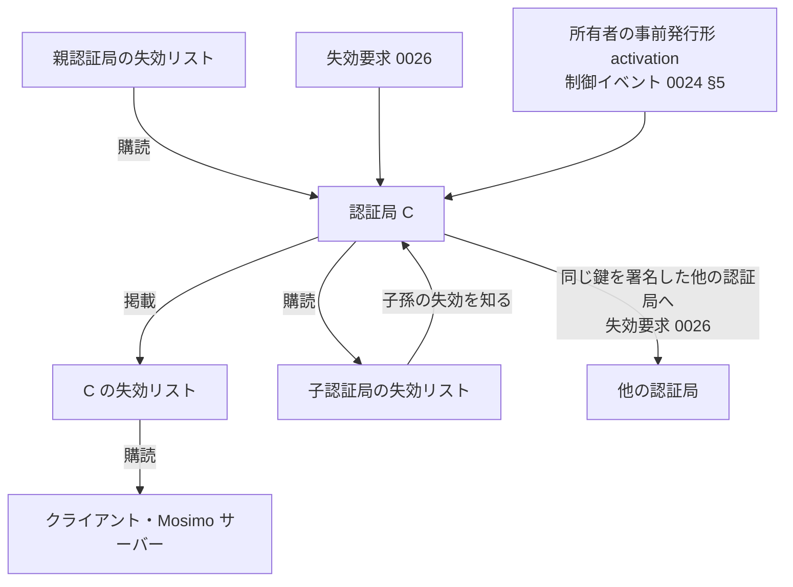

# 0025: 失効リスト配信

状態: draft-01 — [0024](0024-revocation-notice.md) の拡張。認証局が失効通知を HTTPS で公開・購読・再掲する方法と、クライアント・Mosimo サーバーがオンライン時に行う確認を定義する。

## 要旨

失効通知の配送経路のうち、認証局が自身のドメインで運用するエンドポイントを定める。通知自体の検証は 0024 に従い、エンドポイントの到達性や応答は失効の有無を保証しない。本書はインターネットに接続できる参加者の動作を追加するものであり、オフラインの受信者に新たな要件を課さない。

## 1. エンドポイント

鍵署名の `issuerDomain.domain` を `D` とする（[0022 §3.3](0022-key-attestation.md#33-ドメインとエンドポイントの発見)）。

| 用途 | URL | 定義 |
|---|---|---|
| 失効リスト | `https://D/.well-known/mosimo/attest/revocations` | 本書 |
| 失効要求 | `https://D/.well-known/mosimo/attest/revocation-requests` | [0026](0026-revocation-request.md) |
| 署名要求 | `https://D/.well-known/mosimo/attest/signing-requests` | [0027](0027-signing-request.md) |

ドメインの所有と鍵の対応はエンドポイントからではなく鍵署名から得る。

## 2. 失効リスト

```ts
type RevocationListBody = {
  $type: "dev.oriom.mosimo.attest#revocationList";
  publisher: PublicKey;        // この認証局の鍵
  generatedAt: Timestamp;
  revocations: Revocation[];   // 0024 §2
};
type RevocationList = Signed<RevocationListBody>;  // publisher 鍵が署名
```

- `GET` に `application/cbor` で `C(RevocationList)` を返す。`Accept: application/json` には [0022 §2](0022-key-attestation.md#2-共通符号化と署名) の規則で JSON を返してよい。
- `generatedAt` と `publisher` の署名は「この時点で認証局が公開していた集合」の表明であり、各通知の真正性は内側の署名で独立に検証する。リストの署名が検証できなくても、内側の有効な通知は適用してよい。
- 任意の `?since=<Timestamp>` で、`issuedAt` または `activation.effectiveAt` がそれ以降の通知だけを返してよい。`ETag` と `If-None-Match` の対応を推奨する。
- 既定の全量応答は 1 MiB 以下とし、超える場合は `since` の利用を求める応答を返す。古い通知を黙って落とさない。

## 3. 掲載する内容

| 内容 | 掲載 |
|---|---|
| 自身が発行した即時形の通知 | 必須 |
| 自身が発行した事前発行形の通知のうち、`activation` を受け取ったもの | 必須 |
| 親鍵が失効した通知を知った場合、その通知 | 必須 |
| 自身または子孫の鍵が他者（祖先）によって失効された通知を知った場合 | 必須 |
| 自身の子孫のそれぞれについて、祖先の失効を理由とする個別の通知 | 発行しないことを推奨 |

保持期間は `subject` の `keyValidity.notAfter` までとし、無期限の鍵の通知は恒久に保持する。

## 4. 伝播の規則



- 認証局は親の失効リストを購読するなどして、親鍵・自身・子孫の失効を知る。経路は HTTPS のほか、[0024 §5](0024-revocation-notice.md#5-制御イベントとしての運び方) の制御イベントの購読でもよい。
- 親鍵の失効を知った認証局は、その通知を自身のリストに掲載する。自身の鍵の失効通知を新たに発行しない。チェーン上、親の失効は自身と子孫に既に及んでいる。
- 自身または子孫の失効を知った認証局は、その通知を自身のリストに掲載する。
- 認証局が鍵を失効させたとき、同じ鍵に鍵署名を発行している他の認証局を知っていれば、自身の鍵で署名した失効要求をその認証局へ送ってよい（[0026 §3](0026-revocation-request.md#3-認証局の判断)）。受け入れるかは相手の認証局が決める。
- 認証局が自身の鍵を失効させる手順は次のとおり。
  1. 親認証局の失効要求エンドポイント（0026）へ、自身の鍵で署名した失効要求を送る。
  2. 失敗した場合、事前発行形の `notice` に `activation` を付け、制御イベントとして配送する。
  3. いずれの場合も、自身の失効リストに掲載する。

## 5. クライアントと Mosimo サーバーの確認

クライアント、PDS、Nostr リレーは、インターネットに接続できたとき次を行う。

1. 受け取った投稿のチェーンに含まれる `issuerDomain.domain` を収集する。同じドメインへの取得頻度は実装の方針で抑え、認証局側の資源制限に従う。
2. 各ドメインの失効リストを取得し、[0024](0024-revocation-notice.md) の規則で通知を検証して永続保持する。
3. 保持している投稿を再評価し、`revoked` となった投稿に失効フラグを立て、新たな広告・転送の対象から外す（[0023 §4.2](0023-attestation-chain-extension.md#42-失効と拡散)）。
4. 自身がメッシュや他リレーへ投稿を渡していた場合、該当する `Revocation` を [0024 §5](0024-revocation-notice.md#5-制御イベントとしての運び方) の制御イベントとして一度配送する。
5. ドメインごとに最終確認時刻を記録し、表示の「失効情報の確認時点」に用いる。

取得の失敗は最後の状態を保ち、失効とも未失効とも扱わない。失効リストが取得できないことを理由に投稿の表示・中継を止めない。

## 6. 認証局の運用要件

- エンドポイントの秘密鍵は認証局の鍵と同一でよいが、リストの署名以外に使わない。鍵署名の発行は別の環境でよい。
- 失効リストの改ざんは内側の署名で検出されるため、配布には CDN・ミラーを用いてよい。ミラーの URL を鍵署名に載せない。
- 認証局の鍵が失効した後も、そのドメインの失効リストは子孫の通知を提供し続けることを推奨する。

## 7. 参照

- [0024: 失効通知](0024-revocation-notice.md)
- [0026: 失効要求](0026-revocation-request.md)
- [RFC 8615: Well-Known URIs](https://www.rfc-editor.org/rfc/rfc8615)
