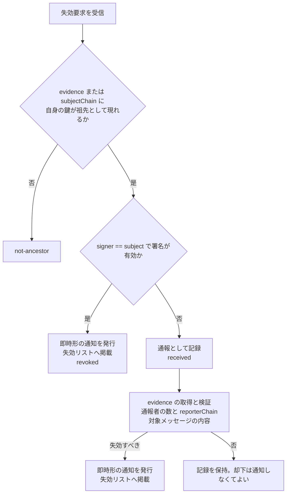

# 0026: 失効要求

状態: draft-01 — [0025](0025-revocation-list-endpoint.md) の拡張。所有者による自己の鍵の失効要求、第三者による通報、他の認証局からの要求の形式と、認証局の判断を定義する。

## 要旨

失効要求は、認証局に対して特定の鍵の失効を求める入力である。対象鍵自身が署名した要求は即時に失効へつながり、それ以外の署名または無署名の要求は通報として認証局の判断に委ねる。要求はエンドポイントへの送信であり、要求が受理されただけでは失効は成立しない。失効の成立は [0024](0024-revocation-notice.md) の通知の発行である。

## 1. 構造

```ts
type RevocationRequestBody = {
  $type: "dev.oriom.mosimo.attest#revocationRequest";
  subject: PublicKey;          // 失効を求める鍵
  requestedAt: Timestamp;
  blocks: Block[];             // 任意
};
type RevocationRequest = {
  body: RevocationRequestBody;
  signer?: PublicKey;          // 署名者。省略時は無署名
  sig?: Signature;             // signer 鍵による H(body) への署名
};
```

| `$type` | フィールド | 意味 |
|---|---|---|
| `dev.oriom.mosimo.attest#reason` | [0024 §2](0024-revocation-notice.md#2-構造) と同じ | 要求の理由 |
| `dev.oriom.mosimo.attest#evidence` | `events: NostrEventId[]`、`uris?: AtUri[]` | 通報対象のメッセージ。メッセージには対象鍵のチェーンが同梱されている |
| `dev.oriom.mosimo.attest#subjectChain` | `attestations: KeyAttestation[]` | 対象鍵のチェーン。`evidence` を伴わない要求で、認証局が自身の位置を判断するために付ける |
| `dev.oriom.mosimo.attest#reporterChain` | `attestations: KeyAttestation[]` | `signer` のチェーン。通報者または要求元の認証局の身元の重み付けに用いる |

`evidence.events` は 64 件以下、`C(RevocationRequest)` は 16,384 バイト以下とする。

## 2. エンドポイント

`POST https://D/.well-known/mosimo/attest/revocation-requests` に `application/cbor` で `C(RevocationRequest)` を送る。応答は次の構造とする。

```ts
type RevocationRequestResponse = {
  $type: "dev.oriom.mosimo.attest#revocationRequestResponse";
  status: "revoked" | "received" | "rejected" | "not-ancestor";
  revocationId?: Bytes;        // revoked のとき
  text?: Text;
};
```

| `status` | 意味 |
|---|---|
| `revoked` | 即時形の通知を発行し、失効リストに掲載した |
| `received` | 通報として記録した。判断は後続 |
| `rejected` | 形式不正、資源上限、重複、または判断の結果として却下 |
| `not-ancestor` | 提示されたチェーンに自身の鍵が祖先として現れない。送信元は正しい祖先のドメインへ送る |

認証局は、送信元ごと・`subject` ごとの受付数と頻度に上限を設ける。無署名の要求はより低い上限でよい。

## 3. 認証局の判断



- 認証局は、`evidence` のメッセージに同梱されたチェーン、または `subjectChain` から、自身が `subject` の祖先であるかを判断する。発行記録の照合は補助であり、子認証局の記録を持たなくてよい。祖先であれば、直接の発行者でなくても失効させられる（[0024 §3.1](0024-revocation-notice.md#31-受信者が受け入れる通知)）。
- `signer == subject` の要求は所有者本人の意思表示であり、審査なしに失効させる。所有者はこれにより、事前発行形の `activation` を配送する前に認証局経由の失効を試みられる（[0025 §4](0025-revocation-list-endpoint.md#4-伝播の規則)）。
- `signer` が他の認証局の鍵で、`reporterChain` によりその認証局が `subject` に鍵署名を発行していると確認できる場合、その認証局が既に当該鍵を失効させた旨の要求として扱う。受け入れるかは受信した認証局が決める。
- その他の署名または無署名の要求は、`evidence` のメッセージを取得し、それが `subject` 鍵で署名されていることと内容を確認する。確認できない証拠は重みを持たない。独立した通報者の数と、`reporterChain` が検証できる通報者の信頼度を判断材料とする。基準は認証局の方針とする。
- 判断の結果として失効させる場合、通知の `effectiveAt` は認証局が定める。最初の問題メッセージの時刻まで遡らせてよい。

## 4. 通報者への配慮

通報者の鍵・署名は認証局の記録に残り、公開はしない。失効通知には通報者の情報を含めない。認証局は通報の有無・内容を `subject` の所有者に開示する義務を持たず、開示する場合も通報者を特定できる情報を除く。

## 5. 参照

- [0024: 失効通知](0024-revocation-notice.md)
- [0025: 失効リスト配信](0025-revocation-list-endpoint.md)
