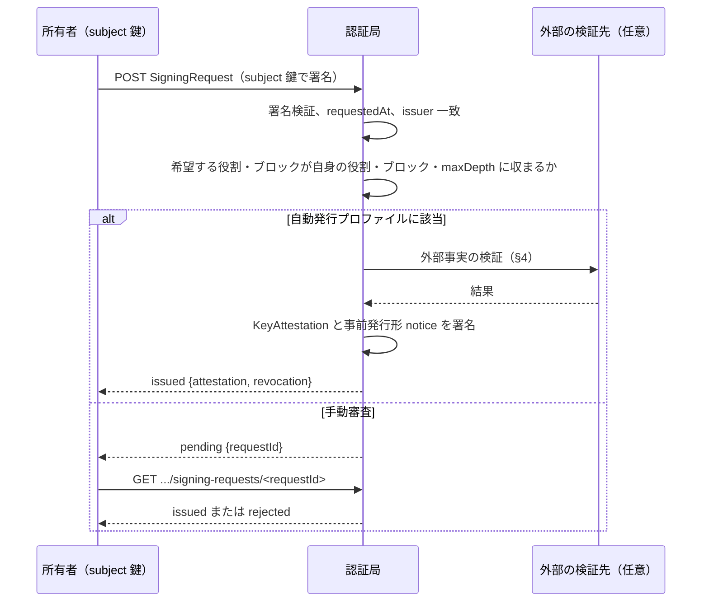

# 0027: 署名要求と自動発行

状態: draft-01 — [0022](0022-key-attestation.md) の拡張。認証局の署名要求エンドポイント、鍵所持の証明、自動発行の条件、NIP-05 によるドメイン検証プロファイルを定義する。エンドポイントは任意であり、オフライン発行だけの認証局は本書を実装しなくてよい。

## 要旨

鍵の所有者が認証局に鍵署名を要求する手順を定める。要求は所有者の鍵で署名し、鍵の所持を示す。認証局は方針に応じて自動または手動で審査し、鍵署名と事前発行形の失効通知（[0024 §3.2](0024-revocation-notice.md#32-事前発行)）を返す。自動発行は検証できる外部事実に限って行い、その旨を `trustLevel` に表す。

## 1. 構造

```ts
type SigningRequestBody = {
  $type: "dev.oriom.mosimo.attest#signingRequest";
  issuer: PublicKey;           // 宛先の認証局の鍵
  subject: PublicKey;          // 署名を求める鍵
  owner: Owner;                // 希望する所有者情報
  roles: Text[];               // 希望する役割
  blocks: Block[];             // 希望する追加ブロックと検証材料
  requestedAt: Timestamp;
};
type SigningRequest = Signed<SigningRequestBody>;   // subject 鍵が署名

type SigningRequestResponse = {
  $type: "dev.oriom.mosimo.attest#signingRequestResponse";
  status: "issued" | "pending" | "rejected";
  requestId?: Bytes;           // pending のとき。H(request.body)
  attestation?: KeyAttestation;
  revocation?: RevocationNotice;   // 事前発行形
  text?: Text;
};
```

`issuer` を含めるのは、同じ要求を別の認証局へ転用できないようにするためである。`requestedAt` から一定時間（24 時間を推奨）を過ぎた要求は受け付けない。

## 2. エンドポイント

| 操作 | URL | 内容 |
|---|---|---|
| 要求 | `POST https://D/.well-known/mosimo/attest/signing-requests` | `C(SigningRequest)` を送り、`SigningRequestResponse` を受ける |
| 状態照会 | `GET https://D/.well-known/mosimo/attest/signing-requests/<hex(requestId)>` | `pending` の要求の現在の `SigningRequestResponse` |

HTTP 共通規約は [0022 §3.3](0022-key-attestation.md#33-ドメインとエンドポイントの発見) に従う。認証局は送信元ごとの受付数に上限を設ける。

## 3. 署名要求



- 要求の署名は `subject` 鍵の所持の証明である。認証局は別のチャレンジ応答を追加してよい。
- 認証局は要求の `owner`・`roles`・`blocks` をそのまま採用する義務を持たない。縮小して発行してよく、拡大してはならない。発行内容は応答の `attestation` が正本である。
- 手動審査で発行した鍵署名は、確認過程に応じて `trustLevel` 2 以上を表明できる。自動発行は 1 以下とする。

## 4. NIP-05 ドメイン検証プロファイル

企業等が自身のドメインで管理する Nostr 鍵に、簡易な鍵署名を自動発行するためのプロファイルである。

| 項目 | 内容 |
|---|---|
| 要求 | `subject` は 32 バイト鍵。`blocks` に `subjectDomain { domain, method: "nip05" }` と `nip05 { name: Text }` を含める。`name` は `<local-part>@<domain>` または `_@<domain>` |
| 検証 | 認証局が `https://<domain>/.well-known/nostr.json?name=<local-part>` を取得し、`names[<local-part>]` が `hex(subject)` に一致することを確認する。redirect を追わず、サイズ・時間を制限する |
| 発行 | `owner.id = "nip05:" + name`、`owner.name` は要求値、`roles = ["identity"]`、`delegation` なし、`organization` なし、`subjectDomain { domain, method: "nip05" }`、`trustLevel { level: 1, method: "nip05" }`、`keyValidity.notAfter` は認証局の方針 |

```ts
type Nip05Block = { $type: "dev.oriom.mosimo.attest#nip05"; name: Text };
```

このプロファイルで確認できるのは「そのドメインの `nostr.json` が、その時点でこの鍵を名乗らせていた」ことである。ドメインの所有者の実体、`public-information` の権限、再委任は与えない。`_@<domain>` はドメイン自体を所有者名とする。更新時は再検証する。

## 5. 手動審査プロファイル

公的機関・自治体など `trustLevel` 2 以上を要する発行は手動審査とする。確認の方法は認証局の方針であり、本書は少なくとも次を記録することを求める。

- 確認した資料・連絡先の種別と確認日
- 発行した鍵署名の `attestationId` と事前発行形 `notice` の `revocationId`
- 所有者へ渡した事前発行形 `notice` の保管方法についての案内

## 6. 参照

- [0022: 鍵署名](0022-key-attestation.md)
- [0024 §3.2 事前発行](0024-revocation-notice.md#32-事前発行)
- [NIP-05: Mapping Nostr keys to DNS-based internet identifiers](https://github.com/nostr-protocol/nips/blob/master/05.md)
