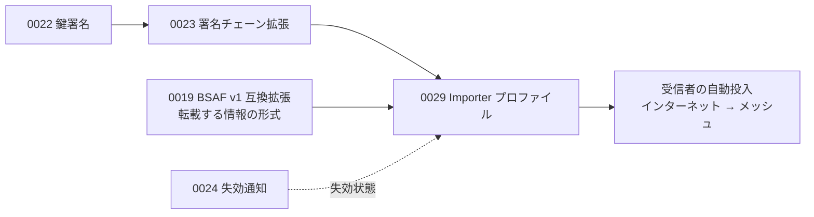
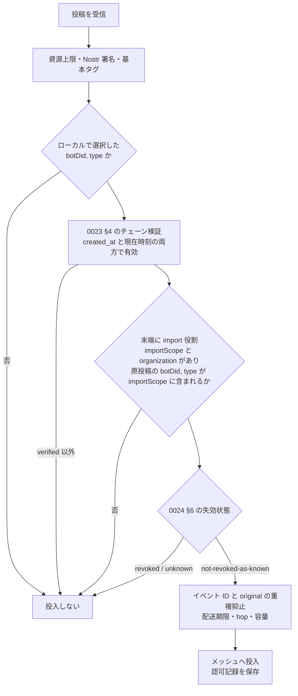

# 0029: Importer プロファイル

状態: draft-00 — [0023](0023-attestation-chain-extension.md) と [0019](0019-bsaf.md) の拡張。外部情報を転載するサーバー（importer）の鍵署名に要求するブロックと、受信者がインターネットからメッシュへ自動投入する際の認可を定義する。[0020](0020-wire-v1.md) の certificate・snapshot・receiver 認可を置き換える。

## 要旨

importer は、他者が発表した情報を取得し、自身の鍵で署名し直して Mosimo の投稿として流すサーバーである。importer の署名は転載の証言であって原発表者の署名ではない。本書は、鍵署名の `import` 役割と `importScope`・`organization` ブロックによって「誰が、どの情報源を転載してよいか」を表し、受信者がそれとローカルの選択に基づいて自動投入を認可する規則を定める。転載する情報の形式は本書の対象外であり、BSAF は 0019 が定める。

## 1. 位置付け



0020 で一つの文書にあった要素は次のように分かれる。

| 0020 の要素 | 本群での所在 |
|---|---|
| certificate、role、scope、orgId/orgName、期間 | 0022 の鍵署名、`import` 役割、本書 §2 のブロック |
| binding と identity 拡張 | 0023 |
| root-signed trust snapshot と鮮度要求 | 廃止。0024 の失効通知と 0025 の失効リスト |
| receiver の認可アルゴリズム、ローカル選択、重複抑止 | 本書 §4 |
| bsafV1 と original | 0019 |
| priority 拡張 | [0011 §10](0011-extensions.md#10-配送優先度ヒント-priority) |
| MOSIMO-REQ と NIP-11 | [0007 §6](0007-nostr-relay-profile.md#6-priority-順の-opt-in-取得) |

## 2. 役割とブロック

importer の末端鍵署名は、`roles` に `import` を持ち、次の二つのブロックを持たなければならない。どちらかが欠けるか、包含を満たさない場合、受信者は認可しない。

```ts
type ImportScopeBlock = {
  $type: "dev.oriom.mosimo.attest#importScope";
  sources: ImportSource[];     // botDid の UTF-8 辞書順、重複なし
};
type ImportSource = {
  botDid: Did;                 // 原投稿の著者 DID
  types: Text[];               // 情報種別。0019 の `type:` タグの値。辞書順、重複なし
};
```

| ブロック | 意味 | 包含規則 |
|---|---|---|
| `importScope` | 転載してよい `(botDid, type)` の組 | 子の各組は親の組に含まれる。親にブロックがなければ、親が `import` 役割を持つ限り任意 |
| `organization`（[0022 §3.2](0022-key-attestation.md#32-追加ブロック)） | importer を運営する組織 | 0022 の規則 |

- `owner` は importer の運営者を表す。認可に通った投稿の発信者表示には `organization.orgName` を用い、`owner.name` で代用しない。
- `botDid` は `did:plc:[a-z2-7]{24}`。`types` は `type:` 接頭辞を除いた原値で、`*` はリテラルである。
- importer の鍵は 32 バイトの Nostr 鍵を推奨する。転載は Nostr 専用であり（§3）、atproto 鍵と `binding` を要しない。
- 認証局は importer に `attest` を与えない。importer が他の鍵を署名する構成は本書の対象外である。

## 3. 投稿

認可の対象となる転載投稿は、[0010](0010-core.md) の通常投稿に次を含める。

| 拡張 | 個数 | 内容 |
|---|---|---|
| `attest#chain`（0023） | 1 以上 | 末端が importer 鍵 |
| `bsafV1`（0019） | ちょうど 1 | `original` 必須。原投稿の URI・CID・作成時刻 |
| `priority`（0011 §10） | 0 または 1 | 著者ヒント |

- 本文は原レコードの `text` と一致させ、説明を追記しない。
- `bsafV1.original` を持つ転載は Nostr 専用とし、PDS の atproto 公開・リポジトリ公開・firehose へ投入しない。
- importer は `(original.uri, original.cid)` ごとに生成した投稿を永続記録し、再取得・再試行で新しい投稿を作らない。
- importer は取得した原レコードの CID を検算し、取得経路と原レコードを保存する。AppView 経由だけで取得した場合、原 Bot のリポジトリ署名まで検証したとは表示しない。

## 4. 受信者の認可

受信者（Android・ESP32 等のゲートウェイ、PDS、リレー）は、インターネットから得た投稿をメッシュへ新たに自動投入するごとに次を実行する。サーバー側で検証済みという自己申告を信用しない。



- **ローカル選択が前提である。** 受信者の運用者・利用者が選んだ `(botDid, type)` の組だけを対象とする。初期値は空であり、鍵署名の `importScope` が選択を自動で有効にすることはない。
- **チェーンは作成時刻と現在時刻の両方で有効であること。** 投入は現在の行為であり、期限切れの鍵署名による新規投入は認可しない。未来の `created_at` を持つ投稿も認可しない。時計を確信できない受信者は投入しない。
- **失効は手元の通知で判定する。** `not-revoked-as-known` で投入してよい。鮮度を要求しない。ただし自動投入を行う受信者はインターネットに接続しているので、投入前と定期的に、チェーン上の `issuerDomain` の失効リスト（[0025 §5](0025-revocation-list-endpoint.md#5-クライアントと-mosimo-サーバーの確認)）を取得することを推奨する。取得の失敗は投入を妨げない。
- **取り込んだ情報の更新・取消も同じ認可で扱う。** 原情報の続報・訂正・取消を転載した投稿が認可されたとき、受信者はその `(botDid, type)` について先に転載された旧版の新たな拡散を止めてよい（[0002 §4.1](0002-ingestion-and-trust.md#41-更新による置換と旧版の拡散停止合意済み)）。`public-information` 役割は要らない。原情報のどの投稿が旧版に当たるかは各形式の拡張仕様が定める。
- **認可に失敗した投稿を通常投稿として投入し直さない。** 認可は自動投入の条件であり、通常の閲覧・ローカル中継の条件ではない。
- 認可記録には、ルート鍵、末端の `attestationId`、`(botDid, type)`、失効情報の最終確認時刻、確認時刻を残す。キューで待機した投稿は実際の投入時に再確認する。

### 4.1 重複抑止

受信者は最低限イベント ID で重複を抑止する。異なる importer が同じ原投稿を転載した場合、それぞれ別の署名付き投稿であり、未検証の `original` だけで配送済みとはしない。[0002 §3](0002-ingestion-and-trust.md#3-配送同値性) の配送同値による抑制は、検証後に適用する。

### 4.2 表示

認可された転載は「`orgName` が転載した `botDid` の情報」として表示し、原 Bot や原発表機関自身の署名があるとは表示しない。認可されなかった転載は通常投稿として扱い、組織名を表示しない。

## 5. 資源上限

`importScope.sources` は 16 件以下、各 `types` は 32 件以下、全体の `(botDid, type)` は 64 組以下を推奨する。これは 0020 の上限を引き継いだ初期値であり、0019 §5.2.3 の Kikikuru Bot 23 種と JMA Bot 5 種を同時に表現できる。超過は unsupported として扱い、途中を削らない。

## 6. 適合チェック

少なくとも次の否定ケースを確認する。未知のルート、鍵と `pubkey` の不一致、`import` 役割なし、`importScope` または `organization` の欠落、`importScope` の拡大、未選択の `(botDid, type)`、期限境界、時計 unknown、失効した祖先または末端、`priority` 自己申告だけでの昇格、認可失敗後の通常投稿としての投入。

## 7. 参照

- [0022: 鍵署名](0022-key-attestation.md)、[0023: 署名チェーン拡張ブロック](0023-attestation-chain-extension.md)
- [0019: BSAF v1 互換拡張](0019-bsaf.md)
- [0024: 失効通知](0024-revocation-notice.md)、[0025: 失効リスト配信](0025-revocation-list-endpoint.md)
- [0002: 公的情報の取り込みと信頼](0002-ingestion-and-trust.md)
