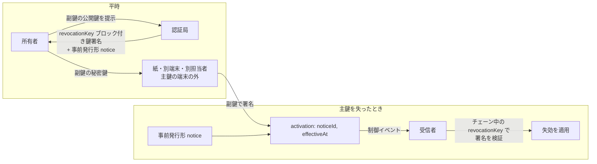

# 0030: 失効用サブ鍵拡張

状態: draft-00 — [0024](0024-revocation-notice.md) の拡張。署名鍵を失った所有者が、事前発行形の失効通知を別に保管した副鍵で活性化するための拡張を定義する。

## 要旨

事前発行形の失効通知は所有者の鍵による活性化を要するため、端末の盗難・破損で鍵を失うと使えない（[0024 §7](0024-revocation-notice.md#7-設計上の帰結)）。本書では、所有者が通常の署名鍵（主鍵）とは別に失効専用の副鍵を持ち、副鍵の公開鍵を鍵署名のブロックとして親に署名してもらう。鍵を失ったときは、事前発行形の通知に失効日を付け、副鍵で署名して配送する。活性化は署名付きなので、第三者が失効日を書き換えて再発信することはできない。副鍵の秘密鍵は主鍵を置く端末の外に保管する。



## 1. 鍵署名のブロック

```ts
type RevocationKeyBlock = {
  $type: "dev.oriom.mosimo.attest#revocationKey";
  key: PublicKey;      // 副鍵の公開鍵。0022 §2 の 32 または 33 バイト
};
```

- 所有者が副鍵を生成し、公開鍵だけを発行者へ渡す。発行者は副鍵の秘密鍵を知らない。
- 副鍵は主鍵・他の用途の鍵と共用しない。副鍵でチェーン上の鍵署名や投稿に署名しても効力を持たない。
- 一つの鍵署名に本ブロックは一つ。副鍵を替えるには鍵署名を再発行する。
- 包含規則はない。親子で独立に設定する。

## 2. 副鍵による活性化

活性化のオブジェクトは [0024 §2](0024-revocation-notice.md#2-構造) の `RevocationActivation` と同一であり、署名者だけが異なる。

```ts
type RevocationActivation = Signed<{
  $type: "dev.oriom.mosimo.attest#revocationActivation";
  noticeId: Bytes;
  effectiveAt: Timestamp;
}>;   // sig は subject 鍵、または subject の鍵署名にある revocationKey.key による署名
```

受信者は次を全て満たす場合に、`notice.subject` を `effectiveAt` から失効として適用する。

| 確認 | 内容 |
|---|---|
| 通知 | `notice.sig` が有効で、`notice.body.effectiveAt` がなく、`activation.body.noticeId == H(notice.body)`、`activation.body.effectiveAt >= notice.issuedAt` |
| 署名者の権限 | `notice.issuer` が評価中のチェーンにおいて `subject` の祖先（[0024 §3.1](0024-revocation-notice.md#31-受信者が受け入れる通知)） |
| 活性化の署名 | `activation.sig` が `subject` 鍵で検証できる、または評価中のチェーンで `subject` を被署名鍵とする鍵署名に `revocationKey` があり、その `key` で検証できる |

活性化は署名対象に `effectiveAt` を含むため、配送後に第三者が失効日を変えることはできない。運ぶ制御イベントの署名者は任意である（[0024 §5](0024-revocation-notice.md#5-制御イベントとしての運び方)）。

## 3. 永続保持

受信者は、チェーンを評価する前に副鍵による活性化を受け取ることがある。その場合は `Revocation` を `subject` に紐付けて保持し、`subject` を含むチェーンを評価するときに `revocationKey` で署名を検証する。検証に失敗した活性化はそのチェーンに適用しない。成功したら以後は通常の失効状態として扱い、巻き戻さない。

## 4. 運用

- 副鍵の秘密鍵は主鍵を置く端末の外に保管する。紙への印字、別の端末、別の担当者による保管などが候補である。所有者が組織であれば、主鍵を持つ担当者と別の者が保管できる。
- 主鍵と同じ場所に保管すると、一緒に失われ、または一緒に盗まれる。
- 副鍵の漏えいは第三者による鍵の失効を許すが、主鍵による発信の偽造は許さない。漏えいが分かったら鍵署名を再発行して副鍵を替える。
- 認証局自身の鍵にも本拡張を用いてよい。stratum 1 の無期限の鍵では、鍵の喪失に備える手段として特に推奨する。

## 5. 参照

- [0022: 鍵署名](0022-key-attestation.md)
- [0024: 失効通知](0024-revocation-notice.md)
