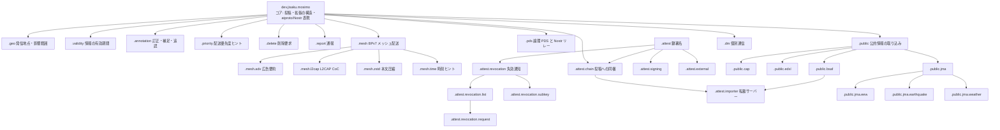

# Mosimo プロトコル仕様

正式名称は「もしもプロトコル」。災害時に、インターネットが使えない地域でも、異なるアプリの間で署名付きの投稿を共有するためのプロトコル群である。コアの識別子は `dev.jisaku.mosimo`、管理ドメインは `mosimo.jisaku.dev` とし、各拡張プロトコルはその下位の識別子を持つ。識別子とディレクトリは一対一に対応し、各プロトコルは一つの `README.md` と、型が確定していれば lexicon JSON を持つ。

## 構成

| 識別子 | 文書 | 内容 |
|---|---|---|
| `dev.jisaku.mosimo` | [mosimo/](mosimo/README.md) | 参加者、投稿単位、基本型、拡張の共通構造、atproto レコードと commit、Nostr イベントとタグ、版管理、名前空間 |
| `dev.jisaku.mosimo.geo` | [mosimo/geo/](mosimo/geo/README.md) | 発信地点、影響範囲、Geohash、近似 |
| `dev.jisaku.mosimo.validity` | [mosimo/validity/](mosimo/validity/README.md) | 情報の有効期間 |
| `dev.jisaku.mosimo.annotation` | [mosimo/annotation/](mosimo/annotation/README.md) | 訂正・補足・追認と Label |
| `dev.jisaku.mosimo.priority` | [mosimo/priority/](mosimo/priority/README.md) | 著者の配送優先度ヒントと実効優先度 |
| `dev.jisaku.mosimo.delete` | [mosimo/delete/](mosimo/delete/README.md) | 著者による投稿の削除要求（NIP-09）と削除後の commit、ノードでの扱い |
| `dev.jisaku.mosimo.report` | [mosimo/report/](mosimo/report/README.md) | 不適切な投稿の通報（NIP-56）と、通報の集計による配送の停止 |
| `dev.jisaku.mosimo.mesh` | [mosimo/mesh/](mosimo/mesh/README.md) | BPv7 による保存・中継、BLE/LAN/Nearby、接触時交換、Negentropy による差分照合、メッシュ用 CBOR |
| `dev.jisaku.mosimo.mesh.adv` | [mosimo/mesh/adv/](mosimo/mesh/adv/README.md) | 広告に載せる所持要約。接続前に接続の要否を判断する |
| `dev.jisaku.mosimo.mesh.l2cap` | [mosimo/mesh/l2cap/](mosimo/mesh/l2cap/README.md) | L2CAP CoC への経路切替 |
| `dev.jisaku.mosimo.mesh.zstd` | [mosimo/mesh/zstd/](mosimo/mesh/zstd/README.md) | payload の zstd 圧縮 |
| `dev.jisaku.mosimo.mesh.time` | [mosimo/mesh/time/](mosimo/mesh/time/README.md) | HELLO の時刻ヒント |
| `dev.jisaku.mosimo.pds` | [mosimo/pds/](mosimo/pds/README.md) | 論理 PDS グループ、復元と正規公開、Nostr リレープロファイル、priority 順取得 |
| `dev.jisaku.mosimo.attest` | [mosimo/attest/](mosimo/attest/README.md) | 鍵署名、役割、stratum、チェーン検証 |
| `dev.jisaku.mosimo.attest.chain` | [mosimo/attest/chain/](mosimo/attest/chain/README.md) | 投稿への署名チェーンの同梱と発信者の確認 |
| `dev.jisaku.mosimo.attest.revocation` | [mosimo/attest/revocation/](mosimo/attest/revocation/README.md) | 失効通知、事前発行、制御イベント |
| `dev.jisaku.mosimo.attest.revocation.list` | [mosimo/attest/revocation/list/](mosimo/attest/revocation/list/README.md) | 認証局の失効リスト配信 |
| `dev.jisaku.mosimo.attest.revocation.request` | [mosimo/attest/revocation/request/](mosimo/attest/revocation/request/README.md) | 失効要求と通報 |
| `dev.jisaku.mosimo.attest.revocation.subkey` | [mosimo/attest/revocation/subkey/](mosimo/attest/revocation/subkey/README.md) | 主鍵を失ったときの失効 |
| `dev.jisaku.mosimo.attest.signing` | [mosimo/attest/signing/](mosimo/attest/signing/README.md) | 署名要求と自動発行、NIP-05 |
| `dev.jisaku.mosimo.attest.external` | [mosimo/attest/external/](mosimo/attest/external/README.md) | NIP-39 外部アカウント証明 |
| `dev.jisaku.mosimo.attest.importer` | [mosimo/attest/importer/](mosimo/attest/importer/README.md) | 転載サーバーの認証と自動投入の認可 |
| `dev.jisaku.mosimo.public` | [mosimo/public/](mosimo/public/README.md) | 公的情報の取り込み、出典、配送同値、更新による置換 |
| `dev.jisaku.mosimo.public.cap` | [mosimo/public/cap/](mosimo/public/cap/README.md) | CAP 1.2 |
| `dev.jisaku.mosimo.public.edxl` | [mosimo/public/edxl/](mosimo/public/edxl/README.md) | EDXL-DE 1.0 |
| `dev.jisaku.mosimo.public.jma` | [mosimo/public/jma/](mosimo/public/jma/README.md) | 気象庁 XML 共通 |
| `dev.jisaku.mosimo.public.jma.eew` | [mosimo/public/jma/eew/](mosimo/public/jma/eew/README.md) | 緊急地震速報 |
| `dev.jisaku.mosimo.public.jma.earthquake` | [mosimo/public/jma/earthquake/](mosimo/public/jma/earthquake/README.md) | 地震観測情報 |
| `dev.jisaku.mosimo.public.jma.weather` | [mosimo/public/jma/weather/](mosimo/public/jma/weather/README.md) | 気象防災情報 |
| `dev.jisaku.mosimo.public.bsaf` | [mosimo/public/bsaf/](mosimo/public/bsaf/README.md) | BSAF v1 互換 |
| `dev.jisaku.mosimo.dm` | [mosimo/dm/](mosimo/dm/README.md) | 暗号化した 1 対 1 メッセージ（NIP-04）、構造化オブジェクトの運搬、配達通知、表示名 |

## 実装の入口

| 実装 | 読む順序 |
|---|---|
| 発信アプリ | コア → geo・validity・annotation → mesh。身元を示す場合は attest.chain |
| 表示・中継だけのアプリ | コア → mesh。未知の拡張は書き換えず保持する |
| PDS・Nostr リレー | コア → pds → attest.revocation.list §5 |
| 公的情報の取り込み | public → cap・edxl・jma → attest.importer |
| 認証局 | attest → attest.revocation → attest.revocation.list → attest.revocation.request。自動発行は attest.signing、個人向けは attest.external、転載サーバーへの発行は attest.importer |
| ゲートウェイ（Android・ESP32） | mesh → attest.chain → attest.importer |

## 文書の書き方

- 一つのプロトコルに一つの `README.md`。冒頭に識別子、目的、前提とするプロトコルの表を置く。
- 現時点の仕様だけを現在形で書く。決まっていない事項は末尾の「未確定事項」にまとめる。
- 禁止・非推奨は理由を伴う「してはならない」「すべきではない」の形でだけ書く。
- 型は TypeScript 風の記法で示し、確定した型は同じディレクトリの lexicon JSON に置く。
- 用語は [用語集](../CONTEXT.md) に従う。
