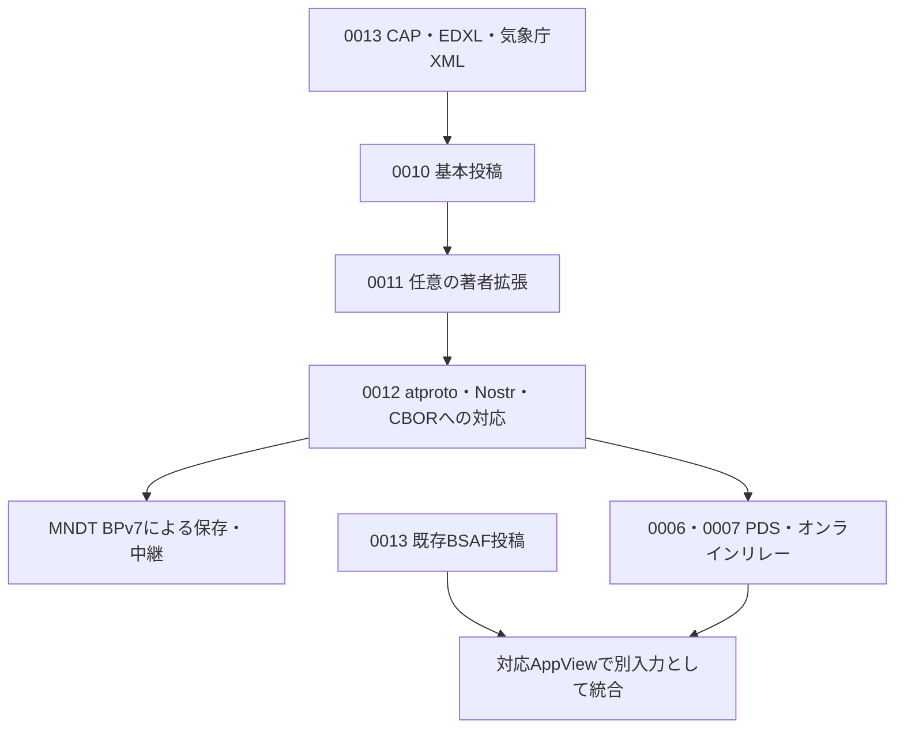

# 災害時情報共有プロトコル仕様群

更新日: 2026-10-18

**状態: 設計草案。** 日本語の RFC 風文書として、基本モデル、拡張、データ表現、配送、外部情報との互換性を分けて記述します。公式名前空間は `mosimo.oriom.dev` を基点として割り当て済みです。基本プロトコル・拡張型・メッシュ符号化の独立した版管理も採用済みです。正式な表示名称・版の具体表記・一部の具体型は未確定であり、相互運用可能な wire 仕様の完成を宣言するものではありません。

## 1. 最初に読む文書

| 文書 | 役割 | 分かること |
|---|---|---|
| [0010: 基本プロトコル](0010-core.md) | 基本仕様 | 投稿単位、基本型、作成から配送・公開まで |
| [0011: 著者署名付き拡張ブロック](0011-extensions.md) | 拡張仕様 | 位置・影響範囲・有効期間・注釈等の型と意味 |
| [0012: atproto・Nostr・CBOR のデータ表現](0012-bindings.md) | 形式ごとの対応 | 本文・レコード・path・commit の配置とサイズ削減案 |
| [MNDT: BPv7 メッシュ配送](mndt.md) | 配送仕様 | BLE GATT・接続済み LAN の探索、任意の Nearby 切替、payload と配送状態、保存・中継・ゲートウェイ |
| [0013: 公的情報の取り込みと出典](0013-public-information.md) | 外部形式との対応 | CAP・EDXL-DE・気象庁 XML のマッピングと具体例、BSAF の AppView 統合 |
| [0014: 公式名前空間と識別子](0014-namespaces.md) | 名前の割り当て | `mosimo.oriom.dev` に基づく Lexicon・タグの正式な名前 |
| [0015: CAP 1.2 著者拡張](0015-cap.md) | 形式別拡張 | CAPの型・本文への変換・共通領域と期間・更新取消・配送判断 |
| [0016: EDXL-DE 1.0 著者拡張](0016-edxl-de.md) | 配布容器の拡張 | 内容選択・配布先・公開条件・容器と内包警報の分離 |
| [0017: 気象庁緊急地震速報](0017-jma-eew.md) | 予測・警報の拡張 | 警報・予報、震源精度、地域別予測、PLUM法、続報・取消、遅着時の動作 |
| [0018: 気象庁地震観測情報](0018-jma-earthquake.md) | 観測情報の拡張 | 震度速報・震源・震源震度・長周期地震動の型と変換 |

### 実装の担当別の入口

- **発信アプリ**: 0010 → 0011 → 0012 → MNDT。平時にアカウントを自動準備します。
- **本文表示・中継のみのアプリ**: 0010 と MNDT。未知の著者拡張は書き換えず保持し、DID 認証のための情報取得を本文表示の前提にしません。
- **PDS・オンラインリレー**: 0012 → 0006・0007。
- **公的情報の取り込み**: 0013 → 0011・0012、CAPの個別仕様草案は0015、EDXL-DEは0016、気象庁の緊急地震速報は0017、地震観測情報は0018、信頼の方針は 0002。
- **BSAF 対応 AppView**: 0013 §6.4。既存 BSAF 投稿を独自 Lexicon へ書き換えず収集します。

## 2. 専門文書と既存の設計記録

`protocol/` はプロトコル定義書の置き場とし、調査報告・技術比較・作業メモは置きません。調査資料は `docs/research/` に分離し、仕様の採用事項とは区別します。0010 以降は実装者向けの構造化した入口、以下は詳細方針と合意事項です。

| 文書 | 内容 |
|---|---|
| [0000: 全体概要](0000-overview.md) | 目的・全体像・保証の境界 |
| [0001: リポジトリ正本モデル](0001-repository-model.md) | 合意した設計判断の記録 |
| [0002: 公的情報の取り込みと信頼](0002-ingestion-and-trust.md) | 取り込みサーバーへの信頼と配送同値性 |
| [0003: 未決事項](0003-open-questions.md) | 今後固定する項目と延期事項 |
| [0004: 地理情報](0004-geography.md) | 円・Geohash の意味と部分実装 |

| [0006: 論理 PDS と分散公開](0006-logical-pds.md) | 複数物理 PDS の役割と正規公開 |
| [0007: Nostr リレープロファイル](0007-nostr-relay-profile.md) | 直接投稿・取得・発見・保持 |
| [0008: 投稿と注釈・Label](0008-posts-and-labels.md) | 本人の注釈とサービスの集約 Label |
| [0009: 署名チェーンによる身元証明](0009-identity-attestations.md) | 公式発信者への帰属と信頼の起点 |

| [用語集](../CONTEXT.md) | 発信者・影響範囲・訂正等の既存用語 |

## 3. 要件と型案の読み分け

- **要件・合意済み**: 既存の採用方針。1投稿＝1レコード追加・1 commit・1 Nostr イベント等は再選択しません。
- **型案・配置案・提案**: 既存方針を実装可能な形にするための具体化。未決定のフィールド名・タグ名・NSID 等を採用済みとは扱いません。共通時刻型や独自タグの bytes 符号化など、個別に合意した事項は各文書で区別します。
- **未決定**: 決定に必要な事項。仕様全体の整理を先に進め、互換性・責務・安全性を左右する判断が必要な場合に確認します。
- **延期**: 初期仕様の対象外。個別通信・限定公開・メディア本体・欠落履歴の探索・全面的な逆変換・端末状態の巻き戻りへの対応。

各文書の TypeScript 風の型は説明用であり、そのまま正式 Lexicon や登録済みの wire schema ではありません。基本投稿の実装済み Lexicon JSON は [`lexicons/dev/oriom/mosimo/post.json`](../lexicons/dev/oriom/mosimo/post.json)、利用方法と実装範囲は [`lexicons/README.md`](../lexicons/README.md) に置きます。個別拡張は未確定の型案を実装済みとは扱いません。明示的な合意と型案が食い違う場合は合意を優先します。検証アルゴリズム・適合試験・テストベクトルは今回の文書化の対象に含めません。署名等に関する既存要件は維持します。

旧 MNDT draft-00 は現在の責務分離に合わせて改訂しました。旧案のタグ・EID・ブロック番号・数値を採用済みとして実装しないでください。

## 4. BSAF 互換性の範囲

独自 Lexicon と BSAF のタグ方式を比較し、本プロトコル本体には独自 Lexicon を採用済みです。BSAF の既存投稿は対応 AppView が別入力として収集し、著者・atURI・CID・本文・出典を残したまま、一覧・地図・絞り込みで併置します。

独自 Lexicon の投稿が既存 Bluesky クライアントへ自動表示されることや、既存 BSAF 投稿をそのまま本プロトコルのメッシュへ投入できることは保証しません。BSAF → Nostr／メッシュの再配信は未決定です。詳しい型・タグの対応は 0013 を参照してください。

## 5. 更新方針

既存の合意を重複して質問せず、仕様全体の構造とデータの流れを先に整えます。新しい具体案は提案と明示し、重要な未決事項だけを必要に応じて質問します。回答の反映・文書更新ごとに差分を確認してコミット・pushします。公開リポジトリのため、秘密鍵・認証情報・非公開の個人情報を含めません。
