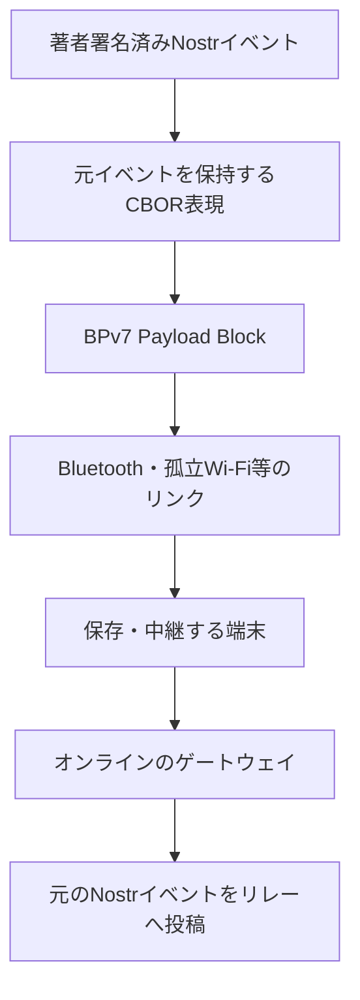
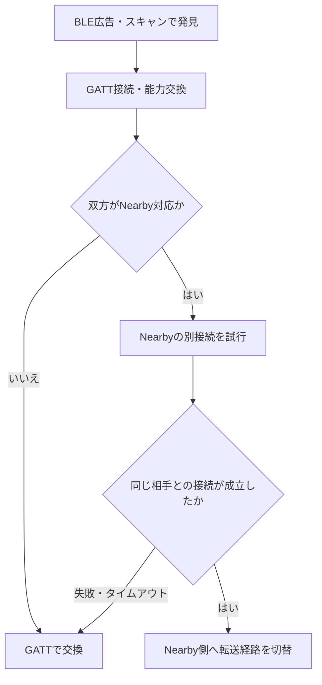

# MNDT: BPv7 メッシュ配送プロファイル

状態: draft-01 — BLE GATT を基本経路、接続済み Wi-Fi LAN を追加経路とし、BLE 接続後に任意の Nearby Connections 経路へ切り替える方針は合意済み。endpoint・各リンクの wire 形式・制御メッセージ・一部の上限値は未確定。

## 要旨

MNDT は、本プロトコルの署名済み Nostr イベントを CBOR で表現し、BPv7 により断続的な端末間リンクで保存・中継する配送プロファイルである。本文や地理情報の意味を新たに定義せず、[基本プロトコル](0010-core.md)・[著者拡張](0011-extensions.md)・[データ表現](0012-bindings.md) を利用する。

本書は旧 draft-00 の初期案を置き換える。旧案の `mndt` タグ、group EID 書式、固定 hop 数・優先度の段階数、独自 block type 192、receipt の形式は採用済みの登録値・相互運用規約として引き継がない。配送同値性と制御情報の扱いも全体仕様へ合わせる。

## 1. 層とデータの所有者

| 情報 | 保持先 | 中継者による変更 |
|---|---|---|
| 本文、配送期限、影響範囲、その他の著者拡張 | Nostr イベントを表す payload | 不可 |
| レコード・path・端末署名済み commit・適用元 CID | 同じイベントの payload 内 | 不可 |
| 宛先 endpoint、Bundle 作成情報・Lifetime | BPv7 primary block | BPv7 の規則に従う |
| hop count、Bundle Age、直前ノード | BPv7 標準拡張ブロック等 | BPv7 の規則に従う |
| peer ごとの送信済み状態・実効優先度 | ノード内の配送管理 | ローカル方針で更新 |

参加機器はスマートフォンに限定しない。M5Stack 等のマイコンを含む無線機器も、対応する共通リンクを介して保存・中継へ参加できる構成を要件とする。共通の基本転送経路には BLE GATT を採用する。接続済み Wi-Fi LAN を追加の探索・転送経路とし、Nearby Connections は双方が対応する場合の任意追加経路とする。Nearby 非対応でも BLE GATT で配送を完結できなければならない。

著者の `area` 等を BPv7 拡張ブロックにだけ置かない。独自ブロックがなくても本文と著者拡張が Nostr へ搬出できる構成とする。

## 2. Bundle の構成

- payload は [0012 §4](0012-bindings.md#4-メッシュ用-cbor合意済み) の元イベントを維持する固定7要素 CBOR 配列とする。共通の自己完結拡張タグは、内側の型が未知でも値を生バイト列へ戻せる。その他の既知タグの整数・バイト列も可逆な対応規則で型変換し、運び方も未知のタグ・変換条件に合わない値・日時の原表記はそのまま保持する。共通接頭辞は [0014](0014-namespaces.md) の `mosimo.oriom.dev:ext:` で識別する。payload のメッシュ符号化版は基本プロトコル版・拡張型と独立に管理する。初版は整数 `1` を配列先頭に置き、続けて公開鍵・Nostr 作成時刻・kind・タグ一覧・本文・署名を格納する。型変換するタグと値の位置は0012の v1 対応表に限定する。
- primary block の source・destination・creation timestamp・lifetime 等は BPv7 の構造を使う。CBOR の payload 配列を BPv7 のブロック配列と混同しない。
- hop・経過時間の制限には BPv7 の標準機構を用いる方針とする。Hop Count・Bundle Age の必須範囲、初期値・更新規則・フラグは RFC 9171 に対応させて今後固定する。
- 最初の仕様では独自の経路証明・転送 receipt は要求しない。

宛先を non-singleton endpoint とする group 配送は候補だが、EID の方式・authority・group の発見・複製方法は未確定。旧案の `dtn://<mesh-id>/~<group>` を確定 EID として実装しない。BPv7 自体が全 group 構成員への配送を保証するわけではない。

## 3. 接触時の処理の流れ

相手の探索・経路選択の方針は本節の合意事項に従う。以下の段階で接触時交換を行い、リンク上の具体的なメッセージ名・wire 構造は別途定める。

| 段階 | 交換・処理する情報 | 目的 |
|---|---|---|
| 接続・能力共有 | プロファイル版、転送可能サイズ等 | 異なるアプリの共通機能を把握 |
| 所持情報の交換 | Nostr event ID 等 | 同じイベントの不要な転送を抑える |
| 転送要求 | 受信側が必要とするイベント | 保存量・帯域の範囲で選択 |
| Bundle 転送 | 署名済みイベントを含む Bundle | 保存して次の接触へ運ぶ |
| 配送管理の更新 | peer への送信状態等 | 同じ接触での繰り返しを抑える |

### 3.1 二経路の探索と基本転送（合意済み）

| 経路 | 相手の発見 | 接続・転送 |
|---|---|---|
| BLE | 共通サービスを示す BLE 広告・スキャン | GATT で能力交換と Bundle 転送を行う共通の基本経路 |
| 接続済み Wi-Fi LAN | 到達可能な LAN 上のサービス探索 | IP 経由で接続する追加経路 |

BLE の探索は広告・スキャンで行い、GATT は接続後のデータ交換に使う。Wi-Fi 側は既に接続している LAN 等で相手に到達できる場合を対象とする。インターネット接続は不要だが、AP のない環境で直接 Wi-Fi 接続を新規構築することは、この LAN 経路の機能に含めない。LAN 上の探索には mDNS／DNS-SD 等を候補とし、具体方式・サービス名・IP 上の転送形式は未確定である。

各機器は利用可能な探索経路を用いる。Wi-Fi のないマイコンや LAN に接続していない端末にも、BLE GATT の基本経路を残す。資源や OS の制約を無視した、二経路の常時同時探索は要求しない。異なるアプリ間で共通サービスを発見できるようにし、アプリ固有の識別子だけで探索対象を分断しない。

### 3.2 接続後の能力交換（合意済み）

接続後に、対応する交換プロトコルの版、受信可能サイズ等の制限、Nearby 対応の有無、利用可能な LAN 経路等を交換する。Nearby の能力を広告だけから推測して切り替えない。能力申告を投稿者の身元や相手の信頼性の保証とは扱わない。

BLE の central／peripheral と GATT client／server の役割はリンクの役割であり、配送上の固定の親・子を意味しない。接続後は両方向に交換できる構成とする。スマホ同士・マイコン同士も接続できるよう、役割選択と対応能力を具体化する。

### 3.3 BLE から Nearby への経路切替（合意済み）

BLE GATT で接続した双方が Nearby Connections に対応し、各機器の制限の範囲で利用可能な場合は、Nearby による別の接続を試み、成立時に転送経路を切り替えられる。既存の独自 GATT 接続をそのまま Nearby 接続へ変換するものではない。Nearby 自身の探索・接続・双方の受け入れを行う。

Nearby 側では参加アプリ間の共通 service ID・互換な strategy を用いる。具体的な値・SDK の対象版は別途定める。Nearby の内部経路選択によって BLE 等が使われる場合もあるため、切替を高速 Wi-Fi 接続の成立や帯域向上の保証とはしない。マイコン等の参加に Nearby 互換実装を要求しない。

BLE で接続した相手のアプリ実体と、Nearby で接続した相手を、接続セッションの情報により対応付ける。単に最初に見つかった endpoint へ切り替えてはならない。対応付けの具体形式は未確定であり、識別情報の一致だけで相手を暗号学的に認証済みとはしない。Nearby の接続承認・検証コードの扱いと、著者の Nostr 署名による投稿の保護を区別する。無人の自動受け入れ方針は別途定める。

### 3.4 切替失敗・切断と重複（合意済み）

- Nearby 非対応、接続失敗、切替試行のタイムアウトでも、GATT による交換を継続できるようにする。
- 接続枠・無線資源・OS の制約が許す場合は、追加経路の成立を確認してから GATT 側の転送を止める。切替試行だけを理由に、保持済みのイベントを失ってはならない。
- Nearby 等の追加経路が切断された場合、利用可能な GATT 経路への復帰、または次回接触での再送を可能とする。経路の再確立や配送完了を保証するものではない。
- 複数経路から同じイベントが届いても、Nostr event ID を用いて §5 の重複排除を適用する。リンクの送信受け付けを相手の保存完了とは扱わない。
- 経路切替によって著者署名付きイベントを変更せず、配送期限を延長しない。BPv7 の可変な配送状態は BPv7 と本プロファイルの規則に従い、切替だけを理由に寿命・hop の制限を解除しない。

途中転送の識別・再開位置・受領応答、重複接続の整理、タイムアウト・再試行の上限は、今後具体化する。

### 3.5 wire 形式と動作範囲の残事項

BLE のサービス UUID・characteristic・広告内容、能力交換・相手の対応付け・所持一覧・要求の具体的なデータ型、各リンクの分割・流量制御・再開方法は未確定である。32 KiB はイベント payload の上限であり、Bundle を一度の GATT 書込みや Nearby Bytes payload に収める要件ではない。下位リンクの分割と BPv7 の Bundle fragmentation は区別する。

OS が実行を許す間の接触で交換する。背景・画面消灯・強制終了後の常時探索・中継を保証しない。Nostr WebSocket session を透過的にメッシュへ流すものではない。

## 4. 転送候補の選択

署名済みイベントを変えずに、受信側の方針で送信順・保存順位を決める。

- peer が未所持のイベントを候補にする。
- 著者の配送期限、BPv7 Lifetime、ローカルな保持時間・hop・保存量・帯域上限を併せて適用する。
- 影響範囲内への配送を優先できる。範囲外でもゲートウェイへの搬出等のため中継できる。
- 位置を持たない peer や地域不明の投稿も、通常の上限内で扱える。地域不明を全世界対象・最高優先度とはしない。
- 著者指定の優先度はヒントとする。未信頼の高優先度申告によって資源上限を解除しない。

優先度の具体的な型・段階数・スケジューリング、遭遇履歴等の利用、コピー数上限は未決定である。特定の peer の到達性広告だけで、唯一の保管コピーを預ける構成を要求しない。

## 5. 重複・再バンドル・保持

通常は同じ Nostr event ID を同じイベントとして扱う。Bundle が異なっても新しい投稿にならない。公的情報の配送同値による例外的な重複抑制は [0002](0002-ingestion-and-trust.md) に従い、自己申告の inventory や本文一致だけで適用しない。

再バンドル時も著者が署名した配送期限を延長しない。新しい Bundle の Lifetime・hop 状態の初期化だけで無制限に再拡散できないように、既知イベントの記録とローカル上限を使う。記録の寿命と再投入の具体規則は未確定である。

配送期限の既定期間はアプリ・運用者に委ねる。時計不明時は期限内と保証された扱いにせず、ローカル上限内で中継できる。配送期限満了は投稿削除ではなく、オンライン側の保持期間とも同じではない。

## 6. ゲートウェイ

メッシュから取得した元イベントを標準 Nostr JSON に戻し、対応物理 PDS のリレー等へ投稿する。元の公開鍵・時刻・kind・tags・content・署名を変えない。BPv7 の経路情報を元イベントのタグへ追加しない。

逆方向は [0013](0013-public-information.md) のような信頼する取り込みサーバーによる公的情報等を、方針・期限・地域・資源上限の範囲でメッシュへ投入する。AppView や Nostr で取得した全件の自動投入はしない。既存 BSAF 投稿からの再配信は未決定である。

Nostr リレーの受理は、全メッシュ端末への到達や、PDS・AppView への公開完了を意味しない。

## 7. 公開性と資源

元の投稿は公開情報である。BPv7 の拡張だけで本文の限定公開を実現するものではない。保存量・デコード量・送信量には上限が必要であり、未知拡張の保持を無制限の資源提供義務とはしない。メッシュ符号化形式 v1 の1イベントの CBOR payload は全体で32 KiB（32,768バイト）以下とする（[0012 §4.4](0012-bindings.md#44-payload-のサイズ上限合意済み)）。BPv7 のヘッダー・CRC・拡張ブロック等はこの値に含めず、断片化によってイベント全体の上限を回避しない。端末はさらに小さい受信・転送上限を設定でき、上限内でも受理・中継を保証しない。署名済みイベントを削って小さくせず、運べない場合は配送を見送る。ネスト・要素数等のデコード負荷上限、保存量・送信量の具体上限は未確定である。

## 8. 参照

- [RFC 9171 — Bundle Protocol Version 7](https://www.rfc-editor.org/rfc/rfc9171.html)
- [RFC 8949 — CBOR](https://www.rfc-editor.org/rfc/rfc8949.html)
- [NIP-01](https://github.com/nostr-protocol/nips/blob/master/01.md)

## 9. Android 実装の暫定値（提案・未採用）

本節は `apps/android` の実験実装が未確定事項を埋めるために使っている値の記録であり、合意済み事項ではない。相互運用規約として固定する場合は別途合意する。§1〜§7 の合意事項を変更しない。

### 9.1 BLE GATT リンク

| 項目 | 暫定値 |
|---|---|
| Service UUID | `b5e89a01-f9da-45c2-9111-2de7a7441d24` |
| RX characteristic（central → peripheral、write with response） | `483c3867-c832-4c60-9a96-7018059eaf74` |
| TX characteristic（peripheral → central、notify。CCCD あり） | `49d60590-c23f-4a0a-a58e-f2f2f606f94d` |
| 広告 | legacy 31 バイト内。128-bit Service Data（AD type `0x21`）= Service UUID + node ID 8 バイト + flags 1 バイト（bit0 = peripheral 専用）。Service UUID 一覧は載せない |
| 役割選択 | 各端末が GATT server・広告と scan・central を兼ねる。相手が peripheral 専用、または自 node ID < 相手 node ID（16進小文字の辞書順）のときだけ central として接続し、重複リンクを避ける |
| 分割 | MTU 517 を要求し、(MTU − 3) バイトごとに分割。1チャンクずつ write 応答・notify 完了を待つ |

node ID はプロセス起動ごとの乱数であり、身元・著者・端末の識別子ではない。

### 9.2 LAN リンク

接続済み LAN 上で DNS-SD のサービス種別 `_mosimo._tcp`、インスタンス名 = node ID を広告・探索し、node ID の小さい側が TCP 接続する。TLS は使わない（運ぶのは公開の署名済みイベントであり、通信路保護は別途検討）。NICT NerveNet 等の IP 網も、mDNS が届く範囲ではこの経路で扱う。mDNS が届かない網向けの手動アドレス指定は未実装。

### 9.3 フレームと接触時交換

GATT・TCP とも、4 バイト big-endian の長さ（1〜32,768）に続けて1フレームを送る。フレーム先頭が `{` なら制御メッセージ、`0x9f` なら BPv7 Bundle とする。制御メッセージは JSON で、`v: 1` と `type` を持つ。

| type | フィールド | 用途（§3 の段階） |
|---|---|---|
| `hello` | `node`（16進16文字）、`max`（受信可能な最大フレームバイト数） | 接続・能力共有。未知フィールドは無視 |
| `inventory` | `ids`（転送対象の Nostr event ID、最大128） | 所持情報の交換 |
| `want` | `ids` | 転送要求 |
| `ack` | `ids`（1件） | 署名検証・保存の応答。経路証明・配送完了の証明ではない |

接続は自動で受け入れる。保護は Nostr 署名の検証と資源上限による。Nearby への切替（§3.3）は未実装。

### 9.4 Bundle と保持

- destination EID は `dtn://mosimo.oriom.dev/~post`（non-singleton）とする。source EID は `dtn://n<著者公開鍵の先頭32桁>/post` を仮置きする。
- Hop Count の上限は 8（ローカル方針。著者署名の対象外）。Lifetime は最大24時間。配送期限は `mosimo.oriom.dev:delivery-expires-at` から読む。
- 保存は128件まで。満杯時は、転送対象外かつリレー受理済み → 転送対象外 → 最古受信の順に1件を退避する。
- 搬出先は同梱の一般リレー（`wss://relay.damus.io`、`wss://nos.lol`）と利用者の追加分で、全リレーへ順に元イベントを送る。
