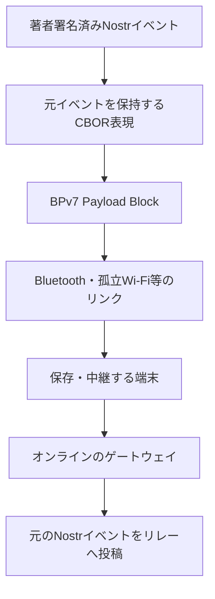
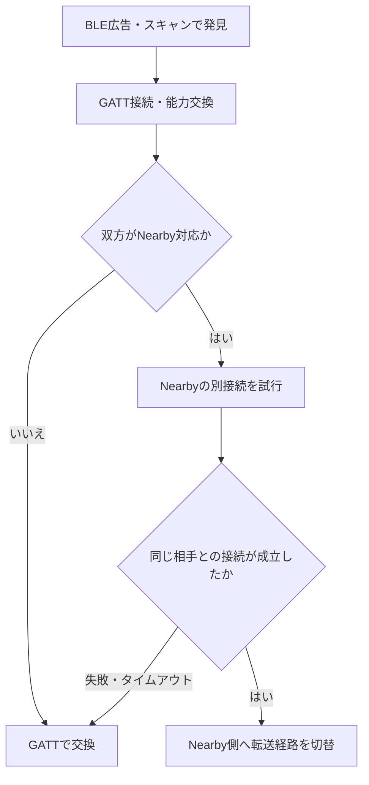

# MNDT: BPv7 メッシュ配送プロファイル

状態: draft-01 — BLE GATT を基本経路、接続済み Wi-Fi LAN を追加経路とし、BLE 接続後に任意の Nearby Connections 経路へ切り替える方針は合意済み。endpoint・各リンクの wire 形式・制御メッセージ・一部の上限値は未確定。

## 要旨

MNDT は、本プロトコルの署名済み Nostr イベントを CBOR で表現し、BPv7 により断続的な端末間リンクで保存・中継する配送プロファイルである。本文や地理情報の意味を新たに定義せず、[基本プロトコル](0010-core.md)・[著者拡張](0011-extensions.md)・[データ表現](0012-bindings.md) を利用する。

本書は旧 draft-00 の初期案を置き換える。旧案の `mndt` タグ、group EID 書式、固定 hop 数・優先度の段階数、独自 block type 192、receipt の形式は採用済みの登録値・相互運用規約として引き継がない。配送同値性と制御情報の扱いも全体仕様へ合わせる。

## 1. 層とデータの所有者



| 情報 | 保持先 | 中継者による変更 |
|---|---|---|
| 本文、配送期限、影響範囲、その他の著者拡張 | Nostr イベントを表す payload | 不可 |
| レコード・path・端末署名済み commit・適用元 CID | 同じイベントの payload 内 | 不可 |
| 宛先 endpoint、Bundle 作成情報・Lifetime | BPv7 primary block | BPv7 の規則に従う |
| hop count、Bundle Age、直前ノード | BPv7 標準拡張ブロック等 | BPv7 の規則に従う |
| peer ごとの送信済み状態・実効優先度 | ノード内の配送管理 | ローカル方針で更新 |

参加機器はスマートフォンに限定しない。M5Stack 等のマイコンを含む無線機器も、対応する共通リンクを介して保存・中継へ参加できる構成を要件とする。共通の基本転送経路には BLE GATT を採用する。接続済み Wi-Fi LAN を追加の探索・転送経路とし、Nearby Connections は双方が対応する場合の任意追加経路とする。Nearby 非対応でも BLE GATT で配送を完結できなければならない。

著者の `area` 等を BPv7 拡張ブロックにだけ置かない。独自ブロックがなくても本文と著者拡張が Nostr へ搬出できる構成とする。

## 2. Bundle の構成

- payload は [0012 §4](0012-bindings.md#4-メッシュ用-cbor合意済み) の元イベントを維持する固定7要素 CBOR 配列とする。共通の自己完結拡張タグは、内側の型が未知でも値を生バイト列へ戻せる。その他の既知タグの整数・バイト列も可逆な対応規則で型変換し、運び方も未知のタグ・変換条件に合わない値・日時の原表記はそのまま保持する。共通接頭辞は [0014](0014-namespaces.md) の `mosimo.oriom.dev:ext:` で識別する。payload のメッシュ符号化版は基本プロトコル版・拡張型と独立に管理する。初版は整数 `1` を配列先頭に置き、続けて公開鍵・Nostr 作成時刻・kind・タグ一覧・本文・署名を格納する。型変換するタグと値の位置は0012の v1 対応表に限定する。
- primary block の source・destination・creation timestamp・lifetime 等は BPv7 の構造を使う。CBOR の payload 配列を BPv7 のブロック配列と混同しない。
- hop・経過時間の制限には BPv7 の標準機構を用いる方針とする。Hop Count・Bundle Age の必須範囲、初期値・更新規則・フラグは RFC 9171 に対応させて今後固定する。
- 最初の仕様では独自の経路証明・転送 receipt は要求しない。

宛先を non-singleton endpoint とする group 配送は候補だが、EID の方式・authority・group の発見・複製方法は未確定。旧案の `dtn://<mesh-id>/~<group>` を確定 EID として実装しない。BPv7 自体が全 group 構成員への配送を保証するわけではない。

## 3. 接触時の処理の流れ

相手の探索・経路選択の方針は本節の合意事項に従う。以下の段階で接触時交換を行い、リンク上の具体的なメッセージ名・wire 構造は別途定める。

| 段階 | 交換・処理する情報 | 目的 |
|---|---|---|
| 接続・能力共有 | プロファイル版、転送可能サイズ等 | 異なるアプリの共通機能を把握 |
| 所持情報の交換 | Nostr event ID 等 | 同じイベントの不要な転送を抑える |
| 転送要求 | 受信側が必要とするイベント | 保存量・帯域の範囲で選択 |
| Bundle 転送 | 署名済みイベントを含む Bundle | 保存して次の接触へ運ぶ |
| 配送管理の更新 | peer への送信状態等 | 同じ接触での繰り返しを抑える |

### 3.1 二経路の探索と基本転送（合意済み）

| 経路 | 相手の発見 | 接続・転送 |
|---|---|---|
| BLE | 共通サービスを示す BLE 広告・スキャン | GATT で能力交換と Bundle 転送を行う共通の基本経路 |
| 接続済み Wi-Fi LAN | 到達可能な LAN 上のサービス探索 | IP 経由で接続する追加経路 |

BLE の探索は広告・スキャンで行い、GATT は接続後のデータ交換に使う。Wi-Fi 側は既に接続している LAN 等で相手に到達できる場合を対象とする。インターネット接続は不要だが、AP のない環境で直接 Wi-Fi 接続を新規構築することは、この LAN 経路の機能に含めない。LAN 上の探索には mDNS／DNS-SD 等を候補とし、具体方式・サービス名・IP 上の転送形式は未確定である。

各機器は利用可能な探索経路を用いる。Wi-Fi のないマイコンや LAN に接続していない端末にも、BLE GATT の基本経路を残す。資源や OS の制約を無視した、二経路の常時同時探索は要求しない。異なるアプリ間で共通サービスを発見できるようにし、アプリ固有の識別子だけで探索対象を分断しない。

### 3.2 接続後の能力交換（合意済み）

接続後に、対応する交換プロトコルの版、受信可能サイズ等の制限、Nearby 対応の有無、利用可能な LAN 経路等を交換する。Nearby の能力を広告だけから推測して切り替えない。能力申告を投稿者の身元や相手の信頼性の保証とは扱わない。

BLE の central／peripheral と GATT client／server の役割はリンクの役割であり、配送上の固定の親・子を意味しない。接続後は両方向に交換できる構成とする。役割の対応と部分実装は §3.2.1 に従う。

### 3.2.1 BLE の役割と部分実装（合意済み）

スマホアプリと汎用中継ノードの基本実装は、central と peripheral の両方の役割に対応する。機器種別で役割を固定せず、接続ごとに一方が central、他方が peripheral となる。本 GATT プロファイルでは役割を次のように対応させる。

| BLE の接続役割 | GATT の役割 | 接続時の動作 |
|---|---|---|
| central | client | 相手を探索し、接続を開始する |
| peripheral | server | 共通サービスを広告し、接続を受け付ける |

この対応は本プロファイルの規約であり、BLE 一般で両者が同義であるという意味ではない。どちらの役割でも接続後はイベントの送受信を行える。基本実装同士では、スマホ同士・スマホとマイコン・マイコン同士のいずれも役割の組合せを作れる構成とする。実際の接続成立・同時接続数は、OS・無線資源・実装の制限に従う。

制約の強い機器では central 専用または peripheral 専用の部分実装を許容する。実装の対応役割を明示し、両役対応の基本実装と区別する。同じ片役だけの2台は BLE で直接接続できず、反対の役割に対応する相手との接触、または別の共通経路を必要とする。

両役対応とは両方の役割で動作できることを意味し、広告と探索の常時同時実行、多数の同時接続、背景での常時動作を要求するものではない。両役対応同士の接続開始競合・重複接続の整理、役割の広告・選択・切替の具体形式は別途定める。

### 3.2.2 GATT サービスと共通送受信経路（合意済み）

本プロファイルは、参加アプリ・機器に共通の一つの GATT サービスと、方向別の二つの characteristic を使う。`RX`・`TX` は server 側から見た方向を表す説明用名称であり、UUID の値は別途割り当てる。

| characteristic | 転送方向 | GATT 操作 |
|---|---|---|
| RX | central／client → peripheral／server | client からの Write Without Response |
| TX | peripheral／server → central／client | Notification。client は通知を購読する |

能力交換・所持一覧・取得要求・Bundle 転送等は、同じ送受信経路の上位メッセージ種別で区別する。機能・投稿の種類・個別の著者拡張ごとに characteristic を追加する構成は採用しない。GATT 層は上位のメッセージをバイト列として運び、本文や拡張の意味を解釈する条件を設けない。共通の交換メッセージを LAN・Nearby の転送経路でも再利用できるよう、GATT 固有の操作と上位メッセージの意味を分離する。

同じ接続で両方向に送受信し、能力交換や Bundle の送信側を central または peripheral の一方に固定しない。二つの characteristic はサービスのデータ転送用の構成を表し、通知設定等に必要な標準 descriptor を除外するものではない。

転送には §3.2.3 の許容量付き連続転送と Bundle 単位の受理応答を用いる。GATT 操作の成功だけで Bundle の受信・保存完了を保証した扱いにはしない。

### 3.2.3 分割・流量制御・受理応答（合意済み）

初版は RX の Write Without Response と TX の Notification を使う。断片ごとに GATT の書込み応答を待つ方式を基本とせず、上位の送信許容量で受信側の負荷を制限する。送信側は OS／SDK の送信キュー制限と、相手が通知した許容量の両方に従う。

- 相手・OS が扱える長さに応じて転送を分割する。MTU を固定値と仮定せず、GATT 操作ごとのデータ長制限に転送フレームのヘッダー等も含める。
- 各方向の受信側は、自身が処理できる量を送信側に許可する。送信側は許可された量を超えて送ってはならず、許容量を使い切った場合は追加の許可を待つ。許可は §3.2.7 の累積バイト上限で表す。初期上限の伝達方法・通知の具体配置は別途定める。
- 送信許容量の追加は、断片の処理・バッファ解放等に基づく流量制御であり、Bundle の受理・保存完了を意味しない。
- Bundle の全体を受信し、既存要件に従った検査と配送用の保存を完了した受信側は、Bundle 単位の受理応答を返す。断片受信やメモリ上の未完了データだけで、この応答を返してはならない。
- 送信側は受理応答を得るまで、その転送を受理済みと扱わない。応答が失われた場合は、次の交換で相手の所持状態を確認するか再送し、受信側は既存の重複排除で扱う。

受理応答は直近の相手が配送用に保存したことを示すものであり、最終宛先・AppView への到達、全ノードへの配送、永久保持を保証しない。応答だけを根拠に唯一のコピーを削除する規約は設けない。

初版では、切断をまたぐ未完了 Bundle の途中位置からの再開は行わない。切断時の未完了転送は次回接触で、引き続き配送対象であればその Bundle の先頭から再送する。受理を確認済みの Bundle を、接続が変わったという理由だけで再送する必要はない。既存の寿命・hop・保存上限等は引き続き適用し、再送や切断によって著者の配送期限を延長しない。

未完了データを次の接続へ引き継ぐことや、その再開位置を永続管理することは初版の要件にしない。短い接触では再送負荷が増え、大きな Bundle を完送できない場合があることを許容する。これは未完了転送の扱いであり、受理済みデータの保存・中継を不要にするものではない。

転送フレーム・メッセージ境界、接続内の識別・順序、送信許容量の通知形式、受理／拒否応答の型・識別対象・再試行期限、§3.2.4 の制御枠の具体的な上限・送出規則は別途定める。

### 3.2.4 接続内の転送数と制御メッセージ（合意済み）

初版の接触時交換では、一つの接続の各送信方向につき、進行中の Bundle 転送を最大1件とする。A→B と B→A は独立して進められ、同じ方向で異なる Bundle の断片を混在させない。現在の転送が受理・拒否・中止のいずれかで終了してから、次の Bundle を開始する。全断片を送信して受理応答を待つ間も、その方向の転送枠は使用中とする。

送信許容量の追加、受理・拒否・中止等の制御メッセージは、Bundle の転送中や応答待ちでも送信できる。これらを Bundle 全体の終了まで待たせない。データの送信許容量が尽きても、追加許可や終了応答を送れるよう、データとは別に小さな制御用の資源枠を確保する。新しい GATT characteristic を追加するものではなく、同じ RX／TX 上でメッセージを区別する。

制御枠は無制限の送受信を許す例外ではない。必要な小さな制御メッセージを対象とし、サイズ・頻度・キューの上限と、データを飢餓状態にしない送出規則を別途定める。所持一覧等の任意の大量データを、制御という名目だけで許容量制限から除外しない。

Bundle の優先順位は次に開始する転送の選択へ反映する。複数 Bundle の断片を交互に送る優先度制御は初版では行わず、進行中の大きな Bundle によって次の Bundle の開始が待たされることを許容する。中止処理とタイムアウトの具体形式は別途定める。受信側の Bundle 組み立ては各接続の受信方向で1件に制限できるが、複数接続を受け付ける機器は接続数に応じた総資源上限も適用する。

### 3.2.5 共通交換メッセージの符号化（合意済み）

接触時の共通交換メッセージは、数値のメッセージ種別を先頭に持つ CBOR 配列で表す。後続の配列位置は種別ごとに定義し、フィールド名を毎回運ばない。イベント ID 等のバイト列と Bundle の断片は CBOR byte string とし、hex・Base64 の文字列へ変換して運ばない。

この配列は端末間の交換・転送を制御する外側の形式であり、[0012 §4](0012-bindings.md#4-メッシュ用-cbor合意済み) の7要素のイベント payload とは別である。符号化済み BPv7 Bundle のバイト列を分割して運び、著者署名付きイベントを展開・再生成する規則にはしない。本文・著者拡張の構造や独立性は変更しない。

共通メッセージの意味と CBOR 表現は GATT・LAN・Nearby の経路で共有し、各リンクでのメッセージ境界・分割・再組み立ては別途定める。一つの共通メッセージが必ず一度の GATT 操作に収まるとは仮定しない。

メッセージ種別と責務は §3.2.6 に従う。数値割り当て・フィールド配置・版の具体表現・CBOR 符号化の詳細制約は未確定である。

### 3.2.6 共通交換メッセージの種別（合意済み）

基本の交換・転送は以下の8種で構成する。英語名は仕様上の種別名であり、wire 上は §3.2.5 の数値種別へ対応させる。表の内容は役割と必要情報の整理であり、具体的なフィールド名・配列位置・番号を確定するものではない。

| 種別 | 役割 | 主に扱う情報 |
|---|---|---|
| `HELLO` | 接続開始時の能力交換 | 交換プロトコルの版、受信上限、対応経路、接続セッションの識別情報 |
| `INVENTORY` | 配送候補の所持情報を提示 | イベント ID の一覧、必要な配送用情報、一覧の続き・終了 |
| `WANT` | イベントの取得要求 | 要求の識別情報、要求するイベント ID の一覧 |
| `BEGIN` | 1件の Bundle の転送を開始 | 転送の識別情報、対応するイベント ID、Bundle 全体のバイト長 |
| `DATA` | Bundle の断片を送信 | 対象転送、符号化済み Bundle の断片 |
| `CREDIT` | 累積送信上限を通知・拡大 | 対象となる送信方向・転送、Bundle 先頭からの許可バイト数（§3.2.7） |
| `RESULT` | 要求・転送の処理結果を通知 | 対象の識別情報、結果コード、必要な理由 |
| `CANCEL` | 進行中の転送の中止要求 | 対象転送、中止理由 |

`RESULT` は次の結果区分を持つ。受理・拒否・中止確認を独立のメッセージ種別に分けない。

| 結果区分 | 意味 |
|---|---|
| 保存受理 | Bundle の検査と配送用の保存を完了した |
| 所持済み | 対象イベントを既に保持しており、今回の転送は不要である |
| 拒否 | 容量不足・上限超過・不正なデータ等により受理できない |
| 提供不能 | 要求されたイベントを破棄済み等の理由で提供できない |
| 中止確認 | 対象転送の中止処理を完了した |

保存受理と所持済みを区別し、どちらも最終配送・永久保持の証明にはしない。所持済みと応答できる保持状態の具体条件、対象が要求か転送かの識別、理由と結果の数値表現は別途定める。`CANCEL` は中止の要求、`RESULT` の中止確認は処理結果であり、同じ意味として扱わない。

通常の片方向の交換は、双方の `HELLO`、所持側の `INVENTORY`、取得側の `WANT`、送信側の `BEGIN`、受信側の `CREDIT`、送信側の一つ以上の `DATA`、受信側の `RESULT` という流れとなる。`CREDIT` は処理の進行に応じて追加できる。これは全メッセージの厳密な状態遷移や初期許容量の wire 表現を確定するものではない。

`INVENTORY` は配送方針と資源上限に従う候補一覧であり、全所持データの無制限な列挙ではない。一覧・要求は小さく分けて交換できる構造とし、無制限の制御枠へ流さない。`BEGIN` の全長により Bundle のデータ受信終了を判別し、終了通知だけの `END` は設けない。全長の受信と保存受理の完了は別である。

要求・転送の識別子は接続セッション内の処理用とし、イベント ID や BPv7 Bundle ID と区別する。発行元・対象の識別と再送時の扱いは §3.2.8 に従い、具体的な wire 配置は別途定める。

経路切替に対応する場合は、次の2種も扱う。GATT のみの機器に、この任意機能への対応を要求しない。

| 種別 | 役割 | 主に扱う情報 |
|---|---|---|
| `ROUTE_OFFER` | 利用可能な追加経路を提案 | LAN／Nearby の経路情報、現在のセッションとの対応情報 |
| `BIND` | 新しい経路を既存の相手・セッションへ対応付け | 既存セッションへの参照、対応付けに必要な情報 |

`HELLO` の経路対応能力と、`ROUTE_OFFER` の今回利用可能な候補を区別する。`BIND` の具体的な保護・相手確認方法は未確定であり、識別文字列の一致だけで認証済みとはしない。

投稿・削除要求・PLC 初期操作・鍵対応宣言はそれぞれの署名済みデータを Bundle に入れて運び、共通交換メッセージの種別にはしない。CAP・EDXL・地理情報等も種別追加の理由にしない。既読・最終宛先への配送証明、接続維持専用の `PING`／`PONG` は初版の種別に含めない。

### 3.2.7 CREDIT の累積バイト上限（合意済み）

`CREDIT` は、対象転送の符号化済み Bundle の先頭から何バイトまで送信を許可するかを、累積の非負整数で通知する。追加量を足し合わせる形式は採用しない。計数対象は Bundle 自体のバイト列であり、BPv7 のヘッダー等を含むが、`DATA` 等の共通交換メッセージのヘッダー・CBOR の包み・下位リンクのフレームは含めない。

送信上限を `L` とすると、送信可能なのは Bundle の先頭から `L` バイト、すなわちゼロ始まりの位置 `[0, L)` である。送信側は Bundle を先頭から順に送り、次に送る断片の終端位置が許可上限を超えないようにする。上限は `BEGIN` の Bundle 全長を超えない。

同じ対象転送に対しては、これまでに受け取った有効な上限の最大値を使う。同じ値の重複通知を加算せず、古い小さい値によって上限を巻き戻さない。従って、小さい値を再通知して既に与えた許可を撤回する方式にはしない。受信側は許可済みの範囲を処理できる資源を確保し、処理に応じて上限を拡大する。転送を終了させる場合は中止・拒否等の既存の制御を用いる。

許可は対象の送信方向・転送にだけ有効とし、逆方向、別の Bundle 転送、切断後の新しい転送へ持ち越さない。同じイベントの再送でも、新しい転送について許可を得る。経路切替時に未完了転送をどの単位で終了・開始するかは別途具体化し、許可を別転送へ推測で流用しない。

この値は送信の許可であり、受信済み位置・保存済み位置・受理応答ではない。上限全体の送信が許されたことだけで受理済みとはせず、保存受理は `RESULT` で確認する。初期上限の通知方法・更新間隔・許可窓の大きさ・整数の具体値域と wire 配置は別途定める。

### 3.2.8 セッション・要求・転送の識別（合意済み）

接続セッションの識別情報と、要求 ID・転送 ID を次のように分離する。

| 識別情報 | 用途 | 有効範囲 |
|---|---|---|
| 接続セッションの識別情報 | 今回の相手との交換を識別し、追加経路の対応付けにも使う | 対象の接触・交換セッション |
| 要求 ID | `WANT` と提供不能等の処理結果を対応付ける | 発行元＋接続セッションの要求用名前空間 |
| 転送 ID | `BEGIN`・`DATA`・`CREDIT`・`RESULT`・`CANCEL` を対応付ける | 発行元＋接続セッションの転送用名前空間 |

セッションの識別情報は乱数で生成する一時的な情報とし、DID・公開鍵・MAC アドレスを流用しない。著者の識別や、相手の暗号学的な認証の代用にはしない。乱数の長さ、両端の情報からセッションを確定する方法、追加経路への対応付けと保護は別途定める。

要求 ID と転送 ID は、それぞれの発行元が独立した連番の整数として採番する。同じ接続セッションの同じ名前空間では、終了した番号も再利用しない。要求と転送は別の名前空間とし、同じ整数値でも同じ対象を意味しない。双方向で同じ番号を発行しても、どちら側の発行した対象かを区別して衝突を避ける。

`RESULT` は要求・転送のどちらを指すかと対象の発行元を明確にし、`CREDIT`・`CANCEL` 等も対象転送を一意に特定できる形にする。全メッセージへ発行元情報を毎回重複格納することを要求するものではない。メッセージの方向等から明確に得られる場合と、明示が必要な場合の具体的な配置は別途定める。

同じイベント・Bundle の再送でも、新しいセッションでは新しい転送として識別する。異なるセッションで同じ整数値を使えても、古い応答・許可を新しい対象へ適用しない。接続内の連番とは別に、イベント自体の重複は Nostr event ID により扱う。

`BIND` で既存の交換セッションへ追加する経路と、新たな交換セッションの開始を区別する。経路切替の具体的な引継ぎ手順は未確定であり、番号の一致だけで既存セッションや転送へ対応付けない。

連番の初期値・最大値・枯渇時の扱い、発行元の wire 表現、終了状態の保持期限は別途定める。要求と転送の対応は §3.2.9 に従う。

### 3.2.9 取得要求と Bundle 転送の対応（合意済み）

`WANT` と `BEGIN` の配列は次の配置とする。`WANT種別`・`BEGIN種別` は数値種別を表す記号であり、番号の割り当ては別途定める。

```text
WANT  = [WANT種別, 要求ID, [イベントID, ...]]
BEGIN = [BEGIN種別, 転送ID, 要求ID, イベントID, Bundle全長]
```

- 要求 ID・転送 ID は §3.2.8 の連番整数、イベント ID は Nostr event ID の32バイトの byte string、Bundle 全長は符号化済み BPv7 Bundle のバイト数を表す正整数とする。整数の具体的な上限と一覧の件数上限は別途定める。
- 取得側が `WANT` を発行し、提供側が対象イベントごとに `BEGIN` を発行する。`BEGIN` の要求 ID は取得側が発行した要求、転送 ID は提供側が発行した転送を指す。発行元はこの方向関係から特定し、これらの配列に発行元を重複格納しない。
- `BEGIN` には要求 ID とイベント ID の両方を含める。イベント ID を要求一覧内の位置に置き換えず、対象要求で指定されたイベントの転送として対応付ける。
- 要求されたイベントを提供できない場合、提供側は要求 ID とイベント ID を指定した `RESULT` で提供不能を通知する。この応答の具体的な配列配置と結果コードは別途定める。
- 要求内の全イベントについて、対応する転送が終了するか、提供不能が通知された時点で、その要求は終了する。要求全体の終了通知は追加しない。転送の終了と保存受理の意味は §3.2.4・§3.2.6 に従い、拒否・中止による終了を取得成功とは扱わない。

初版では要求されていない Bundle の転送を開始しない。新たに配送したいイベントも、まず `INVENTORY` で提示し、相手の `WANT` を受けてから転送する。1件ずつの転送と双方向の独立性は §3.2.4 に従う。

### 3.3 BLE から Nearby への経路切替（合意済み）

BLE GATT で接続した双方が Nearby Connections に対応し、各機器の制限の範囲で利用可能な場合は、Nearby による別の接続を試み、成立時に転送経路を切り替えられる。既存の独自 GATT 接続をそのまま Nearby 接続へ変換するものではない。Nearby 自身の探索・接続・双方の受け入れを行う。



Nearby 側では参加アプリ間の共通 service ID・互換な strategy を用いる。具体的な値・SDK の対象版は別途定める。Nearby の内部経路選択によって BLE 等が使われる場合もあるため、切替を高速 Wi-Fi 接続の成立や帯域向上の保証とはしない。マイコン等の参加に Nearby 互換実装を要求しない。

BLE で接続した相手のアプリ実体と、Nearby で接続した相手を、接続セッションの情報により対応付ける。単に最初に見つかった endpoint へ切り替えてはならない。対応付けの具体形式は未確定であり、識別情報の一致だけで相手を暗号学的に認証済みとはしない。Nearby の接続承認・検証コードの扱いと、著者の Nostr 署名による投稿の保護を区別する。無人の自動受け入れ方針は別途定める。

### 3.4 切替失敗・切断と重複（合意済み）

- Nearby 非対応、接続失敗、切替試行のタイムアウトでも、GATT による交換を継続できるようにする。
- 接続枠・無線資源・OS の制約が許す場合は、追加経路の成立を確認してから GATT 側の転送を止める。切替試行だけを理由に、保持済みのイベントを失ってはならない。
- Nearby 等の追加経路が切断された場合、利用可能な GATT 経路への復帰、または次回接触での再送を可能とする。経路の再確立や配送完了を保証するものではない。
- 複数経路から同じイベントが届いても、Nostr event ID を用いて §5 の重複排除を適用する。リンクの送信受け付けを相手の保存完了とは扱わない。
- 経路切替によって著者署名付きイベントを変更せず、配送期限を延長しない。BPv7 の可変な配送状態は BPv7 と本プロファイルの規則に従い、切替だけを理由に寿命・hop の制限を解除しない。

切断後の未完了 Bundle は §3.2.3 に従い先頭から再送し、初版では途中再開を行わない。切替先での転送識別・再送と受理確認の具体形式、重複接続の整理、タイムアウト・再試行の上限は、今後具体化する。

### 3.5 wire 形式と動作範囲の残事項

GATT は §3.2.2 の1サービス・方向別2 characteristic とし、分割・許容量付き流量制御・Bundle 単位の受理応答は §3.2.3 の方針に従う。サービスと characteristic の UUID・広告内容、能力交換・相手の対応付け・所持一覧・要求の具体的なデータ型、および各リンクの具体的なフレーム配置・計数単位・上限値・制御メッセージ形式は未確定である。32 KiB はイベント payload の上限であり、Bundle を一度の GATT 書込みや Nearby Bytes payload に収める要件ではない。下位リンクの分割と BPv7 の Bundle fragmentation は区別する。

OS が実行を許す間の接触で交換する。背景・画面消灯・強制終了後の常時探索・中継を保証しない。Nostr WebSocket session を透過的にメッシュへ流すものではない。

## 4. 転送候補の選択

署名済みイベントを変えずに、受信側の方針で送信順・保存順位を決める。

- peer が未所持のイベントを候補にする。
- 著者の配送期限、BPv7 Lifetime、ローカルな保持時間・hop・保存量・帯域上限を併せて適用する。
- 影響範囲内への配送を優先できる。範囲外でもゲートウェイへの搬出等のため中継できる。
- 位置を持たない peer や地域不明の投稿も、通常の上限内で扱える。地域不明を全世界対象・最高優先度とはしない。
- 著者指定の優先度はヒントとする。未信頼の高優先度申告によって資源上限を解除しない。

優先度の具体的な型・段階数・スケジューリング、遭遇履歴等の利用、コピー数上限は未決定である。特定の peer の到達性広告だけで、唯一の保管コピーを預ける構成を要求しない。

## 5. 重複・再バンドル・保持

通常は同じ Nostr event ID を同じイベントとして扱う。Bundle が異なっても新しい投稿にならない。公的情報の配送同値による例外的な重複抑制は [0002](0002-ingestion-and-trust.md) に従い、自己申告の inventory や本文一致だけで適用しない。

再バンドル時も著者が署名した配送期限を延長しない。新しい Bundle の Lifetime・hop 状態の初期化だけで無制限に再拡散できないように、既知イベントの記録とローカル上限を使う。記録の寿命と再投入の具体規則は未確定である。

配送期限の既定期間はアプリ・運用者に委ねる。時計不明時は期限内と保証された扱いにせず、ローカル上限内で中継できる。配送期限満了は投稿削除ではなく、オンライン側の保持期間とも同じではない。

## 6. ゲートウェイ

メッシュから取得した元イベントを標準 Nostr JSON に戻し、対応物理 PDS のリレー等へ投稿する。元の公開鍵・時刻・kind・tags・content・署名を変えない。BPv7 の経路情報を元イベントのタグへ追加しない。

逆方向は [0013](0013-public-information.md) のような信頼する取り込みサーバーによる公的情報等を、方針・期限・地域・資源上限の範囲でメッシュへ投入する。AppView や Nostr で取得した全件の自動投入はしない。既存 BSAF 投稿からの再配信は未決定である。

Nostr リレーの受理は、全メッシュ端末への到達や、PDS・AppView への公開完了を意味しない。

## 7. 公開性と資源

元の投稿は公開情報である。BPv7 の拡張だけで本文の限定公開を実現するものではない。保存量・デコード量・送信量には上限が必要であり、未知拡張の保持を無制限の資源提供義務とはしない。メッシュ符号化形式 v1 の1イベントの CBOR payload は全体で32 KiB（32,768バイト）以下とする（[0012 §4.4](0012-bindings.md#44-payload-のサイズ上限合意済み)）。BPv7 のヘッダー・CRC・拡張ブロック等はこの値に含めず、断片化によってイベント全体の上限を回避しない。端末はさらに小さい受信・転送上限を設定でき、上限内でも受理・中継を保証しない。署名済みイベントを削って小さくせず、運べない場合は配送を見送る。ネスト・要素数等のデコード負荷上限、保存量・送信量の具体上限は未確定である。

## 8. 参照

- [RFC 9171 — Bundle Protocol Version 7](https://www.rfc-editor.org/rfc/rfc9171.html)
- [RFC 8949 — CBOR](https://www.rfc-editor.org/rfc/rfc8949.html)
- [NIP-01](https://github.com/nostr-protocol/nips/blob/master/01.md)
