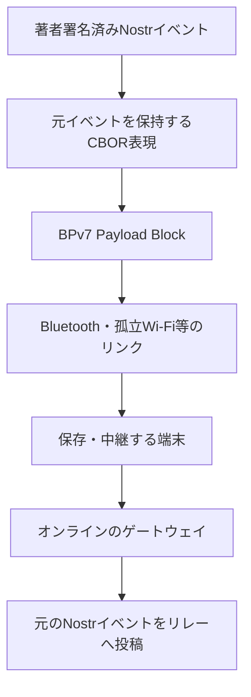

# MNDT: BPv7 メッシュ配送プロファイル

状態: draft-01 — 基本プロトコルと配送層の責務を整理した草案。endpoint・リンク・制御メッセージ・上限値は未確定。

## 要旨

MNDT は、本プロトコルの署名済み Nostr イベントを CBOR で表現し、BPv7 により断続的な端末間リンクで保存・中継する配送プロファイルである。本文や地理情報の意味を新たに定義せず、[基本プロトコル](0010-core.md)・[著者拡張](0011-extensions.md)・[データ表現](0012-bindings.md) を利用する。

本書は旧 draft-00 の初期案を置き換える。旧案の `mndt` タグ、group EID 書式、固定 hop 数・優先度の段階数、独自 block type 192、receipt の形式は採用済みの登録値・相互運用規約として引き継がない。配送同値性と制御情報の扱いも全体仕様へ合わせる。

## 1. 層とデータの所有者

| 情報 | 保持先 | 中継者による変更 |
|---|---|---|
| 本文、配送期限、影響範囲、その他の著者拡張 | Nostr イベントを表す payload | 不可 |
| レコード・path・端末署名済み commit・適用元 CID | 同じイベントの payload 内 | 不可 |
| 宛先 endpoint、Bundle 作成情報・Lifetime | BPv7 primary block | BPv7 の規則に従う |
| hop count、Bundle Age、直前ノード | BPv7 標準拡張ブロック等 | BPv7 の規則に従う |
| peer ごとの送信済み状態・実効優先度 | ノード内の配送管理 | ローカル方針で更新 |

参加機器はスマートフォンに限定しない。M5Stack 等のマイコンを含む無線機器も、対応する共通リンクを介して保存・中継へ参加できる構成を要件とする。下位リンクの方式は未採用であり、Nearby Connections 互換実装と別の共通リンクの比較案は [0016](../docs/research/0016-embedded-mesh-links-research.md) を参照する。

著者の `area` 等を BPv7 拡張ブロックにだけ置かない。独自ブロックがなくても本文と著者拡張が Nostr へ搬出できる構成とする。

## 2. Bundle の構成

- payload は [0012 §4](0012-bindings.md#4-メッシュ用-cbor合意済み) の元イベントを維持する固定7要素 CBOR 配列とする。共通の自己完結拡張タグは、内側の型が未知でも値を生バイト列へ戻せる。その他の既知タグの整数・バイト列も可逆な対応規則で型変換し、運び方も未知のタグ・変換条件に合わない値・日時の原表記はそのまま保持する。共通接頭辞は [0014](0014-namespaces.md) の `mosimo.oriom.dev:ext:` で識別する。payload のメッシュ符号化版は基本プロトコル版・拡張型と独立に管理する。初版は整数 `1` を配列先頭に置き、続けて公開鍵・Nostr 作成時刻・kind・タグ一覧・本文・署名を格納する。型変換するタグと値の位置は0012の v1 対応表に限定する。
- primary block の source・destination・creation timestamp・lifetime 等は BPv7 の構造を使う。CBOR の payload 配列を BPv7 のブロック配列と混同しない。
- hop・経過時間の制限には BPv7 の標準機構を用いる方針とする。Hop Count・Bundle Age の必須範囲、初期値・更新規則・フラグは RFC 9171 に対応させて今後固定する。
- 最初の仕様では独自の経路証明・転送 receipt は要求しない。

宛先を non-singleton endpoint とする group 配送は候補だが、EID の方式・authority・group の発見・複製方法は未確定。旧案の `dtn://<mesh-id>/~<group>` を確定 EID として実装しない。BPv7 自体が全 group 構成員への配送を保証するわけではない。

## 3. 接触時の処理の流れ

以下は配送手順の構成案であり、リンク上のメッセージ名・wire 構造は未確定である。

| 段階 | 交換・処理する情報 | 目的 |
|---|---|---|
| 接続・能力共有 | プロファイル版、転送可能サイズ等 | 異なるアプリの共通機能を把握 |
| 所持情報の交換 | Nostr event ID 等 | 同じイベントの不要な転送を抑える |
| 転送要求 | 受信側が必要とするイベント | 保存量・帯域の範囲で選択 |
| Bundle 転送 | 署名済みイベントを含む Bundle | 保存して次の接触へ運ぶ |
| 配送管理の更新 | peer への送信状態等 | 同じ接触での繰り返しを抑える |

リンクの発見・BLE service・Wi-Fi の接続方式、OS の実行制約、分割・再開・断片化は別途具体化する。Nostr WebSocket session を透過的にメッシュへ流すものではない。

## 4. 転送候補の選択

署名済みイベントを変えずに、受信側の方針で送信順・保存順位を決める。

- peer が未所持のイベントを候補にする。
- 著者の配送期限、BPv7 Lifetime、ローカルな保持時間・hop・保存量・帯域上限を併せて適用する。
- 影響範囲内への配送を優先できる。範囲外でもゲートウェイへの搬出等のため中継できる。
- 位置を持たない peer や地域不明の投稿も、通常の上限内で扱える。地域不明を全世界対象・最高優先度とはしない。
- 著者指定の優先度はヒントとする。未信頼の高優先度申告によって資源上限を解除しない。

優先度の具体的な型・段階数・スケジューリング、遭遇履歴等の利用、コピー数上限は未決定である。特定の peer の到達性広告だけで、唯一の保管コピーを預ける構成を要求しない。

## 5. 重複・再バンドル・保持

通常は同じ Nostr event ID を同じイベントとして扱う。Bundle が異なっても新しい投稿にならない。公的情報の配送同値による例外的な重複抑制は [0002](0002-ingestion-and-trust.md) に従い、自己申告の inventory や本文一致だけで適用しない。

再バンドル時も著者が署名した配送期限を延長しない。新しい Bundle の Lifetime・hop 状態の初期化だけで無制限に再拡散できないように、既知イベントの記録とローカル上限を使う。記録の寿命と再投入の具体規則は未確定である。

配送期限の既定期間はアプリ・運用者に委ねる。時計不明時は期限内と保証された扱いにせず、ローカル上限内で中継できる。配送期限満了は投稿削除ではなく、オンライン側の保持期間とも同じではない。

## 6. ゲートウェイ

メッシュから取得した元イベントを標準 Nostr JSON に戻し、対応物理 PDS のリレー等へ投稿する。元の公開鍵・時刻・kind・tags・content・署名を変えない。BPv7 の経路情報を元イベントのタグへ追加しない。

逆方向は [0013](0013-public-information.md) のような信頼する取り込みサーバーによる公的情報等を、方針・期限・地域・資源上限の範囲でメッシュへ投入する。AppView や Nostr で取得した全件の自動投入はしない。既存 BSAF 投稿からの再配信は未決定である。

Nostr リレーの受理は、全メッシュ端末への到達や、PDS・AppView への公開完了を意味しない。

## 7. 公開性と資源

元の投稿は公開情報である。BPv7 の拡張だけで本文の限定公開を実現するものではない。保存量・デコード量・送信量には上限が必要であり、未知拡張の保持を無制限の資源提供義務とはしない。メッシュ符号化形式 v1 の1イベントの CBOR payload は全体で32 KiB（32,768バイト）以下とする（[0012 §4.4](0012-bindings.md#44-payload-のサイズ上限合意済み)）。BPv7 のヘッダー・CRC・拡張ブロック等はこの値に含めず、断片化によってイベント全体の上限を回避しない。端末はさらに小さい受信・転送上限を設定でき、上限内でも受理・中継を保証しない。署名済みイベントを削って小さくせず、運べない場合は配送を見送る。ネスト・要素数等のデコード負荷上限、保存量・送信量の具体上限は未確定である。

## 8. 参照

- [RFC 9171 — Bundle Protocol Version 7](https://www.rfc-editor.org/rfc/rfc9171.html)
- [RFC 8949 — CBOR](https://www.rfc-editor.org/rfc/rfc8949.html)
- [NIP-01](https://github.com/nostr-protocol/nips/blob/master/01.md)
