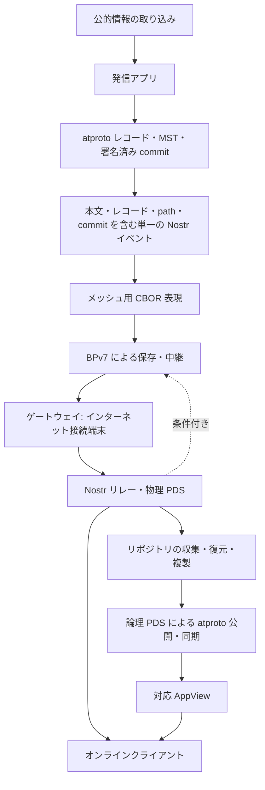
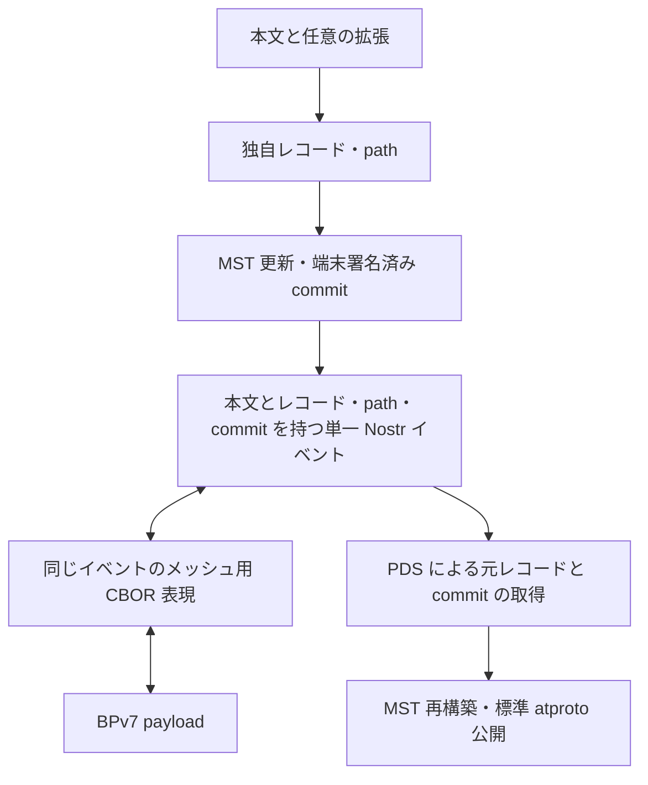

# もしもプロトコル

識別子: `dev.jisaku.mosimo`

## 目的

もしもプロトコル（Mosimo）は、災害等でインターネット接続が途絶した状況でも、異なるアプリの間で署名済みの公開テキスト投稿を保存・中継し、接続回復時にはインターネット上の情報網へ接続するための共通プロトコルである。専用の単一アプリを前提とせず、自治体の防災アプリ等に組み込んで相互運用する。個人による被災状況の報告と、公的な発表を元にした情報の双方を同じ投稿単位で扱う。

本書は基本プロトコルとして、参加者と責務、投稿の単位、基本データ型、投稿レコードの構造、拡張の共通構造と運び方、atproto レコード・commit と Nostr イベントへの対応、版管理、名前空間、識別子の意味、公開性を定義する。発信地点・影響範囲・情報の有効期間・注釈・配送優先度・削除要求・通報・メッシュ配送・PDS・発信者証明・公的情報の取り込みは、それぞれ拡張プロトコルが定義する（[§5.4](#54-公式拡張プロトコル)）。

本書が保証する範囲は次の三点である。

- 本文を含む Nostr イベントの著者署名を、過去の投稿やリポジトリ状態を取得していなくても単独で検証して表示できる。
- 端末が署名した atproto リポジトリを正本とし、収集側が著者の秘密鍵を持たずに、元の commit・レコード・署名を維持して復元できる。
- 未知の拡張を含む投稿を、意味を解釈せずに元の表現のまま保持・中継・再構成できる。

次は本書の保証の範囲外である。全端末への配送、正確に一回の配送、通信可能性。投稿内容の真実性、GPS の真正性、申告された優先度の正当性。全コピーの削除と、全端末が最新の訂正・削除を知ること。Sybil・妨害・悪意ある廃棄・資源枯渇攻撃の完全な防止。既存 atproto ネットワークが複数の PDS を自動で統合すること。署名検証が示すのは、その鍵による署名と署名対象の非改変であり、申告された DID・人物・機関への帰属は[発信者証明](attest/README.md)による別の確認を要する。本書は公開情報のみを対象とし、個別通信・限定公開・投稿の暗号化、画像等のメディア本体の配送、atproto データだけからの Nostr イベントの逆生成、OS バックアップ復元等による端末状態の巻き戻りへの対応は対象外である。本文や公開した位置情報は第三者が取得・保存し得る。

## 1. 全体の構成



図は論理的な情報の流れである。インターネットからメッシュへの投入は、信頼する取り込みサーバーの投稿等に限る条件付きの経路として[公的情報](public/README.md)が定める。

### 1.1 参加者と責務

| 参加者 | 責務 | 境界 |
|---|---|---|
| 発信アプリ | 鍵・DID・リポジトリの保持、投稿作成、atproto と Nostr の両形式への署名 | 他の発信者として投稿・削除してはならない。発信者の境界はインストール単位の鍵で定義されるためである |
| 中継アプリ | 署名済みイベントの保存・配送、解釈できる本文の表示 | 著者の本文・拡張を編集してはならない。署名対象の改変になるためである |
| ゲートウェイ | 同じイベントの Nostr リレーへの投稿、条件付きのメッシュ投入 | 搬出時に著者署名を付け直してはならない。元の event ID と署名を維持するためである |
| 物理 PDS | Nostr リレーの提供、レコードと変更操作からの MST 再構築、複製 | 著者の commit を新規に署名してはならない。正本は著者の署名で定義されるためである |
| 論理 PDS | DID が指す正規公開 endpoint、標準 atproto 同期の提供 | 無調整な複数ホストを同時に正規公開元としてはならない。firehose の順序とカーソルの継続性が崩れるためである |
| 対応 AppView | 独自 Lexicon と既存 BSAF 投稿の収集、索引・一覧・地図 | 書き換えたレコードを原投稿として扱ってはならない。元の著者・署名・識別子を保持するためである |

一つの実装が複数の役割を持てる。基本本文を表示するだけのクライアントは、署名検証と本文表示だけで参加できる。論理 PDS・物理 PDS・リレーの詳細は [PDS](pds/README.md)、メッシュ配送は[メッシュ配送](mesh/README.md)に従う。

### 1.2 発信者と鍵

発信者は、アプリのインストールごとに独立した鍵・DID・リポジトリを持つ。これらはインストール後の初回起動等、平時のアプリ初期化で自動的に生成・永続化し、オンラインで PLC 登録と既定の論理 PDS グループでの受け入れを進める。同じ人や同じ端末でも、アプリのインストールが異なれば別の発信者である。

| 鍵 | 署名方式 | 曲線 | 用途 |
|---|---|---|---|
| Nostr 署名鍵 | BIP-340 Schnorr | `secp256k1` | Nostr イベントの署名 |
| atproto リポジトリ署名鍵 | ECDSA | `secp256k1` | atproto commit の署名 |
| PLC 管理鍵 | ECDSA | `secp256k1` | PLC 初期操作と DID 設定の変更。初期操作の `rotationKeys` に置く |

三つの鍵は秘密鍵を共用してはならない。用途が異なる署名を一つの鍵で行うと、一方の署名を他方の文脈へ流用できるためである。PLC 管理鍵は発信端末だけが保持し、PDS や代理登録者へ渡してはならない。渡すことは DID の管理権限の移転にあたるためである。曲線の統一は端末が生成する鍵に関する決定であり、認証局のルート鍵やサービスの Label 署名鍵には適用されない。

DID は `did:plc` とし、端末が署名した初期操作のハッシュから決定する。発信者 DID と atproto 用・Nostr 用公開鍵の対応は、両方の鍵で署名した独立の**鍵対応宣言**で示す。宣言は用途を区別する識別子・仕様バージョン・発信者 DID・atproto 用公開鍵・Nostr 用公開鍵と、その DID の発信に当該鍵の組を用いることへの同意を含む。初回は PLC 初期操作から DID を決定した後に宣言へ署名する。宣言が示すのは両秘密鍵の保持者による対応付けへの同意であり、DID の認証は、検証に用いる PLC の状態において宣言内の atproto 公開鍵がその DID のリポジトリ署名鍵として認められていることの確認を要する。この確認は正規の atproto リポジトリとしての公開時に PDS が行い、通常のメッシュ受信・中継・本文表示には要らない。

初回起動がオフラインで PLC 登録が完了していない場合に限り、署名済み初期操作を独立した制御データとして配送し、受け取ったオンラインノードが PLC Directory への提出を代行する。PLC Directory は認証なしの HTTP リクエストで署名済み操作を受け付け、操作の署名を検証する。代理登録は署名済み操作をそのまま送信する行為であり、代理者は秘密鍵も DID の管理権限も得ない。全ノードがオフラインの間は登録完了が保証されない。制御イベントの形式と手順は [PDS](pds/README.md) に従う。

### 1.3 正本と検証の段階

端末で生成・署名した atproto リポジトリを正本とし、Nostr と BPv7 はその配送を担う。収集サーバーは復元・検証・複製を行う。

検証は三つの独立した状態として扱う。

| 状態 | 検証対象 | 要する情報 |
|---|---|---|
| Nostr 署名の検証 | イベント内の `pubkey` に対する `id`・`sig` | イベント単体 |
| DID の認証 | `pubkey`・atproto 公開鍵と DID の対応 | 鍵対応宣言と PLC の状態 |
| 署名済み状態への包含 | レコードが commit の指す MST に含まれること | 適用元の状態、レコード、path |

通常のメッシュ受信・中継・本文表示は第一の状態だけを要する。第一の状態をもって第二・第三の状態が成立したと扱ってはならない。前者はイベント単体で確認できるが、後者は外部の状態に依存するためである。

## 2. 投稿の単位

```text
1 投稿
  ├─ 著者自身のリポジトリへ 1 レコード追加
  ├─ その状態を指す端末署名済み atproto commit を 1 件生成
  └─ 本文・commit・適用元 CID・path・レコードを表す Nostr イベントを 1 件生成
```

通常投稿と、対象投稿に対する訂正・補足・追認にこの単位を適用する。基本版 1 のレコード型は `dev.jisaku.mosimo.post`、操作は新規レコード追加であり、一つの commit はちょうど一つのレコード追加を含む。一投稿の本文・レコード・path・commit・適用元 commit CID は同じ Nostr イベントに含める。別イベントに分けると、イベント単体でレコードと commit を復元できなくなるためである。

適用元は端末が直前に確定した commit の CID とし、初回は適用元なしを明示する。訂正・補足・追認は対象投稿を参照する新しい投稿であり、対象投稿の著者以外も発信できる（[注釈](annotation/README.md)）。既存レコードの内容を上書きする更新操作は設けず、内容の変更は常に新しい投稿として表す。これにより、どの端末が元投稿だけを保持していても、その署名済み表現が変わることはない。

削除はレコード追加ではなく、[削除要求](delete/README.md)が定める著者の制御処理である（[§11](#11-削除と通報)）。PLC 初期操作と鍵対応宣言は繰り返し利用する独立した制御データであり、投稿とは別に配送する。

## 3. 基本データ型

型の記法は説明用の TypeScript 風であり、正規の定義は各 Lexicon JSON である。

| 型 | 論理上の値 | 表記 |
|---|---|---|
| `Text` | Unicode 文字列 | UTF-8。署名後に改行・Unicode 正規化を変更してはならない。文字列が変わると CID と署名対象が変わるためである |
| `integer` | 整数 | atproto の範囲内。JavaScript の number への丸めを避ける |
| `Timestamp` | 絶対時刻 | [§3.1](#31-共通時刻型-timestamp) |
| `Microdegrees` | 整数 | 緯度・経度。100 万分の 1 度を 1 とする（[§3.2](#32-座標と距離の整数表現)） |
| `Millimeters` | 整数 | 距離。1 mm を 1 とする（[§3.2](#32-座標と距離の整数表現)） |
| `Bytes` | 生バイト列 | CBOR では byte string。独自 Nostr タグでは [§3.3](#33-バイト列の文字列表現) の Base64 |
| `Did` | DID 文字列 | 発信者は `did:plc` |
| `Cid` | CID | 文字列表現は標準どおり。atproto 内のリンクは標準 CID link |
| `RepositoryPath` | collection と record key | `dev.jisaku.mosimo.post/<record-key>` |
| `AtUri` | atproto レコードの場所 | `at://<DID>/<collection>/<record-key>` |
| `NostrEventId` | Nostr イベント識別子 | 32 バイト。Nostr JSON では小文字 hex |

値は atproto データモデルに従い、文字列・整数・真偽値・bytes・CID link・配列・文字列キーのオブジェクト・null を用いる。float は atproto データモデルに存在しないため使えない。`null`、省略、空配列はそれぞれ別の意味を持つ。

### 3.1 共通時刻型 Timestamp

`Timestamp` は UTC・末尾が大文字 `Z` の日時文字列であり、atproto の `datetime` 形式に適合する。作成時刻・配送期限・有効期間・出典内の原発表時刻等の全ての時刻に共通で用いる。

```text
2026-10-17T12:34:56Z
2026-10-17T12:34:56.789Z
```

- 基本形は秒精度の `YYYY-MM-DDTHH:mm:ssZ` であり、配送期限 `exp` と任意の `created` 以外の時刻もこの形を基本とする。秒未満は、より細かい精度を必要とする項目だけが付ける。固定の小数桁数は定めない。
- 受信済みの文字列を、末尾ゼロの削除・精度の切り詰め・日時ライブラリ経由の再整形等で変更してはならない。同じ瞬間を表しても文字列が変わると元レコードの CID が変わるためである。
- 原情報のオフセット付き時刻は、新しい変換投稿を作成する際に UTC へ変換する。原表記が必要なら出典の形式別情報に保持する。
- 不明・曖昧な時刻を現在時刻や Unix epoch のゼロで補ってはならない。補った値は著者の署名付き主張として配送されるためである。任意の時刻項目は不明なら省略する。
- 投稿の作成時刻は Nostr の標準 `created_at`（Unix 秒整数）が正本である。秒未満の精度が必要な投稿だけがレコードの任意項目 `created` に `Timestamp` 文字列を持ち、その秒部分は `created_at` と一致しなければならない。
- BPv7・外部の原文・標準 Label 等が固有に持つ日時の符号化はそれぞれの標準に従う。

### 3.2 座標と距離の整数表現

バンドルのサイズ削減のため、座標・距離は十進小数文字列ではなく単位を固定した整数で表す。

| 量 | 保存単位 | 例 |
|---|---|---|
| WGS 84 緯度・経度 | 100 万分の 1 度 | 35.123456 度 → `35123456` |
| 円の半径・測位精度 | ミリメートル | 2500 m → `2500000` |

atproto レコードとその CBOR では整数型として格納する。自己完結した Nostr 拡張タグの内部 CBOR でも整数のまま保持する。基本項目や標準タグとの直接対応で数値をタグの値へ出す場合は整数の十進文字列とし、レコードを構成する際に整数型へ戻す。説明用のフィールド名は `latitudeMicrodegrees`・`longitudeMicrodegrees`・`radiusMillimeters`・`accuracyMillimeters` とする。

固定単位は表現の分解能であり、測位の実精度とは別である。表示は度・メートルへ換算できる。中継者は受信した整数を再量子化してはならない。署名対象の改変になるためである。

### 3.3 バイト列の文字列表現

本プロトコルの独自 Nostr タグで定義するバイト列項目は、RFC 4648 §4 の通常の Base64 で表し、末尾の `=` padding を省く。アルファベットは英大文字・英小文字・数字・`+`・`/` であり、Base64url の `-`・`_` は用いない。改行・空白を含めず、RFC 4648 の正規な符号化から末尾の `=` を除いた一意の表現とする。

| 場所 | 表現 |
|---|---|
| 独自タグの bytes 項目 | 通常の Base64、末尾 `=` なし |
| メッシュ用 CBOR の変換済み値 | 生バイト列（byte string） |
| Nostr 標準の `id`・`pubkey`・`sig` | 標準どおり小文字 hex |
| CID の文字列表現 | atproto 等の既存規則 |
| atproto JSON の bytes | 標準の `{"$bytes":"..."}`。元レコード内は bytes 型 |

生バイト列 `01 02` は `AQI`、`fb ff` は `+/8` と表し、32 バイトは 43 文字になる。この規則は bytes 型の文字列表現を定めるものであり、整数・時刻・通常の文字列には適用されない。既知の独自タグでもこの表記に合わない値は、正規化して置き換えずに文字列のまま保持する。置き換えると元の署名対象を復元できなくなるためである。

## 4. 投稿の構造

### 4.1 基本項目

```ts
type Post = {
  text: Text;
  exp: Timestamp;          // 配送期限。秒精度の基本形
  created?: Timestamp;     // 秒未満の精度が必要な場合だけ。秒は created_at と一致
  ext: Extension[];        // 拡張がなければ空配列
};
```

| 項目 | 必須 | 意味 |
|---|---|---|
| `text` | 必須 | 拡張に未対応でも読める本文。公的情報では発表元・対象・主要な指示を本文でも伝える |
| `exp` | 必須 | 著者が署名するメッシュ配送の絶対期限。秒精度の基本形 |
| `created` | 任意 | 秒未満の精度を持つ作成時刻。省略時の作成時刻は Nostr の `created_at`。原情報の発表時刻や取得時刻とは別 |
| `ext` | 必須 | 著者署名付き拡張の一覧（[§5](#5-拡張)） |

基本版 1 の atproto レコードのトップレベルは、上記の項目と `$type: "dev.jisaku.mosimo.post"` に固定する。レコードの項目名は atproto 側にだけ現れ、メッシュと Nostr では Nostr のフィールドとタグで運ぶ。言語・分類・アプリ固有情報等の任意の追加情報は `ext` の要素として定義する。基本項目そのものの追加は基本プロトコルの版変更として扱い、Lexicon の互換性規則を併せて適用する。追加のトップレベル項目を持つレコードから、その項目を削って版 1 の同じ元レコードとして扱ってはならない。削った結果は元の署名対象と異なるレコードになるためである。

DID・Nostr 公開鍵・event ID・record CID・commit CID は各形式の外側の情報から得る。

配送期限は、利用者による毎回の入力ではなく、アプリ・運用者が設定する既定期間から投稿作成時に絶対期限を確定して署名する。既定期間はアプリ・運用者ごとに定める。中継者は署名された期限を用い、発信アプリの既定値を知る必要がない。配送期限は著者が許可する配送の上限であり、各ノードはローカルな資源事情により配送を早く打ち切れる。受信側の保持時間・保存量・送信量の上限は、指定された期限の長さとは独立に適用される。再バンドル時に著者署名付きの配送期限を延長してはならない。期限は署名対象であり、延長は著者の許可を超えた再拡散になるためである。

配送期限の実施は実装・時計・資源状態に依存するベストエフォートである。時刻を信頼できるノードは期限内と期限切れを区別し、期限切れの新たなメッシュ配送を停止することを推奨する。期限を判定できないノードも、期限内と確認済みにはせずに、ローカルな保持時間・配送量の上限内で保持・中継できる。受信したことだけを根拠に期限内・最新と扱ってはならない。再投入や不正な時計により期限切れの情報が届き得るためである。

### 4.2 時間の区別

| 時間 | 所有者 | 省略・満了の意味 |
|---|---|---|
| 投稿作成時刻 `created_at`（任意の `created`） | 発信アプリ | 必須。原発表・受信時刻とは別 |
| 情報の有効期間 | [有効期間](validity/README.md)拡張 | 省略は不明。満了は内容がその時点の指示として有効でなくなったこと |
| 配送期限 `exp` | 通常投稿の基本項目 | 必須。満了は新たなメッシュ配送の対象外になったこと |
| BPv7 Lifetime・経過時間 | 配送層 | 署名付き期限とローカル上限に併せて適用 |
| リレー・PDS の保持期間 | サービス運用 | 配送期限とは別。永久保存は保証されない |

満了した配送期限や有効期間から投稿の削除・撤回を導いてはならない。削除は著者の制御処理（[削除要求](delete/README.md)）だけが表すためである。不明な有効期間を配送期限から推測して補ってはならない。

## 5. 拡張

### 5.1 共通構造

投稿の `ext` は、Lexicon の open union を要素とする配列である。各要素は `$type` で型を識別するオブジェクトであり、拡張固有のフィールドをそのオブジェクトへ直接格納する。

```ts
type Extension = KnownExtension | UnknownExtension;
type UnknownExtension = { $type: string; [field: string]: DataValue };
```

`DataValue` は atproto データモデルの値である。

- `$type` は完全修飾の Lexicon 型参照（NSID、必要なら `#定義名`）である。プロトコルが一つの型だけを定義する場合は main 定義とし、`$type` はプロトコル識別子そのもの（例 `dev.jisaku.mosimo.validity`）、複数なら `dev.jisaku.mosimo.geo#area` のように `#` で区別する。
- 拡張は投稿内の入れ子のオブジェクトであり、別レコード・別 Nostr イベントにはならない。
- 拡張の互換性を壊す変更は新しい `$type` で識別する。共通の `version` フィールドは置かない（[§8](#8-版管理)）。
- 拡張一覧は配列であり、中継時に並べ替えてはならない。同じ型の複数要素も独立して保持し、統合・上書き・重複削除してはならない。配列の順序と要素はいずれも署名対象だからである。個別の型が意味上許す多重性はその型の仕様が定める。

著者の拡張と中継者の配送情報は次のように区別する。

| 著者の拡張 | 中継者の配送情報 |
|---|---|
| 発信地点・影響範囲・出典・注釈等 | hop count・Bundle Age・直前ノード等 |
| 著者の署名対象で不変 | 各配送層の規則に従って変わる |
| Nostr タグと atproto レコードで保持 | BPv7 の標準ブロック等で保持 |

著者拡張の正本は署名付き投稿の一部である。BPv7 独自ブロックだけへの格納は Nostr 搬出時に失われるため、著者情報の唯一の保存先にしてはならない。標準・独自のいずれのタグも著者が署名時点で含め、中継者は付け足してはならない。

### 5.2 未知の拡張の保持

未知の `$type`、既知型の未知フィールドは、元の署名対象表現を保持して中継・再構成する。保持・中継用の元オブジェクトと、表示用に読み取った既知フィールドを区別し、既知項目だけで元データを作り直してはならない。作り直したデータは元の CID と一致しないためである。保持できない場合は、改変して転送せず転送を見送る。

未知の拡張があることだけを理由に既知の本文の表示を拒んではならない。本文は拡張に未対応でも読めるように定義されているためである。一方、形式不正や資源上限超過は資源保護のため拒否できる。

### 5.3 拡張の独立性と部分実装

拡張は任意であり、誰でも自身の衝突しない Lexicon 名前空間で定義できる（[§10.3](#103-第三者の拡張)）。共通管理者の承認、全クライアント・PDS への型一覧や専用コードの追加、受信時のオンラインスキーマ取得は定義・運搬の条件ではない。意味を利用するアプリだけがその型に対応する。

- 独立した型の同名フィールドは互いに別の意味を持つ。名前の一致だけで他の拡張のフィールドを上書き・統合してはならない。例えば独自型内の `priority` フィールドを共通の[配送優先度](priority/README.md)として採用してはならない。
- 拡張間の対応や依存が必要な機能は、その拡張仕様で明示する。依存先がない・非対応の場合、該当機能は利用できない状態となり、無関係な本文・拡張の処理は成立する。
- 複数の拡張が矛盾する配送方針等を示す場合の解決は、対応する拡張の意味規則とクライアントの採用方針に委ねる。後勝ち、配列順による上書き、型名の一致しない情報の自動統合を共通規則として適用してはならず、具体的な競合解決規則がなければ一方を確定した共通情報として扱ってはならない。どちらの拡張も著者の署名対象であり、基本プロトコルには優劣を決める根拠がないためである。元の署名付きオブジェクトはどの場合も保持する。
- ある拡張に非対応でも、その投稿の本文と、同梱された別の対応済み拡張を利用できる。発信側は重要な指示を本文にも示し、意味を正しく表せる範囲で既存の共通拡張を併用する。共通拡張へ合わせるために原形式の意味を変えたり、未知型からフィールド名だけで値を推測したりしてはならない。
- 拡張が定義する動作を有効にするかは、対応クライアントと利用者・運用者の方針で決める。拡張を受信しただけで実行コードの取得・実行、端末権限の付与、外部資源への無制限なアクセスを行ってはならない。拡張が定義する動作も、著者署名付きデータの改変禁止・配送期限・サイズ上限・資源上限の下で行う。拡張の名前や高い優先度の自己申告は、それだけでは信頼の根拠にならない。

### 5.4 公式拡張プロトコル

| 識別子 | 文書 | 定義する内容 | 省略・未対応時 |
|---|---|---|---|
| `dev.jisaku.mosimo.geo` | [地理情報](geo/README.md) | 発信地点 `#origin`、影響範囲 `#area`、Geohash、近似 | 位置不明・地域不明 |
| `dev.jisaku.mosimo.validity` | [情報の有効期間](validity/README.md) | 内容が有効な期間 | 期間不明 |
| `dev.jisaku.mosimo.annotation` | [注釈](annotation/README.md) | 訂正・補足・追認の対象と関係、Label との関係 | 対象との関連は不明。本文は読める |
| `dev.jisaku.mosimo.priority` | [配送優先度](priority/README.md) | 著者の配送優先度ヒントと実効優先度 | level 1 として扱う |
| `dev.jisaku.mosimo.delete` | [削除要求](delete/README.md) | 著者による投稿の削除要求（NIP-09）と削除後の commit | 削除要求を通常のイベントとして中継する |
| `dev.jisaku.mosimo.report` | [通報](report/README.md) | 不適切な投稿の通報（NIP-56）と、通報の集計による配送の停止 | 通報を通常のイベントとして中継する |
| `dev.jisaku.mosimo.mesh` | [メッシュ配送](mesh/README.md) | BPv7 による保存・中継、接触時交換、メッシュ用 CBOR | 配送層の仕様であり拡張型を持たない |
| `dev.jisaku.mosimo.pds` | [PDS](pds/README.md) | 論理 PDS と物理 PDS、Nostr リレープロファイル | サービス側の仕様であり拡張型を持たない |
| `dev.jisaku.mosimo.attest` 以下 | [鍵署名](attest/README.md)、[署名チェーン](attest/chain/README.md)、[失効通知](attest/revocation/README.md)、[転載サーバー](attest/importer/README.md) 等 | 発信者証明、投稿への同梱、失効 | 発信者未確認 |
| `dev.jisaku.mosimo.public` 以下 | [公的情報](public/README.md) と形式別の [CAP](public/cap/README.md)、[EDXL-DE](public/edxl/README.md)、[気象庁 XML](public/jma/README.md)、[BSAF](public/bsaf/README.md) | 出典 `#source`、取り込みの信頼、形式別の原情報 | 本文と理解できる他の拡張を利用 |

これらは独立した関心である。公的な投稿に `#origin` は必須ではなく、`#area` があっても発信者の現在地は分からない。

## 6. atproto 表現

### 6.1 レコード

基本投稿の Lexicon は [`post.json`](post.json) である。`ext.items` は `refs: []`・`closed: false` の open union とし、各要素の `$type` を必須としつつ第三者の型も運ぶ。空の refs を持つ open union は Lexicon 標準で認められる。

```ts
type PostRecord = {
  $type: "dev.jisaku.mosimo.post";
  text: Text;
  exp: Timestamp;
  created?: Timestamp;
  ext: Extension[];
};
```

レコードを atproto の正規化 CBOR（現行 Data Model が規定する DRISL）で符号化して record CID を得る。本書で「atproto deterministic CBOR」と呼ぶものはこの符号化である。同じ CID を得るには、一般の deterministic CBOR ではなく atproto の符号化制約に従う必要がある。

Lexicon の `datetime` は時差オフセットを許容するため、UTC・末尾 `Z` の制約（[§3.1](#31-共通時刻型-timestamp)）、トップレベル 5 項目の制約、メッシュ payload の 32 KiB 上限は Lexicon の型検査とは別に適用する。

### 6.2 レコードキー

repository path は `dev.jisaku.mosimo.post/<record-key>` であり、本文投稿ごとに新しい path へ追加する。record key は atproto 標準の 13 文字の TID とし、Lexicon のレコード定義では `key: "tid"` を指定する。文字種とビット構造は TID 仕様に従い、短縮・大文字化・区切り文字の追加を行わない。

- 端末の時計と TID 標準の clock identifier を用い、オフラインでも生成する。
- 直前に生成した値を永続化し、同時刻の連続生成・通常動作中の時計の後退・アプリ再起動でも、同じリポジトリのこの collection でキーを再利用せず単調増加させる。並行して作成する場合も生成状態を共有する。
- キーに含まれる時刻を投稿時刻の証拠にしてはならない。表示・有効期間・配送期限は、それぞれの日時フィールドで扱う。
- キーは同じリポジトリの同じ collection 内で一意であればよく、レコードの場所は `(DID, collection, record-key)` の組で識別する。Nostr event ID・record CID・commit の `rev` とは別の識別子である。
- 中継者・PDS は著者が署名した path を保持し、受信時刻に合わせたキーの再生成や置換を行ってはならない。path は署名対象だからである。

例: `dev.jisaku.mosimo.post/3jzfcijpj2z2a`。

### 6.3 commit と変更操作

標準 repository v3 commit の構造は次のとおりであり、本プロトコルが新設する型ではない。

```ts
type AtprotoCommitV3 = {
  did: Did;
  version: 3;
  data: CidLink; // MST root
  rev: string;   // TID。単調増加する repository revision
  prev: CidLink | null;
  sig: Bytes;
};
```

`sig` を含めた commit の符号化バイト列を保持する。`rev` はリポジトリの改訂識別子であり、`data` は MST root である。

配送する変更情報の論理構造は次のように表せる。

```ts
type CreateRecordChange = {
  baseCommit: Cid | null;  // 適用元 commit。初回は null
  commit: Bytes;           // 元の署名済み commit の atproto CBOR
  action: "create";
  path: RepositoryPath;
  record: PostRecord;
};
```

`record` と `commit` の CID は元のバイト列から算出し、DID は commit から得るため、配送データはこれらを別項目として持たない。`action: "create"` は説明用の論理操作であり、通常投稿の Nostr イベントは新規追加として扱われるため `action` タグを持たない。適用元 commit CID は本プロトコルの配送情報であり、標準 commit の `prev` はそのままの意味で用いる。

MST は repository path → record CID の写像である。PDS はレコード・path・変更操作から適用元の状態を更新し、再構築した root と署名済み commit の `data` を照合する。MST ノード・包含証明は配送データに含まれず、標準 atproto 同期向けの MST・CAR は PDS が構築する。適用元の状態や必要なレコードが欠けている場合、PDS は検証を保留し、推測した木を検証済みとして公開してはならない。推測した状態は著者が署名した状態と一致する保証がないためである。詳細は [PDS](pds/README.md) に従う。

## 7. Nostr 表現

### 7.1 標準フィールド

| フィールド | 内容 |
|---|---|
| `kind` | 通常投稿・訂正・補足・追認は `1`。制御イベントは [§7.5](#75-制御イベント) |
| `content` | `Post.text` そのもの。人が読める本文であり、XML・CBOR・CAR の Base64 を置いてはならない。拡張に未対応のクライアントに本文を提供するためである |
| `tags` | 発見用 `t` タグ、基本項目、各拡張を [§7.2](#72-基本タグ) の固定順で置く。並び順・文字列を署名後に変えない |
| `created_at` | 投稿の作成時刻の Unix 秒整数。レコードに `created` があればその秒部分と一致 |
| `pubkey`・`id`・`sig` | 標準 Nostr の値・符号化 |

Nostr のタグは文字列配列の配列であり、JSON object や生バイト列を直接入れられないため、本文以外のデータは文字列表現で署名対象のタグに置く。

### 7.2 基本タグ

基本項目と各拡張は複数のタグへ分け、拡張ごとの独立した実装を可能にする。これは一つのイベント内の配置であり、投稿が複数イベントに分かれることはない。

```text
Nostr イベント
├─ content = 元レコードの text
└─ tags
   ├─ プロトコル識別 ["t", "mosimo.jisaku.dev"]
   ├─ 基本版・署名済み commit・適用元 CID・record key
   ├─ 配送期限、任意の精密な作成時刻
   └─ 各拡張の自己完結タグ（元の配列順）
```

基本版 1 の通常投稿・訂正・補足・追認は、`kind: 1` の一つのイベントに次を含める。

| 項目 | タグ配列 | 個数 |
|---|---|---|
| プロトコル識別 | `["t", "mosimo.jisaku.dev"]` | この識別値を持つタグを 1 個 |
| 基本版 | `["mosimo:v", "1"]` | 1 個 |
| 署名済み commit | `["mosimo:commit", commitBase64]` | 1 個 |
| 適用元 commit | `["mosimo:base", baseCid]` | 1 個。適用元なしの初回は値を `""` とする |
| record key | `["mosimo:rkey", tid]` | 1 個 |
| 配送期限 | `["mosimo:exp", exp]` | 1 個 |
| 精密な作成時刻 | `["mosimo:created", created]` | レコードに `created` がある場合に 1 個 |
| 拡張 | `["mosimo:ext:" + type, fieldsBase64]` | 任意個。元の配列順 |

- この表のタグは名前と一つの値の 2 要素である。
- `commitBase64` は元の署名済み commit CBOR の [§3.3](#33-バイト列の文字列表現) による Base64。
- `baseCid` は適用元 commit CID の標準文字列表現。空文字列は「適用元なし」という明示値であり、タグの省略とは異なる。
- `tid` はレコードの record key（[§6.2](#62-レコードキー)）。collection は版 1 で `dev.jisaku.mosimo.post` に固定されているため、repository path は `dev.jisaku.mosimo.post/<tid>` として復元する。
- `exp`・`created` は `Timestamp` 文字列。レコードに `created` がない場合、復元するレコードにも `created` を置かない。
- タグ名は UTF-8 の文字列としてそのままイベントに含まれるため、短い名前を用いる。接頭辞 `mosimo:` がこのプロトコルの管理範囲を示す。
- 拡張タグが 0 個なら `ext` は空配列になる。
- タグの並び順は固定する。先頭から `t`、`mosimo:v`、`mosimo:commit`、`mosimo:base`、`mosimo:rkey`、`mosimo:exp`、（あれば）`mosimo:created` の順に置き、続けて拡張タグを `ext` の配列順に置き、その後に他のタグを置く。この順序でないイベントは版 1 の投稿として扱ってはならない。並び順を固定することで、メッシュ用 CBOR が内容の固定されたタグを省略して定位置へ戻せ、受信側が位置だけで基本項目を取り出せるためである。

DID・`rev`・MST root・atproto 署名は commit から、record CID・commit CID は元データから算出する。`mosimo:type` と `mosimo:action` は制御形式のために確保した名前であり、通常投稿には現れない。

元のイベントにある追加タグはそのまま保持・中継できる。未知のタグを推測してトップレベルのレコード項目へ取り込んではならない。トップレベルは版 1 で固定されているためである。

### 7.3 自己完結した拡張タグ

既定の運び方は、1 拡張オブジェクト ＝ 1 自己完結タグである。

```text
タグ名 = "mosimo:ext:" + 拡張の完全修飾 $type
タグ値 = $type 以外の全フィールドの atproto deterministic CBOR を、通常の Base64・padding なしで表した文字列
```

例えば影響範囲のタグ名は `mosimo:ext:dev.jisaku.mosimo.geo#area` である。

- タグ名から接頭辞を除いた残り全体が元の `$type` 文字列であり、値のオブジェクトへ戻す際にこの `$type` を付ける。`$type` を URL エンコード・percent-encode・大文字小文字変換してはならず、`#` は定義名を示す文字としてそのまま保持する。
- 値の CBOR は、他の全フィールド、未知フィールド、配列順、bytes・CID link・null 等の型、省略と null の区別を保持する。符号化は atproto データモデルの正規化 CBOR であり、拡張固有のスキーマを知らなくても符号化・復号できる。
- 共通の拡張タグをタグ一覧に現れた順に取り出して元の `ext` 配列を構成する。非拡張タグは配列要素として数えない。位置番号や別の順序リストは持たない。
- 同じ `$type` が複数あってもそれぞれ独立した要素として保持する。
- PDS・中継者は、共通接頭辞と CBOR のデータ型だけで未知の拡張を元のオブジェクトへ戻せる。意味の解釈と運搬・再構成は分離される。

レコード内では open union の `$type` 付きオブジェクトのまま保持し、Nostr に載せる際だけ拡張ごとに独立して符号化する。自己完結タグの内部では、時刻は `Timestamp` 文字列、座標・距離は固定単位の整数（[§3.2](#32-座標と距離の整数表現)）として格納する。

### 7.4 標準タグとリレー検索

NIP-01 の標準的なタグ検索は英字一文字のタグ名とその最初の値に対する一致を対象とする。複数文字の独自タグは保持されても一般リレーで同様に検索できるとは限らない。本プロトコルは、独自タグが一般リレーで検索できないことを許容し、取得後の索引・絞り込みは対応 AppView・クライアントが担う。

標準タグは、定義元 NIP の対象 kind・文脈・値の意味が正確に一致し、型・全フィールド・元の配列位置を欠落なく構成できる共通の対応規則がある場合だけ再利用する。それ以外の基本項目・拡張は `mosimo.jisaku.dev:` を接頭辞とする独自タグとする。検索性のためだけに新しい一文字タグを割り当てたり、標準タグの意味を流用したり、別名タグ・重複索引を追加してはならない。署名対象が増える一方で、意味の一致しないタグは他のクライアントの解釈を誤らせるためである。

全てのタグは著者が署名時点で含める。中継者が署名済みイベントのタグを追加・変更すると署名が無効になるため、行ってはならない。

### 7.5 制御イベント

| `kind` | 用途 | 定義 |
|---|---|---|
| `1` | 通常投稿・訂正・補足・追認 | 本書 |
| `5` | NIP-09 削除要求 | [削除要求](delete/README.md) |
| `1984` | NIP-56 通報 | [通報](report/README.md) |
| `8173` | 本プロトコル固有の制御イベント全般 | 下記 |

既存の Nostr の kind に意味が一致する制御処理はその kind を用いる。それ以外の本プロトコル固有の制御イベントは一つの kind `8173` に統一し、中身は自己完結拡張タグ（[§7.3](#73-自己完結した拡張タグ)）で運び、種別は拡張の `$type` で区別する。`8173` は通常イベントの範囲（1000〜9999）にあり、公開されている割り当てと重ならない値である。

制御イベントは発見用の `["t", "mosimo.jisaku.dev"]` に加えて、種別ごとの値 `["t", "mosimo.jisaku.dev/<種別名>"]` を持つ。リレーの `#t` フィルタで種別ごとに取得できるようにするためである。タグの並び順は、先頭から `["t", "mosimo.jisaku.dev"]`、種別の `t`、`mosimo:exp`、拡張タグ、その後に他のタグとする。制御イベントに `mosimo:v` タグを付けてはならない。基本版タグは通常投稿の基本項目構成を識別するものであり、制御イベントの内容は運ぶ拡張の `$type` で版管理されるためである。メッシュでは通常投稿と同じ外側の構造（[メッシュ配送](mesh/README.md)）を用い、解釈できない端末も制御イベントを通常の中継対象として扱える。

| 種別名（`t` の二つ目の値） | 内容 | 定義 |
|---|---|---|
| `mosimo.jisaku.dev/revocation` | 鍵の失効通知 | [失効通知](attest/revocation/README.md) |
| `mosimo.jisaku.dev/plc` | PLC 初期操作の配送と代理登録 | [PDS §6](pds/README.md#6-plc-初期操作の制御イベントと代理登録) |

## 8. 版管理

基本プロトコル・各拡張型・メッシュ符号化形式は独立して版管理する。

| 対象 | 識別方法 | 互換性を壊す変更 |
|---|---|---|
| 基本プロトコル | Nostr の `mosimo:v` タグ。初期値は文字列 `"1"` | 基本タグ・必須項目・共通の対応規則の変更 |
| 各拡張型 | 個別の `$type` | 新しい型参照を割り当てる |
| メッシュ用 CBOR | payload 先頭のメッシュ符号化版。初期値は整数 `1` | payload の配置・文字列への復元規則の変更 |

三つの版は役割が異なり、同じ値に揃える必要はない。拡張の追加や未知の型の出現だけで基本版・メッシュ符号化版は変わらず、メッシュ表現だけの変更でレコード型も変わらない。基本版は投稿の更新回数や atproto commit の `version: 3` とも別である。

各拡張型は Lexicon の進化規則に従う。互換な任意フィールドの追加では同じ `$type` を使い、既存フィールドの型・必須条件・意味を互換性なく変更する場合は新しい型名を使う。古い型名の意味を書き換えてはならず、旧型と新型は別々に識別する。書き換えると、旧型を保持する端末が同じ `$type` に異なる意味を与えるためである。未知の新型も、共通の運び方が既知なら保持・再構成できる。

未知の基本版・メッシュ符号化版を、既知の版と推測して解釈してはならない。現在のタグ構文を互換性なく変更して同じ基本版として再利用することも同じ理由で行わない。元の Nostr イベントを取得できる場合、Nostr 標準としての署名・本文の扱いと、本プロトコルの意味を解釈できることは区別する。

## 9. 作成から公開まで

### 9.1 発信

1. 本文と任意の拡張を作り、配送期限を確定する。
2. 新しい TID をレコードキーとしてレコードを追加し、MST を更新して atproto commit に署名する。適用元は端末が直前に確定した commit の CID であり、初回は適用元なしを明示する。
3. 同じ投稿の本文・レコード・path・commit・適用元 CID を一つの Nostr イベントに表現し、Nostr 鍵で署名する。
4. オンラインなら Nostr リレーへ投稿する。メッシュでは元のイベントをメッシュ用 CBOR にして BPv7 の payload で配送する。

署名対象の生成は発信アプリで完結する。中継者は本文・タグ・拡張を補修せず、同じイベントを運ぶ。

### 9.2 受信・中継・再接続

本文を扱う端末は Nostr 公開鍵に対するイベント署名を検証し、DID 認証のための PLC 情報取得を待たずに表示する。解釈できる拡張だけを表示・配送のヒントに使い、未知の著者拡張は元の表現を保持する。

オンラインに戻った端末は、元の署名済みイベントを対応物理 PDS のリレー等へ投稿する。リレー候補はアプリ同梱・保存済みキャッシュ・既知 AppView の一覧・Nostr 経由の発見を併用する（[PDS](pds/README.md)）。インターネットから取得した情報のメッシュへの再投入は、[公的情報](public/README.md)が定める条件を満たす場合に限る。

### 9.3 PDS と AppView

PDS はレコード・path・変更操作から MST を再構築し、元の署名済み commit と照合する（[§6.3](#63-commit-と変更操作)）。DID ごとに一つの論理 PDS endpoint を指定し、その背後で物理 PDS が複製する。AppView は独自 Lexicon と既存 BSAF 投稿を、それぞれの著者・識別子を残して収集する。既存の Bluesky AppView・クライアントが独自 Lexicon を表示することは保証されず、本文の表示は Nostr の `content` と対応 AppView が提供する。

### 9.4 変換方向



- Nostr とメッシュ用 CBOR の間では元の event ID・署名・署名対象フィールドを維持する。
- Nostr から atproto へは元の record CID・commit CID・署名を維持する。
- BPv7 の hop count・経過時間・直前ノード等の可変な配送状態は著者署名付きデータから分離し、Nostr へ移さない。経路ごとに異なる Bundle 全体のバイト単位の復元は対象外である。
- 元の Nostr イベントを保持している PDS がそれを再配信することは、atproto からの逆変換とは別の行為であり、行える。

## 10. 名前空間

### 10.1 Lexicon の NSID

公式 Lexicon の NSID 接頭辞は `dev.jisaku.mosimo` であり、管理ドメインは `mosimo.jisaku.dev` である。拡張プロトコルは `dev.jisaku.mosimo.<name>` のサブ識別子を持ち、識別子とディレクトリ構造を一致させる。各プロトコルは文書 1 本と、型が確定している場合は Lexicon JSON をそのディレクトリに置く。

| 識別子 | 役割 | 定義 |
|---|---|---|
| `dev.jisaku.mosimo.post` | 通常投稿・訂正・補足・追認のレコード型と collection | [`post.json`](post.json) |
| `dev.jisaku.mosimo.getFeed` | 対応 AppView の索引済み投稿一覧の query | [`getFeed.json`](getFeed.json) |
| `dev.jisaku.mosimo.<name>` | 拡張プロトコル | [§5.4](#54-公式拡張プロトコル) |

この NSID 群の authority は `mosimo.jisaku.dev` であり、Lexicon の標準解決では `_lexicon.mosimo.jisaku.dev` の DNS TXT でスキーマを提供する DID を指定し、そのリポジトリに `com.atproto.lexicon.schema` のレコードを公開する構成となる。オフラインの受信・中継・未知拡張の再構成は DNS 照会や Lexicon 取得なしに完結する。名前の authority と、災害時に接続が必要なサービスは別である。

### 10.2 Nostr の識別子

発見用の `t` タグの値は `mosimo.jisaku.dev` である。この値はプロトコルの発見用であり、公式著者・適合性・信頼の証明ではない。版は `mosimo:v` タグで別に識別する。

基本項目の独自タグは `mosimo:` を接頭辞とし、名前は [§7.2](#72-基本タグ) の表のとおりである。拡張タグの接頭辞は `mosimo:ext:` である。タグ名と `$type` は ASCII の文字列であり、Nostr JSON では UTF-8 の JSON 文字列、メッシュ用 CBOR では UTF-8 の text string として、そのバイト数がイベントの大きさに加わる。追加の基本項目が必要になった場合は同じ管理範囲で名前を割り当てる。

### 10.3 第三者の拡張

公式の型を `dev.jisaku.mosimo` に置くことは、第三者の拡張をその配下へ登録させることを意味せず、第三者は自身が管理する衝突しない Lexicon 名前空間で定義する。自己完結タグの共通接頭辞 `mosimo:ext:` は第三者の `$type` にも同じように使う。PDS・中継者は共通の運び方として識別し、内側の型が公式の接頭辞に一致することを受理・再構成の条件にしてはならない。条件にすると、未知拡張の保持という本書の保証が公式型に限定されるためである。

未知の型の意味の解釈・表示と、その型のデータの保持・再構成は別である。資源上限・不正形式に対する制約は第三者の型にも適用される。

### 10.4 サービス用ドメイン

論理 PDS、物理 PDS、Nostr リレー、AppView、文書サイト等にドメインが必要になった場合は、`mosimo.jisaku.dev` 以下で役割に応じて割り当てる。公式識別子に共通ドメインを使うことは、全発信者の正規 PDS を一つに固定することや、第三者運用者のサービスへ同じドメインを要求することとは独立である。

## 11. 削除と通報

削除と通報はコアから独立した拡張プロトコルであり、コアだけに対応する実装もそれらのイベントを通常のイベントとして保存・中継できる。

| 操作 | 発行者 | 定義 |
|---|---|---|
| 投稿の削除要求（NIP-09 `kind: 5`）と、対象を除いた atproto commit | 対象の著者だけ | [削除要求](delete/README.md) |
| 不適切な投稿の通報（NIP-56 `kind: 1984`） | 誰でも | [通報](report/README.md) |

誰でも注釈を発信できることと、他人の投稿を著者として削除できることは別である。他人の投稿に対しては通報だけが行え、通報を受けた各ノードが自身の配送を止めるかを決める。標準 Label の否定（`neg`）も削除とは別の操作である（[注釈](annotation/README.md)）。失効した鍵による直近の投稿への削除要求は[失効通知](attest/revocation/README.md)が扱う。

## 12. 識別子と重複

| 識別子 | 同一とする対象 | 同一を意味しないもの |
|---|---|---|
| Nostr event ID | 同じ署名対象イベント | 同じ本文、同じ原発表 |
| record CID | 同じ符号化済みレコード内容 | 同じ著者、同じ repository path |
| atURI | 著者のリポジトリ内のレコードの場所 | 内容の特定版 |
| commit CID | 同じ署名済み commit | 同じ本文、単一レコード |
| BPv7 Bundle の識別 | 配送層の Bundle | 同じ Nostr イベントの別 Bundle |
| 配送同値キー | 信頼済み変換者による同じ原情報の配送抑制（[公的情報](public/README.md)） | event ID・署名・個々のリポジトリの統合 |

AppView と Nostr の二経路の対応には、その投稿の DID・path・record CID を用いる。本文の一致だけで同じ投稿と断定してはならない。異なる著者が同じ本文を投稿することは正当な利用だからである。

## 13. 公開性

本プロトコルが扱う投稿は公開情報であり、本文・公開した発信地点・公開鍵・接触情報は第三者が取得・保存し、追跡に利用し得る。発信地点の公開は任意であり、利用者は精度を落とせる（[地理情報](geo/README.md)）。影響範囲は表示と配送のヒントである。TLS 等の通信路保護は中継経路上の第三者からの保護であり、投稿を受信者だけに秘匿する手段とは別である。

要救助者の氏名・連絡先・詳細な所在等には別途プライバシー設計が必要であり、本プロトコルの投稿へ記載すべきではない。公開情報として配送された内容は回収できないためである。

## 未確定事項

- 鍵の生成・保管方式、独立生成と用途別導出の選択、鍵の更新・失効時の規則、複数の PLC 管理鍵による回復構成。
- 鍵対応宣言の署名対象の符号化と配送形式、鍵対応宣言を独立した制御イベントとして運ぶ場合の kind・参照・更新。
- 代理登録の再試行・重複抑止・負荷制限の規則。
- 本文長、タグ数、拡張数、ネスト深さ、整数の値域、文字列長、小数桁数、commit サイズ等の資源上限の具体値。Nostr JSON とレコードのサイズ上限。
- 時計を信頼できない端末が必須の `created_at`・`exp` を作成する方針と、時計ずれの判定規則。
- `mosimo:action`・`mosimo:type` の制御形式での利用。
- 新しい型名の命名規則と、任意の発見カタログの方式。
- Lexicon 公開に用いるサービス DID の選定。
- 投稿・制御データ以外の制御データ（欠落ブロック取得等）の保持・配送規則。

## 参照

- [atproto Data Model](https://atproto.com/specs/data-model)
- [atproto Repository](https://atproto.com/specs/repository)
- [atproto Record Key](https://atproto.com/specs/record-key)
- [atproto Timestamp Identifiers (TID)](https://atproto.com/specs/tid)
- [atproto Lexicon](https://atproto.com/specs/lexicon)
- [atproto NSID](https://atproto.com/specs/nsid)
- [atproto Cryptography](https://atproto.com/specs/cryptography)
- [DID PLC Method Specification](https://github.com/did-method-plc/did-method-plc/blob/main/website/spec/v0.1/did-plc.md)
- [NIP-01: Basic protocol flow](https://github.com/nostr-protocol/nips/blob/master/01.md)
- [NIP-09: Event Deletion Request](https://github.com/nostr-protocol/nips/blob/master/09.md)
- [BIP-340: Schnorr Signatures for secp256k1](https://github.com/bitcoin/bips/blob/master/bip-0340.mediawiki)
- [RFC 8949: CBOR](https://www.rfc-editor.org/rfc/rfc8949.html)
- [RFC 4648: Base Encodings](https://www.rfc-editor.org/rfc/rfc4648.html)
- [RFC 9171: Bundle Protocol Version 7](https://www.rfc-editor.org/rfc/rfc9171.html)
