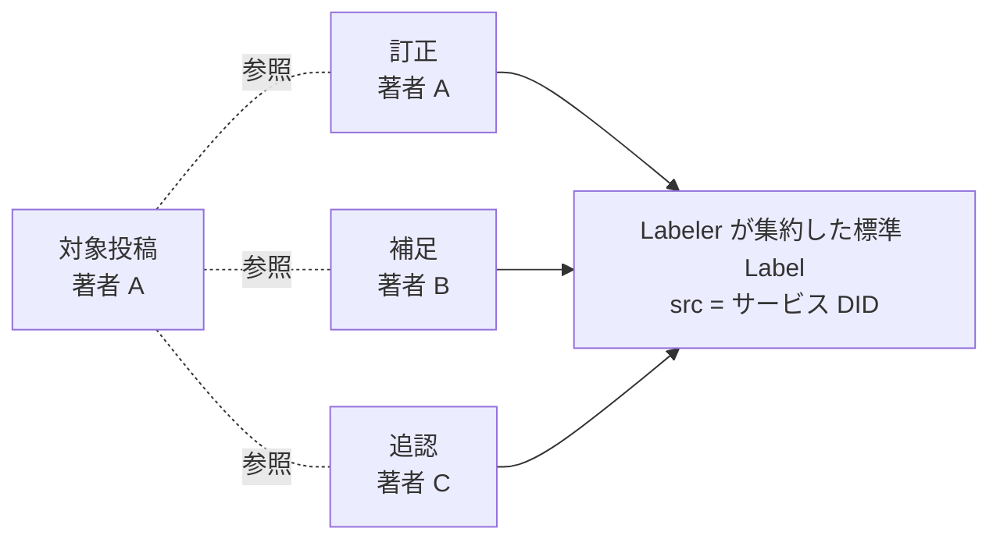

# 注釈

識別子: `dev.jisaku.mosimo.annotation`

## 目的

本プロトコルは、既存の投稿を参照して内容を訂す「訂正」、関連する追加情報を示す「補足」、賛同・確認を表明する「追認」を、投稿の拡張として定義する。注釈は対象投稿の著者以外も発信できる新しい投稿であり、元著者による訂正と他者の主張を区別して表示・判断できるようにすることが目的である。あわせて、注釈を atproto の標準 Label として対象投稿に提示する際の、注釈レコードと Label の関係を定める。

本書が保証するのは、注釈の著者・対象・関係が著者署名のもとで保持されることである。注釈の存在や件数は内容の正誤を確定せず、追認は内容の真実性を保証しない。注釈は元投稿を上書き・消去せず、注釈が存在しても元投稿の署名済み表現は変わらない。

## 前提

| 識別子 | 文書 | 依存する理由 |
|---|---|---|
| `dev.jisaku.mosimo` | [コア](../README.md) | 投稿単位、基本型 `AtUri`・`Cid`・`NostrEventId`、拡張の共通構造と運び方、削除 |
| `dev.jisaku.mosimo.attest.chain` | [署名チェーン](../attest/chain/README.md) | 注釈の発信者が自治体等であることの確認。元発信者への信頼を判断材料にするため |

## 1. 注釈の投稿単位

注釈は[コア §2](../README.md#2-投稿の単位)の投稿単位に従う新しい投稿であり、発信者自身のリポジトリへの 1 レコード追加・1 commit・1 Nostr イベント（`kind: 1`）で表す。発信者は本文・対象参照を自身の鍵で署名し、対象投稿のリポジトリには書き込まない。注釈の著者は注釈を発信した主体であり、対象投稿の著者ではない。



## 2. 型

```ts
type PostReference =
  | { network: "atproto"; uri: AtUri; cid?: Cid }
  | { network: "nostr"; eventId: NostrEventId };

type AnnotationExtension = {
  $type: "dev.jisaku.mosimo.annotation";
  relation: "correction" | "supplement" | "endorsement";
  target: PostReference;
};
```

正規の定義は [`lexicon.json`](lexicon.json) である。Lexicon では `target` を `network` で種別を選ぶ一つの `#postReference` オブジェクトとして定義し、`eventId` は 32 バイトの bytes とする。

## 3. 関係の意味

| `relation` | 名称 | 意味 | 発信者 |
|---|---|---|---|
| `correction` | 訂正 | 対象投稿を参照して内容を訂す | 誰でも。元著者の訂正と他者の訂正の主張は著者で区別する |
| `supplement` | 補足 | 対象投稿に関連する追加情報を示す | 誰でも |
| `endorsement` | 追認 | 対象投稿への賛同・確認を表明する | 誰でも。発信者の表明であり、内容の真実性の確認とは別 |

注釈本文は単独でも意味が分かるように書く。注釈が対象より先に届くこと、注釈が未到着の端末に元投稿が残ることは正常な状態であり、対応クライアントは対象を取得できた時点で元投稿に注釈の存在を表示できる。

## 4. 対象参照

| `network` | 項目 | 指すもの |
|---|---|---|
| `atproto` | `uri` | 対象レコードの場所 `at://<DID>/dev.jisaku.mosimo.post/<record-key>` |
| `atproto` | `uri` + `cid` | 対象レコードの特定版 |
| `nostr` | `eventId` | 対象 Nostr イベント |

`cid` の有無で、場所を指す参照と特定版を指す参照を区別する。atproto の URI と Nostr の event ID を同じ投稿へ対応付ける索引は AppView 等が担い、DID・path・record CID による対応を用いる。二つの参照を文字列一致で比較してはならない。同じ投稿の atproto 表現と Nostr 表現は異なる識別子を持つためである。

## 5. 標準 Label との関係

注釈を atproto 上で対象投稿への Label として提示する。本人署名付きの注釈レコードを正本とし、論理 PDS グループ等の Labeler が収集・検証した注釈から、自身のサービス DID を `src` とする標準 Label を集約発行する。閲覧者は少数の Labeler を選べばよく、注釈の発信者ごとに Labeler を購読する必要がない。

標準 Label 仕様に由来する制約は次のとおりである。

- Label はリポジトリレコード・commit とは独立した自己認証可能なオブジェクトであり、発行者 `src`（DID）、対象 `uri`、短い値 `val`、必要に応じて対象版の `cid` を持つ。
- `val` は最大 128 バイトの短いトークンであり、注釈本文を Label 本体に置いてはならない。本文は注釈レコードが保持する。
- Label の署名鍵は発行者 DID の `#atproto_label` で解決する。Label はサービス自身の Label 署名鍵で署名し、利用者の投稿署名鍵・PLC 管理鍵をサービスへ渡してはならない。鍵の移転は発信者の境界を壊すためである。
- Labeler service の識別・配信はリポジトリ firehose とは別であり、`com.atproto.label.subscribeLabels` の stream は複数の `src` を運べる。一方、`queryLabels` は発行元 DID の一覧 `sources` で絞り込み、AppView の実装は閲覧者が選択した Labeler の `src` で Label を絞り込む。したがって Label の `src` は閲覧者が選択できる少数のサービスとする。
- 同じ `src`・`uri`・`val` の Label のライフサイクルは時刻・否定（`neg`）・期限に従う。注釈レコード 1 件を永続する Label 1 件と同一視してはならない。

標準 Label はサービスによる判断・証言であり、元の注釈著者・署名済みレコードは Label とは別に保持する。サービスが本人になり替わって発行したものとして表示してはならない。対応 AppView 等は、Label の根拠となった注釈レコードの参照と、その元著者・対象・内容を確認できる情報を提供する。

### 5.1 元の注釈発信者に基づく信頼判断

基本 Label は注釈の存在を示す。閲覧者側の判断材料は、元の注釈発信者の身元と署名である。注釈発信者が自治体等であることを[署名チェーン](../attest/chain/README.md)で確認できる場合、その誤情報指摘を強い判断材料として扱える。

- 署名が正しいこと、公開鍵・DID が特定の自治体に属すること、内容が事実であることは別の事柄である。
- 表示名・プロフィール・独自タグだけで公式の身元と認定してはならない。これらは自己申告であり署名チェーンの検証を経ないためである。
- 根拠データや身元を確認できない場合、その未確認状態を表示する。未確認の注釈を「自治体の確認済み見解」として表示してはならない。
- 元の注釈発信者への信頼と、集約サービス・公的情報取り込みサーバーへの信頼は別に扱う。

## 6. 削除との区別

注釈は対象投稿を削除する手段ではなく、他人の投稿を著者として削除する権限も与えない。著者自身による削除は[コア §11](../README.md#11-削除)の制御処理である。NIP-09 の削除要求と標準 Label の否定（`neg`）は別の操作である。

## 7. Nostr 上の表現

[コア §7.3](../README.md#73-自己完結した拡張タグ)の自己完結した拡張タグで運ぶ。

```text
["mosimo:ext:dev.jisaku.mosimo.annotation", B64(C({relation, target}))]
```

`C` は atproto deterministic CBOR、`B64` は padding なしの通常 Base64 である。`target.eventId` は内部 CBOR で byte string のまま保持する。

## 未確定事項

- `target` と atproto の strong reference（`com.atproto.repo.strongRef`）・Nostr の `e` タグとの対応。
- Label の具体値、採用基準、注釈レコードと Label の対応付けと参照形式、複数注釈の集約と撤回、サービスの運用単位・発見・配信・冗長化。
- 元発信者への信頼の重み付け、適用範囲、相反する指摘の扱い。
- 訂正の連鎖と複数訂正の表示。
- 注釈レコードの削除と、対応する Label の撤回・集約状態の関係。

## 参照

- [AT Protocol Labels](https://atproto.com/specs/label)
- [AT Protocol Repository](https://atproto.com/specs/repository)
- [com.atproto.label.subscribeLabels](https://github.com/bluesky-social/atproto/blob/main/lexicons/com/atproto/label/subscribeLabels.json)
- [com.atproto.label.queryLabels](https://github.com/bluesky-social/atproto/blob/main/lexicons/com/atproto/label/queryLabels.json)
- [NIP-09: Event Deletion Request](https://github.com/nostr-protocol/nips/blob/master/09.md)
