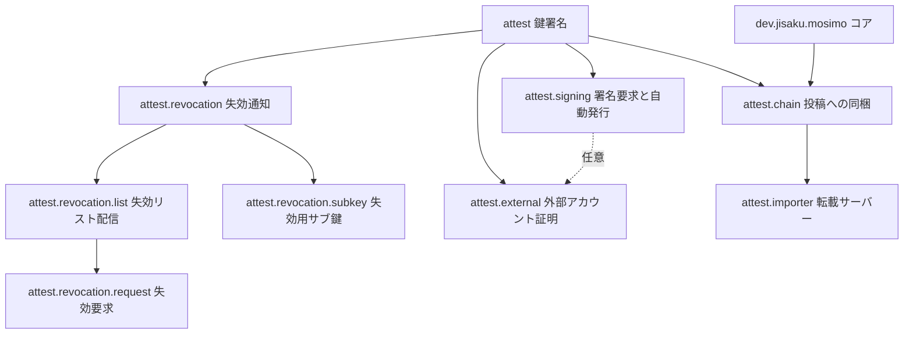
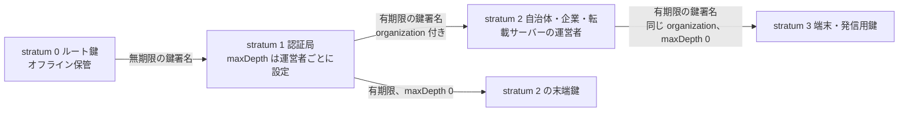
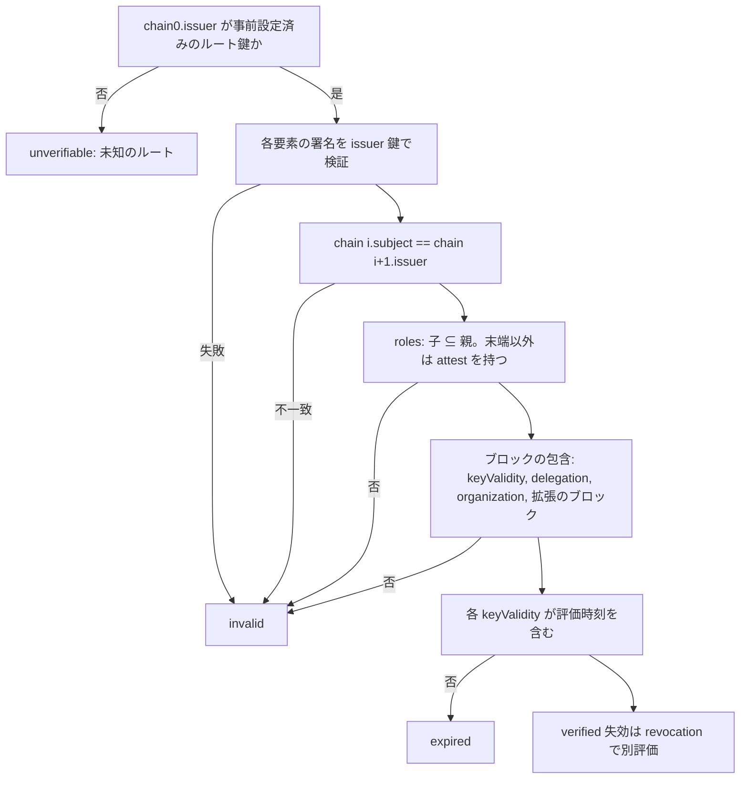
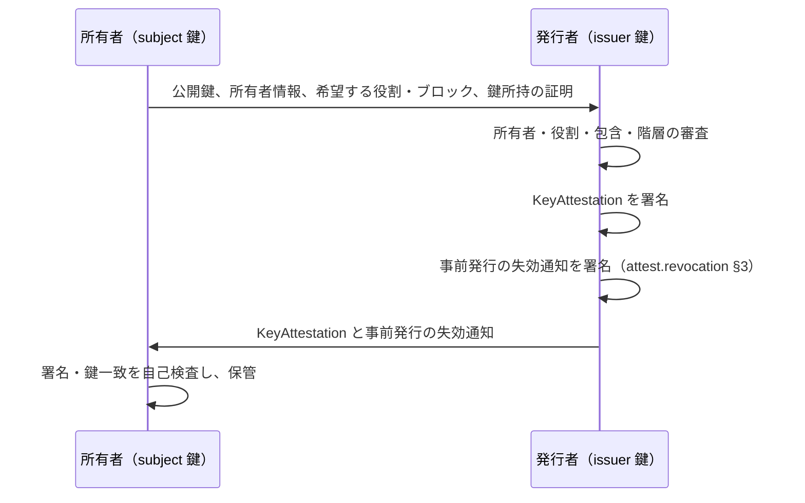

# 鍵署名

識別子: `dev.jisaku.mosimo.attest`

## 目的

ある鍵が別の鍵の所有者と役割に署名する「鍵署名」を定義し、受信者が事前に信頼したルート鍵から末端の鍵へ至る署名チェーンをオフラインで検証できるようにする。これにより自治体等の名称と公開鍵の対応、転載サーバーの権限、個人のアカウントの所持などを、受信者が選んだ信頼の起点に基づいて確認できる。

鍵署名が証明するのは、発行者がその鍵の所有者・役割・付随情報を確認したという事実である。投稿内容の真実性、鍵の安全性、所有者の実名は証明の対象に含まれない。信頼の起点は受信者ごとに選ぶものであり、全受信者が共通の単一ルートを使う構成は前提にしない。

本プロトコルは Mosimo の投稿やネットワークに依存せず、鍵署名の形式と検証だけを定める。投稿への同梱、失効、発行の自動化、転載サーバーの認可は、本プロトコルを前提とする拡張がそれぞれ定義する。



| 拡張 | 前提 | 定義する範囲 |
|---|---|---|
| [attest.chain](chain/README.md) | attest、コア | 投稿への署名チェーンの同梱と発信者の確認 |
| [attest.revocation](revocation/README.md) | attest | 失効通知の形式、事前発行、制御イベントとしての運び方 |
| [attest.revocation.list](revocation/list/README.md) | revocation | 認証局による失効リストの公開・購読・再掲 |
| [attest.revocation.request](revocation/request/README.md) | revocation.list | 所有者・第三者・他の認証局からの失効要求 |
| [attest.revocation.subkey](revocation/subkey/README.md) | revocation | 主鍵を失った所有者による事前発行形の活性化 |
| [attest.signing](signing/README.md) | attest | 認証局の署名要求エンドポイントと自動発行 |
| [attest.external](external/README.md) | attest | NIP-39 に基づく外部アカウントの証明 |
| [attest.importer](importer/README.md) | attest.chain、public.bsaf | 転載サーバーの認証と受信者の自動投入の認可 |

## 前提

前提とするプロトコルはない。符号化は [コア](../README.md) の atproto deterministic CBOR と同一とし、一つの実装で投稿と鍵署名の両方を扱えるようにする。

## 1. 共通符号化と署名

| 記法 | 定義 |
|---|---|
| `C(x)` | atproto deterministic CBOR。definite length、最短の整数表現、map key は UTF-8 バイト長昇順、同長なら辞書順。float、indefinite length、重複 key、未知の CBOR tag、末尾データを拒否する |
| `H(x)` | `SHA-256(C(x))` |
| `PublicKey` | `Bytes`。長さ 32 は BIP-340 x-only 公開鍵、長さ 33 は SEC1 compressed secp256k1 公開鍵（prefix 02/03）。曲線上の有効な点であることを確認する。他の長さは不正 |
| `Signature` | `Bytes`、64 バイト。署名者の鍵が 32 バイトなら BIP-340 Schnorr、33 バイトなら低 S の compact ECDSA（`1 <= r < n`、`1 <= s <= n/2`） |
| `Signed<T>` | `{ body: T, sig: Signature }`。`sig` は `H(body)` への署名 |
| 各オブジェクトの ID | `H(body)`。署名は ID に含めない |

鍵の長さで署名方式が決まるため、同じ曲線を用いる Nostr 鍵（32 バイト）と atproto・PLC 鍵（33 バイト）の両方を、変換なしに署名者・被署名者にできる。鍵の長さと署名方式が一致しない署名は不正である。DER 形式の署名は受理してはならない。同じ署名を複数の表現で表せると ID と重複抑止が壊れるためである。

署名対象オブジェクトは `$type` を含む。これにより鍵署名・失効通知・失効要求を同じ鍵で署名しても互いに流用できない。JSON で運ぶ場合、`Bytes` は通常の Base64・padding なしとし、重複 key・不正な UTF-8・float を拒否してから `C(x)` を得る。署名対象は常に CBOR であり、JSON 表現そのものに署名してはならない。

## 2. 鍵署名の構造

```ts
type KeyAttestationBody = {
  $type: "dev.jisaku.mosimo.attest#keyAttestation";
  issuer: PublicKey;          // 署名する鍵
  subject: PublicKey;         // 署名される鍵
  owner: Owner;               // subject を運用する主体
  roles: Text[];              // subject が行使または付与できる役割
  blocks: Block[];            // 追加ブロック（open union）
};
type Owner = { id: Text; name: Text };
type Block = { $type: string; [field: string]: DataValue };
type KeyAttestation = Signed<KeyAttestationBody>;
```

- `owner.id` は発行者の名前空間で安定した不透明な ID であり、完全一致で比較する。`owner.name` は表示専用である。鍵が代表する組織は `owner` ではなく §2.2 の `organization` ブロックで表す。
- `roles` は UTF-8 バイト列の辞書順に並べた重複のない文字列配列である。
- `blocks` は `$type` 付きオブジェクトの配列であり、コアの拡張と同じ open union である。同じ `$type` のブロックは一つに限る。未知のブロックは保持し、§5.2 の包含判定には参加させない。
- `issuer == subject` の自己署名はチェーンの要素として不正である。

### 2.1 役割

役割は鍵が何をしてよいかを表す。子の `roles` は親の `roles` の部分集合でなければならない。したがって認証局は、自身が行使しない役割も、付与するためには保持する。

| 役割 | 意味 | 定義 |
|---|---|---|
| `attest` | 他の鍵に鍵署名を発行できる。§2.2 の `delegation` と併用する | 本書 |
| `identity` | 組織または所有者の発信として表示してよい | [attest.chain §4.1](chain/README.md#41-役割と投稿の扱い) |
| `public-information` | 組織が自らの名で公的情報を発信し、同じ組織の過去の投稿の訂正・取消により旧版の拡散停止を認可できる | attest.chain §4.1 |
| `import` | 外部情報を転載し、受信者の自動投入の対象になれる | [attest.importer](importer/README.md) |

受信者は自分が解釈できる役割だけを扱い、未知の役割は保持する。

### 2.2 追加ブロック

| `$type` | フィールド | 省略時 | 包含規則（§5.2） |
|---|---|---|---|
| `dev.jisaku.mosimo.attest#keyValidity` | `from?: Timestamp`、`until?: Timestamp` | 無期限。§3 の制約に従う | 子の期間は親の期間に含まれる |
| `dev.jisaku.mosimo.attest#delegation` | `maxDepth: integer` | `0`。subject は他の鍵を署名できない | 子は親より小さい |
| `dev.jisaku.mosimo.attest#organization` | `orgId: Text`、`orgName: Text` | 鍵は特定の組織を代表しない | 親にあれば子の `orgId` は親と同じ |
| `dev.jisaku.mosimo.attest#issuerDomain` | `domain: Text` | 発行者はエンドポイントを持たない | なし |
| `dev.jisaku.mosimo.attest#subjectDomain` | `domain: Text`、`method: Text` | 所有者のドメインは未確認 | なし |
| `dev.jisaku.mosimo.attest#trustLevel` | `level: integer`、`method?: Text` | 信頼度の表明なし | なし |
| `dev.jisaku.mosimo.attest.revocation.subkey` | `key: PublicKey` | 主鍵なしの失効はできない | なし。[attest.revocation.subkey](revocation/subkey/README.md) |
| `dev.jisaku.mosimo.attest.importer` | `sources` | 転載を認可されない | 子は親の部分集合。[attest.importer](importer/README.md) |

- `keyValidity` の境界は `from <= t < until`。`Timestamp` はコアの共通時刻型であり、秒精度を推奨する。子の期間は親に含まれなければならないため、親より長い鍵は発行できず、有効期間の上限は階層を下るごとに自然に定まる。
- `delegation.maxDepth` は subject の下に作れる鍵の階層数である。`0` は末端、`1` は末端だけを署名できる認証局を表す。チェーン長はルート鍵の運用者が各認証局へ与える値で定まる。
- `organization` は鍵が代表する組織である。`orgId` は発行者の名前空間で安定した不透明な ID、`orgName` は表示名である。`identity` 役割の表示にはこのブロックがあれば `orgName` を、なければ `owner.name` を用いる。
- `issuerDomain.domain` は発行者が運用するエンドポイントの発見に用いる（§2.3）。小文字に正規化した DNS 名とし、URL・パス・ポートを含めない。
- `subjectDomain.method` は所有者のドメイン確認の方法で、初期値は `nip05`（[attest.signing §4](signing/README.md#4-nip-05-ドメイン検証プロファイル)）と `manual`。
- `trustLevel.level` は発行者が所有者の確認過程について表明する序数で、§4 に定める。

ブロックは発行者の表明である。受信者が検証できるのは署名とチェーン上の整合性であり、`subjectDomain` の所有や `trustLevel` の妥当性を受信者が再検証することは求められない。各拡張は独自のブロックと包含規則を追加できる。

### 2.3 ドメインとエンドポイントの発見

`issuerDomain.domain` を `D` とすると、発行者のエンドポイントは `https://D/.well-known/mosimo/attest/` 以下に置く。個別のパスは [attest.revocation.list](revocation/list/README.md#1-エンドポイント)、[attest.revocation.request](revocation/request/README.md#2-エンドポイント)、[attest.signing](signing/README.md#2-エンドポイント) が定める。

全エンドポイントに共通して、HTTPS のみとし、redirect を追わず、応答サイズと時間に上限を設ける。本文は `application/cbor` の canonical CBOR を基本とし、`application/json` を任意に提供できる。ドメインの所有や TLS の成立を鍵の信頼の根拠にしてはならない。鍵の信頼はルート鍵からの署名チェーンだけから得る。

## 3. 階層（stratum）

stratum は信頼の起点からの距離であり、鍵署名には符号化せず、チェーン上の位置から導く。



| stratum | 保管 | `keyValidity` | `delegation` |
|---|---|---|---|
| 0 ルート鍵 | 完全にオフライン。耐タンパ性のあるハードウェアを推奨 | 受信者のローカル設定で扱う | ローカル設定の上限 |
| 1 認証局 | オンラインでよい | 省略できる（無期限）。発行者がルート鍵の場合に限る | 運営者に応じて設定 |
| 2 以降 | 所有者の運用に従う | `until` を必須とする | 親より小さい値 |

ルート鍵は複数存在してよい。受信者はアプリ・運用者の設定として、信頼するルート鍵ごとに公開鍵・認める `roles`・認める `maxDepth` を事前に保持し、どのルートを信頼するかを自分で決める。受信データに含まれる鍵をルートとして追加してはならない。チェーンの先端を自動で信頼すると、信頼の起点を選ぶという受信者の権限が失われるためである。ルート鍵の入れ替えはアプリ・OS の更新など帯域外の手段で行う。

stratum 1 を無期限とするのは、ルート鍵をオンライン操作から切り離すためである。stratum 1 の鍵の無効化は失効通知だけで行う。stratum 2 以降に期限を必須とするのは、失効通知が届かない受信者に対する被害の上限を定めるためである。

## 4. 信頼度

`trustLevel.level` は所有者の確認過程の強さを表す序数である。

| level | 確認過程 | 例 |
|---|---|---|
| 0 | 鍵の所持のみ | 自動発行で他の確認なし |
| 1 | 自動化された外部検証 | NIP-05 のドメイン検証、NIP-39 のアカウント検証 |
| 2 | 発行者による手動確認 | 書類・既知の連絡先による確認 |
| 3 | 対面または法的根拠に基づく確認 | 公的機関への発行 |

どの確認過程をどの段階に置くかは認証局の方針とする。受信者は、末端の信頼度と、それを表明した発行者がどの信頼度で証明されているかを併せて示す。チェーン上の信頼度を加算・平均して一つの点数にすべきではない。段階は確認過程の種類を表す序数であり、量ではないためである。

## 5. チェーンの検証

チェーンは、信頼するルート鍵が署名した鍵署名から末端の鍵署名へ並べた配列である。



### 5.1 時刻

評価時刻 `t` は検証対象に応じて決める。投稿の発信者確認では投稿の作成時刻を用い、受信者が信頼できる時計を持つ場合は現在時刻での有効性も別の状態として求める（[attest.chain §3](chain/README.md#3-検証)）。時計を確信できない受信者は `keyValidity` の判定を `unknown-time` とし、`verified` と表示してはならない。期限の確認を省いた結果を確認済みと示すと、期限を設ける意味が失われるためである。

### 5.2 役割とブロックの包含

- `chain[i].roles ⊆ chain[i-1].roles`。`chain[-1]` はルート鍵のローカル設定とする。末端以外の全要素は `attest` を持つ。
- `keyValidity`: 子の `from` は親の `from` 以上、子の `until` は親の `until` 以下。親が無期限なら子に制約を課さない。
- `delegation`: `d_i <= d_{i-1} - 1`（省略は 0、`d_{-1}` はローカル設定）。末端以外は `d_i >= 1`。
- `organization`: 親にあれば、子にも同じ `orgId` のブロックが必要。親になければ子は任意。
- 拡張が定義するブロックは、その拡張の包含規則に従う。受信者が解釈しないブロックは判定に参加せず、そのブロックに依存する役割は認められない。

### 5.3 結果の状態

検証結果は少なくとも `verified`・`expired`・`invalid`・`unverifiable`・`unknown-time` を区別し、失効の状態は [attest.revocation §6](revocation/README.md#6-受信者の状態) の値を併記する。`verified` は署名・役割・包含・期間の検証を意味する。

### 5.4 検証結果のキャッシュ

受信者は鍵署名ごとの検証結果を `H(body)` を鍵として保持し、同じ鍵署名を含むチェーンの再検証では署名と構造（§5 の手順 1〜4 のうち時刻に依存しない部分）の確認を省いてよい。キャッシュに入れるのは、署名の検証に成功し、役割とブロックの包含も確認できた鍵署名だけである。`keyValidity` の評価（§5.1）と失効状態（[attest.revocation §6](revocation/README.md#6-受信者の状態)）は評価のたびに行う。これらは評価時刻と手元の失効通知に依存し、キャッシュした時点の結果が後に変わるためである。キャッシュの上限と追い出しは受信者のローカル方針とし、追い出された鍵署名は再検証すればよい。

## 6. 発行



- 発行者は subject 鍵の所持を確認する。確認方法は発行者の方針とし、[attest.signing §3](signing/README.md#3-署名要求) が自動発行向けの一方式を定める。
- 発行者は発行内容を永続記録する。同じ subject へ複数の鍵署名を発行してよく、別の認証局が同じ鍵に鍵署名を発行してもよい。受信者は提示されたチェーンをそれぞれ独立に検証する。
- [attest.revocation](revocation/README.md) を実装する発行者は、鍵署名と同時に事前発行の失効通知を渡す。所有者がオフラインでも自己の鍵を失効させるためである。
- 発行はオフラインとファイルの受け渡しで完結してよい。

## 7. 資源上限

`C(KeyAttestation)` は 4,096 バイト以下でなければならない。メッシュで鍵署名を一件のオブジェクトとして取り寄せる際の大きさの前提になるためである。`owner.id`・`owner.name`・`orgId`・`orgName`・各 `Text` は 256 UTF-8 バイト以下、`roles` は 32 要素以下、`blocks` は 16 要素以下を推奨する。上限を超えたオブジェクトは全体を unsupported として扱い、一部を削って受理してはならない。署名対象の一部を削ると署名が検証できなくなるためである。

## 未確定事項

- `orgId` の名前空間。現状は発行者ごとの不透明な ID であり、認証局をまたいだ同一組織の対応付けは定めていない。
- `trustLevel` を独立した拡張へ切り出すかどうか。

## 参照

- [BIP-340: Schnorr Signatures for secp256k1](https://github.com/bitcoin/bips/blob/master/bip-0340.mediawiki)
- [SEC 1: Elliptic Curve Cryptography](https://www.secg.org/sec1-v2.pdf)
- [atproto Data Model](https://atproto.com/specs/data-model)
