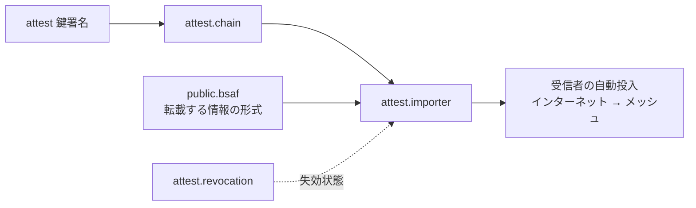
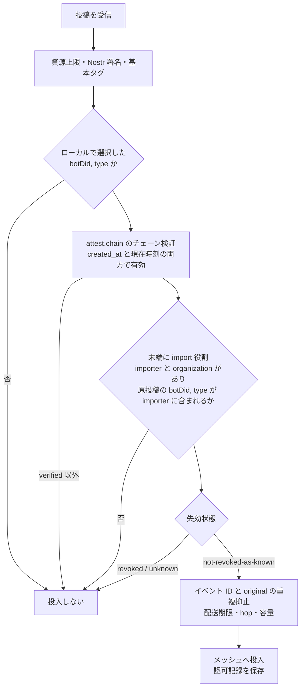

# 転載サーバー

識別子: `dev.jisaku.mosimo.attest.importer`

## 目的

転載サーバー（importer）は、他者が発表した情報を取得し、自身の鍵で署名し直して Mosimo の投稿として流すサーバーである。転載サーバーの署名は転載の証言であり、原発表者の署名ではない。本拡張は、鍵署名の `import` 役割と `importer`・`organization` ブロックによって「誰が、どの情報源を転載してよいか」を表し、受信者がそれとローカルの選択に基づいて、インターネットからメッシュへの自動投入を認可する規則を定める。転載する情報の形式は本拡張の対象外であり、BSAF は [public.bsaf](../../public/bsaf/README.md) が定める。

## 前提

| 識別子 | 役割 |
|---|---|
| [`dev.jisaku.mosimo.attest.chain`](../chain/README.md) | 投稿に同梱するチェーンと検証 |
| [`dev.jisaku.mosimo.attest`](../README.md) | 鍵署名、役割、`organization` ブロック |
| [`dev.jisaku.mosimo.public.bsaf`](../../public/bsaf/README.md) | 転載する投稿の形式と原投稿参照 |
| [`dev.jisaku.mosimo.attest.revocation`](../revocation/README.md) | 失効状態 |
| [`dev.jisaku.mosimo.priority`](../../priority/README.md) | 著者の優先度ヒント |



## 1. 役割とブロック

転載サーバーの末端の鍵署名は、`roles` に `import` を持ち、次の二つのブロックを持たなければならない。どちらかが欠けるか包含を満たさない場合、受信者は認可してはならない。ブロックがなければ、転載してよい情報源と責任を負う組織が定まらないためである。

```ts
type ImporterBlock = {
  $type: "dev.jisaku.mosimo.attest.importer";
  sources: Source[];           // botDid の UTF-8 辞書順、重複なし
};
type Source = {
  botDid: Did;                 // 原投稿の著者 DID
  types: Text[];               // 情報種別。bsaf の `type:` タグの値。辞書順、重複なし
};
```

| ブロック | 意味 | 包含規則 |
|---|---|---|
| `dev.jisaku.mosimo.attest.importer` | 転載してよい `(botDid, type)` の組 | 子の各組は親の組に含まれる。親にブロックがなければ、親が `import` 役割を持つ限り任意 |
| `dev.jisaku.mosimo.attest#organization` | 転載サーバーを運営する組織 | 鍵署名プロトコルの規則 |

- `owner` は転載サーバーの運営者を表す。認可に通った投稿の発信者表示には `organization.orgName` を用いる。
- `botDid` は `did:plc:[a-z2-7]{24}`。`types` は `type:` 接頭辞を除いた原値で、`*` はリテラルである。
- 転載サーバーの鍵は 32 バイトの Nostr 鍵を推奨する。転載は Nostr 専用であり（§2）、atproto 鍵と `binding` なしで成立する。
- 認証局は転載サーバーに `attest` を与えない。

## 2. 投稿

認可の対象となる転載投稿は、コアの通常投稿に次を含める。

| 拡張 | 個数 | 内容 |
|---|---|---|
| `attest.chain` | 1 以上 | 末端が転載サーバーの鍵 |
| `public.bsaf` | ちょうど 1 | `original` 必須。原投稿の URI・CID・作成時刻 |
| `priority` | 0 または 1 | 著者ヒント |

- 本文は原レコードの `text` と一致させる。説明を追記してはならない。原文との一致が転載の検証可能性の根拠であるためである。
- `original` を持つ転載は Nostr 専用とし、PDS の atproto 公開・リポジトリ公開・firehose へ投入してはならない。転載を atproto へ再公開すると、原投稿とは別の著者による同内容のレコードが原投稿と並んで配信され、帰属が混乱するためである。
- 転載サーバーは `(original.uri, original.cid)` ごとに生成した投稿を永続記録し、再取得・再試行で新しい投稿を作らない。
- 転載サーバーは取得した原レコードの CID を検算し、取得経路と原レコードを保存する。AppView 経由だけで取得した場合、原 Bot のリポジトリ署名まで検証したと表示してはならない。

## 3. 受信者の認可

受信者（Android・ESP32 等のゲートウェイ、PDS、リレー）は、インターネットから得た投稿をメッシュへ新たに自動投入するごとに次を実行する。サーバー側で検証済みという自己申告を信用してはならない。



- **ローカル選択が前提である。** 受信者の運用者・利用者が選んだ `(botDid, type)` の組だけを対象とする。初期値は空であり、鍵署名の `importer` ブロックが選択を自動で有効にすることはない。
- **チェーンは作成時刻と現在時刻の両方で有効であること。** 投入は現在の行為であり、期限切れの鍵署名による新規投入と、未来の `created_at` を持つ投稿は認可してはならない。時計を確信できない受信者は投入を保留する。
- **失効は手元の通知で判定する。** `not-revoked-as-known` で投入してよい。自動投入を行う受信者はインターネットに接続しているので、投入前と定期的に、チェーン上の `issuerDomain` の失効リストを取得することを推奨する。取得の失敗は投入を妨げない。
- **取り込んだ情報の更新・取消も同じ認可で扱う。** 原情報の続報・訂正・取消を転載した投稿が認可されたとき、受信者はその `(botDid, type)` について先に転載された旧版の新たな拡散を止めてよい。原情報のどの投稿が旧版に当たるかは各形式の拡張が定める。
- **認可に失敗した投稿を通常投稿として投入し直してはならない。** 認可は自動投入の条件であり、失敗した投稿を別経路で投入すると認可が無意味になる。通常の閲覧・ローカル中継はこの認可の対象外である。
- 認可記録には、ルート鍵、末端の鍵署名 ID、`(botDid, type)`、失効情報の最終確認時刻、確認時刻を残す。キューで待機した投稿は実際の投入時に再確認する。

### 3.1 重複抑止

受信者は最低限イベント ID で重複を抑止する。異なる転載サーバーが同じ原投稿を転載した場合、それぞれ別の署名付き投稿であり、未検証の `original` だけで配送済みと扱ってはならない。[公的情報の配送同値](../../public/README.md) による抑制は、検証後に適用する。

### 3.2 表示

認可された転載は「`orgName` が転載した `botDid` の情報」として表示する。原 Bot や原発表機関自身の署名があるとは表示してはならない。転載サーバーの署名は転載の証言にすぎないためである。認可されなかった転載は通常投稿として扱い、組織名を表示してはならない。

## 4. 資源上限

`sources` は 16 件以下、各 `types` は 32 件以下、全体の `(botDid, type)` は 64 組以下を推奨する。これは BSAF の Kikikuru Bot 23 種と JMA Bot 5 種を同時に表現できる値である。超過は unsupported として扱う。

## 5. 適合チェック

少なくとも次の否定ケースを確認する。未知のルート、鍵と `pubkey` の不一致、`import` 役割なし、`importer` または `organization` の欠落、`importer` の拡大、未選択の `(botDid, type)`、期限境界、時計 unknown、失効した祖先または末端、`priority` 自己申告だけでの昇格、認可失敗後の通常投稿としての投入。
