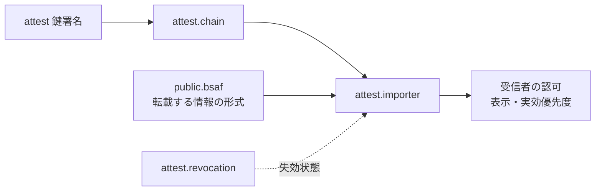
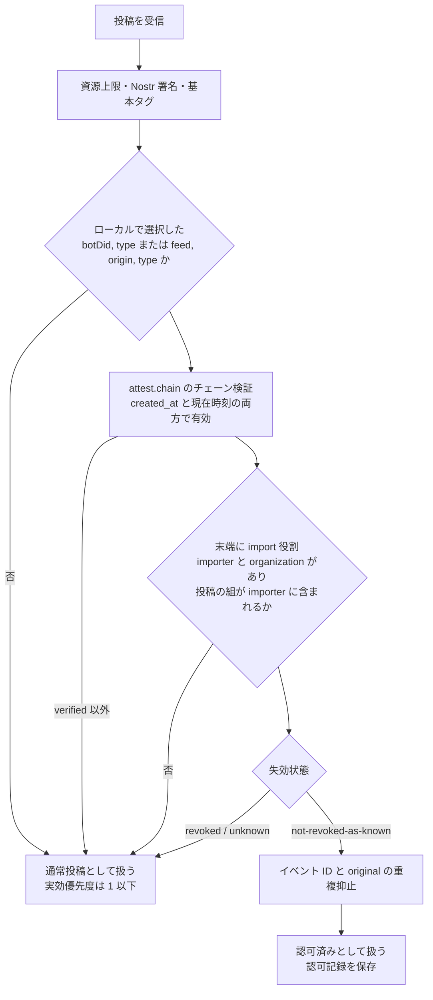

# 転載サーバー

識別子: `dev.jisaku.mosimo.attest.importer`

## 目的

転載サーバー（importer）は、他者が発表した情報を取得し、自身の鍵で署名し直して Mosimo の投稿として流すサーバーである。転載サーバーの署名は転載の証言であり、原発表者の署名ではない。本拡張は、鍵署名の `import` 役割と `importer`・`organization` ブロックによって「誰が、どの情報源を転載してよいか」を表し、受信者がそれとローカルの選択に基づいて、転載を認可済み発信者の投稿として扱う（表示・実効優先度・置換）規則を定める。転載する情報の形式は本拡張の対象外であり、BSAF は [public.bsaf](../../public/bsaf/README.md)、気象庁防災情報 XML は [public.jma](../../public/jma/README.md) が定める。

情報源は 2 種類ある。原投稿の著者 DID で識別する **Bot**（`sources`。BSAF 等の atproto 投稿の転載）と、原著者 DID を持たない公開配信をフィード ID・発表者 ID・種別で識別する **フィード**（`feeds`、§1.1）である。

## 前提

| 識別子 | 役割 |
|---|---|
| [`dev.jisaku.mosimo.attest.chain`](../chain/README.md) | 投稿に同梱するチェーンと検証 |
| [`dev.jisaku.mosimo.attest`](../README.md) | 鍵署名、役割、`organization` ブロック |
| [`dev.jisaku.mosimo.public.bsaf`](../../public/bsaf/README.md) | 転載する投稿の形式と原投稿参照 |
| [`dev.jisaku.mosimo.public`](../../public/README.md) | フィードの転載の宣言（`public#source` の `feed`） |
| [`dev.jisaku.mosimo.public.jma`](../../public/jma/README.md) | フィード `dev.jisaku.mosimo.public.jma` の定義 |
| [`dev.jisaku.mosimo.attest.revocation`](../revocation/README.md) | 失効状態 |
| [`dev.jisaku.mosimo.priority`](../../priority/README.md) | 著者の優先度ヒント |



## 1. 役割とブロック

転載サーバーの末端の鍵署名は、`roles` に `import` を持ち、次の二つのブロックを持たなければならない。どちらかが欠けるか包含を満たさない場合、受信者は認可してはならない。ブロックがなければ、転載してよい情報源と責任を負う組織が定まらないためである。

```ts
type ImporterBlock = {
  $type: "dev.jisaku.mosimo.attest.importer";
  sources?: Source[];          // botDid の UTF-8 辞書順、重複なし
  feeds?: Feed[];              // (feed, origin) の順序（§1.3）、重複なし
};                             // sources と feeds の少なくとも一方を持ち、持つものは空でない
type Source = {
  botDid: Did;                 // 原投稿の著者 DID
  types: Text[];               // 情報種別。bsaf の `type:` タグの値。辞書順、重複なし
};
type Feed = {
  feed: Nsid;                  // フィード定義の識別子（§1.1）
  origin?: Uri;                // 発表者（§1.1）。省略はそのフィードの全ての発表者
  types?: Text[];              // 種別（§1.1）。辞書順、重複なし、1 件以上。省略はそのフィードの全ての種別
};
```

| ブロック | 意味 | 包含規則 |
|---|---|---|
| `dev.jisaku.mosimo.attest.importer` | 転載してよい `(botDid, type)` と `(feed, origin, type)` の組 | 子の各組は親の同じ種類の組に含まれる（§1.3）。親のブロックが `feeds` を持たなければ子は `feeds` を持てない（`sources` も同様）。親にブロックがなければ、親が `import` 役割を持つ限り任意 |
| `dev.jisaku.mosimo.attest#organization` | 転載サーバーを運営する組織 | 鍵署名プロトコルの規則 |

- `owner` は転載サーバーの運営者を表す。認可に通った投稿の発信者表示には `organization.orgName` を用いる。
- `botDid` は `did:plc:[a-z2-7]{24}`。`types` は `type:` 接頭辞を除いた原値で、`*` はリテラルである。
- 転載サーバーの鍵は 32 バイトの Nostr 鍵を推奨する。転載は Nostr 専用であり（§2）、atproto 鍵と `binding` なしで成立する。
- 認証局は転載サーバーに `attest` を与えない。

### 1.1 情報源の識別

原著者の DID を持たない公開配信（各国の気象機関の XML や CAP など）は、**フィード**として次の 3 つの識別子の組で識別する。どの識別子も中央の登録簿を持たず、定義した者が自身の管理する名前空間で一意にする。誰でも新しい情報源の転載を定義でき、共通管理者の承認・本書の改訂・全受信者の更新を必要としない。

| 識別子 | 形式 | 一意にする仕組み | 例 |
|---|---|---|---|
| フィード ID `feed` | [atproto NSID](https://atproto.com/specs/nsid)。authority 部（ドメインの逆順）は小文字 | 定義者が管理するドメインの名前空間（[コア §10](../../README.md#10-名前空間)と同じ） | `dev.jisaku.mosimo.public.jma`、`org.example.alerts.cap` |
| 発表者 ID `origin` | 絶対 URI（scheme 必須、256 バイト以下、空白・制御文字なし） | URI の scheme ごとの割当規則。警報の発表機関には [WMO Register of Alerting Authorities](https://alertingauthority.wmo.int/) の OID（`urn:oid:2.49.0.…`）を推奨する。ほかに `did:`、`https:` など | `urn:oid:2.49.0.…`、`https://www.example.go.xx/` |
| 種別 `type` | Text（128 バイト以下） | フィード定義の中で一意 | `震源・震度に関する情報` |

- **フィード ID はフィード定義を指す。** フィード定義は、そのフィード ID の authority を管理する者が公開する文書で、少なくとも次を定める。原情報の種類と取得元、投稿に含める形式拡張、原情報から `origin` と `type` を決める規則（`origin` を使わないならその旨）、投稿単位と更新・取消の規則。既存の識別子の意味が変わる改訂には、新しいフィード ID を使う。
- **発表者 ID は原情報の発表者を表す。** 転載サーバーや取得経路は表さない。一つのフィードが複数の発表者の原情報を運ぶ場合（多国の CAP を集めた配信など）に、発表者ごとに範囲を分けるために使う。発表者が一つに決まるフィードは `origin` を使わない。
- **比較はバイト列の完全一致で行う。** 大文字・小文字、末尾の `/`、全角・半角の正規化は、フィード定義に従って投稿時に済ませる。受信者は識別子を解決（DNS 照会・取得）せずに比較する。災害時にオフラインでも認可できるようにするためである。
- **フィード ID・発表者 ID・種別は認可の範囲であり、真正性の証明ではない。** 発表者 ID を名乗っても発表機関の署名にはならない。転載の証言としての信頼は、鍵署名のチェーンだけが与える。
- `dev.jisaku.mosimo.public.bsaf` はフィード ID に使わない。Bot の転載は `sources` で表す。
- 本プロジェクトが定めるフィードは次のとおり。

| フィード ID | 定義 | `origin` | `type` |
|---|---|---|---|
| `dev.jisaku.mosimo.public.jma` | [気象庁 XML §12](../../public/jma/README.md#12-フィード) | 使わない | 原電文の `Control/Title` の文字列そのもの |

### 1.2 投稿の宣言

フィードの転載投稿は、`public#source` の `feed` に自身の組 `{id, origin?, type}` を宣言する（[公的情報 §5.1](../../public/README.md#51-型)）。受信者はこの宣言で認可する。

- 受信者がそのフィード定義に対応している場合は、宣言が投稿の内容とフィード定義の規則に一致することを確かめ、一致しなければ認可してはならない。`dev.jisaku.mosimo.public.jma` では、`public.jma.earthquake` と `public.jma.weather` の合計がちょうど 1 個で、`type` がその拡張の `message.control.title` に一致し、`origin` がないことを確かめる。
- 対応していないフィードは、宣言をそのまま用いて認可してよい。内容は解釈できなくても、鍵署名のチェーンが転載サーバーにその組の転載を認めているためである。表示は本文と共通拡張（[災害情報](../../hazard/README.md)など）で行う。

### 1.3 範囲の比較

`feeds` の要素は、`feed` の UTF-8 バイト列の辞書順、同じ `feed` では `origin` の UTF-8 バイト列の辞書順に並べる（`origin` を省略した要素が先）。`(feed, origin)` は重複してはならない。

範囲の要素 `e` が投稿の組 `(f, o, t)` を含むのは、`e.feed` が `f` と一致し、`e.origin` が省略されているか `o` と一致し、`e.types` が省略されているか `t` を含む場合である。`o` を持たない投稿は、`origin` を省略した要素にだけ含まれる。

子の要素 `c` が親の範囲に含まれるのは、`c` が表す全ての組を、親のいずれかの要素が含む場合である。すなわち、`origin` を省略した子には `origin` を省略した親の要素が、`types` を省略した子には `types` を省略した親の要素が必要である。ローカル選択（§3）にも同じ形と比較を用いる。

**互換性。** `feeds` は本版で追加した。追加前の検証器は `feeds` を持つブロックを不正とし、そのチェーン全体を検証しない。このため、追加前の検証器にも認可させる必要があるチェーンには、`feeds` を持つ鍵署名を含めない。`sources` だけの転載サーバーでも、認証局が `feeds` を持てば、そのチェーンは追加前の検証器では検証されない。既存の検証器は、検証できないチェーンの投稿を通常投稿として扱い、通常どおり保持・中継する。

## 2. 投稿

認可の対象となる転載投稿は、コアの通常投稿に次を含める。

| 拡張 | 個数 | 内容 |
|---|---|---|
| `attest.chain` | 1 以上 | 末端が転載サーバーの鍵 |
| `public.bsaf` | ちょうど 1 | `original` 必須。原投稿の URI・CID・作成時刻（Bot の転載） |
| `public#source` | ちょうど 1 | `feed` 必須（§1.2）。フィードの転載。`public.bsaf` とは併用しない |
| フィードの形式拡張 | フィード定義 | 例: `public.jma.earthquake` |
| `priority` | 0 または 1 | 著者ヒント |

次の各項の BSAF に関する規則は Bot の転載に適用する。フィードの転載の本文・投稿単位はフィード定義が定める。フィードの転載も Nostr 専用とし、PDS の atproto 公開・リポジトリ公開・firehose へ投入してはならない。転載サーバーの DID はリポジトリを公開しないためである。PDS は `public.bsaf` または `feed` を持つ `public#source` の有無で振り分ける。

- 本文は原レコードの `text` と一致させる。説明を追記してはならない。原文との一致が転載の検証可能性の根拠であるためである。
- `original` を持つ転載は Nostr 専用とし、PDS の atproto 公開・リポジトリ公開・firehose へ投入してはならない。転載を atproto へ再公開すると、原投稿とは別の著者による同内容のレコードが原投稿と並んで配信され、帰属が混乱するためである。
- 転載サーバーは `(original.uri, original.cid)` ごとに生成した投稿を永続記録し、再取得・再試行で新しい投稿を作らない。
- 転載サーバーは取得した原レコードの CID を検算し、取得経路と原レコードを保存する。AppView 経由だけで取得した場合、原 Bot のリポジトリ署名まで検証したと表示してはならない。

## 3. 受信者の認可

受信者（Android・ESP32 等の端末、PDS、リレー）は、転載を認可済み発信者の投稿として扱う前に次を実行する。受信経路（近接リンク・Nostr リレー・PDS）は問わない。サーバー側で検証済みという自己申告を信用してはならない。認可は投稿をメッシュで運ぶ条件ではない。認可されなかった転載も通常投稿として保持・中継され（[mesh §9](../../mesh/README.md#9-転送候補の選択と送信順)）、認可が左右するのは表示（§3.2）・[実効優先度](../../priority/README.md)・置換だけである。



- **ローカル選択が前提である。** 受信者の運用者・利用者が選んだ `(botDid, type)` と `(feed, origin, type)` の組だけを対象とする（比較は §1.3）。初期値は空であり、鍵署名の `importer` ブロックが選択を自動で有効にすることはない。
- **チェーンは作成時刻と現在時刻の両方で有効であること。** 期限切れの鍵署名と、未来の `created_at` を持つ投稿は認可してはならない。時計を確信できない受信者は認可を保留し、その間は通常投稿として扱う。
- **失効は手元の通知で判定する。** `not-revoked-as-known` で認可してよい。インターネットに接続している受信者は、定期的にチェーン上の `issuerDomain` の失効リストを取得することを推奨する。取得の失敗は認可を妨げない。
- **取り込んだ情報の更新・取消も同じ認可で扱う。** 原情報の続報・訂正・取消を転載した投稿が認可されたとき、受信者はその組について先に転載された旧版の新たな拡散を止めてよい。原情報のどの投稿が旧版に当たるかは各形式の拡張が定める。
- **認可に失敗した投稿は通常投稿として扱う。** 組織名を表示せず（§3.2）、実効優先度は `min(hint, 1)` とし、置換による旧版の停止にも使わない。受信経路を変えても認可の結果は変わらない。
- 認可記録には、ルート鍵、末端の鍵署名 ID、`(botDid, type)` または `(feed, origin, type)`、失効情報の最終確認時刻、確認時刻を残す。認可は時刻・失効に依存するため、優先度の評価のたびに再確認できるようにする。

### 3.1 重複抑止

受信者は最低限イベント ID で重複を抑止する。異なる転載サーバーが同じ原投稿を転載した場合、それぞれ別の署名付き投稿であり、未検証の `original` だけで配送済みと扱ってはならない。[公的情報の配送同値](../../public/README.md) による抑制は、検証後に適用する。

### 3.2 表示

認可された転載は「`orgName` が転載した `botDid`（フィードの場合はフィード定義が示す情報源名）の情報」として表示する。原 Bot や原発表機関自身の署名があるとは表示してはならない。転載サーバーの署名は転載の証言にすぎないためである。認可されなかった転載は通常投稿として扱い、組織名を表示してはならない。

## 4. 資源上限

`sources` は 16 件以下、`feeds` は 32 件以下、各 `types` は 32 件以下、明示した `types` の合計は 64 以下とする。`feed` は 317 バイト以下（NSID の上限）、`origin` は 256 バイト以下とする。これは BSAF の Kikikuru Bot 23 種と JMA Bot 5 種を同時に表現でき、`types` を省略すれば多数の種別を持つフィードも 1 要素で表せる値である。超過は unsupported として扱う。

## 5. 適合チェック

少なくとも次の否定ケースを確認する。未知のルート、鍵と `pubkey` の不一致、`import` 役割なし、`importer` または `organization` の欠落、`importer` の拡大、未選択の `(botDid, type)` と `(feed, origin, type)`、`origin` を省略した範囲を要する子、宣言と内容の不一致（対応しているフィード定義）、期限境界、時計 unknown、失効した祖先または末端、`priority` 自己申告だけでの昇格、認可失敗時の組織名の表示や優先度の昇格。
