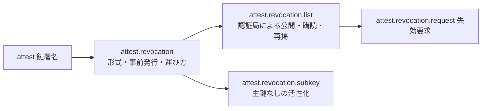
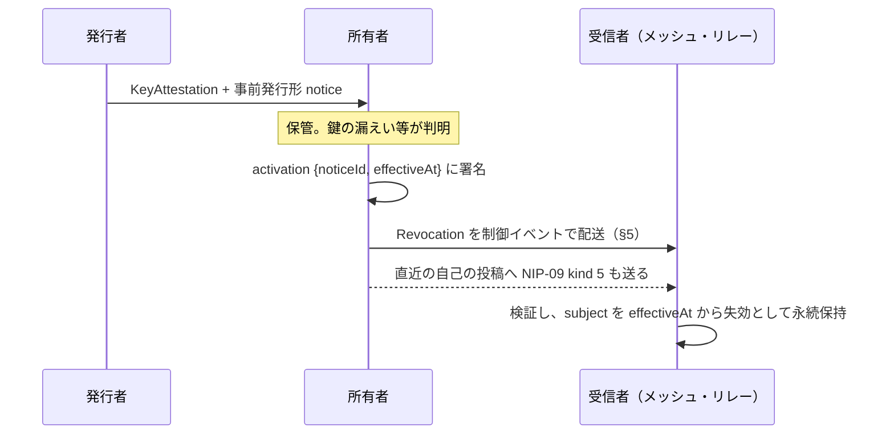

# 失効通知

識別子: `dev.jisaku.mosimo.attest.revocation`

## 目的

失効通知は「鍵 S を時刻 T から無効とする」という署名付きの永続的な事実である。失効が起きたときにだけ生成・配送し、定期的な「異常なし」の通知を前提としない。受信者はインターネットなしでも、手元に届いた通知だけで失効を適用できる。

この設計では、受信者は「失効していない」と「通知を受け取っていない」を区別できない。届かない失効による被害の上限は、その鍵の `keyValidity.until` である。stratum 2 以降の鍵に期限を必須とするのはこのためである。

## 前提

| 識別子 | 役割 |
|---|---|
| [`dev.jisaku.mosimo.attest`](../README.md) | 鍵署名、共通符号化、チェーン上の祖先の定義 |
| [`dev.jisaku.mosimo`](../../README.md) | 制御イベントの運び方 |



## 1. 構造

```ts
type NoticeBody = {
  $type: "dev.jisaku.mosimo.attest.revocation#notice";
  issuer: PublicKey;         // 通知に署名する鍵。§2.1 の条件を満たすこと
  subject: PublicKey;        // 失効させる鍵
  issuedAt: Timestamp;
  effectiveAt?: Timestamp;   // 即時形では必須、事前発行形では省略
  blocks: Block[];
};
type Notice = Signed<NoticeBody>;

type ActivationBody = {
  $type: "dev.jisaku.mosimo.attest.revocation#activation";
  noticeId: Bytes;           // H(notice.body)
  effectiveAt: Timestamp;
};
type Activation = Signed<ActivationBody>;   // subject 鍵、または subkey 拡張の副鍵が署名

type Revocation = {
  $type: "dev.jisaku.mosimo.attest.revocation";
  notice: Notice;
  activation?: Activation;
};
```

| ブロック `$type` | フィールド | 意味 |
|---|---|---|
| `dev.jisaku.mosimo.attest.revocation#reason` | `code: Text`、`text?: Text` | `compromise`・`superseded`・`ceased`・`unspecified` |

`Revocation` が運搬・保存の単位である。`revocationId = H(notice.body)` とし、`activation` の有無で ID を変えない。

## 2. 二つの形式

| 形式 | `effectiveAt` | 成立条件 | 用途 |
|---|---|---|---|
| 即時形 | `notice.body` に必須 | `notice.sig` の検証 | 親が失効させる。失効要求への応答 |
| 事前発行形 | `notice.body` では省略、`activation.body` に必須 | `notice.sig` と `activation.sig` の検証。`activation.noticeId == H(notice.body)`、`activation.effectiveAt >= notice.issuedAt` | 所有者が自ら、親と通信せずに失効させる |

`effectiveAt` のない `notice` 単体を失効として適用してはならない。活性化前の事前発行形が流出しただけで鍵が無効になることを防ぐためである。

### 2.1 受信者が受け入れる通知

認証局は任意の鍵に対して通知を発行できる。受信者は、評価中のチェーンにおいて `notice.issuer` が `subject` の祖先（ルート鍵、または `subject` より前の位置の `issuer`）であるか、`subject` 自身である場合にだけ、その通知をそのチェーンに適用する。この判定は評価中のチェーンの鍵だけで行える。

ある鍵が複数の認証局から鍵署名を受けている場合、一つの認証局の通知はその認証局を含むチェーンにだけ効く。鍵を全ての経路で無効にしたい認証局は、他の認証局へ失効要求を送る（[失効要求 §3](request/README.md#3-認証局の判断)）。自己署名の通知は `subject` を含む全てのチェーンに効く。

## 3. 事前発行

発行者は鍵署名を発行するとき、同じ `subject` に対する事前発行形の `notice` を署名し、鍵署名と一緒に所有者へ渡す。所有者はこれを鍵と別に保管し、必要になったとき `activation` を署名して `Revocation` を完成させる。



所有者は、失効通知と併せて、失効させる鍵で署名した直近の投稿に対する NIP-09 の削除要求（`kind: 5`）を同じ鍵で発行することを推奨する。本拡張に未対応のリレー・クライアントも削除要求には対応している可能性があるためである。

## 4. ルート鍵

ルート鍵は失効通知の対象外である。ルート鍵の入れ替えは、HTTPS の信頼ストアと同様に、アプリ・OS の更新など帯域外の手段で行う。

## 5. 制御イベントとしての運び方

`Revocation` は投稿ではなく、独立した制御イベントとして運ぶ。

| 項目 | 値 |
|---|---|
| Nostr `kind` | `8173`（本プロトコル固有の制御イベント共通） |
| `content` | 空文字列、または人が読める説明 |
| タグ | `["t", "mosimo.jisaku.dev"]`、`["t", "mosimo.jisaku.dev/revocation"]`、`["mosimo:ext:dev.jisaku.mosimo.attest.revocation", B64(C({notice, activation}))]`、`["mosimo:exp", Timestamp]` |
| イベントの署名者 | 任意。運搬者の鍵でよい |
| 1 イベント | ちょうど 1 個の `Revocation` |

- 通知の真正性は内側の `notice.sig`・`activation.sig` で決まる。運搬者の認証を通知の検証に代用してはならない。運搬者は誰でもよく、人が端末を持ち運ぶ経路も含むためである。
- 配送期限は `subject` の `keyValidity.until`、無期限の鍵では運搬者が決める。受信者は配送期限が過ぎても失効状態を保持する。
- 同じ `revocationId` の再送は捨てる。異なる運搬者による同じ通知はイベント ID が違っても失効状態は一つである。
- メッシュではコアの 7 要素配列をそのまま使い、共通接頭辞の規則でタグ値が `bstr` になる。解釈できない端末も通常の制御イベントとして中継できる。
- 受信者は本イベントを通常投稿より低くない優先度で中継することを推奨する。

## 6. 受信者の状態

受信者は検証済みの `Revocation` を `subject` ごとに永続保持し、状態を巻き戻してはならない。投稿ごとに最初に観測した時刻 `seenAt` を記録する。鍵 K について、チェーン評価時の失効状態は次のいずれかである。

| 状態 | 条件 |
|---|---|
| `revoked` | K またはその祖先に有効な通知があり、投稿の `created_at >= effectiveAt` または `seenAt >= effectiveAt` |
| `revoked-later` | 有効な通知があるが、`created_at < effectiveAt` かつ `seenAt < effectiveAt` |
| `not-revoked-as-known` | 手元の通知に該当なし。失効情報を最後に得た時刻を併記する |
| `unknown` | 通知の署名者の権限を判定できない等 |

`seenAt` を条件に含めるのは、失効した鍵の保持者が `created_at` を偽ることを防ぐためである。失効前に作成され配送が遅れた正当な投稿も `revoked` になるが、偽情報の拡散防止を優先する。

祖先の失効は子孫全体に及ぶため、子孫ごとの通知は要らない。


## 参照

- [NIP-09: Event Deletion Request](https://github.com/nostr-protocol/nips/blob/master/09.md)
