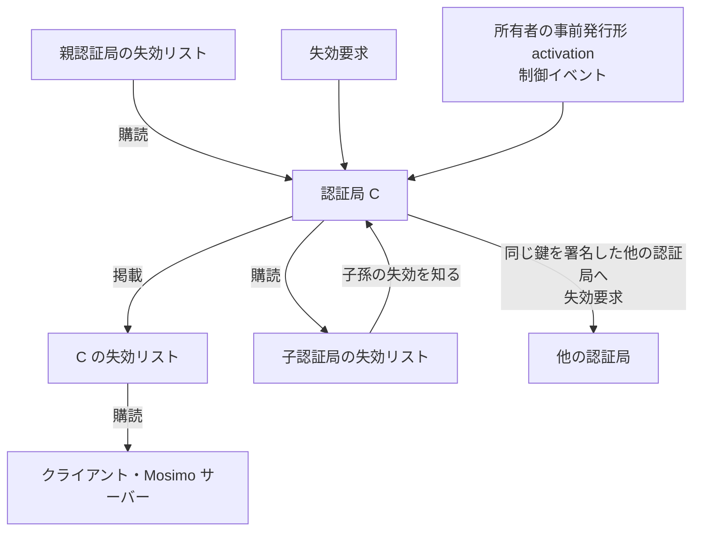

# 失効リスト配信

識別子: `dev.jisaku.mosimo.attest.revocation.list`

## 目的

認証局が失効通知を自身のドメインで公開・購読・再掲する方法と、クライアント・Mosimo サーバーがインターネットに接続できたときに行う確認を定義する。通知自体の検証は失効通知プロトコルに従い、エンドポイントの到達性や応答は失効の有無の根拠にならない。本プロトコルはインターネットに接続できる参加者の動作を追加するものであり、オフラインの受信者に要件を課さない。

## 前提

| 識別子 | 役割 |
|---|---|
| [`dev.jisaku.mosimo.attest.revocation`](../README.md) | 失効通知の形式と受信者の状態 |
| [`dev.jisaku.mosimo.attest`](../../README.md) | `issuerDomain` ブロックとエンドポイントの共通規約 |

## 1. エンドポイント

鍵署名の `issuerDomain.domain` を `D` とする。

| 用途 | URL | 定義 |
|---|---|---|
| 失効リスト | `https://D/.well-known/mosimo/attest/revocations` | 本書 |
| 失効要求 | `https://D/.well-known/mosimo/attest/revocation-requests` | [失効要求](../request/README.md) |
| 署名要求 | `https://D/.well-known/mosimo/attest/signing-requests` | [署名要求](../../signing/README.md) |

HTTP の共通規約は [鍵署名 §2.3](../../README.md#23-ドメインとエンドポイントの発見) に従う。

## 2. 失効リスト

```ts
type ListBody = {
  $type: "dev.jisaku.mosimo.attest.revocation.list";
  publisher: PublicKey;        // この認証局の鍵
  generatedAt: Timestamp;
  revocations: Revocation[];
};
type RevocationList = Signed<ListBody>;  // publisher 鍵が署名
```

- `GET` に `application/cbor` で `C(RevocationList)` を返す。`Accept: application/json` には JSON を返してよい。
- `generatedAt` と `publisher` の署名は「この時点で認証局が公開していた集合」の表明である。各通知の真正性は内側の署名で独立に検証し、リストの署名が検証できなくても内側の有効な通知は適用してよい。
- 任意の `?since=<Timestamp>` で、`issuedAt` または `activation.effectiveAt` がそれ以降の通知だけを返してよい。`ETag` と `If-None-Match` の対応を推奨する。
- 既定の全量応答は 1 MiB 以下とし、超える場合は `since` の利用を求める応答を返す。古い通知を応答から黙って落としてはならない。受信者が失効を見逃す原因になるためである。

## 3. 掲載する内容

| 内容 | 掲載 |
|---|---|
| 自身が発行した即時形の通知 | 必須 |
| 自身が発行した事前発行形の通知のうち、`activation` を受け取ったもの | 必須 |
| 親鍵が失効した通知を知った場合、その通知 | 必須 |
| 自身または子孫の鍵が祖先によって失効された通知を知った場合 | 必須 |

保持期間は `subject` の `keyValidity.until` までとし、無期限の鍵の通知は恒久に保持する。親鍵の失効を知った認証局は、自身の子孫のそれぞれについて個別の失効通知を発行すべきではない。祖先の失効は既に子孫全体に及んでおり、個別通知は失効情報の流量を増やすだけである。

## 4. 伝播の規則



- 認証局は親の失効リストを購読するなどして、親鍵・自身・子孫の失効を知る。経路は HTTPS のほか、制御イベントの購読でもよい。
- 認証局が鍵を失効させたとき、同じ鍵に鍵署名を発行している他の認証局を知っていれば、自身の鍵で署名した失効要求をその認証局へ送ってよい。受け入れるかは相手の認証局が決める。
- 認証局が自身の鍵を失効させる手順は次のとおり。
  1. 親認証局の失効要求エンドポイントへ、自身の鍵で署名した失効要求を送る。
  2. 失敗した場合、事前発行形の `notice` に `activation` を付け、制御イベントとして配送する。
  3. いずれの場合も、自身の失効リストに掲載する。

## 5. クライアントと Mosimo サーバーの確認

クライアント、PDS、Nostr リレーは、インターネットに接続できたとき次を行う。

1. 受け取った投稿のチェーンに含まれる `issuerDomain.domain` を収集する。同じドメインへの取得頻度は認証局側の資源制限に従って抑える。
2. 各ドメインの失効リストを取得し、通知を検証して永続保持する。
3. 保持している投稿を再評価し、`revoked` となった投稿に失効フラグを立て、新たな広告・転送の対象から外す。
4. 自身がメッシュや他リレーへ投稿を渡していた場合、該当する `Revocation` を制御イベントとして一度配送する。
5. ドメインごとに最終確認時刻を記録し、表示の「失効情報の確認時点」に用いる。

取得の失敗は最後の状態を保つ。失効リストが取得できないことを理由に投稿の表示・中継を止めてはならない。配布基盤の障害が災害時の情報の流れを止める単一障害点になるためである。

## 6. 認証局の運用要件

- 失効リストの改ざんは内側の署名で検出されるため、配布に CDN・ミラーを用いてよい。
- 認証局の鍵が失効した後も、そのドメインの失効リストは子孫の通知を提供し続けることを推奨する。

## 参照

- [RFC 8615: Well-Known Uniform Resource Identifiers](https://www.rfc-editor.org/rfc/rfc8615)
