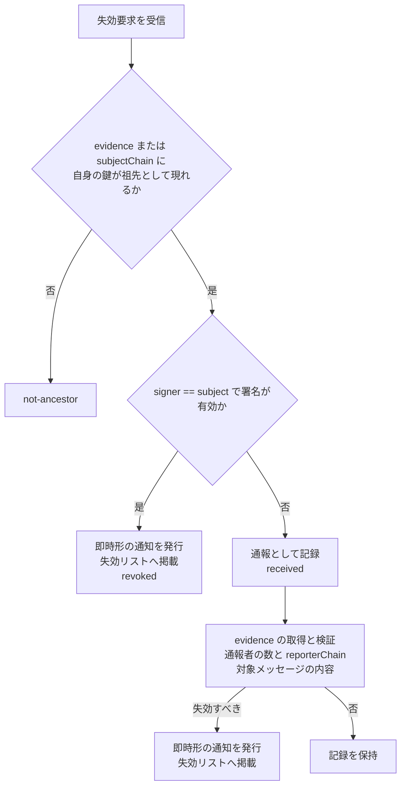

# 失効要求

識別子: `dev.jisaku.mosimo.attest.revocation.request`

## 目的

認証局に対して特定の鍵の失効を求める入力を定義する。対象鍵自身が署名した要求は即時に失効へつながり、他者の署名または無署名の要求は通報として認証局の判断に委ねる。要求が受理されただけでは失効は成立せず、失効の成立は失効通知の発行である。

## 前提

| 識別子 | 役割 |
|---|---|
| [`dev.jisaku.mosimo.attest.revocation.list`](../list/README.md) | エンドポイントの配置、発行した通知の掲載 |
| [`dev.jisaku.mosimo.attest.revocation`](../README.md) | 失効通知の形式 |

## 1. 構造

```ts
type RequestBody = {
  $type: "dev.jisaku.mosimo.attest.revocation.request";
  subject: PublicKey;          // 失効を求める鍵
  requestedAt: Timestamp;
  blocks: Block[];
};
type RevocationRequest = {
  body: RequestBody;
  signer?: PublicKey;          // 省略時は無署名
  sig?: Signature;             // signer 鍵による H(body) への署名
};
```

| ブロック `$type` | フィールド | 意味 |
|---|---|---|
| `dev.jisaku.mosimo.attest.revocation#reason` | 失効通知と同じ | 要求の理由 |
| `dev.jisaku.mosimo.attest.revocation.request#evidence` | `events: NostrEventId[]`、`uris?: AtUri[]` | 通報対象のメッセージ。メッセージには対象鍵のチェーンが同梱されている |
| `dev.jisaku.mosimo.attest.revocation.request#subjectChain` | `attestations: KeyAttestation[]` | 対象鍵のチェーン。`evidence` を伴わない要求で、認証局が自身の位置を判断するために付ける |
| `dev.jisaku.mosimo.attest.revocation.request#reporterChain` | `attestations: KeyAttestation[]` | `signer` のチェーン。通報者または要求元の認証局の身元の重み付けに用いる |

`evidence.events` は 64 件以下、`C(RevocationRequest)` は 16,384 バイト以下とする。

## 2. エンドポイント

`POST https://D/.well-known/mosimo/attest/revocation-requests` に `application/cbor` で `C(RevocationRequest)` を送る。

```ts
type Response = {
  $type: "dev.jisaku.mosimo.attest.revocation.request#response";
  status: "revoked" | "received" | "rejected" | "not-ancestor";
  revocationId?: Bytes;
  text?: Text;
};
```

| `status` | 意味 |
|---|---|
| `revoked` | 即時形の通知を発行し、失効リストに掲載した |
| `received` | 通報として記録した。判断は後続 |
| `rejected` | 形式不正、資源上限、重複、または判断の結果として却下 |
| `not-ancestor` | 提示されたチェーンに自身の鍵が祖先として現れない。送信元は正しい祖先のドメインへ送る |

認証局は、送信元ごと・`subject` ごとの受付数と頻度に上限を設ける。無署名の要求はより低い上限でよい。

### 2.1 DM による要求

エンドポイントに届かない状況では、要求を[個別通信](../../../dm/README.md)の構造化オブジェクトとして認証局の鍵へ送れる。平文は `RevocationRequest` の JSON（`$type` は `dev.jisaku.mosimo.attest.revocation.request`、`Bytes` は通常の Base64・padding なし）であり、認証局は復号後にエンドポイントと同じ判断を行い、`Response` を同じ経路で返す。DM の宛先にできるのは 32 バイトの Nostr 鍵なので、メッシュ経由の要求を受け付ける認証局は 32 バイトの鍵を用いる。認証局の鍵が 33 バイトの場合はエンドポイントだけが要求の経路である。

## 3. 認証局の判断



- 認証局は、`evidence` のメッセージに同梱されたチェーン、または `subjectChain` から、自身が `subject` の祖先であるかを判断する。祖先であれば、直接の発行者でなくても失効させられる。
- `signer == subject` の要求は所有者本人の意思表示であり、審査なしに失効させる。所有者はこれにより、事前発行形の `activation` を配送する前に認証局経由の失効を試みられる。
- `signer` が他の認証局の鍵で、`reporterChain` によりその認証局が `subject` に鍵署名を発行していると確認できる場合、その認証局が当該鍵を既に失効させた旨の要求として扱う。受け入れるかは受信した認証局が決める。
- その他の署名または無署名の要求は、`evidence` のメッセージを取得し、それが `subject` 鍵で署名されていることと内容を確認する。確認できない証拠は重みを持たない。独立した通報者の数と、`reporterChain` が検証できる通報者の信頼度を判断材料とする。基準は認証局の方針とする。
- 判断の結果として失効させる場合、通知の `effectiveAt` は認証局が定める。最初の問題メッセージの時刻まで遡らせてよい。

## 4. 通報者への配慮

通報者の鍵・署名は認証局の記録に残し、公開してはならない。失効通知にも通報者の情報を含めてはならない。通報者が特定されると、問題のある発信者からの報復を恐れて通報が行われなくなるためである。認証局が通報の有無・内容を `subject` の所有者に開示する場合も、通報者を特定できる情報を除く。
