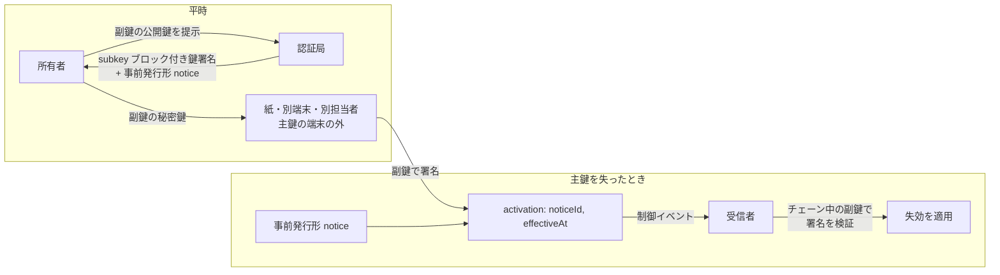

# 失効用サブ鍵

識別子: `dev.jisaku.mosimo.attest.revocation.subkey`

## 目的

事前発行形の失効通知は所有者の鍵による活性化を要するため、端末の盗難・破損で鍵を失うと使えない。本拡張では、所有者が通常の署名鍵（主鍵）とは別に失効専用の副鍵を持ち、副鍵の公開鍵を鍵署名のブロックとして親に署名してもらう。主鍵を失ったときは、事前発行形の通知に失効日を付け、副鍵で署名して配送する。活性化は署名付きなので、第三者が失効日を書き換えて再発信することはできない。



## 前提

| 識別子 | 役割 |
|---|---|
| [`dev.jisaku.mosimo.attest.revocation`](../README.md) | 事前発行形の通知と `activation` |
| [`dev.jisaku.mosimo.attest`](../../README.md) | 鍵署名のブロック |

## 1. 鍵署名のブロック

```ts
type SubkeyBlock = {
  $type: "dev.jisaku.mosimo.attest.revocation.subkey";
  key: PublicKey;      // 副鍵の公開鍵。32 または 33 バイト
};
```

- 所有者が副鍵を生成し、公開鍵だけを発行者へ渡す。
- 副鍵は主鍵・他の用途の鍵と共用してはならない。副鍵でチェーン上の鍵署名や投稿に署名しても効力を持たない。副鍵の用途を失効に限ることで、副鍵の漏えいによる被害を「第三者が鍵を失効させられる」ことに留めるためである。
- 一つの鍵署名に本ブロックは一つ。副鍵を替えるには鍵署名を再発行する。
- 包含規則はない。親子で独立に設定する。

## 2. 副鍵による活性化

活性化のオブジェクトは失効通知の `Activation` と同一であり、署名者だけが異なる。受信者は次を全て満たす場合に `notice.subject` を `effectiveAt` から失効として適用する。

| 確認 | 内容 |
|---|---|
| 通知 | `notice.sig` が有効で、`notice.body.effectiveAt` がなく、`activation.body.noticeId == H(notice.body)`、`activation.body.effectiveAt >= notice.issuedAt` |
| 署名者の権限 | `notice.issuer` が評価中のチェーンにおいて `subject` の祖先 |
| 活性化の署名 | `activation.sig` が `subject` 鍵で検証できる、または評価中のチェーンで `subject` を被署名鍵とする鍵署名に本ブロックがあり、その `key` で検証できる |

## 3. 永続保持

受信者は、チェーンを評価する前に副鍵による活性化を受け取ることがある。その場合は `Revocation` を `subject` に紐付けて保持し、`subject` を含むチェーンを評価するときに副鍵で署名を検証する。検証に失敗した活性化はそのチェーンに適用せず、成功したら以後は通常の失効状態として扱う。

## 4. 運用

- 副鍵の秘密鍵は主鍵を置く端末の外に保管する。紙への印字、別の端末、別の担当者による保管などが候補である。主鍵と同じ場所に保管すべきではない。一緒に失われ、または一緒に盗まれるためである。
- 副鍵の漏えいが分かったら鍵署名を再発行して副鍵を替える。
- 認証局自身の鍵にも本拡張を用いてよい。stratum 1 の無期限の鍵では、鍵の喪失に備える手段として特に推奨する。
