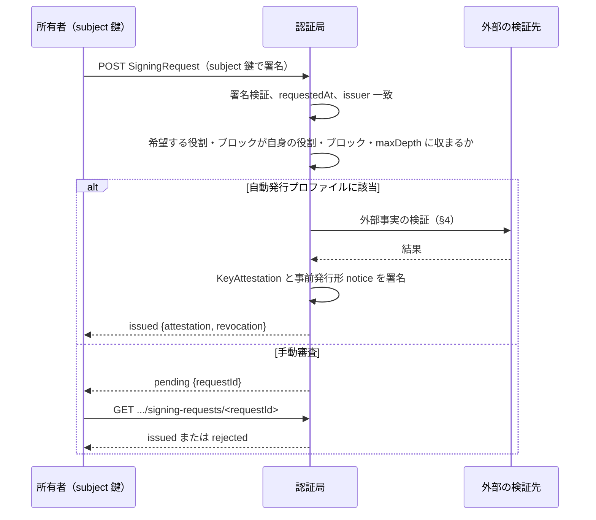

# 署名要求と自動発行

識別子: `dev.jisaku.mosimo.attest.signing`

## 目的

鍵の所有者が認証局に鍵署名を要求する手順と、認証局が要求を自動または手動で審査して鍵署名と事前発行形の失効通知を返すエンドポイントを定義する。自動発行は検証できる外部の事実に限って行い、その旨を `trustLevel` に表す。エンドポイントの提供は任意であり、オフライン発行だけの認証局は本拡張を実装しなくてよい。

## 前提

| 識別子 | 役割 |
|---|---|
| [`dev.jisaku.mosimo.attest`](../README.md) | 鍵署名の構造、エンドポイントの共通規約、信頼度 |
| [`dev.jisaku.mosimo.attest.revocation`](../revocation/README.md) | 発行時に渡す事前発行形の失効通知 |

## 1. 構造

```ts
type RequestBody = {
  $type: "dev.jisaku.mosimo.attest.signing";
  issuer: PublicKey;           // 宛先の認証局の鍵
  subject: PublicKey;          // 署名を求める鍵
  owner: Owner;
  roles: Text[];
  blocks: Block[];             // 希望する追加ブロックと検証材料
  requestedAt: Timestamp;
};
type SigningRequest = Signed<RequestBody>;   // subject 鍵が署名

type Response = {
  $type: "dev.jisaku.mosimo.attest.signing#response";
  status: "issued" | "pending" | "rejected";
  requestId?: Bytes;           // pending のとき。H(request.body)
  attestation?: KeyAttestation;
  revocation?: Notice;         // 事前発行形
  text?: Text;
};
```

`issuer` を含めるのは、同じ要求を別の認証局へ転用できないようにするためである。`requestedAt` から一定時間（24 時間を推奨）を過ぎた要求は受け付けない。

## 2. エンドポイント

| 操作 | URL | 内容 |
|---|---|---|
| 要求 | `POST https://D/.well-known/mosimo/attest/signing-requests` | `C(SigningRequest)` を送り、`Response` を受ける |
| 状態照会 | `GET https://D/.well-known/mosimo/attest/signing-requests/<hex(requestId)>` | `pending` の要求の現在の `Response` |

HTTP の共通規約は [鍵署名 §2.3](../README.md#23-ドメインとエンドポイントの発見) に従う。認証局は送信元ごとの受付数に上限を設ける。

## 3. 署名要求



- 要求の署名は `subject` 鍵の所持の証明である。認証局は別のチャレンジ応答を追加してよい。
- 認証局は要求の `owner`・`roles`・`blocks` を縮小して発行してよいが、拡大してはならない。発行内容は応答の `attestation` が正本である。
- 手動審査で発行した鍵署名は確認過程に応じて `trustLevel` 2 以上を表明できる。自動発行は 1 以下とする。

## 4. NIP-05 ドメイン検証プロファイル

企業等が自身のドメインで管理する Nostr 鍵に、簡易な鍵署名を自動発行するためのプロファイルである。

| 項目 | 内容 |
|---|---|
| 要求 | `subject` は 32 バイト鍵。`blocks` に `subjectDomain { domain, method: "nip05" }` と `nip05 { name }` を含める。`name` は `<local-part>@<domain>` または `_@<domain>` |
| 検証 | 認証局が `https://<domain>/.well-known/nostr.json?name=<local-part>` を取得し、`names[<local-part>]` が `hex(subject)` に一致することを確認する。redirect を追わず、サイズ・時間を制限する |
| 発行 | `owner.id = "nip05:" + name`、`owner.name` は要求値、`roles = ["identity"]`、`delegation` と `organization` なし、`subjectDomain { domain, method: "nip05" }`、`trustLevel { level: 1, method: "nip05" }`、`keyValidity.until` は認証局の方針 |

```ts
type Nip05Block = { $type: "dev.jisaku.mosimo.attest.signing#nip05"; name: Text };
```

このプロファイルで確認できるのは「そのドメインの `nostr.json` が、その時点でこの鍵を名乗らせていた」ことである。`_@<domain>` はドメイン自体を所有者名とする。更新時は再検証する。

## 5. 手動審査プロファイル

公的機関・自治体など `trustLevel` 2 以上を要する発行は手動審査とする。確認の方法は認証局の方針であり、少なくとも次を記録する。

- 確認した資料・連絡先の種別と確認日
- 発行した鍵署名の ID と事前発行形 `notice` の ID
- 所有者へ渡した事前発行形 `notice` と、用いる場合は副鍵の保管方法についての案内

## 参照

- [NIP-05: Mapping Nostr keys to DNS-based internet identifiers](https://github.com/nostr-protocol/nips/blob/master/05.md)
