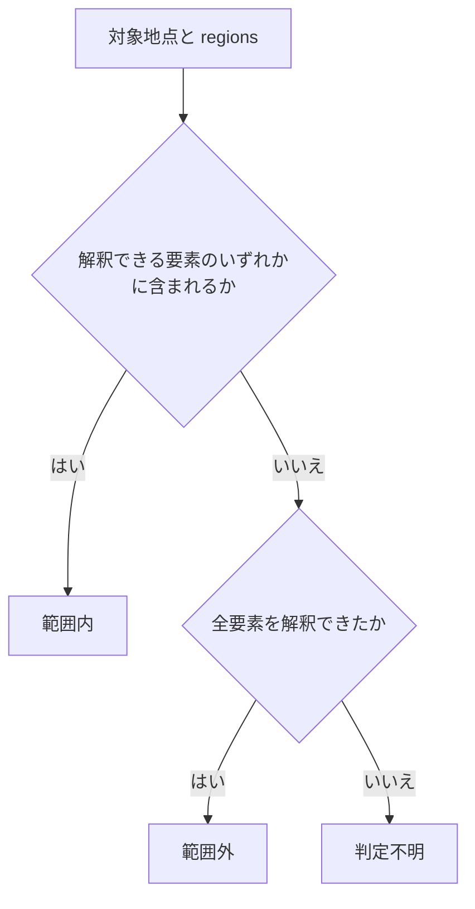

# 地理情報

識別子: `dev.jisaku.mosimo.geo`

## 目的

本プロトコルは、投稿に付随する二つの地理情報、発信地点 `#origin` と影響範囲 `#area` を定義する。既存アプリへの組み込み負担を抑えつつ、情報の表示と配送を地理的に絞り込めるようにすることが目的である。行政境界データの事前搭載やサーバーへの照会なしに、端末だけで領域の復元と地点の包含判定ができる表現を選ぶ。

本書が保証するのは、署名された座標・領域が著者の申告どおりに保持・復元されること、解釈できる要素だけで部分的な包含判定ができることである。発信地点は著者が任意に公開する端末位置の申告であり、現地にいたことや GPS の真正性の証明にはならない。影響範囲は表示と配送順位のヒントであり、範囲外への中継や閲覧を制限する境界ではない。近似領域に含まれる地点が原情報の厳密な警報対象であることも保証されない。

## 前提

| 識別子 | 文書 | 依存する理由 |
|---|---|---|
| `dev.jisaku.mosimo` | [コア](../README.md) | 基本型 `Microdegrees`・`Millimeters`・`Timestamp`、拡張の共通構造、自己完結拡張タグによる運び方 |

## 1. 二つの型

| 型 | `$type` | 意味 | 省略・未対応時 |
|---|---|---|---|
| 発信地点 | `dev.jisaku.mosimo.geo#origin` | 発信端末が任意に公開する投稿時の位置 | 位置不明。本文は利用できる |
| 影響範囲 | `dev.jisaku.mosimo.geo#area` | 投稿内容が関係する地理的範囲 | 地域不明。全世界対象や高優先度にはならない |

発信地点と影響範囲は独立した任意の拡張である。公的な投稿に発信地点は必須ではなく、影響範囲があっても発信者の現在地は分からない。省略時や受信側が解釈できない場合も、本文の受信・検証・表示は成立する。受信側は発信地点を影響範囲として代用してはならない。両者は別の意味を持ち、代用は著者が公開していない影響範囲を捏造することになるためである。

## 2. 座標系と単位

発信地点と円の中心は WGS 84 の緯度・経度で表す。保存形式は[コア §3.2](../README.md#32-座標と距離の整数表現)の固定単位の整数であり、緯度・経度は 100 万分の 1 度、半径・測位精度はミリメートルを 1 とする。表示時は度・メートルへ換算できる。

範囲判定は地表上の二次元領域を対象とし、高度は用いない。原情報が異なる座標系や単位を使う場合は取り込み側で変換し、変換できない座標を WGS 84 として解釈してはならない。異なる座標系の値をそのまま用いると、数十メートルから数百メートルの誤差を署名付きで配送することになるためである。

## 3. 発信地点

```ts
type OriginExtension = {
  $type: "dev.jisaku.mosimo.geo#origin";
  lat: Microdegrees;
  lon: Microdegrees;
  acc?: Millimeters;
  at?: Timestamp;
};
```

| 項目 | 必須 | 意味 |
|---|---|---|
| `lat` | 必須 | WGS 84 緯度 |
| `lon` | 必須 | WGS 84 経度 |
| `acc` | 任意 | 測位精度を表す距離 |
| `at` | 任意 | 測位時刻。不明なら省略する |

公開は任意であり、利用者は精度を落として公開できる。測位時刻が不明な場合に現在時刻で補ってはならない。補った値は著者の署名付き申告として配送されるためである。

公的電文の震源・観測地点や、変換サーバーの所在地を発信地点に置いてはならない。発信地点は発信端末の位置を意味し、それ以外の地点を置くと受信側が被災現場の報告と誤認するためである。

## 4. 影響範囲

```ts
type Circle = {
  shape: "circle";
  lat: Microdegrees;
  lon: Microdegrees;
  r: Millimeters;
};
type GeohashCell = { shape: "geohash"; hash: string };
type AreaExtension = {
  $type: "dev.jisaku.mosimo.geo#area";
  regions: (Circle | GeohashCell)[];
  approximation?: boolean;
};
```

`regions` の意味は和集合である。円だけ、セルだけ、両者の混在を許容する。初期の共通範囲型が表すのは円と Geohash セルであり、行政区域コード・多角形・除外領域・差集合・任意の論理式は[近似](#43-近似)によって円とセルへ変換する。[Lexicon](lexicon.json) では `regions` の要素を `shape` で種別を選ぶ一つの `#region` オブジェクトとして定義する。

```json
{
  "$type": "dev.jisaku.mosimo.geo#area",
  "regions": [
    { "shape": "circle", "lat": 35000000, "lon": 139000000, "r": 2500000 },
    { "shape": "geohash", "hash": "xn76" }
  ]
}
```

この例の二つの領域は互いに独立した要素であり、同一形状を表すものではない。要素数と総バイト数には上限を設ける。未知の要素を削って署名済みの領域を変更してはならない。領域が縮小し、著者の署名した範囲と異なる領域が配送されるためである。

### 4.1 Geohash

Geohash は、国に依存しない既存の公開方式として採用する。コードだけからセルの緯度・経度の範囲を復元できる。ただし符号化・復号・領域判定の実装コードは必要である。

- コードの長さによってセルの大きさが変わる。セルは緯度・経度の区間で表され、同じ文字数でも実際の幅・面積は緯度によって異なる。
- 隣接地点が同じ接頭辞を持つとは限らないため、近隣検索を接頭辞一致だけで完結させてはならない。コードを領域に復号する処理と、検索・配送のための索引は区別する。

### 4.2 包含判定



対象地点が解釈できる要素のいずれかに含まれる場合は範囲内と判定できる。未対応の要素があって全体を評価できない場合は判定不明とし、範囲外と断定してはならない。未知の要素が対象地点を含む可能性が残るためである。全要素を評価でき、どの要素にも含まれない場合にのみ範囲外と判定できる。

これは符号化された領域への地点の包含に関する規則である。近似領域（[§4.3](#43-近似)）に含まれる地点が原情報の厳密な対象かどうかは、本文や原形式の拡張で確認する。範囲外・判定不明のいずれの結果でも、本文の表示と通常の配送上限内での中継は成立する。

### 4.3 近似

CAP の多角形や気象庁 XML の地域コード等から解決した領域は、その全体を覆う Geohash セルの和集合へ近似して `#area` に格納できる。近似変換は取り込み側の任意の処理であり、署名前に行う。

- 取り込み側が原情報の領域と必要な境界資料を解釈する。中継端末は行政境界資料やオンライン照会なしに判定できる。
- 生成するセルの和集合は元領域全体を含む。セル数を抑える際は全体の包含を維持して粗いセルへまとめる。一部のセルを削除して縮小してはならない。対象地域の一部が範囲外として扱われるためである。
- 近似であることは `approximation: true` で `#area` 自体に明示する。原形式や出典の拡張を解釈しなければ近似と分からない構造にしてはならない。本文と `#area` だけを扱う端末も、厳密な対象領域と配送用の近似領域を区別できる必要があるためである。
- 元の地域名・地域コードは本文や原形式の拡張に残す。近似領域内であることだけを根拠に、その地点が厳密な警報対象であると表示してはならない。
- 境界を解決できず元領域全体を覆うことを確認できない場合は `#area` を省略して地域不明とする。一部の解決済み領域だけを完全な範囲として発行したり、地域名から推測した中心点や震源から便宜的な円を生成したりしてはならない。いずれも原情報が示していない領域を署名付きで配送することになるためである。
- EDXL-DE の `targetArea` は配布対象であって警報の影響範囲ではないため、内包する警報の `#area` に置き換えてはならない。

## 5. 配送と表示

影響範囲内への配送を優先できる。範囲外への中継は許容され、地域外のゲートウェイへ向かう中継も行える。地域不明の投稿は通常の配送上限内で中継し、地域内優先の加点は与えない。寿命・hop・保存量・帯域の上限は影響範囲とは独立に適用し、位置情報を持たないノードもローカルな資源上限の範囲で配送に参加できる。

精度の高いセルや発信地点は位置の特定につながるため、発信地点の公開は任意とし、精度を落とせる。大量のセルによる処理・通信負荷は要素数・総バイト数の上限で防ぐ。

## 6. Nostr 上の表現

発信地点と影響範囲は、それぞれ[コア §7.3](../README.md#73-自己完結した拡張タグ)の自己完結した拡張タグで運ぶ。

```text
["mosimo:ext:dev.jisaku.mosimo.geo#origin", B64(C({lat, lon, acc?, at?}))]
["mosimo:ext:dev.jisaku.mosimo.geo#area",   B64(C({regions, approximation?}))]
```

`C` は atproto deterministic CBOR、`B64` は padding なしの通常 Base64 である。内部の座標・距離は CBOR integer のまま保持する。メッシュ用 CBOR ではタグ値が `bstr` になる。

NIP-52 の `g` タグはカレンダーイベントを対象文脈とする Geohash タグであり、`kind: 1` の本文投稿の影響範囲とは文脈も意味も一致しないため、`#area` の代わりに用いてはならない。中継者は検索のための `g` 等の補助タグを署名済みイベントに追加してはならない。署名対象の改変になるためである。

## 未確定事項

- Geohash の許容コード長、セル数、総バイト数、半径の上限の具体値。空の `regions` 配列の扱い。
- 原値から整数への丸め規則、丸めによる領域誤差の扱い、測位精度の統計的な定義と数値範囲。
- 地表距離の計算法、円の境界上の判定、セル境界・日付変更線・極付近の取り扱い。
- Geohash 表記の正規化、重複セル・親子セルの整理。
- 全体を覆う近似を生成する具体的アルゴリズム、用いる境界資料の版、近似領域の表示方法。
- Geohash の符号化を相互運用可能に固定する一次参照とテストベクトル。

## 参照

- [NIP-52: Calendar Events](https://github.com/nostr-protocol/nips/blob/master/52.md)（Geohash タグの先例）
- [NIP-01: Basic protocol flow](https://github.com/nostr-protocol/nips/blob/master/01.md)
- [World Geodetic System 1984 (WGS 84)](https://earth-info.nga.mil/?dir=wgs84&action=wgs84)
