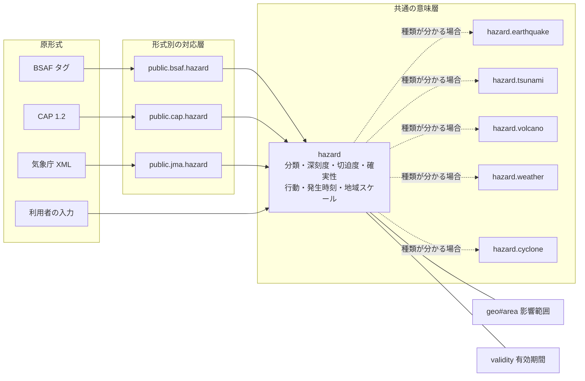

# 災害情報

識別子: `dev.jisaku.mosimo.hazard`

## 目的

本プロトコルは、地震・津波・気象警報などの災害情報を、発表国・原形式・言語に依存しない共通の意味で表す拡張を定義する。目的は、ある国・形式向けの対応しか持たないアプリが別の国や別の形式から変換された災害情報を受信しても、正確な名称は分からなくても、種類の大分類、深刻さ、切迫度、取るべき行動の種類、発生時刻、範囲が分かるようにすることである。

本プロトコルは二つの層からなる。

| 層 | 識別子 | 内容 |
|---|---|---|
| 共通の意味層 | 本拡張 `dev.jisaku.mosimo.hazard` と種類別拡張 `dev.jisaku.mosimo.hazard.*` | 形式に依存しない分類・深刻度・時刻と、種類ごとの物理量 |
| 形式別の対応層 | `dev.jisaku.mosimo.public.bsaf.hazard`、`dev.jisaku.mosimo.public.cap.hazard`、`dev.jisaku.mosimo.public.jma.hazard` 等 | 既存形式の項目から共通の意味層への変換規則 |

分類と深刻度の語彙は、国際的に最も普及した警報形式である CAP 1.2 の列挙値をそのまま採用する。各国固有の階級（日本の震度・警戒レベル等）は、共通値に加えて地域スケールとして併記する。

本書が保証するのは、著者または変換者が署名した分類・深刻度・時刻・物理量が、共通の意味で保持・復元されることである。保証しないのは、内容の真実性、発表機関の真正性、地域スケールから共通値への変換が原発表機関の公式な対応であること、共通値だけで原情報の全ての条件を表せることである。真正性は[署名チェーン](../attest/chain/README.md)と[公的情報の取り込み](../public/README.md)で別に扱う。

## 前提

| 識別子 | 文書 | 依存する理由 |
|---|---|---|
| `dev.jisaku.mosimo` | [コア](../README.md) | `Timestamp`、座標・距離の整数表現、拡張の open union と自己完結タグ |
| `dev.jisaku.mosimo.geo` | [地理情報](../geo/README.md) | 影響範囲 `#area`。本拡張は範囲を持たない |
| `dev.jisaku.mosimo.validity` | [情報の有効期間](../validity/README.md) | 警報が有効な期間。本拡張の発生時刻とは別 |
| `dev.jisaku.mosimo.attest.chain` | [署名チェーン](../attest/chain/README.md) | 公的な発表・転載と個人の申告の区別 |

## 1. 構成



一つの投稿は、一つの災害情報について共通拡張を高々一つ持つ。種類が分かる場合は対応する種類別拡張を併せて一つ持てる。影響範囲は [`geo#area`](../geo/README.md)、有効期間は [`validity`](../validity/README.md) で表し、本拡張に重複して持たない。

| 受信側が理解するもの | 分かること |
|---|---|
| 本文だけ | 人が読める警報内容。本文は全ての端末が利用できる唯一の情報であり、発信側は重要な指示を必ず本文に含める |
| 本文と `hazard` | 大分類、深刻度、切迫度、確実性、取るべき行動、発生時刻、原名称。未知の地域スケールは原値のまま表示 |
| さらに種類別拡張 | 種類（地震・津波等）と、震源・規模・火山名等の物理量 |
| さらに地域スケールの登録表 | 震度・警戒レベル等の国固有の正確な表示 |
| さらに原形式の拡張（`public.cap` 等） | 原形式の全項目と更新・取消の規則 |

## 2. 共通拡張

### 2.1 型

```ts
type CapCategory = "Geo" | "Met" | "Safety" | "Security" | "Rescue" | "Fire"
  | "Health" | "Env" | "Transport" | "Infra" | "CBRNE" | "Other";
type Severity = "Extreme" | "Severe" | "Moderate" | "Minor" | "Unknown";
type Urgency = "Immediate" | "Expected" | "Future" | "Past" | "Unknown";
type Certainty = "Observed" | "Likely" | "Possible" | "Unlikely" | "Unknown";
type ResponseType = "Shelter" | "Evacuate" | "Prepare" | "Execute" | "Avoid"
  | "Monitor" | "Assess" | "AllClear" | "None";

type LocalizedText = { text: string; lang: string }; // lang は BCP 47

type Scale = {
  scheme: string;                    // §5 の登録名
  value: string;                     // 原表記の値
  basis?: "observed" | "forecast";   // 観測値か予測値か。不明なら省略
};

type HazardExtension = {
  $type: "dev.jisaku.mosimo.hazard";
  status: "Actual" | "Exercise" | "Test";
  category: CapCategory[];           // 1〜4 件
  severity: Severity;
  urgency: Urgency;
  certainty: Certainty;
  responseTypes?: ResponseType[];    // 0〜4 件
  onset?: Timestamp;                 // 現象の発生・開始時刻
  event?: LocalizedText;             // 原情報での情報名称
  scales?: Scale[];                  // 0〜8 件
  glide?: string;                    // GLIDE 番号
};
```

正規の定義は [`lexicon.json`](lexicon.json) である。

| 項目 | 必須 | 意味 |
|---|---|---|
| `status` | 必須 | 実情報・訓練・試験の区別。CAP `status` の `Actual`・`Exercise`・`Test` と同じ意味。CAP の `System`・`Draft` に当たる情報は本拡張を付けて配送しない |
| `category` | 必須 | CAP 1.2 `category` の値（§3） |
| `severity`・`urgency`・`certainty` | 必須 | CAP 1.2 の同名項目と同じ値と意味（§4）。不明なら `Unknown` |
| `responseTypes` | 任意 | CAP 1.2 `responseType` と同じ値と意味。原情報が行動を示さない場合は省略する |
| `onset` | 任意 | 現象が発生した、または発生が見込まれる時刻（§6） |
| `event` | 任意 | 原情報での情報名称（例: `竜巻注意情報`、`Tornado Warning`）と、その言語の BCP 47 タグ |
| `scales` | 任意 | 地域スケール（§5） |
| `glide` | 任意 | 発行済みの [GLIDE 番号](https://glidenumber.net/)（例: `EQ-2011-000028-JPN`）。同じ災害事象を機関間で参照するための識別子 |

`status` を必須とするのは、省略を実情報と解釈すると、訓練の情報が実災害として表示されるためである。訓練・試験の投稿は[公的情報 §2.3](../public/README.md#23-公開可否と運用種別)により実情報用の自動投入から外す。

`event` は表示用の原名称であり、機械的な分類に使ってはならない。言語・国ごとに表記が異なり、同じ文字列が同じ意味である保証がないためである。

### 2.2 値の扱い

列挙値は CAP 1.2 の綴り（大文字始まり）をそのまま用いる。CAP から変換する場合に値を書き換えずに済み、CAP の解説資料をそのまま参照できるためである。受信側は未知の値を `Unknown` と同じに扱う。同じ配列内の値の重複は許さない。

`category`・`responseTypes` が複数ある場合、配列の順序に意味はないが、署名対象として保持する（[コア §5.1](../README.md#51-共通構造)）。

## 3. 大分類

CAP 1.2 の `category` は、全く知らない種類の災害情報でも大まかな分野を示す最後の縮退先として使う。種類を区別する値ではないため、種類が分かる場合は種類別拡張（§7）を併用する。

| 値 | 意味 | 例 |
|---|---|---|
| `Geo` | 地球物理 | 地震、津波、火山、土砂災害 |
| `Met` | 気象・水文 | 大雨、洪水、暴風、台風、竜巻、大雪 |
| `Safety` | 一般の安全 | 避難所の開設、一般的な注意喚起 |
| `Security` | 治安・国家安全 | 弾道ミサイル情報 |
| `Rescue` | 救助・捜索 | 行方不明者の捜索 |
| `Fire` | 火災 | 林野火災、市街地火災 |
| `Health` | 保健・医療 | 感染症、熱中症 |
| `Env` | 環境汚染 | 大気汚染、水質汚染 |
| `Transport` | 交通 | 道路・鉄道・航空の途絶 |
| `Infra` | インフラ | 停電、断水、通信障害 |
| `CBRNE` | 化学・生物・放射性物質・核・爆発物 | 有害物質の漏洩 |
| `Other` | その他 | 上記に当てはまらないもの |

変換者は、原形式が `category` を持つ場合はその値を用いる。持たない場合は、本書と種類別拡張の各文書が示す既定の大分類を用いる。同じ現象でも原形式によって `category` が異なり得るため（洪水の `Met` と `Geo` 等）、受信側は `category` だけで同一の災害とみなしてはならない。

## 4. 深刻度・切迫度・確実性・行動

CAP 1.2 の定義に従う。日本語の意味は次のとおりである。

| 項目 | 値 | 意味 |
|---|---|---|
| `severity` 深刻度 | `Extreme` | 生命・財産への並外れた脅威 |
| | `Severe` | 生命・財産への重大な脅威 |
| | `Moderate` | 生命・財産への脅威の可能性 |
| | `Minor` | 生命・財産への脅威は最小限、またはない |
| `urgency` 切迫度 | `Immediate` | 直ちに対応すべき |
| | `Expected` | 近いうち（概ね1時間以内）に対応すべき |
| | `Future` | 近い将来に対応すべき |
| | `Past` | 対応はもはや必要ない |
| `certainty` 確実性 | `Observed` | 発生した、または発生中であることが確認された |
| | `Likely` | 起こる可能性が高い（概ね 50% 超） |
| | `Possible` | 起こり得るが可能性は高くない |
| | `Unlikely` | 起こるとは考えにくい |
| `responseTypes` 行動 | `Shelter` | その場、または屋内で安全を確保する |
| | `Evacuate` | 対象地域から立ち退く |
| | `Prepare` | 避難等の準備をする |
| | `Execute` | 事前に計画した行動をとる |
| | `Avoid` | 対象を避ける |
| | `Monitor` | 情報に注意する |
| | `Assess` | 状況を見極める |
| | `AllClear` | 脅威は去った。解除 |
| | `None` | 行動は不要 |

いずれも原情報が示す、または形式別の対応層が定める規則で得た値だけを入れる。変換者が独自の判断で深刻度を上げ下げしてはならない。同じ原情報を別の変換者が変換すると深刻度が食い違い、受信者が比較できなくなるためである。

解除（危険が去ったことの通知）は `responseTypes: ["AllClear"]` と `urgency: "Past"` で表す。原情報の誤りによる取消は解除とは別であり、[公的情報 §9](../public/README.md#9-更新による置換と旧版の拡散停止) と原形式の拡張で扱う。解除を取消として扱ってはならず、その逆もしてはならない。解除は「危険が去った」という新しい事実であり、取消は「先の情報は誤りであった」という意味で、利用者の取るべき行動が異なるためである。

## 5. 地域スケール

### 5.1 意味

地域スケールは、国や機関が独自に定める階級（震度、警戒レベル、台風の強さ等）を原表記のまま運ぶ。共通の深刻度に変換すると失われる精度を、そのスケールを知るアプリのために保持する。

- `scheme` は §5.2 の登録名、`value` はそのスケールの原表記の値である。値の大小比較、正規化（`5+` を `5強` に書き換える等）は登録表の規則に従い、登録表を持たない受信側は値を文字列のまま表示する。
- `basis` は予測値と観測値の区別である。震度の予測（緊急地震速報）と観測（震度速報）のように、同じスケールで意味が大きく異なる場合に必ず付ける。分からない場合は省略し、推測で補ってはならない。
- 地域スケールを持つ投稿も、共通の `severity` 等を必ず持つ。スケールを知らないアプリは共通値だけで表示できる。
- 共通値と地域スケールの対応は、形式別の対応層の文書が定める。地域スケールの値から共通値を受信側で推測してはならない。対応は発表機関・形式ごとに異なるためである。

### 5.2 登録名

登録名は、発表国の ISO 3166-1 alpha-2 コードの小文字、または国際的な体系であることを示す `intl`、続いて機関名、スケール名を `.` で連ねる。本書が定める登録名は次のとおりである。第三者は、自身が管理するドメインの逆順表記（例: `org.example.flood-stage`）で独自の登録名を使える。

| 登録名 | スケール | 値 | 大小 |
|---|---|---|---|
| `jp.jma.shindo` | 気象庁震度階級 | `0`、`1`、`2`、`3`、`4`、`5-`、`5+`、`6-`、`6+`、`7`。`5-` は 5 弱、`5+` は 5 強 | 列挙順 |
| `jp.jma.warning-level` | 警戒レベル（大雨・洪水・土砂・高潮） | `1`〜`5` | 数値順 |
| `jp.jma.warning-class` | 注意報・警報・特別警報の区分 | `advisory`（注意報級）、`warning`（警報級）、`special-warning`（特別警報級） | 列挙順 |
| `jp.jma.tsunami` | 津波警報等の種類 | `forecast`（津波予報）、`advisory`（津波注意報）、`warning`（津波警報）、`major-warning`（大津波警報） | 列挙順 |
| `jp.jma.volcanic-alert-level` | 噴火警戒レベル | `1`〜`5` | 数値順 |
| `jp.jma.typhoon-intensity` | 台風の強さの階級 | `none`（階級なし）、`strong`（強い）、`very-strong`（非常に強い）、`violent`（猛烈な） | 列挙順 |
| `jp.jma.nankai-trough` | 南海トラフ地震臨時情報のキーワード | `investigating`（調査中）、`caution`（巨大地震注意）、`alert`（巨大地震警戒）、`concluded`（調査終了） | なし |
| `intl.mmi` | 改正メルカリ震度階級 | `I`〜`XII` のローマ数字 | 数値順 |
| `intl.saffir-simpson` | サファ・シンプソン・ハリケーン・スケール | `1`〜`5` | 数値順 |
| `intl.meteoalarm.awareness-level` | MeteoAlarm の警戒色 | `green`、`yellow`、`orange`、`red` | 列挙順 |

同じ登録名の地域スケールを一つの投稿に複数置いてはならない。どちらが投稿全体の値か受信側が判断できないためである。地域ごとに値が異なる場合は投稿を分けるか、最大値であることを本文で明示したうえで最大値を置く。

## 6. 時刻

| 時刻 | 置く場所 | 意味 |
|---|---|---|
| 発生時刻 | 本拡張の `onset` | 現象が発生した、または発生が見込まれる時刻。地震では発震時刻、台風では解析時刻ではなく現象の開始時刻 |
| 有効期間 | [`validity`](../validity/README.md) | 警報・指示が有効な期間 |
| 原情報の発表時刻 | [`public#source`](../public/README.md#5-出典拡張-source) の `document.sentAt` | 発表機関が情報を出した時刻 |
| 作成時刻 | Nostr の `created_at` | 投稿を作成した時刻 |
| 配送期限 | 投稿の `exp` | 新たなメッシュ配送を打ち切る時刻 |

`onset` は CAP の `onset` に相当する。原情報が発生時刻を示さない場合は省略し、発表時刻・受信時刻・作成時刻で補ってはならない。補った値は、現象がその時刻に起きたという署名付きの主張になるためである。

## 7. 種類別拡張

種類別拡張は、拡張の型そのものが災害の種類を表す。各型は種類に固有の物理量だけを持ち、深刻度・時刻・範囲は共通拡張と `geo`・`validity` に任せる。各文書が必須とする項目以外は任意であり、物理量が分からなくても種類を示すために置ける。種類別拡張は共通拡張と組で用い、共通拡張のない投稿に種類別拡張だけを置いてはならない。深刻度と発生時刻が分からないまま種類だけが表示されるためである。

| 識別子 | 文書 | 種類 | 既定の大分類 | GLIDE |
|---|---|---|---|---|
| `dev.jisaku.mosimo.hazard.earthquake` | [地震](earthquake/README.md) | 地震の発生、緊急地震速報、地震活動の評価 | `Geo` | `EQ` |
| `dev.jisaku.mosimo.hazard.tsunami` | [津波](tsunami/README.md) | 津波 | `Geo` | `TS` |
| `dev.jisaku.mosimo.hazard.volcano` | [火山](volcano/README.md) | 噴火、降灰、火山活動 | `Geo` | `VO` |
| `dev.jisaku.mosimo.hazard.weather` | [気象・水文](weather/README.md) | 大雨・洪水・土砂災害・暴風・竜巻・大雪等の気象警報類 | 現象別 | 現象別 |
| `dev.jisaku.mosimo.hazard.cyclone` | [熱帯低気圧](cyclone/README.md) | 台風・ハリケーン・サイクロン | `Met` | `TC` |

各文書は、対応する UNDRR/ISC Hazard Information Profiles（HIP）の項目を示す。HIP は国連防災機関（UNDRR）と国際学術会議（ISC）による災害種別の国際的な定義集であり、種類別拡張の範囲を国際的な定義と照合するための参照である。ID は 2025 年版の体系による（2021 年版とは番号が異なる）。HIP の ID は投稿には載せない。種類別拡張の型と現象の語彙が HIP より粗く、投稿ごとに ID を付けても受信側の判断材料が増えないためである。

一つの投稿に種類別拡張を複数置いてはならない。複数の種類にまたがる情報（地震と津波を同時に伝える情報等）は、主たる種類の拡張を一つ置き、他の種類は本文で伝えるか投稿を分ける。どの拡張が投稿の主題か受信側が判断できないためである。

本書にない種類（火災、感染症、停電等）は、共通拡張だけで表す。種類別拡張の追加は新しい識別子の追加であり、既存の型を変更しない。第三者は自身の名前空間で種類別拡張を定義できる（[コア §10.3](../README.md#103-第三者の拡張)）。

## 8. 発信者と表示

本拡張は公的情報の取り込みに限らず、利用者自身の投稿（「近所で火災」等）にも付けられる。誰でも任意の深刻度を署名できるため、受信側は発信者の確認状態によって表示を分ける。

| 発信者の確認状態 | 扱い |
|---|---|
| [署名チェーン](../attest/chain/README.md)が現在確認でき、末端が `public-information` 役割を持つ | 発表機関の発表として表示できる |
| [転載サーバーの認可](../attest/importer/README.md#3-受信者の認可)を受信者のローカル選択で確認できた | 「`orgName` が転載した情報」として表示できる |
| 上記以外 | 利用者の申告として表示する |

利用者の申告である投稿を、公的な警報と同じ外観（警報色の強調、警報音、全画面通知等）で表示してはならない。誰でも `Extreme` の津波情報を署名でき、外観で区別できなければ偽の警報で避難行動を誤らせられるためである。申告の深刻度は、申告であることを示したうえで表示できる。

深刻度・切迫度は配送の優先権を与えない。配送の扱いは[配送優先度](../priority/README.md)の実効優先度に従う。

## 9. Nostr 上の表現

[コア §7.3](../README.md#73-自己完結した拡張タグ)の自己完結した拡張タグで運ぶ。

```text
["mosimo:ext:dev.jisaku.mosimo.hazard", B64(C({status, category, severity, urgency, certainty, responseTypes?, onset?, event?, scales?, glide?}))]
```

`C` は atproto deterministic CBOR、`B64` は padding なしの通常 Base64 である。種類別拡張も同様に、それぞれの `$type` を名前とする独立したタグで運ぶ。

## 10. 例

気象庁の竜巻注意情報を変換した投稿の共通拡張・種類別拡張・影響範囲の例である。例示の値は実際の災害通知ではない。

```json
[
  {
    "$type": "dev.jisaku.mosimo.hazard",
    "status": "Actual",
    "category": ["Met"],
    "severity": "Severe",
    "urgency": "Immediate",
    "certainty": "Likely",
    "responseTypes": ["Shelter"],
    "onset": "2026-10-18T03:00:00Z",
    "event": { "text": "竜巻注意情報", "lang": "ja" },
    "scales": [{ "scheme": "jp.jma.warning-class", "value": "warning" }]
  },
  { "$type": "dev.jisaku.mosimo.hazard.weather", "phenomena": ["tornado"] },
  {
    "$type": "dev.jisaku.mosimo.geo#area",
    "regions": [{ "shape": "geohash", "hash": "xn76" }],
    "approximation": true
  }
]
```

竜巻注意情報を知らない海外のアプリも、「気象の分野で、重大な脅威が、直ちに、起こる可能性が高く、その場で安全を確保すべき情報が、この範囲に出ている。種類は竜巻」と解釈できる。

## 未確定事項

- `event.text` の長さ上限と、複数言語の原名称の扱い。
- 地域スケールの登録名の追加手続きと、登録表の機械可読な配布形式。
- 複数の種類にまたがる情報で、主たる種類を決める規則。
- 発信者の確認状態ごとの通知（音・振動・全画面）の具体的な規則。
- CAP の `System`・`Draft` 相当の情報を本拡張で扱う必要があるか。

## 参照

- [OASIS Common Alerting Protocol Version 1.2, OASIS Standard, 2010-07-01](https://docs.oasis-open.org/emergency/cap/v1.2/CAP-v1.2-os.html) — `category`、`severity`、`urgency`、`certainty`、`responseType`、`onset`、`status`
- [ITU-T X.1303 bis: Common alerting protocol (CAP 1.2)](https://www.itu.int/rec/T-REC-X.1303bis)
- [UNDRR-ISC Hazard Information Profiles](https://www.undrr.org/publication/hazard-information-profiles-hips)
- [GLIDEnumber](https://glidenumber.net/) — 災害事象の識別番号と種別コード
- [気象庁 防災気象情報と警戒レベルとの対応](https://www.jma.go.jp/jma/kishou/know/bosai/alertlevel.html)
