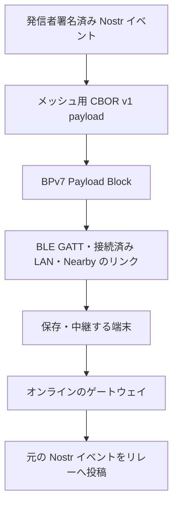
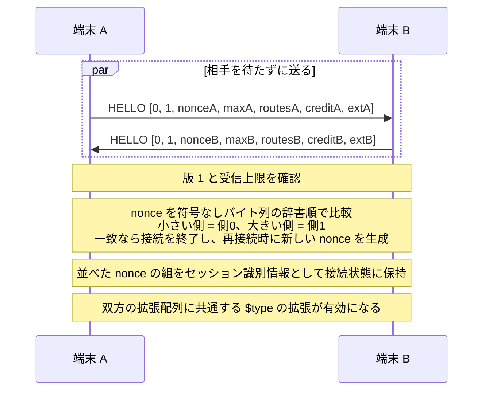
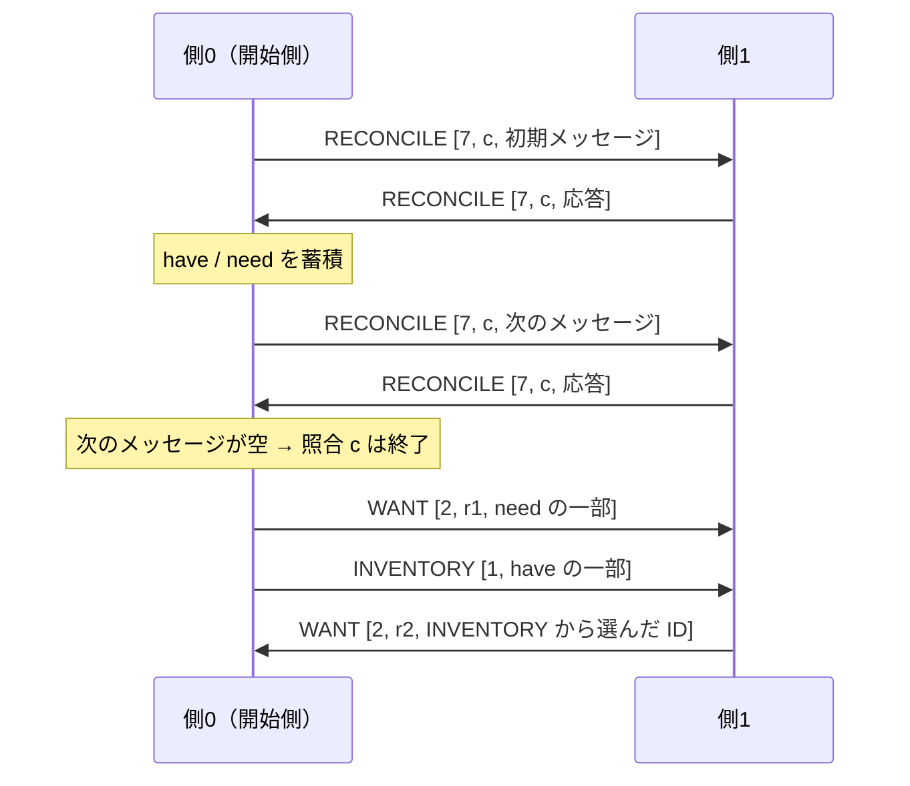
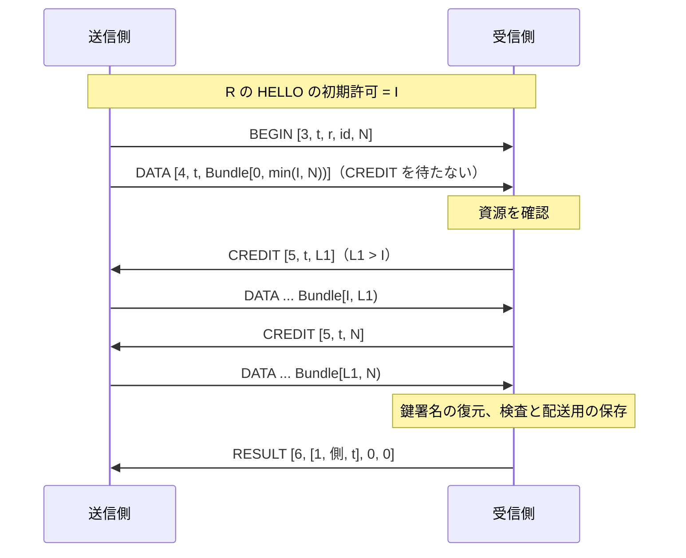
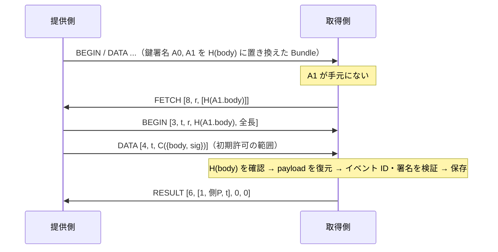
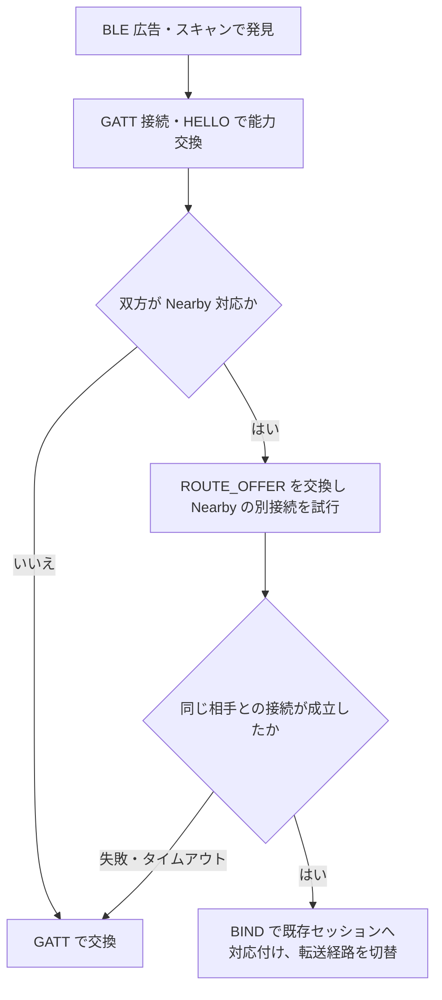

# BPv7 メッシュ配送

識別子: `dev.jisaku.mosimo.mesh`

## 目的

本プロトコルは、[コア](../README.md)が定義する発信者署名済みの Nostr イベントを、断続的な端末間リンク上で保存・中継して届ける配送プロファイルを定義する。イベントをメッシュ用 CBOR で可逆に表現して BPv7（RFC 9171）の Bundle に収め、BLE GATT を全参加機器に共通の基本経路、接続済み Wi‑Fi LAN を追加経路、Nearby Connections を双方が対応する場合の任意経路として、接触した端末間で Bundle を交換する。本文・影響範囲・配送期限等の意味はコアと各拡張の定義に従い、本プロトコルはそれらを変えずに運ぶ手順だけを定める。通信の成立に必要な最小限を本書が定め、広告要約・L2CAP 経路・本文圧縮・時刻ヒントは `HELLO` の拡張配列で交渉する独立した拡張プロトコル（[広告要約](adv/README.md)、[L2CAP CoC 経路](l2cap/README.md)、[本文圧縮](zstd/README.md)、[時刻ヒント](time/README.md)）が定める。

本プロトコルが保証するのは次の三点である。第一に、中継を経ても発信者の署名対象（公開鍵・作成時刻・kind・タグ・本文・署名）は変わらず、ゲートウェイは元の Nostr イベントを復元できる。第二に、共通交換メッセージと GATT プロファイルに従う実装同士は、アプリや機器種別が異なっても BLE GATT だけで配送を完結できる。第三に、`RESULT` の保存受理は、直近の相手が Bundle を検査し配送用に保存したことを示す。

保証の境界は次のとおりである。受理応答、リンクの送信成功、Nostr リレーの受理のいずれも、最終宛先や AppView への到達、全ノードへの配送、永久保持を意味しない。セッション識別情報、能力申告、Nearby の接続承認は相手の暗号学的な認証や発信者の身元の保証ではなく、投稿の保護は発信者の Nostr 署名だけに依る。本プロトコルは公開情報のみを運び、BPv7 の拡張による限定公開、背景・画面消灯・強制終了後の常時探索と中継、Nostr WebSocket セッションの透過的な中継、上限内の Bundle の必然的な受理・中継、経路の再確立は保証の対象外である。配送期限の満了は投稿の削除ではなく、オンライン側の保持期間とも異なる。中継者のブロック設定は自端末の挙動を定めるものであり、他者への配送を止める権限ではない。

## 前提

| 識別子 | 文書 | 依存する理由 |
|---|---|---|
| `dev.jisaku.mosimo` | [コア](../README.md) | 署名済みイベント、Nostr の基本タグ（`mosimo:commit`・`mosimo:base`・`mosimo:rkey`・`mosimo:exp`・`mosimo:created`・`mosimo:v`）と自己完結拡張タグ（`mosimo:ext:` + 完全修飾 `$type`）、発見用タグ `["t","mosimo.jisaku.dev"]`、独自タグのバイト列表現、制御イベント、配送期限の定義。メッシュ用 CBOR はこれらの Nostr 表現を可逆に変換する |
| `dev.jisaku.mosimo.attest.chain` | [署名チェーンの同梱](../attest/chain/README.md) | payload 内の鍵署名を参照へ置き換える対象、認可された発信者の判定、ブロック単位となる `organization.orgId` |
| `dev.jisaku.mosimo.priority` | [配送優先度](../priority/README.md) | 発信者の優先度ヒントと実効優先度を、次に開始する転送と保存順位の選択に用いる |
| `dev.jisaku.mosimo.geo` | [地理情報](../geo/README.md) | 影響範囲に基づく配送候補の優先に用いる |
| `dev.jisaku.mosimo.public` | [公的情報](../public/README.md) | 認可済みの置換による旧版の拡散停止と、配送同値による重複抑制の条件 |
| `dev.jisaku.mosimo.pds` | [論理 PDS と物理 PDS](../pds/README.md) | ゲートウェイの搬出先となるリレーと、PLC 初期操作の制御イベントの定義 |

## 1. 層とデータの所有者



| 情報 | 保持先 | 中継者による変更 |
|---|---|---|
| 本文、配送期限、影響範囲、その他の発信者の拡張 | Nostr イベントを表す payload | 不可 |
| レコードキー・端末署名済み commit・適用元 CID | 同じイベントの payload 内 | 不可 |
| 宛先 endpoint、Bundle 作成情報、Lifetime | BPv7 primary block | BPv7 の規則に従う |
| Hop Count、Bundle Age、直前ノード | BPv7 標準拡張ブロック等 | BPv7 の規則に従う |
| 鍵署名の参照（§2.1.3） | 署名チェーン拡張の値の中の鍵署名を置き換えたハッシュ | 送信側が接触ごとに付け外しする |
| peer ごとの送信済み状態、実効優先度、ブロック設定 | ノード内の配送管理 | ローカル方針で更新 |

発信者が署名した情報は payload 内で完結する。影響範囲等の拡張を BPv7 拡張ブロックにだけ置いてはならない。独自ブロックを解釈しない中継者やゲートウェイも、payload だけから本文と拡張を Nostr へ搬出できる構成を保つためである。

参加機器はスマートフォンに限らず、M5Stack 等のマイコンを含む無線機器も、対応する共通リンクを介して保存・中継に参加できる。各経路の位置づけは次のとおりである。

| 経路 | 位置づけ | 対応の要否 |
|---|---|---|
| BLE GATT | 全参加機器に共通の基本経路。探索は広告・スキャン、転送は GATT | 必須。Nearby 非対応の機器同士でも配送を完結できなければならない |
| BLE L2CAP CoC | 同じ BLE 接続上で GATT の代わりに全メッセージを運ぶ高速経路 | 任意。[L2CAP CoC 経路](l2cap/README.md) |
| 接続済み Wi‑Fi LAN | 既に接続している LAN 上で相手に到達できる場合の追加経路。インターネット接続は不要 | 任意 |
| Nearby Connections | BLE GATT で接続した後、双方が対応する場合に切り替える任意経路 | 任意。マイコン等には要求されない |

## 2. Bundle の構成

### 2.1 メッシュ用 CBOR v1 payload

Payload Block の内容は、元イベントを保持する CBOR 配列とする。配列先頭の整数がメッシュ符号化形式の版であり、版は `1` である。配列は常に 7 要素である。

```cddl
compact-event = [
  mesh-version: 1,
  pubkey: bstr .size 32,
  created-at: uint,
  kind: 0..65535,
  tags: [* compact-tag],
  content: tstr,
  sig: bstr .size 64
]
compact-tag = [name: tstr, * (tstr / uint / bstr)]
```

| 位置 | 項目 | 型・値 |
|---:|---|---|
| 0 | メッシュ符号化版 | 整数 `1` |
| 1 | 公開鍵 | Nostr `pubkey` の 32 バイト byte string |
| 2 | 作成時刻 | Nostr `created_at` の Unix 秒。元レコードの日時文字列とは別 |
| 3 | kind | 0〜65535 の整数 |
| 4 | タグ一覧 | `compact-tag` の配列。§2.1.2 で省略するタグを除き、順序・各タグの要素数は元イベントのまま |
| 5 | 本文 | `content` の text string |
| 6 | 署名 | `sig` の 64 バイト byte string |

Nostr event ID は署名対象から再計算できるため、配列には含めない。通常投稿も制御イベントも同じ外側の構造で運ぶ。

メッシュ符号化版は、コアの基本プロトコル版（Nostr の `mosimo:v` タグ）および各拡張の `$type` とは独立に管理する。外側の構造や文字列への復元規則を非互換に変える場合にのみ版を上げ、共通の自己完結拡張タグで新しい拡張型を追加しても版は変わらない。送受信側は配列先頭の版で、以下の対応表を特定する。

#### 2.1.1 タグ値の可逆な型変換

メッシュではタグの値を、完全に元の文字列へ戻せる場合に限り、整数またはバイト列へ置き換える。全拡張を一括データにまとめず、タグごとの独立性を維持する。変換するタグと値の位置は次の表に限定する。値の位置はタグ名を位置 0 とした位置 1 を指し、名前と一つの値だけの 2 要素タグを対象とする。他の要素数のタグでは全ての値を元の文字列のまま保持する。タグ名は常に文字列である。

| タグ名 | 条件 | 位置 1 の CBOR 表現 | Nostr へ戻す表現 |
|---|---|---|---|
| `mosimo:commit` | 値がコアのバイト列表現（通常 Base64・padding なし）として復号でき、再符号化が元の文字列に一致する | `bstr` | 同じ規則の Base64、padding なし |
| `mosimo:ext:` に空でない完全修飾 `$type` を連結した名前 | 同上 | `bstr` | 同じ規則の Base64、padding なし |
| `mosimo:base` | 値が空文字列、または `b` で始まる小文字 base32（padding なし）の CID 文字列であり、復号したバイト列を同じ表現で再符号化すると元の文字列に一致する | CID のバイナリ表現（multiformats）の `bstr`。空文字列は空の `bstr` | 小文字 base32、`b` 接頭辞。空 `bstr` は `""` |
| `mosimo:rkey` | 値が TID（base32-sortable のアルファベット `234567abcdefghijklmnopqrstuvwxyz` の 13 文字、先頭文字は `2`〜`7`・`a`〜`j`）である | 13 文字が表す 64 ビット整数の `uint` | 13 文字、上位を `2` で埋めた base32-sortable |
| `mosimo:exp` | 値が `YYYY-MM-DDTHH:mm:ssZ` 形式（UTC、秒精度、小数秒なし）であり、Unix 秒に変換した値が位置 2 の `created_at` 以上である | `created_at` からの経過秒数の `uint`。意味は RFC 9581 の duration に対応する | `created_at` に経過秒数を加えた時刻を同じ形式で表す |
| `mosimo:created` | 小数秒を含み得る作成時刻の文字列 | `tstr`（原表記） | 元の文字列 |
| その他のタグ、上記の条件を満たさない値 | | `tstr` | 元の文字列 |

推測による変換をしてはならない。例えば `"001"` を整数 `1` に置き換えると元の文字列が失われ、署名対象を復元できなくなる。同様に、文字種・padding・大文字小文字が異なるバイト列の文字列表現を同じバイト列へ潰してから整形し直すと、元の署名対象が変わる。条件に合わない値は元の文字列のまま保持し、型変換のために正規化・補修してはならない。

自己完結拡張タグは内側の `$type` が未知でも共通の運び方が既知であり、値の Base64 を生バイト列へ戻す処理は拡張固有のコードなしに行える。内部 CBOR はそのまま保持し（§2.1.3 の参照化を除く）、解析して再符号化してはならない。再符号化でバイト列が変わると発信者の署名対象と一致しなくなるためである。内部の座標・距離は既に整数、日時は原表記の文字列であるため、この表で追加の変換はない。

#### 2.1.2 省略タグ

コアはタグの並び順を固定しているため、内容が固定されたタグは payload から取り除き、Nostr へ戻すときに定位置へ付け直す。

| kind | 省略するタグ | 復元位置 |
|---|---|---|
| `1`（通常投稿） | `["t", "mosimo.jisaku.dev"]` と `["mosimo:v", "1"]` | タグ一覧の先頭 2 要素 |
| `8173`（制御イベント） | `["t", "mosimo.jisaku.dev"]` | タグ一覧の先頭 |

残るタグは元の順序のまま並べる。コアの固定順に従っていないイベントは可逆に符号化できないため、Mosimo のイベントとして運んではならない。

#### 2.1.3 鍵署名の参照化

[署名チェーンの同梱](../attest/chain/README.md)の拡張タグ値 `C({attestations, binding})` に含まれる各鍵署名 `{body, sig}` は、送信側が `H(body)`（`SHA-256(C(body))`、32 バイト）への参照に置き換えて送ってよい。チェーンの大部分は多数の投稿で共通であり、一度受け取った相手に毎回送る必要がないためである。

置き換えの手順は次のとおりである。

1. 対象の拡張タグ（名前 `mosimo:ext:dev.jisaku.mosimo.attest.chain`）の値を atproto deterministic CBOR として復号する。
2. `attestations[i]` のオブジェクトを 32 バイトの `bstr` `H(body)` に置き換える。
3. 値を atproto deterministic CBOR で再符号化し、タグの位置 1 に `bstr` として置く。

```text
送信前: tags[k] = ["mosimo:ext:dev.jisaku.mosimo.attest.chain", C({attestations: [A0, A1, A2], binding})]
送信時: tags[k] = ["mosimo:ext:dev.jisaku.mosimo.attest.chain", C({attestations: [H(A0.body), H(A1.body), A2], binding})]
```

`attestations` の要素は本来オブジェクトであるため、32 バイトの `bstr` が現れればそれは参照である。参照の一覧を別に運ぶ必要はない。受信側はチェーン拡張の値を復号し、`bstr` の要素ごとに手元の鍵署名を探して `{body, sig}` を元の位置へ戻し、deterministic CBOR で再符号化して payload を復元する。atproto deterministic CBOR は正規形であるため、復元後のバイト列は送信側が参照化する前のバイト列と一致する。復元後の payload で Nostr イベント ID と署名を検証し、イベント ID の重複排除（§11）と保存に用いる。復元できない参照があれば `FETCH`（§5.11）で取り寄せ、受け取った鍵署名の `H(body)` が参照と一致することを確認してから復元に用いる。取り寄せに失敗した場合はその Bundle を拒否する（理由コード 6）。参照を解釈して復元するためには受信側がチェーン拡張の型を知る必要があり、復元できない受信側は Nostr 署名を検証できないため、参照化された Bundle を受け入れてはならない。参照化を受け入れるかは `HELLO` の能力として示す。参照を含んだままの payload を保存・中継・Nostr へ搬出してはならない。署名対象が復元されておらず、検証できないためである。

送信側は、相手が知っていそうな鍵署名を提示なしに参照で送ってよい。相手が知っていそうな鍵署名とは、同じ接続セッション内で一度送った、または受け取った鍵署名、相手の `HELLO` 拡張で所持が示された鍵署名、広く使われると送信側が判断した鍵署名である。相手から `FETCH` された鍵署名は、以後そのセッションで再び参照で送れる。

受信側が保存してよい鍵署名は、復元後に Nostr 署名の検証に成功したイベントに含まれていたもの、または `FETCH` への応答として受け取り `H(body)` が参照と一致したものに限る。検証に失敗したイベントの鍵署名を保存すると、攻撃者が任意のバイト列を正当な鍵署名として相手の記憶に注入できるためである。鍵署名の保存は復元のための記憶であり、署名チェーンの検証結果の代用ではない。

#### 2.1.4 元イベントの保持

タグ一覧の順序、各タグ内の値の順序・要素数、本文、その他の署名対象フィールドを維持する。元の Nostr JSON へ戻す際は、鍵署名の参照を復元し、整数・バイト列を対応規則どおりの元の文字列へ復元し、省略したタグを定位置へ戻し、公開鍵・署名を小文字 hex に戻して、元の event ID と署名を再現する。

未知のタグと、変換条件に合わない元の文字列はそのまま運べる。対応規則が不明な型変換済みタグを推測で文字列化して元イベントとして扱ってはならない。復元できたイベントと区別できなくなり、署名検証に失敗するか、誤った内容を発信者の署名付きとして扱うことになる。未対応データの保持はサイズ上限（§6）と対応プロトコル版の範囲で行う。

CBOR 符号化と可逆な型変換は汎用圧縮ではない。型変換後も、発信者の署名と CID の元の対象バイト列は変わらない。payload 全体の圧縮は [本文圧縮](zstd/README.md) が定める。

### 2.2 BPv7 ブロック

| 項目 | 値 |
|---|---|
| destination EID | `dtn://mosimo.jisaku.dev/~post`（non-singleton） |
| source EID | `dtn://n<発信者公開鍵の先頭 32 桁の小文字 hex>/post` |
| creation timestamp・lifetime | BPv7 の構造。Lifetime は最大 24 時間 |
| Hop Count 上限 | 8。ローカル方針であり、発信者署名の対象外 |
| 配送期限 | payload 内の `mosimo:exp` から読む |

- §2.1 の payload 配列は Payload Block の内容であり、Bundle 自体を構成するブロック配列とは別の層である。
- hop 数・経過時間の制限には BPv7 標準の Hop Count ブロックと Bundle Age ブロックを用いる。
- 経路証明や転送 receipt の独自ブロックは用いない。中継状態は BPv7 の可変ブロックとノード内の配送管理が担う。
- BPv7 の Bundle fragmentation によって §6 の上限を回避してはならない。上限は資源保護のための Bundle 全体に対する制限であり、断片化後の各片が上限内でも、組み立てには全体分の資源が要るためである。

## 3. BLE の探索と接続

### 3.1 広告とスキャン

| 項目 | 値 |
|---|---|
| Service UUID | `b5e89a01-f9da-45c2-9111-2de7a7441d24` |
| RX characteristic | `483c3867-c832-4c60-9a96-7018059eaf74` |
| TX characteristic（CCCD あり） | `49d60590-c23f-4a0a-a58e-f2f2f606f94d` |
| 広告（legacy） | 広告データに 128 ビット Service UUID 一覧（Complete List of 128-bit Service Class UUIDs） |
| scan response | 128 ビット Service Data（AD type `0x21`）= Service UUID 16 バイト + node ID 8 バイト + 役割 flags 1 バイト |
| node ID | プロセス起動ごとに生成する 8 バイトの乱数。身元・発信者・端末の識別子ではない |

役割 flags の bit0 は peripheral 専用（central として接続しない）を示し、他のビットは 0 とする。Service Data の残りの領域は [広告要約](adv/README.md) が用いる。

スキャンは Service UUID で絞り込む。128 ビット Service Data だけでの絞り込みは一致しない端末があるため、Service UUID による絞り込みを用いなければならない。探索対象をアプリ固有の識別子だけで分断してはならない。異なるアプリ間で共通サービスを発見できることが、本プロトコルの相互運用の前提である。

iOS では、アプリが背景にあるとき peripheral 広告の Service UUID はオーバーフロー領域へ移り、他の iOS 端末が同じ UUID を明示して scan している場合にしか見えない。central 側の背景 scan も Service UUID を指定したものに限られ、scan response の Service Data は取得できない場合がある。したがって iOS 端末同士、および iOS 端末と Android・マイコンの組合せでは、前景にある側が探索と接続を担うことを運用上の前提とし、背景での常時探索・中継を本プロトコルの保証に含めない。

### 3.2 役割と接続開始

スマートフォンアプリと汎用中継ノードの基本実装は、central と peripheral の両方の役割に対応し、GATT server・広告・scan・central を兼ねる。機器種別で役割を固定せず、接続ごとに一方が central、他方が peripheral となる。本 GATT プロファイルでは役割を次のように対応させる。この対応は本プロファイルの規約であり、BLE 一般の定義ではない。

| BLE の接続役割 | GATT の役割 | 接続時の動作 |
|---|---|---|
| central | client | 相手を探索し、接続を開始する |
| peripheral | server | 共通サービスを広告し、接続を受け付ける |

両役対応同士では、node ID を符号なしバイト列の辞書順で比較し、小さい側が central として接続する。相手が peripheral 専用（flags bit0）なら自側が central として接続する。相手が自分より小さい node ID を広告しているのに 10 秒間接続が来ない場合は、大きい側から接続してよい。片方向にしか見えない場合に備えるためである。双方から同時に接続して重複リンクができた場合は、後から確立した方を閉じる。閉じるまでに両リンクで届いたイベントはイベント ID の重複排除（§11）で無害化される。

BLE の役割はリンクの役割であり、配送上の親・子ではない。どちらの役割でも接続後はイベントの送受信を両方向に行える。基本実装同士では、スマートフォン同士、スマートフォンとマイコン、マイコン同士のいずれの組合せも接続できる。実際の接続成立と同時接続数は OS・無線資源・実装の制限に従う。

制約の強い機器では central 専用または peripheral 専用の部分実装を許容する。部分実装は対応役割を明示し、両役対応の基本実装と区別する。同じ片役だけの 2 台は BLE で直接接続できないため、反対の役割に対応する相手との接触か、別の共通経路を必要とする。両役対応とは両方の役割で動作できることであり、広告と探索の常時同時実行、多数の同時接続、背景での常時動作までは含まない。

### 3.3 GATT サービスと RX／TX characteristic

本プロファイルは、参加アプリ・機器に共通の一つの GATT サービス（§3.1）と、方向別の二つの characteristic を使う。`RX`・`TX` は server 側から見た方向を表す名称である。

| characteristic | 転送方向 | GATT 操作 |
|---|---|---|
| RX | central／client → peripheral／server | client からの Write Without Response |
| TX | peripheral／server → central／client | Notification。client は通知を購読する |

能力交換・差分照合・取得要求・Bundle 転送は、同じ送受信経路の上で §5 のメッセージ種別により区別する。機能・投稿の種類・個別の拡張ごとに characteristic を追加してはならない。GATT 層は上位メッセージをバイト列として運ぶだけであり、本文や拡張の意味に依存させると、LAN・Nearby で同じ共通メッセージを再利用できなくなるためである。二つの characteristic はデータ転送用の構成を表し、通知設定に必要な標準 descriptor（CCCD 等）は別途備える。

同じ接続で両方向に送受信し、能力交換や Bundle の送信側は central・peripheral のどちらにもなる。GATT 操作の成功は Bundle の受信・保存完了を示さず、受理は `RESULT` でのみ確認する。

接続からメッセージ交換開始までの時間を短くするため、次を推奨する。

- central は接続直後の MTU 交換で 517 を要求し、1 回の書込み・通知を min(MTU − 3, 512) バイト以下とする（属性値の上限は 512 バイト）。
- 同じ node ID の相手に再接続する場合、前回のサービス探索結果（handle）を記憶して探索を省略してよい。node ID はプロセス起動ごとに変わるため、記憶の寿命はその node ID を観測している間に限る。
- 転送中は短い接続間隔を要求し、転送終了後に通常の間隔へ戻す。

### 3.4 バッテリー

探索と接続は電力消費の主要因であるため、次の運用を基本とする。

- scan は Service UUID でフィルタした間欠 scan とし、常時 scan を避ける。
- 接続は、広告要約（[広告要約](adv/README.md)）が前回と異なる、または要約を得られないときだけ行う。
- 転送が終わり、双方に送るものがなくなった時点で切断する。
- 大きな Bundle の転送は L2CAP CoC・LAN・Nearby の高速経路へ寄せ、GATT では小さな Bundle を優先する（§9）。

## 4. 接触時の交換

### 4.1 段階

| 段階 | 交換・処理する情報 | 目的 |
|---|---|---|
| 接続・能力共有 | 交換プロトコルの版、受信可能サイズ、対応経路、初期許可、拡張 | 異なるアプリの共通機能を把握する |
| 差分照合 | 配送候補集合の Negentropy 照合 | 双方に欠けているイベント ID を得る |
| 差分提示・転送要求 | 相手に欠けているイベント ID の提示と、自分が必要とするイベントの要求 | 保存量・帯域の範囲で選択する |
| Bundle 転送 | 署名済みイベントを含む Bundle、参照された鍵署名 | 保存して次の接触へ運ぶ |
| 配送管理の更新 | peer への送信状態 | 同じ接触での繰り返しを抑える |

各段階のメッセージは §5 の共通交換メッセージで表し、GATT・L2CAP・LAN・Nearby のいずれの経路でも同じ意味と CBOR 表現を共有する。

### 4.2 探索経路

| 経路 | 相手の発見 | 接続・転送 |
|---|---|---|
| BLE | 共通サービスを示す BLE 広告・スキャン（§3.1） | GATT で能力交換と Bundle 転送を行う |
| 接続済み Wi‑Fi LAN | DNS-SD のサービス種別 `_mosimo._tcp`、インスタンス名 = node ID の小文字 hex | node ID の小さい側が TCP 接続する。運ぶのは公開の署名済みイベントであり、通信路は平文 TCP である |

Wi‑Fi 側は既に接続している LAN で相手に到達できる場合を対象とし、AP のない環境で Wi‑Fi 接続を新規構築する機能はこの経路に含まれない。mDNS が届く範囲の IP 網（NICT NerveNet 等）もこの経路で扱う。Wi‑Fi のないマイコンや LAN 未接続の端末のため、BLE GATT の基本経路は常に残す。二経路の常時同時探索は資源と OS の制約に従う。

### 4.3 接続後の能力交換

接続後、双方は相手の `HELLO` を待たずに自分の `HELLO`（§5.4）を送り、交換プロトコルの版、受信可能な Bundle 全長、対応経路、初期許可バイト数、拡張を交換する。L2CAP CoC・Nearby 等の追加経路への切替は、`HELLO` で双方の対応を確認してから行う。広告だけから追加経路の対応を推測して切り替えてはならない。広告は探索用の情報であり、相手の実装が今回の接触で経路を扱えるかを示さないためである。

### 4.4 分割・流量制御・受理応答

RX の Write Without Response と TX の Notification を使い、断片ごとに GATT の書込み応答を待つ代わりに、上位の送信許容量（`CREDIT`、§5.9）で受信側の負荷を制限する。送信側は OS／SDK の送信キュー制限と、相手が通知した許容量の両方に従う。

- 相手・OS が扱える長さに応じて書込みを分割する。MTU を固定値と仮定せず、交渉後の値を用いる（§7）。
- 各方向の受信側は、自身が処理できる量を累積バイト上限として送信側に許可する。送信側は許可された量を超えて送ってはならず、許容量を使い切った場合は追加の許可を待つ。
- 許容量の追加は断片の処理・バッファ解放に基づく流量制御であり、Bundle の受理・保存完了とは別である。
- Bundle 全体を受信し、鍵署名の参照を復元し、コアの要件に従った検査と配送用の保存を完了した受信側は、Bundle 単位の受理応答を返す。断片受信やメモリ上の未完了データだけで受理応答を返してはならない。受理応答は相手が転送を完了したと判断する根拠であり、保存前に返すと受理済みと判断された唯一のコピーが失われ得る。
- 送信側は受理応答を得るまで、その転送を受理済みと扱わない。応答が失われた場合は、次の交換で相手の所持状態を確認するか再送し、受信側は §11 の重複排除で扱う。

受理応答だけを根拠に唯一のコピーを削除してはならない。受理応答は直近の相手の保存を示すに留まるためである。

切断をまたぐ未完了 Bundle は途中位置から再開せず、次回接触で引き続き配送対象であれば先頭から再送する。受理を確認済みの Bundle は、接続が変わったことを理由に再送する必要はない。寿命・hop・保存上限は引き続き適用し、再送や切断によって発信者の配送期限を延長してはならない。短い接触では再送負荷が増え、大きな Bundle を完送できない場合があることを許容する。

### 4.5 接続内の転送数と制御枠

一つの接続の各送信方向につき、断片を送信中の転送（Bundle またはオブジェクト）は最大 1 件とし、同じ方向で異なる転送の断片を混在させない。送信側は、現在の転送の全断片を送り終えたら、その `RESULT` を待たずに次の転送の `BEGIN` を送ってよい。小さな Bundle を連続して送るときに、1 件ごとに往復を待たないためである。`RESULT` が未到着の転送は各送信方向で 8 件までとし、上限に達したら `RESULT` を待つ。受信側はこの件数と初期許可の積までのバイト列を応答前に受け取ることになるので、初期許可の値で自分の資源に合わせる。

許容量の追加、受理・拒否・中止等の制御メッセージは、Bundle の転送中や応答待ちでも送信できる。データの許容量が尽きても追加許可や終了応答を送れるよう、データとは別に小さな制御用の資源枠を確保する。制御枠は同じ RX／TX 上でメッセージ種別により区別する。

制御枠は必要な小さな制御メッセージのためのものである。`RECONCILE`・`INVENTORY` 等の任意の大量データを制御枠へ流してはならない。制御枠は許容量制限の例外であり、大量データを通すと流量制御が成り立たなくなるためである。

Bundle の優先順位（§9）は次に開始する転送の選択に反映する。複数 Bundle の断片を交互に送る優先度制御は行わず、進行中の大きな Bundle により次の Bundle の開始が待たされることを許容する。受信側の Bundle 組み立ては各接続の受信方向で 1 件に制限できるが、複数接続を受け付ける機器は接続数に応じた総資源上限も適用する。

## 5. 共通交換メッセージ

### 5.1 符号化

接触時の共通交換メッセージは、数値のメッセージ種別を先頭に持つ CBOR 配列で表す。後続の配列位置は種別ごとに定義し、フィールド名は運ばない。イベント ID・ハッシュ等のバイト列と Bundle の断片は CBOR byte string とし、hex・Base64 の文字列へ変換してはならない。

この配列は端末間の交換・転送を制御する外側の形式であり、§2.1 の payload とは別である。`DATA` は符号化済み BPv7 Bundle のバイト列を分割して運び、受信側はそれを連結して Bundle を得る。共通メッセージの意味と CBOR 表現は GATT・L2CAP・LAN・Nearby で共有し、メッセージの境界は各リンクのバイトストリーム上の CBOR sequence として得る（§7）。一つの共通メッセージが複数の GATT 操作にまたがることを前提とする。

### 5.2 種別

| 番号 | 種別 | 役割 | 主に扱う情報 | 配列配置 |
|---:|---|---|---|---|
| 0 | `HELLO` | 接続開始時の能力交換 | 交換プロトコルの版、セッションの nonce、受信上限、対応経路、初期許可、拡張 | §5.4 |
| 1 | `INVENTORY` | 相手に欠けている配送候補の提示 | イベント ID の一覧 | §5.6 |
| 2 | `WANT` | イベントの取得要求 | 要求 ID、要求するイベント ID の一覧 | §5.7 |
| 3 | `BEGIN` | 1 件の転送を開始。最初の断片を同梱できる | 転送 ID、対応する要求 ID とイベント ID またはハッシュ、全長、任意の断片 | §5.7 |
| 4 | `DATA` | Bundle の断片を送信 | 転送 ID、符号化済み Bundle の断片 | §5.8 |
| 5 | `CREDIT` | 累積送信上限を通知・拡大 | 転送 ID、Bundle 先頭からの許可バイト数 | §5.9 |
| 6 | `RESULT` | 要求・転送の処理結果を通知 | 対象、結果コード、理由コード | §5.10 |
| 7 | `RECONCILE` | 配送候補集合の差分照合 | 照合 ID、Negentropy メッセージ | §5.5 |
| 8 | `FETCH` | ハッシュで参照されたオブジェクトの要求。応答は `BEGIN`・`DATA` で運ぶ | 要求 ID、ハッシュの一覧 | §5.11 |
| 未確定 | `CANCEL` | 進行中の転送の中止要求 | 転送 ID、中止理由 | §5.12 |
| 未確定 | `ROUTE_OFFER` | 利用可能な追加経路を提案 | LAN／Nearby の経路情報、現在のセッションとの対応情報 | §5.13 |
| 未確定 | `BIND` | 新しい経路を既存のセッションへ対応付け | 既存セッションへの参照、対応付けに必要な情報 | §5.13 |

`ROUTE_OFFER`・`BIND` は経路切替に対応する実装だけが扱い、GATT のみの機器には要求されない。未知の種別を受けた側はそのメッセージを無視する。

共通交換メッセージの種別は転送制御のためのものである。投稿・削除要求・PLC 初期操作・失効通知はそれぞれの署名済みイベントを Bundle に入れて運び、メッセージ種別として追加してはならない。CAP・EDXL・地理情報等の内容の種類も同様である。種別を内容ごとに増やすと、GATT 層が内容の意味に依存し、未知の内容を運べなくなるためである。PLC 初期操作の制御イベントもこの規則に従って他の制御イベントと同様に運び、その内容と代理登録は [論理 PDS と物理 PDS](../pds/README.md) に従う。

一覧と要求はメッセージ上限（§6）に収まるよう小さく分けて交換する。Bundle のデータ受信終了は `BEGIN` の全長で判別する。全長の受信と保存受理の完了は別である。

### 5.3 セッション・要求・転送の識別

| 識別情報 | 用途 | 有効範囲 |
|---|---|---|
| 接続セッションの識別情報 | 今回の相手との交換を識別し、追加経路の対応付けにも使う | 対象の接触・交換セッション |
| 照合 ID | 一回の Negentropy 照合の `RECONCILE` を対応付ける | 開始側＋接続セッションの照合用名前空間 |
| 要求 ID | `WANT`・`FETCH` と、提供不能等の処理結果・`BEGIN` を対応付ける | 発行元＋接続セッションの要求用名前空間 |
| 転送 ID | `BEGIN`・`DATA`・`CREDIT`・`RESULT`・`CANCEL` を対応付ける | 発行元＋接続セッションの転送用名前空間 |

セッションの識別情報は乱数で生成する一時的な情報であり（§5.4）、DID・公開鍵・MAC アドレス・node ID を流用してはならない。永続識別子を使うと接触の追跡が可能になり、かつ認証の代用と誤解されるためである。

照合 ID・要求 ID・転送 ID は、それぞれの発行元が独立した連番の整数として採番する。同じ接続セッションの同じ名前空間では、終了した番号も再利用してはならない。遅れて届いた応答が新しい対象へ誤って対応付けられるためである。要求と転送は別の名前空間であり、同じ整数値は別の対象を指す。双方向で同じ番号を発行しても、どちら側が発行した対象かを区別して衝突を避ける。

発行元は、メッセージの方向から明確に得られる場合は配列に含めず（`WANT`・`FETCH`・`BEGIN`・`DATA`・`CREDIT`・`RECONCILE`）、明示が必要な場合は §5.4 の側番号で示す（`RESULT`）。

同じイベント・Bundle の再送でも、新しいセッションでは新しい転送として識別する。古いセッションの応答・許可を新しい対象へ適用してはならない。接続内の連番とは別に、イベント自体の重複は Nostr event ID で扱う（§11）。`BIND` による既存セッションへの経路追加と、新たなセッションの開始は区別し、番号の一致だけで既存セッションや転送へ対応付けてはならない。

### 5.4 HELLO とセッションの確定

```text
HELLO = [0, 1, nonce: bstr .size 8, maxBundleBytes: uint, routes: uint, initialCredit: uint, maxMessageBytes: uint, extensions: [* {"$type": tstr, ...}]]
```

| 位置 | 項目 | 型・値 |
|---:|---|---|
| 0 | メッセージ種別 | 整数 `0` |
| 1 | 共通交換プロトコルの版 | 整数 `1` |
| 2 | nonce | 暗号学的乱数生成器で生成する 8 バイトの byte string |
| 3 | 受信 Bundle 全長上限 | 1〜65,536 の整数。計数は §6 に従う |
| 4 | 対応経路 | 下表のビット値の論理和による非負整数 |
| 5 | 初期許可バイト数 | 0〜65,536 の整数。どの転送でも、`BEGIN` 直後に `CREDIT` なしで送ってよい Bundle 先頭からのバイト数（§5.9）。`4096` を目安とし、`0` も可 |
| 6 | 受信メッセージ上限 | 1,024〜65,536 の整数。この側が受け取れる共通交換メッセージ 1 件の CBOR バイト数の上限（§6） |
| 7 | 拡張配列 | `$type` キーを持つ CBOR map の配列。未知の `$type` を持つ要素は無視する |

| ビット値 | 対応経路 |
|---:|---|
| `1` | BLE GATT |
| `2` | LAN |
| `4` | Nearby Connections |

`HELLO` 自身は相手の受信メッセージ上限を知る前に送るため、1,024 バイトに収めなければならない。

対応経路は実装として対応している経路を示し、今回の接触で直ちに接続できることは示さない。実際に利用できるアドレス等の候補は `ROUTE_OFFER` で知らせる。L2CAP CoC の対応は拡張配列（[L2CAP CoC 経路](l2cap/README.md)）で示す。

拡張配列の各要素は、`$type` にメッシュ拡張プロトコルの識別子（例: `dev.jisaku.mosimo.mesh.zstd`）を持つ map であり、他のキーは各拡張が定める。各拡張は双方の `HELLO` に同じ `$type` の要素があるときだけ有効になる。同じ `$type` の要素を二つ以上置いてはならない。

共通交換プロトコルの版は、イベントの基本版・拡張の `$type`・メッシュ符号化版とは独立である。版 `1` だけを扱い、非対応版の `HELLO` を受けた側は接続を終了する。



セッション識別情報は接続状態としてのみ保持する。側番号は `RESULT` で要求・転送の発行元を示すこと、および差分照合の開始側を決めることに用い、機器種別や GATT の central／peripheral とは無関係である。

### 5.5 RECONCILE による差分照合

配送候補集合の照合には Negentropy（NIP-77 の range-based set reconciliation）を用いる。照合対象は、各端末の配送候補集合、すなわち保持するイベントのうち配送期限内であり、認可済みの置換で停止されておらず、ブロック対象（§10）でないものの `(created_at, イベント ID)` の集合である。Negentropy の timestamp には `created_at`、ID には 32 バイトのイベント ID を用いる。

```text
RECONCILE = [7, 照合ID: uint, メッセージ: bstr]
```

| 位置 | 項目 | 型・値 |
|---:|---|---|
| 0 | メッセージ種別 | 整数 `7` |
| 1 | 照合 ID | 開始側が発行する連番 |
| 2 | メッセージ | Negentropy のメッセージ 1 件。`RECONCILE` の配列全体がメッセージ上限（§6）に収まる長さ |

Negentropy のフレームサイズ上限（frameSizeLimit）は、相手に送るメッセージ上限から `RECONCILE` の包み（最大 24 バイト）を引いた値とし、一つの `RECONCILE` に一つの Negentropy メッセージを収める。上限が 1,024 バイトなら 1,000 バイトである。フレームが小さいほど一回の照合の往復は増えるが、各メッセージが交換メッセージの上限に収まり、分割と再結合の状態を持たずに済む。

照合は `HELLO` の交換後に側0 が開始する。開始側は Negentropy の initiator として初期メッセージを送り、相手（responder）は応答メッセージを返す。開始側は応答から `have`（自分だけが持つ ID）と `need`（相手だけが持つ ID）を蓄積し、次のメッセージが空になるまで往復を続ける。



照合が終了した開始側は、`need` のうち自分の方針（§9・§10）で取得するものを `WANT` し、`have` を `INVENTORY` として相手に提示する。相手は提示された ID のうち方針で取得するものを `WANT` する。`need`・`have` の一部を照合の途中で `WANT`・`INVENTORY` に回してよい。候補集合が照合後に変わった場合（新しい Bundle を受理した等）、どちらの側も新しい照合 ID で照合を開始してよい。開始側が発行した照合 ID と側1 が開始した照合の照合 ID は別の名前空間である。

Negentropy のメッセージは集合の要約であり、相手の所持の証明ではない。照合結果だけを根拠に、唯一のコピーを削除してはならない（§4.4）。

### 5.6 INVENTORY

```text
INVENTORY = [1, [イベントID: bstr .size 32, ...]]
```

`INVENTORY` は、差分照合の結果として相手に欠けていると分かった配送候補、または照合後に新たに候補となったイベントの ID を提示するメッセージである。一覧はメッセージ上限（§6）内に分割する。上限が 1,024 バイトなら一つの `INVENTORY` に含める ID は 30 件以下である。提示する候補は §9 の選択と §10 のブロックに従う。所持データの全列挙を `INVENTORY` で送ってはならない。集合の照合は `RECONCILE` が担い、全列挙は帯域を消費して短い接触での転送を妨げるためである。

### 5.7 WANT と BEGIN

```text
WANT  = [2, 要求ID: uint, [イベントID: bstr .size 32, ...]]
BEGIN = [3, 転送ID: uint, 要求ID: uint, イベントID: bstr .size 32, Bundle全長: uint, ? 断片: bstr]
```

- Bundle 全長は符号化済み BPv7 Bundle のバイト数（§6）であり、正整数とする。鍵署名を参照化した Bundle では、参照化後の実際に送るバイト数である。
- 取得側が `WANT` を発行し、提供側は対象イベントごとに `BEGIN` を発行する。`BEGIN` の要求 ID は取得側が発行した要求、転送 ID は提供側が発行した転送を指す。`WANT` 一つに含める ID は、配列全体がメッセージ上限（§6）に収まる件数（上限 1,024 バイト、要求 ID が 65,535 以下なら 29 件）以下とする。
- `BEGIN` は任意で最初の断片を同梱できる。同梱した断片は `DATA` の最初の断片と同じ扱いで、初期許可（§5.9）の範囲内でなければならず、`BEGIN` の配列全体がメッセージ上限（§6）に収まる長さとする。全長がこの範囲に収まる Bundle は `BEGIN` 1 件で送り終わる。
- `BEGIN` は要求 ID とイベント ID の両方を含む。イベント ID を要求一覧内の位置で置き換えてはならない。一覧の分割や再送で位置が変わると対象が曖昧になるためである。
- 提供できないイベントについては、提供側が要求 ID とイベント ID を指定した `RESULT`（提供不能）を返す。
- 要求内の全イベントについて、対応する転送が終了するか提供不能が通知された時点で、その要求は終了する。拒否・中止による終了は取得成功ではない。

要求されていない Bundle の転送を開始してはならない。新たに配送したいイベントもまず `INVENTORY` で提示し、相手の `WANT` を受けてから転送する。受信側の資源と方針による選択が、転送の前提だからである。

### 5.8 DATA

```text
DATA = [4, 転送ID: uint, 断片: bstr]
```

転送 ID は送信側が `BEGIN` で発行したもの、断片は符号化済み BPv7 Bundle の連続したバイト列である。配列はオフセットを含まない。`BEGIN` に断片が同梱されていればそれが先頭であり、`DATA` はその続きを運ぶ。送信側は Bundle を先頭から順に送り、受信側は対象転送の受信済みバイト数を管理して各断片を末尾へ追加する。追加後の長さが現在の許可上限（§5.9）または `BEGIN` の全長を超える場合、受信側はその転送を拒否する。全長に達した時点では §4.4 の検査・保存を行い、結果を `RESULT` で返す。

各リンクは、共通交換メッセージを方向ごとに順序どおり、重複・欠落なく上位へ渡す責務を持つ。この条件を維持できなくなったリンクは対象転送を中断しなければならない。`DATA` にオフセットがないため、不確かな断片列を継続すると誤った Bundle を組み立てるからである。共通の `DATA` には順不同受信・部分再送・途中再開はなく、欠落はリンクの保証と CBOR sequence の同期（§7）で検出する。リンクの責務は受信後のイベント ID・署名の検査を置き換えない。異なる経路の断片列を無条件に連結してはならない。

### 5.9 初期許可と CREDIT の累積バイト上限

```text
CREDIT = [5, 転送ID: uint, 累積許可バイト数: uint]
```

`CREDIT` は、対象転送の符号化済み Bundle の先頭から何バイトまで送信を許可するかを、累積の非負整数で通知する。対象は `CREDIT` を受け取る側が送信している転送であり、転送 ID の発行元は方向から特定できる。

- 計数対象は Bundle 自体のバイト列であり、BPv7 のヘッダー等を含むが、`DATA` の CBOR の包みは含まない。
- 上限を `L` とすると、送信可能なのは Bundle のゼロ始まりの位置 `[0, L)` である。送信側は次に送る断片の終端位置が `L` を超えないようにする。
- 新しい転送の初期許可は、受信側が `HELLO` で通知した初期許可バイト数と `BEGIN` の全長の小さい方である。送信側は `BEGIN` に同梱する断片と直後の `DATA` を、この範囲内で `CREDIT` を待たずに送れる。初期許可が 0 の相手には、最初の `CREDIT` を受けてから `DATA` を送る。受信側は全長と受信資源を確認し、受け付けられる場合は初期許可を超える `CREDIT` を返し、受け付けられない場合は `RESULT` で拒否する。
- 累積許可バイト数は 0 以上、対象の `BEGIN` の Bundle 全長以下とし、最大値は 65,536 である。
- 同じ転送に対しては、初期許可とこれまでに受け取った有効な上限の最大値を使う。同じ値の重複通知は加算せず、古い小さい値で上限を巻き戻さない。従って小さい値の再通知で許可を撤回することはできず、転送を終了させる場合は `RESULT` の拒否または `CANCEL` を用いる。
- 許可は対象の送信方向・転送にだけ有効であり、逆方向、別の Bundle 転送、切断後の新しい転送へ持ち越されない。同じイベントの再送でも新しい転送について許可を得る。



許可窓の大きさ・更新間隔は受信実装に委ねる。小さな窓による段階的なストレージへの書出しも、Bundle 全体の一括許可も可能である。`CREDIT` 自体は Bundle バイトの許可を消費せず、§4.5 の制御枠に従う。この値は送信の許可であり、受信済み位置・保存済み位置・受理応答ではない。

### 5.10 RESULT の対象・結果・理由

```text
RESULT = [6, 対象, 結果コード: uint, 理由コード: uint]

要求内のイベントの対象     = [0, 要求の発行元の側番号, 要求ID: uint, イベントID: bstr .size 32]
転送の対象                 = [1, 転送の発行元の側番号, 転送ID: uint]
要求内のオブジェクトの対象 = [2, 要求の発行元の側番号, 要求ID: uint, hash: bstr .size 32]
```

側番号は §5.4 の 0 または 1 である。対象配列により、要求と転送の名前空間、および双方向で同じ整数の ID を区別する。

| 結果コード | 結果 | 対象 | 意味 |
|---:|---|---|---|
| 0 | 保存受理 | 転送 | Bundle の検査と配送用の保存を完了した |
| 1 | 所持済み | 転送 | 対象イベントを既に保持しており、今回の転送は不要である |
| 2 | 拒否 | 転送 | 容量不足・上限超過・不正なデータ・ハッシュ不一致等により受理できない |
| 3 | 提供不能 | 要求内のイベント、要求内のオブジェクト | 要求されたイベント・オブジェクトを破棄済み等の理由で提供できない |
| 4 | 中止確認 | 転送 | 対象転送の中止処理を完了した |

| 理由コード | 理由 |
|---:|---|
| 0 | 詳細なし |
| 1 | 資源不足 |
| 2 | サイズ上限超過 |
| 3 | データ不正 |
| 4 | 配送期限切れ |
| 5 | ローカル方針 |
| 6 | 対象データを保持していない |

保存受理・所持済みの理由コードは 0 である。`BEGIN` を受けた時点で対象イベントを保持している受信側は、当該転送に所持済みを返せる。所持済みは、検査済みのイベント本体を保持している場合に限る。イベント ID を観測した記録だけで所持済みを返してはならない。本体のない所持済みは配送の空白を生み、送信側はそのイベントを相手に届いたものとして扱うためである。所持済みは今回の Bundle を保存したという応答ではない。鍵署名の参照を復元できず取り寄せにも失敗した Bundle の拒否は理由コード 6、ブロック対象の Bundle の拒否は理由コード 5 とする。

`CANCEL` は中止の要求、`RESULT` の中止確認はその処理結果であり、両者は別の意味を持つ。wire 上には自由文の診断情報を付けず、実装固有の詳細は端末内のログに記録する。

### 5.11 FETCH

`FETCH` は、ハッシュで内容アドレスされたオブジェクトのバイト列を要求する。鍵署名（§2.1.3）のほか、[本文圧縮](zstd/README.md)の辞書等、ハッシュで参照される任意のバイト列に用いる。応答は Bundle と同じ転送の仕組み（`BEGIN`・`DATA`・`CREDIT`・`RESULT`）で運ぶ。オブジェクトのための別の分割や流量制御を持たないためである。

```text
FETCH = [8, 要求ID: uint, [hash: bstr .size 32, ...]]
```

| 項目 | 規則 |
|---|---|
| 要求 ID | `WANT` と同じ要求用名前空間で取得側が発行する |
| ハッシュ | 要求する対象の識別ハッシュ。鍵署名では `H(body)` = `SHA-256(C(body))` であり、返されるバイト列は `C({body, sig})`。それ以外のオブジェクト（圧縮辞書等）ではバイト列全体の SHA-256 |
| 一覧の件数 | `FETCH` の配列全体がメッセージ上限（§6）に収まる件数（上限 1,024 バイト、要求 ID が 65,535 以下なら 29 件）以下 |
| 応答 | 提供側はオブジェクトごとに `BEGIN [3, 転送ID, 要求ID, hash, 全長]` を送り、`DATA` でバイト列を運ぶ。`BEGIN` の第 4 要素は、イベントの転送ではイベント ID、オブジェクトの転送では要求されたハッシュであり、どちらであるかは要求 ID が `WANT` と `FETCH` のどちらで発行されたかで決まる |
| オブジェクトの全長 | 16,384 バイト以下。鍵署名は 4,096 バイト以下であり、初期許可が 4,096 以上なら `CREDIT` を待たずに 1 回で届く |

受信側は全長の受信後に、要求した対象の種類に応じたハッシュ（鍵署名なら復号した `body` の `H(body)`、それ以外ならバイト列全体の SHA-256）が要求したハッシュと一致することを確認し、転送に対する `RESULT`（保存受理、または拒否）を返す。一致しないバイト列は破棄し、同じハッシュを同じ相手に再要求してはならない。相手が一致しないバイト列を返す以上、再要求しても同じ結果になるためである。提供側は保持していないハッシュについて `RESULT`（提供不能、理由コード 6）を返す。要求内の全ハッシュについて転送の終了または提供不能が届いた時点で要求は終了する。



ハッシュが一致したオブジェクトでも、その内容の妥当性（鍵署名としての署名検証や、イベントの検証）は復元後の通常の検証が担う。

### 5.12 CANCEL

`CANCEL` は進行中の転送の中止要求であり、転送 ID と中止理由を運ぶ。受けた側は中止処理を完了した後に `RESULT` の中止確認を返す。種別番号・配列配置・タイムアウトは未確定事項である。

### 5.13 ROUTE_OFFER と BIND

`ROUTE_OFFER` は今回利用可能な LAN／Nearby の経路情報と現在のセッションとの対応情報を提案し、`BIND` は新しい経路上で既存の相手・セッションへの参照を示して対応付ける。`HELLO` の対応経路（実装の能力）と `ROUTE_OFFER` の候補（今回利用可能な経路）は区別する。識別文字列の一致だけで相手を認証済みとしてはならない。識別情報は平文で交換され、観測した第三者が再利用できるためである。種別番号・配列配置・保護方法は未確定事項である。

### 5.14 典型的な流れ

```mermaid
sequenceDiagram
  participant P as 側0
  participant Q as 側1
  par
    P->>Q: HELLO
    Q->>P: HELLO
  end
  P->>Q: RECONCILE ×n
  Q->>P: RECONCILE ×n
  P->>Q: WANT [2, r0, [id3]]
  P->>Q: INVENTORY [1, [id1, id2]]
  Q->>P: WANT [2, r1, [id1, id2, id4]]
  P->>Q: BEGIN [3, t1, r1, id1, N1, Bundle1 全体]（小さい Bundle は 1 件で完結）
  P->>Q: BEGIN [3, t2, r1, id4, N4, 先頭断片]（t1 の RESULT を待たない）
  P->>Q: DATA [4, t2, ...]（初期許可の範囲）
  Q->>P: RESULT [6, [1, 0, t1], 0, 0]
  Q->>P: CREDIT [5, t2, N4]
  P->>Q: DATA [4, t2, ...] ×n
  Q->>P: RESULT [6, [1, 0, t2], 0, 0]
  P->>Q: RESULT [6, [0, 1, r1, id2], 3, 6]
  Note over P,Q: 要求 r1 内の全イベントが終了 → 要求 r1 は終了
  Q->>P: BEGIN [3, t3, r0, id3, N3, Bundle3 全体]
  P->>Q: RESULT [6, [1, 1, t3], 0, 0]
```



同じ接続上で両方向の転送は独立して進められ、同じ方向の転送は `RESULT` を待たずに連続して送れる（§4.5）。

## 6. サイズ上限

| 対象 | 上限 | 計数範囲 |
|---|---:|---|
| イベント payload | 32,768 バイト（32 KiB） | §2.1 の 7 要素配列（鍵署名の参照を復元した後）の符号化済み CBOR 全体。配列ヘッダー・公開鍵・署名・本文・commit・拡張を全て含む。BPv7 の各ブロック・CRC・下位リンクのフレームは含まない |
| Bundle 全体 | 65,536 バイト（64 KiB） | Primary Block・Payload Block・CRC・その他の拡張ブロックを含む符号化済み Bundle の全バイト。共通交換メッセージの CBOR の包みと各リンクのフレームヘッダーは含まない |
| 共通交換メッセージ | 相手が `HELLO` で通知した受信上限。全実装が受け取れる下限は 1,024 バイト | `DATA` 等の 1 メッセージの CBOR 全体。全種別・各経路に適用 |
| `FETCH` で取得するオブジェクト | 16,384 バイト | 対象バイト列の全長 |

これらは互いに独立した制限である。`DATA` の断片、`RECONCILE` のメッセージ、`INVENTORY` の候補一覧、`WANT`・`FETCH` の要求一覧は、CBOR 配列全体が相手のメッセージ上限に収まるよう分ける。送信側は自分の送信上限と相手の受信上限の小さい方を用いる。1,024 バイトは全実装が受け取れる下限であり、小さな端末が 1 件のメッセージを解釈する前に保持するバッファの大きさを定める。相手が大きい上限を通知した場合、照合・一覧・断片を大きくして往復とメッセージ数を減らせる。GATT のフレーム分割や複数の `DATA` による転送は同じ Bundle のバイト列を運ぶための分割であり、Bundle 全長の計数を変えない。64 KiB は本プロトコルの資源上限であり、BPv7 自体の上限ではない。32 KiB はイベント payload の上限であり、Bundle を一度の GATT 書込みや Nearby の Bytes payload に収めることを要求するものではない。

受信側は `HELLO` の `maxBundleBytes` で、受け付ける Bundle 全長の上限を通知する。ローカルな資源制約により 64 KiB より小さい値を通知できる。送信側は相手の通知上限を超える Bundle の転送を開始してはならない。上限の通知は、そのサイズの RAM を一括確保する義務でも、サイズ内の Bundle を必ず保存受理する約束でもない。受信側は `CREDIT` に従って段階的に受信してストレージへ書き出せ、容量不足等による拒否は引き続き可能である。

payload の 32 KiB は配送の許容上限であり目標サイズではなく、端末は資源やリンクの状態に応じてさらに小さい受信・転送上限を設定できる。32,768 バイトを超えるイベントは、このメッシュ配送形式では運べない。中継者は、署名済みイベントから本文や拡張を削って上限内に収めてはならない。署名対象が変わり、発信者の署名が検証できなくなるためである。保持・転送できない場合は配送を見送る。

## 7. リンク上のメッセージ境界

各リンクは、共通交換メッセージの CBOR バイト列を、送信方向ごとに順序と到達が保証されたバイトストリームとして相手へ渡す。メッセージの境界はこのストリームを CBOR sequence（RFC 8742）として読むことで得る。各メッセージは definite length の CBOR 配列であり長さが自己記述的なので、長さ接頭辞・区切り記号・連番は要らない。受信側はストリームの先頭から CBOR 項目を一つずつ復号し、完成した項目を共通交換メッセージとして上位へ渡す。

| リンク | バイトストリームの実現 | 1 回に書き込む長さ |
|---|---|---|
| BLE GATT | RX への Write Without Response の列、TX の Notification の列。ATT が接続内の順序と到達を保証する | OS が交渉した ATT MTU から 3 を引いた値まで（§3.3）。メッセージの境界と書込みの境界を揃える必要はなく、一回の書込みに複数のメッセージの一部が含まれてよい |
| L2CAP CoC | チャネルのバイトストリーム（[L2CAP CoC 経路](l2cap/README.md)） | OS の API が受け付ける長さ |
| LAN | TCP 接続 | 任意 |
| Nearby Connections | BYTES payload の列。各 payload は 1 件以上の完全なメッセージを含む | 1 payload 32 KiB 以下 |

- 復号中の CBOR 項目が相手のメッセージ上限（§6）を超える長さを示した場合、または CBOR として不正な場合は、ストリームの同期が失われているので接続を終了する。順序・到達が保証されたリンクでこの状態が起きるのは、OS のスタックがデータを失ったか、相手の実装が不正なときに限られ、途中から回復する手段がないためである。
- 送信側は、進行中のメッセージのバイト列を全て書き終えた境界で次のメッセージを書く。異なるメッセージのバイト列を交互に書いてはならない。
- 制御メッセージ（§4.5）は、進行中のメッセージの境界で優先して送る。
- 未完了のメッセージにはタイムアウトを設ける。接続終了時は未完成のメッセージを破棄し、未完了の転送は §4.4 に従う。

## 8. 経路切替

### 8.1 BLE から Nearby へ

BLE GATT で接続した双方が Nearby Connections に対応し、各機器の制限の範囲で利用可能な場合は、Nearby による別の接続を試み、成立時に転送経路を切り替えられる。既存の GATT 接続が Nearby 接続へ変換されるのではなく、Nearby 自身の探索・接続・双方の受け入れを行う。



Nearby 側では参加アプリ間の共通 service ID と互換な strategy を用いる。Nearby の内部経路選択によって BLE 等が使われる場合もあるため、切替の成立は高速 Wi‑Fi 接続や帯域向上の根拠にはならない。

BLE で接続した相手のアプリ実体と Nearby で接続した相手は、接続セッションの情報（§5.3）により対応付ける。最初に見つかった endpoint へ切り替えてはならない。別の相手に接続すると、進行中のセッションの要求・転送が無関係の相手に適用されるためである。Nearby の接続承認・検証コードの扱いと、発信者の Nostr 署名による投稿の保護は別の層にある。

### 8.2 切替失敗・切断・重複

- Nearby 非対応、接続失敗、切替試行のタイムアウトでも、GATT による交換を継続できる。
- 接続枠・無線資源・OS の制約が許す場合は、追加経路の成立を確認してから GATT 側の転送を止める。切替試行を理由に保持済みのイベントを失ってはならない。
- 追加経路が切断された場合、利用可能な GATT 経路への復帰、または次回接触での再送を可能とする。
- 複数経路から同じイベントが届いても、Nostr event ID による §11 の重複排除を適用する。
- 経路切替によって発信者署名付きイベントは変わらず、配送期限も延長されない。BPv7 の可変な配送状態は BPv7 と本プロトコルの規則に従い、切替を理由に寿命・hop の制限を解除してはならない。

切断後の未完了 Bundle は §4.4 に従い先頭から再送する。

## 9. 転送候補の選択と送信順

署名済みイベントを変えずに、受信側の方針で送信順・保存順位を決める。候補の範囲は次に従う。

- peer が未所持のイベント（差分照合の `have`、または `INVENTORY` に対する `WANT`）を候補とする。
- [公的情報](../public/README.md)の認可済みの置換を確認した旧版は、新たな `INVENTORY` の候補と転送開始の対象から外す。認可と対象の条件は同文書に従い、未検証の更新申告だけで停止してはならない。偽の更新申告で正当な情報の拡散を止められるためである。
- 発信者の配送期限、BPv7 Lifetime、ローカルな保持時間・hop・保存量・帯域上限を併せて適用する。
- ブロック対象（§10）は候補に含めない。
- [影響範囲](../geo/README.md)内への配送を優先できる。範囲外でもゲートウェイへの搬出等のため中継できる。
- 位置を持たない peer や地域不明の投稿も、通常の上限内で扱える。地域不明を全世界対象・最高優先度として扱ってはならない。資源を地域不明の投稿が独占するためである。
- [発信者指定の優先度](../priority/README.md)はヒントである。未信頼の高優先度申告によって資源上限を解除してはならない。

送信順のアルゴリズムは実装に委ねる。実装は次を考慮すべきである。

| 考慮点 | 内容 |
|---|---|
| 実効優先度 | 高いものを先に送る |
| 鮮度 | 作成時刻の新しいものを先に送る |
| 地域 | 相手の位置・影響範囲に関係するものを先に送る |
| サイズと経路 | GATT では小さな Bundle を先に、L2CAP CoC・LAN・Nearby の高速経路では大きな Bundle を先にしてよい |
| 発信者の分散 | 同じ発信者の投稿を連続させず、発信者をまんべんなく回す |
| 認可の枠 | 認可された発信者（検証済みの署名チェーンを持つ）と未認可の発信者で送信枠を分け、一方が他方を飢餓状態にしないようにする |

特定の peer の到達性広告だけを根拠に、唯一の保管コピーを預けてはならない。到達性は申告であり、その peer の搬出を保証しないためである。

## 10. 非表示とブロック

| 設定 | 層 | 効果 |
|---|---|---|
| 非表示 | 表示層 | 自端末の画面に出さない。配送候補からは除かず、差分照合・`INVENTORY`・`WANT`・転送は通常どおり行う |
| ブロック | 配送層 | 対象の投稿を `WANT` せず、`INVENTORY` に載せず、差分照合の集合（§5.5）にも含めない。既に保持している対象の投稿は候補から外す。ブロック対象の `BEGIN` を受けた場合は理由コード 5 で拒否する |

単位は Nostr 公開鍵であり、署名チェーンがあれば末端鍵の `organization.orgId` も単位にできる。ブロックは中継者が自端末の資源を何に使うかの判断である。ブロック設定を相手に伝える、または相手にブロックを要求するメッセージを設けてはならない。配送方針は端末ごとに独立であり、申告に基づく他者の配送停止は正当な投稿の拡散を止める手段になるためである。

## 11. 重複・再バンドル・保持

同じ Nostr event ID は同じイベントとして扱う。Bundle が異なっても新しい投稿にはならない。公的情報の配送同値による例外的な重複抑制は [公的情報](../public/README.md)に従い、自己申告の集合要約や本文一致だけで適用してはならない。本文一致は同じ原情報の証明ではなく、誤った抑制は正当な投稿を失わせるためである。

認可済みの公的情報の置換関係は、対象の旧投稿が未着でも記録し、後着時の再拡散抑止に利用する。旧投稿・署名・リポジトリ履歴は改変せず、更新・取消通知自体は独立した配送候補として扱う。この置換の記録は、イベント ID の重複排除や配送同値による重複抑制とは別の状態である。

再バンドル時も発信者が署名した配送期限を延長してはならない。新しい Bundle の Lifetime・hop 状態の初期化だけで無制限に再拡散されないよう、既知イベントの記録とローカル上限を用いる。

保存件数の既定値は 128 件とする。満杯時は、転送対象外かつリレー受理済み → 転送対象外 → 最古受信の順に 1 件を退避する。配送期限の既定期間はアプリ・運用者に委ねる。時計が不明な端末は期限内と確定できないため、ローカル上限内で中継する。相手の `HELLO` の[時刻ヒント](time/README.md)は時計のずれの検出にだけ用いる。

## 12. ゲートウェイ

メッシュから取得した元イベントを標準の Nostr JSON に戻し（§2.1.4）、対応する物理 PDS のリレー等（[論理 PDS と物理 PDS](../pds/README.md)）へ投稿する。搬出先は同梱のリレーと利用者が追加したリレーであり、全リレーへ順に元イベントを送る。元の公開鍵・時刻・kind・tags・content・署名は変えない。BPv7 の経路情報を元イベントのタグへ追加してはならない。署名対象が変わり、元イベントではなくなるためである。

逆方向では、[公的情報](../public/README.md)の信頼する取り込みサーバーによる投稿等を、方針・期限・地域・資源上限の範囲でメッシュへ投入する。AppView や Nostr で取得した全件を自動投入してはならない。メッシュの資源は限られ、全件投入は影響範囲内の投稿の配送を妨げるためである。

## 13. 公開性と資源

元の投稿は公開情報である。保存量・デコード量・送信量には上限が必要であり、未知拡張の保持は無制限の資源提供義務ではない。payload・Bundle・メッセージ・オブジェクトの上限と `HELLO` による受信上限の通知は §6 に従う。端末はさらに小さい受信・転送上限を設定できる。鍵署名の記憶（§2.1.3）にも件数・容量の上限を設け、上限を超えた分は復元に使った時刻の古いものから捨てる。

## 未確定事項

- group 配送: non-singleton endpoint の EID 方式・authority・group の発見・複製方法。BPv7 の non-singleton 配送は全 group 構成員への到達を含まないため、複製方法を併せて定める必要がある。
- Hop Count・Bundle Age の必須範囲、初期値・更新規則・フラグの RFC 9171 への対応付け。
- LAN の通信路保護、mDNS が届かない網向けの手動アドレス指定。
- Nearby の共通 service ID・strategy・SDK の対象版、無人の自動受け入れ方針。
- `CANCEL`・`ROUTE_OFFER`・`BIND` の種別番号と配列配置、`BIND` の保護・相手確認方法、経路切替時の未完了転送の終了・開始単位。
- 照合 ID・要求 ID・転送 ID の整数値域、初期値・最大値・枯渇時の扱い、終了状態の保持期限。
- 制御枠のサイズ・頻度・キューの上限と、データを飢餓状態にしない送出規則。
- タイムアウトの値と起算点（未完了 GATT メッセージ、転送、照合、中止、Nearby 切替試行）、再試行の上限、中止の状態遷移、未知の結果・理由コードの扱い。
- `HELLO` の対応経路ビットと役割 flags のビットを将来追加する際の扱い。
- `HELLO` 拡張で鍵署名の所持を示す形式（§2.1.3 の「相手が知っていそうな鍵署名」の判断材料）。
- 優先度の型・段階数・スケジューリング、遭遇履歴の利用、コピー数上限。
- 置換関係の記録の保持期限・容量・索引、既知イベント記録の寿命と再投入の規則、鍵署名の記憶の件数・容量上限。
- 既存 BSAF 投稿からのメッシュへの再配信。
- ネスト・要素数等のデコード負荷上限、保存総量・送信総量の具体上限。

## 参照

- [RFC 9171 — Bundle Protocol Version 7](https://www.rfc-editor.org/rfc/rfc9171.html)
- [RFC 8949 — CBOR](https://www.rfc-editor.org/rfc/rfc8949.html)、[RFC 8742 — CBOR Sequences](https://www.rfc-editor.org/rfc/rfc8742.html)
- [RFC 9581 — CBOR Tags for Time, Duration, and Period](https://www.rfc-editor.org/rfc/rfc9581.html)
- [RFC 4648 — Base16, Base32, Base64 Data Encodings](https://www.rfc-editor.org/rfc/rfc4648.html)
- [RFC 6762 — Multicast DNS](https://www.rfc-editor.org/rfc/rfc6762.html)、[RFC 6763 — DNS-Based Service Discovery](https://www.rfc-editor.org/rfc/rfc6763.html)
- [NIP-01](https://github.com/nostr-protocol/nips/blob/master/01.md)
- [NIP-77 — Negentropy Syncing](https://github.com/nostr-protocol/nips/blob/master/77.md)、[Negentropy protocol](https://github.com/hoytech/negentropy)
- [Multiformats — CID](https://github.com/multiformats/cid)
- [atproto — Timestamp Identifiers (TID)](https://atproto.com/specs/tid)
- [Bluetooth Core Specification — GATT](https://www.bluetooth.com/specifications/specs/core-specification/)
- [Bluetooth Assigned Numbers — Generic Access Profile AD types](https://www.bluetooth.com/specifications/assigned-numbers/)
- [Nearby Connections API](https://developers.google.com/nearby/connections/overview)
