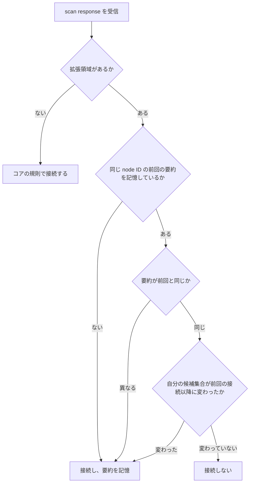

# 広告要約

識別子: `dev.jisaku.mosimo.mesh.adv`

## 目的

本拡張は、BLE 広告の scan response に残る領域へ配送候補集合の要約と状態 flags を載せ、scan 側が接続せずに「前回の接触以降に相手の候補集合が変わったか」を判断できるようにする。接続は電力と無線資源を消費し、変化のない相手との接続は差分照合だけで終わる。要約は接続を省くための推定情報であり、集合の内容や所持の証明を与えるものではない。要約が一致しても相手が自分に欠けるイベントを持つ可能性は残り、本拡張は配送の完全性を保証しない。

## 前提

| 識別子 | 文書 | 依存する理由 |
|---|---|---|
| `dev.jisaku.mosimo.mesh` | [BPv7 メッシュ配送](../README.md) | 広告の基本構成（Service UUID、Service Data、node ID、役割 flags）、配送候補集合の定義、差分照合 |

## 1. 配置

コアの scan response は 128 ビット Service Data（AD type `0x21`）= Service UUID 16 バイト + node ID 8 バイト + 役割 flags 1 バイトであり、AD 構造の長さ上限（31 バイトのうち長さ・AD type の 2 バイトを除く 29 バイト）までに 4 バイトが残る。本拡張はこの 4 バイトを使う。

```text
Service Data (0x21):
[Service UUID 16][node ID 8][役割 flags 1][要約 3][拡張 flags 1]
```

| 位置 | 長さ | 内容 |
|---|---:|---|
| 25〜27 | 3 | 配送候補集合の要約 |
| 28 | 1 | 拡張 flags |

拡張領域を省いた 25 バイトの Service Data はコアどおりであり、本拡張非対応の端末として扱う。

## 2. 要約

要約は、配送候補集合（コア §5.5 の、配送期限内・置換で停止されていない・ブロック対象でないイベント）の全イベント ID を符号なしバイト列の辞書順に並べて連結したバイト列の SHA-256 の先頭 3 バイトである。候補が一つもない場合は、空のバイト列の SHA-256 の先頭 3 バイトとなる。

```text
summary = SHA-256(id_1 || id_2 || ... || id_n)[0..3]   (id_1 < id_2 < ... < id_n)
```

候補集合が変わるごとに要約を再計算し、広告を更新する。広告の更新頻度は OS の制限に従い、連続した変化を一回の更新にまとめてよい。

## 3. 拡張 flags

| ビット | 意味 |
|---:|---|
| bit0 | 実効優先度が最高段階の候補を保持している |
| bit1 | 鍵署名の参照化（コア §2.1.3）と `FETCH` に対応している |
| bit2 | L2CAP CoC 経路に対応している |
| bit3〜7 | 0 |

flags は広告側の自己申告であり、`HELLO` による能力交換を置き換えない。flags だけを根拠に参照化した Bundle を送ってはならない。広告は探索用であり、今回の接続で相手が機能を扱えるかは `HELLO` で確定するためである。

## 4. scan 側の判断



scan 側は node ID ごとに、最後に差分照合を完了したときの相手の要約と、そのときの自分の要約を記憶する。両方が変わっていない場合は接続する理由がない。bit0 が立っている相手には、要約の一致にかかわらず接続してよい。記憶の寿命は node ID を観測している間に限る。node ID はプロセス起動ごとに変わり、新しい node ID は未知の相手として扱えば足りるためである。

要約の衝突（異なる集合が同じ 3 バイトになる）は 2^24 分の 1 の確率で起こり、その場合は次に集合が変わるまで接続が遅れる。この遅れは本拡張の許容する誤りである。

## 5. 拡張広告

BLE 5 の拡張広告（Extended Advertising）が双方で使える場合、広告 PDU に最大 254 バイトの AD 構造を載せられる。このとき Service Data は同じ配置で先頭を揃え、拡張領域を次のように延長してよい。

| 位置 | 長さ | 内容 |
|---|---:|---|
| 25〜27 | 3 | 要約（§2） |
| 28 | 1 | 拡張 flags（§3） |
| 29〜60 | 32 | 要約の全体（SHA-256 の 32 バイト） |
| 61〜 | 可変 | 実効優先度が最高段階の候補のイベント ID（32 バイトずつ、新しいものから最大 4 件） |

拡張広告を用いる端末も legacy 広告と scan response を併せて出し、legacy のみの端末から発見できる状態を保たなければならない。拡張広告だけでは BLE 4 の端末と iOS の背景 scan から見えないためである。

## 参照

- [Bluetooth Core Specification — Advertising, Extended Advertising](https://www.bluetooth.com/specifications/specs/core-specification/)
- [Bluetooth Assigned Numbers — Generic Access Profile AD types](https://www.bluetooth.com/specifications/assigned-numbers/)
- [FIPS 180-4 — Secure Hash Standard (SHA-256)](https://csrc.nist.gov/publications/detail/fips/180/4/final)
