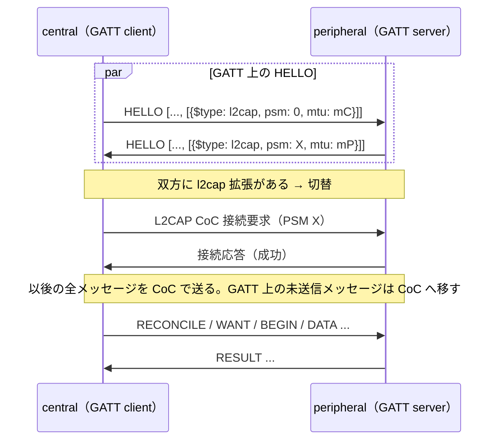

# L2CAP CoC 経路

識別子: `dev.jisaku.mosimo.mesh.l2cap`

## 目的

本拡張は、BLE 接続上で GATT の代わりに L2CAP Connection-oriented Channel（CoC、LE Credit Based Flow Control）を開き、共通交換メッセージの全てをそのチャネルへ移す経路を定める。GATT の characteristic 書込み・通知は 1 操作あたりのデータ長と往復に制約があり、大きな Bundle の転送に時間を要する。L2CAP CoC は L2CAP 層の credit による流量制御とストリーム状の転送を提供し、GATT の書込み単位への分割と Mosimo の `CREDIT` を省ける。

本拡張は双方が対応する場合だけ有効になり、GATT 経路は全参加機器に共通の基本経路として維持される。L2CAP CoC の成立は帯域の向上を保証せず、相手の認証も与えない。

## 前提

| 識別子 | 文書 | 依存する理由 |
|---|---|---|
| `dev.jisaku.mosimo.mesh` | [BPv7 メッシュ配送](../README.md) | `HELLO` の拡張配列、共通交換メッセージとその CBOR 表現、`RESULT`、GATT 経路 |

## 1. HELLO 拡張

```ts
type L2capCapability = {
  $type: "dev.jisaku.mosimo.mesh.l2cap";
  psm: integer;        // 0x0080〜0x00FF の動的 PSM。peripheral 側だけが意味を持つ
  mtu: integer;        // 受信可能な L2CAP SDU の最大長（バイト）。1,024 以上
};
```

peripheral（GATT server）はチャネルを listen し、動的に割り当てられた PSM を `psm` に載せる。central は自分の `psm` を `0` とする。central の L2CAP server を使う構成は認めない。接続開始の方向を GATT と揃え、どちらが開くかの交渉を省くためである。`mtu` は L2CAP の SDU 長であり、共通交換メッセージの上限 1,024 バイトを一つの SDU で運べる値を要求する。

対応 OS は Android 10 以降（`BluetoothAdapter.listenUsingInsecureL2capChannel`、`BluetoothDevice.createInsecureL2capChannel`）と iOS 11 以降（`CBPeripheralManager.publishL2CAPChannel`、`CBPeripheral.openL2CAPChannel`）である。暗号化を要求しないチャネルを用いる。運ぶのは公開の署名済みイベントであり、BLE のペアリングを要求すると利用者の操作が要り、未知の相手との自動接続が成立しないためである。

## 2. 切替



- 双方の `HELLO` に本拡張があるとき、central は `HELLO` 交換の完了後、GATT 上では他のメッセージを送らずに CoC を開く。peripheral は CoC が開くまで GATT 上で待つ。
- CoC が開いた時点でセッションは継続し、`HELLO` で確定した側番号・セッション識別情報・初期許可を引き継ぐ。`HELLO` を再送してはならない。再送すると nonce が変わりセッションが二重になるためである。
- 接続要求が拒否された、または一定時間（例: 5 秒）内に開かない場合、central は GATT 経路で交換を続け、peripheral もそれに従う。
- CoC が開いた後は GATT の RX／TX を使わない。CoC が切断された場合、同じ BLE 接続上の GATT へ戻ってもよいが、進行中の転送はコアの切断時の規則どおり先頭から再送する。

## 3. CoC 上のメッセージ

- チャネルは順序と到達が保証されたバイトストリームであり、共通交換メッセージはコア §7 のとおり CBOR sequence として並べる。OS の API は SDU の境界をアプリに渡さないため、SDU とメッセージの対応は定めない。
- SDU の長さは相手の `mtu` 以下とする。共通交換メッセージの上限（コア §6、相手の `HELLO` の受信メッセージ上限）はそのまま適用する。
- Mosimo の `CREDIT` は用いず、各転送の初期許可を `BEGIN` の全長とみなす。送信側は `BEGIN` に続けて `DATA` を全長まで連続して送り、流量制御は L2CAP の credit に委ねる。受信側は資源の都合で受け付けられない転送を `RESULT`（拒否）で止める。`RESULT` だけが受け入れ可否の手段であり、受信した `CREDIT` は無視する。
- `DATA` の断片長は、配列全体がメッセージ上限に収まる範囲で大きくとる。
- 制御メッセージ、`RECONCILE`、`FETCH` 等の規則はコアと同じである。各送信方向で断片を送信中の転送は 1 件に限り、`RESULT` を待たずに次の転送を始められる点もコアと同じである。

## 4. GATT 経路との関係

GATT 経路は後方互換の基本経路であり、本拡張に対応する端末も GATT の RX／TX を備え、本拡張を持たない相手と GATT だけで配送を完結できなければならない。本拡張の有無で `INVENTORY`・`WANT` の方針を変えてはならない。経路は運び方であり、何を配送するかの判断は配送層の方針に属するためである。

## 未確定事項

- CoC 接続のタイムアウト値と、CoC 切断後に GATT へ戻る際の手順の詳細。
- 暗号化されたチャネルを選べる相手同士での扱い。

## 参照

- [Bluetooth Core Specification — L2CAP, LE Credit Based Flow Control Mode](https://www.bluetooth.com/specifications/specs/core-specification/)
- [Android — BluetoothDevice.createInsecureL2capChannel](https://developer.android.com/reference/android/bluetooth/BluetoothDevice#createInsecureL2capChannel(int))
- [Apple — CBL2CAPChannel](https://developer.apple.com/documentation/corebluetooth/cbl2capchannel)
