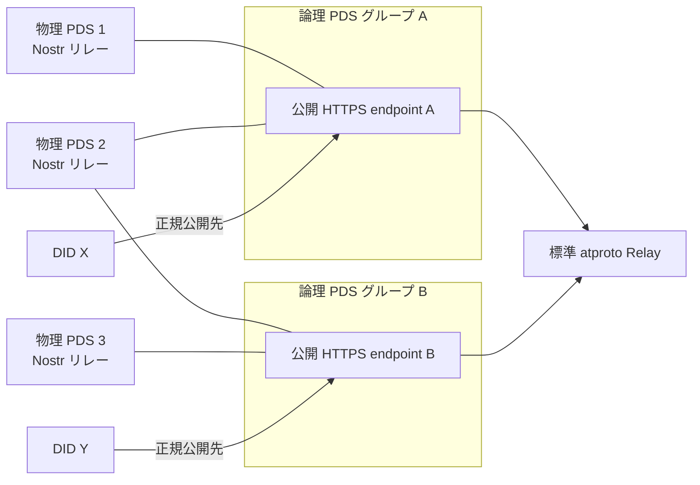
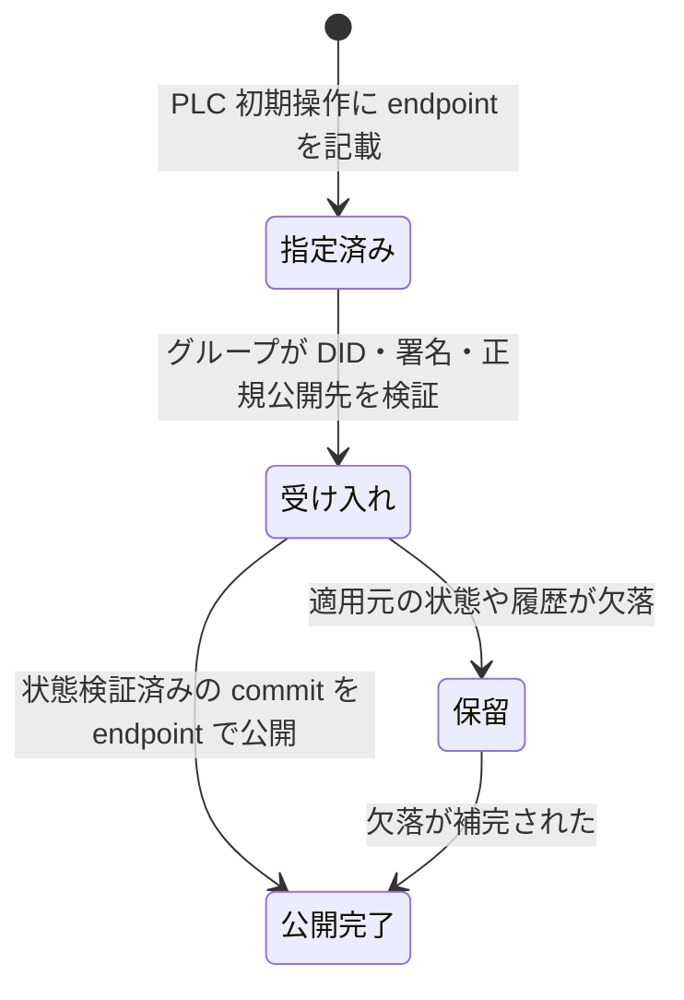
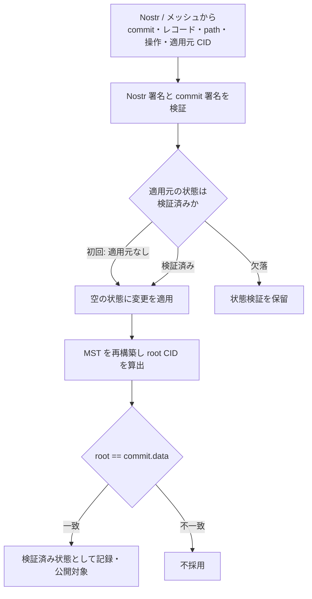
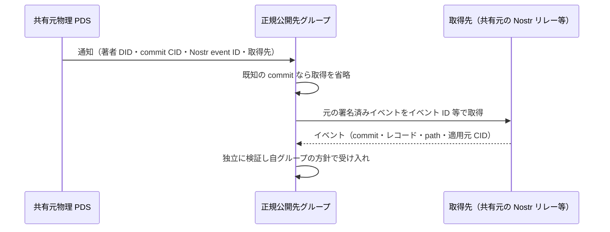
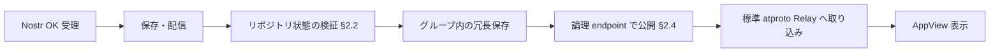
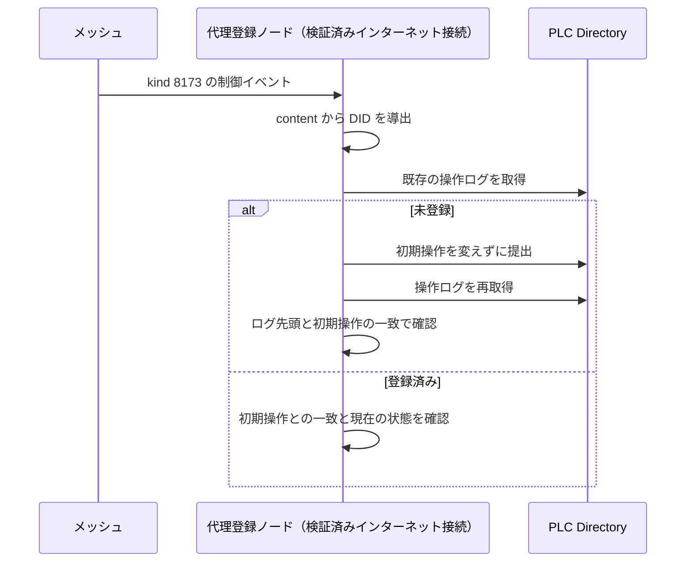
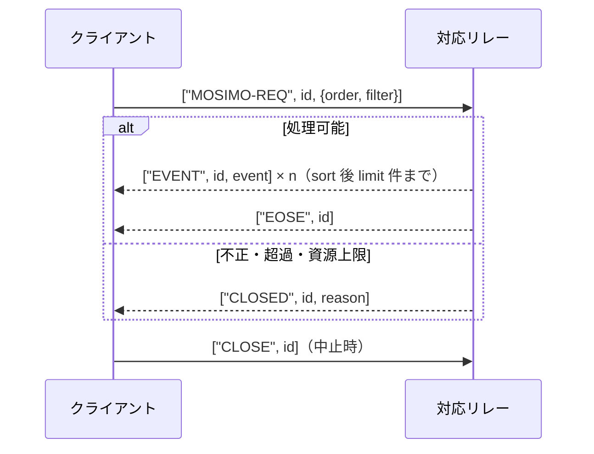

# 論理 PDS と物理 PDS

識別子: `dev.jisaku.mosimo.pds`

## 目的

本プロトコルは、端末が署名した atproto リポジトリを、既存の atproto ネットワークへ公開するためのサーバー側の構成を定める。発信端末を著者の単一 writer とし、複数のサーバーが署名済みリポジトリを収集・復元・複製したうえで、DID ごとに一つの論理 PDS として公開する。本文書は、この公開単位である論理 PDS グループと、収集・復元・公開を実際に担う物理 PDS の役割分担、発信者の受け入れ、Nostr・メッシュから届いた配送データからの MST 再構築、グループ間の commit 共有、そして物理 PDS が提供する Nostr リレーの振る舞い（受け入れ方針、発見、`MOSIMO-REQ`）を定義する。

本文書が保証するのは、復元・公開の過程で著者の署名・commit CID・`rev` が維持されること、論理 PDS の公開 endpoint が標準 atproto の同期経路から見て一貫した一つの PDS として振る舞うこと、対応物理 PDS の Nostr リレーが本プロトコルのイベントを独自タグや古い作成時刻だけを理由に拒否しないことである。

保証の境界は次のとおりである。DID が論理 PDS グループを正規公開先として指定しても、グループが発信者を受け入れたことや公開が完了したことは意味しない。Nostr リレーの `OK` 応答は、PLC 登録、リポジトリ全体の検証、グループ内の冗長保存、標準 atproto Relay への取り込み、AppView での表示のいずれの完了も意味しない。物理 PDS が署名済みデータを保持していることは、公開 endpoint の応答・採番・切替の権限を与えない。Nostr リレーとして機能することは全 NIP の実装や全 kind の無制限な受け入れ・永久保存を意味しない。候補一覧や NIP-11 による能力の自己申告は、グループ所属や情報源としての信頼を与えない。複数運用者によるデータ複製があっても、公開名の DNS・TLS・管理権限と PLC 管理鍵の所在は依存点として残る。

## 前提

| 識別子 | 文書 | 依存する理由 |
|---|---|---|
| `dev.jisaku.mosimo` | [コア](../README.md) | 投稿単位、atproto レコード・commit、Nostr イベントの基本タグ（`mosimo:commit`・`:base`・`:path` 等）、共通時刻型 `Timestamp`、削除、版管理 |
| `dev.jisaku.mosimo.priority` | [配送優先度ヒント](../priority/README.md) | `MOSIMO-REQ` の並び順に用いる実効優先度 effectivePriority の定義 |
| `dev.jisaku.mosimo.attest.chain` | [身元証明チェーンの同梱](../attest/chain/README.md) | 実効優先度の評価で発信者の認可を判定する際のチェーン検証 |
| `dev.jisaku.mosimo.attest.revocation` | [失効通知](../attest/revocation/README.md) | リレーが保存・配信する失効通知の制御イベントの定義と、実効優先度評価時の失効状態 |
| `dev.jisaku.mosimo.attest.importer` | [転載サーバー](../attest/importer/README.md) | リレーが自身の信頼の起点で転載投稿を認可する手順 |
| `dev.jisaku.mosimo.mesh` | [メッシュ配送](../mesh/README.md) | PLC 初期操作の制御イベントを運ぶ Bundle と、Bundle が要求する署名済み配送期限 |

## 1. 公開モデル

### 1.1 論理 PDS グループと物理 PDS

論理 PDS グループは、DID が一つの正規公開先として指定する PDS の運用単位であり、公開 HTTPS endpoint を一つ持つ。物理 PDS は署名済みリポジトリの収集・復元・複製・公開を担うサーバー実体である。複数の物理 PDS が協調して一つの論理 PDS を提供し、既存の atproto Relay からは一つの PDS として見える。



物理 PDS と論理 PDS グループは多対多である。同一の物理 PDS が複数のグループに同時に所属でき、署名済みブロックの保存を共用してもよい。ただし、各論理 endpoint の公開対象・stream・`seq`・再送履歴・account 状態はグループごとに区別して管理する。異なる論理 endpoint の `seq` を共通カーソルとして流用してはならない。カーソルは endpoint ごとの stream 位置であり、流用すると欠落や重複を検出できなくなるためである。

| 観点 | 論理 PDS グループ | 物理 PDS |
|---|---|---|
| 識別 | 公開 HTTPS endpoint（DID の PDS endpoint） | サーバー実体。Nostr リレーの WebSocket endpoint を持つ |
| 役割 | 標準 atproto Relay への正規公開、stream の採番 | 収集・復元・複製、Nostr リレーの提供 |
| 所属 | 複数の物理 PDS を含む | 複数のグループに所属できる |
| 状態 | stream・`seq`・再送履歴・account 状態をグループ単位で保持 | 署名済みブロックの保存は共用可 |

複数の運用グループがそれぞれ論理 PDS を提供でき、世界で一つの公開ドメインは前提にならない。物理 PDS の所在と DID が指す正規公開先は別の概念であり、別グループの物理 PDS が同じ署名済みデータを保持しても、DID の正規公開先は増えない。

### 1.2 DID による正規公開先の指定

DID は一つのグループの公開 HTTPS endpoint を正規 PDS として指定する。アプリ・運用者が既定の論理 PDS グループを事前設定し、平時のアプリ初期化で生成・署名する PLC 初期操作にその公開 endpoint を含める。プロトコル全体で一つの既定グループを強制することはなく、既定グループの選択はアプリ・運用者に属する。

公開先の変更操作は端末の PLC 管理鍵で署名する。PLC 管理鍵は発信端末だけが保持し、物理 PDS や代理登録ノードへ渡してはならない。渡せば端末以外が公開先や鍵を書き換えられるようになり、端末署名済み状態を正本とする前提が崩れるためである。

DID での指定、グループによる受け入れ、リポジトリの公開完了は三つの別の段階である。



### 1.3 参加権限

情報の収集・検証・ミラーは誰でも独立して行える。一方、グループの正規公開系への参加、すなわち公開 endpoint での応答・共通 stream の採番・切替には、そのグループによる承認・認証を必要とする。各グループは独立に参加方針を定め、同一の物理 PDS をそれぞれ承認できる。承認された物理 PDS も著者の投稿署名鍵・PLC 管理鍵を取得することはなく、著者の commit を再署名してはならない。再署名や `rev` の付け直しは、端末が署名した状態と公開される状態の同一性を壊すためである。独立ホストのミラーは保管・復旧等の内部経路に利用できる。

発信者の受け入れ（§2.1）は物理 PDS の運用参加承認とは別であり、発信者は受け入れによって公開系の運用権限を得ない。

## 2. 発信者の受け入れと復元

### 2.1 平時の自動準備と受け入れ

発信アプリは初期化時に Nostr 署名鍵・atproto リポジトリ署名鍵・PLC 管理鍵の3用途の鍵、DID、リポジトリを自動的に準備し、オンラインで PLC Directory への登録と既定の論理 PDS グループでの受け入れを進める。鍵はインストールごとに独立して永続化する。災害時の起動まで登録を待つ設計は、災害時にオンラインである保証がないため避ける。初回起動がオフライン等で登録が完了していない場合に限り、署名済み PLC 初期操作の代理登録（§6）を例外経路として使う。

グループは平時に発信者の受け入れを自動的に進める。利用者による手動の事前登録は要らず、未登録の発信者についても署名済みデータから受け入れを開始できる。受け入れでは次を検証する。

1. PLC の DID 情報と、必要に応じて初期操作。
2. 鍵対応宣言。宣言内の atproto 公開鍵が、検証に用いる PLC の状態においてその DID のリポジトリ署名鍵として認められていること。
3. 署名済み投稿・commit。
4. DID の正規公開先が自グループであること。

検証を通った発信者を、資源上限・濫用対策・運用方針の範囲で復元・公開する。DID に自グループが指定されただけで無制限の保存義務は生じない。

### 2.2 MST の再構築と検証

本プロトコルの配送データは MST ノードや包含証明を同梱せず、端末署名済み commit、新規レコードと正確な repository path、削除対象等の変更操作、適用元 commit CID から物理 PDS が MST を再構築する。標準の MST 構築規則により、同一の path → record CID の写像からは同一の root CID が再現できるため、再構築した root を署名済み commit の `data` と照合すれば、レコードがその commit の状態に含まれることを検証できる。

適用元 commit CID は各更新の配送データに含め、Nostr イベントの署名対象とする（基本タグ `mosimo:base`）。初回更新は値を空文字列として適用元なしを明示し、以後は端末が直前に確定した commit の CID を指定する。適用元参照は本プロトコルの配送情報であり、標準 atproto commit の形式や `prev` の意味とは独立である。



物理 PDS は適用元の状態が検証済みである場合に変更を適用し、再構築した root と新しい署名済み commit の `data` を照合する。適用元の状態、または状態の再現に必要なレコード・変更が欠けている場合は、リポジトリ状態の検証を保留する。推測で補った木を検証済みとして公開してはならない。公開される状態は端末が署名した状態と一致していなければならず、推測した状態はその保証を持たないためである。適用元参照は再構築の手掛かりであり、それだけで履歴の非分岐を証明するものではない。

リポジトリ状態の検証は、Nostr 著者署名による単独投稿の検証・表示とは別の段階である。古いイベントの受理によって古い commit を得ても、現在の検証済みリポジトリを巻き戻してはならない。遅延して届いた過去の状態は、端末が既に確定した後続の状態を上書きする根拠にならないためである。

### 2.3 削除

著者端末は削除時に、対象 Nostr イベントへの NIP-09 削除要求（`kind: 5`）と、対象レコードを MST から除いた状態の atproto commit をそれぞれ署名・発行する。MST は path → record CID の写像であり、削除されるのは対象レコードのエントリであって過去の commit ではない。

物理 PDS は NIP-09 削除要求だけを根拠に著者の新しい atproto commit を生成してはならない。commit の署名は著者だけが行えるものであり、サーバーが生成した commit は端末署名済み状態ではないためである。削除要求のみが到着した状態と、署名済みリポジトリの削除が検証できた状態を区別する。

### 2.4 正規公開

再構築した MST から、物理 PDS は標準 atproto 同期 API と firehose に必要な MST・CAR を生成し、論理 PDS の公開 endpoint から標準 Relay へ提供する。元の commit・CID・`rev` を維持し、標準 Relay 向け出力は既存の同期仕様に従う。

内部の DB・複製方式・合意アルゴリズム・リーダー選出は固定せず、論理 endpoint には次の外部動作を要求する。

| 要件 | 理由 |
|---|---|
| 同じ論理 endpoint の `seq` を、障害切替後に別の意味で再利用してはならない | 購読者のカーソルが別のイベントを指すことになる |
| 保持する再送範囲では、カーソルから欠落なく再開できる | 購読者が切断前の位置から継続できる |
| 再送できない範囲は欠落を隠さず、標準の再同期経路で回復できるようにする | 隠された欠落は購読者側で検出できない |
| 提供する署名済みリポジトリと公開する更新情報を整合させる | API と stream が異なる状態を示すと検証が成立しない |
| 整合性を保てない複製先へ無条件に切り替えてはならない | 切替で `seq` と状態の対応が失われる |

各物理 PDS が無調整に採番した stream を負荷分散するだけでは、これらの要件を満たせない。内部方式が自由であることは、任意の異なる実装がそのまま同じグループで協調できることの保証ではない。

## 3. グループ間の共有

DID の正規公開先が他の対応グループであり、その正規公開先がまだ知らない commit を物理 PDS が収集した場合、当該グループへ commit と取得元の情報を共有する。正規公開先が世界中の Nostr リレーを自力で監視できることに依存しないための経路である。

基本方式は、小さな通知を送り、受信側が必要なデータだけを取得するものとする。



- 共有では元の著者署名・Nostr event ID・commit CID・`rev` を変更してはならない。中継時に元 Nostr イベントのタグへ追記してはならない。署名対象が変わりイベント ID が一致しなくなるためである。
- commit 単体にはレコード本文や復元に必要な情報が含まれないため、通知は必要な交換データ・ブロックの取得先へつながる情報を持つ。共有元は自身が提供する Nostr リレーを取得先として案内できる。
- 取得先の URL やイベント参照は探索ヒントであり、そのリレーの可用性・保持・真正性の保証ではない。受信側は通知中の CID・`rev`・URL の自己申告だけを根拠に受理を完了してはならず、元データを独立に検証して自グループの方針で受け入れる。
- 通知の受信、元データの検証、リポジトリ状態の検証・公開完了は別の段階である。共有元が受信先 DID の正規公開元になることはない。
- 正規公開先が停止中の場合、共有元は制限付きで再試行する。共有は原則として DID の正規公開先に限定し、通知を受けただけで別グループへ転送し続けてはならない。転送の連鎖は循環と増幅を生むためである。
- 通知中の DID・取得元 URL は不信な入力として扱い、外部アクセスには SSRF・増幅攻撃・資源枯渇への対策を施す。

## 4. Nostr リレープロファイル

### 4.1 標準動作

物理 PDS は収集・復元サーバーであると同時に、標準 Nostr クライアントが接続できる Nostr リレーとして機能する。クライアントが対応物理 PDS のリレーに接続できる場合は、その接続へ元の署名済みイベントを直接投稿し、保持されているイベントの取得・購読も直接行える。一般リレーを先に経由する必要はない。

atproto の正規公開先は論理 PDS の HTTPS endpoint であり、物理 PDS の Nostr WebSocket endpoint とは別である。一つの物理 PDS が複数グループに所属していても、イベントの受理によってその全グループの正規公開対象になることはない。

リレーは NIP-01 の標準イベントと WebSocket の投稿・取得・購読を提供する。独自 HTTP ダウンロード口や他リレーへの転送専用プロキシでは、既存 Nostr クライアントからの直接利用が成立しないためである。

- クライアントから `EVENT`・`REQ`・`CLOSE` を受け付け、規則に従い `OK`・`EVENT`・`EOSE`・`CLOSED` 等で応答する。
- event ID と BIP-340 署名を検証し、元の署名対象フィールドを維持する。
- 本プロトコルのイベントを保持し、保存データの取得と新着の購読を提供する。
- NIP-09 削除要求を処理し、§2.3 の削除と整合させる。
- 能力・制限は NIP-11（§5.1）で公開する。

### 4.2 本文投稿と制御イベント

通常投稿と、対象投稿への訂正・補足・追認は `kind: 1` とし、`content` に人が読める本文を格納する。地理情報、署名済み commit・適用元 commit CID・レコード・repository path は同じ Nostr 投稿イベントの署名対象に含める。別イベントへ分離してはならない。分離すると本文と復元データの対応が著者署名で保護されなくなるためである。基本項目・拡張は複数のタグへ分け、拡張は既定で 1 オブジェクト = 1 自己完結タグ（名前 `mosimo:ext:` + 完全修飾 `$type`、値は残り全フィールドの deterministic CBOR の Base64・padding なし）で運ぶ。拡張タグの出現順が元の配列順である。基本タグの名前・値・個数は[コア](../README.md)に従い、通常投稿の基本版は `"1"` である。1 件の通常投稿・訂正・補足・追認は、発信者自身の 1 レコード追加・1 commit・1 Nostr 投稿イベントを単位とする。

通常のテキスト投稿 kind を用いるのは、既存クライアントで本文を扱える可能性を高めるためである。訂正は元投稿を参照する新規イベントであり、既存の `kind: 1` を上書きする仕組みではない。

リレーが扱う kind と制御イベントは次のとおりである。

| kind | 用途 | 署名者 | `t` タグ | `version` タグ | リレーでの扱い |
|---|---|---|---|---|---|
| `1` | 通常投稿・訂正・補足・追認 | 著者の Nostr 鍵 | 1 個 | 1 個（`"1"`） | 保存・配信 |
| `5` | NIP-09 削除要求 | 著者の Nostr 鍵 | — | — | NIP-09 として処理 |
| `8173` | 本プロトコル固有の制御イベント。種別は二つ目の `t` 値と拡張の `$type` で区別 | 種別による | 2 個以上（`mosimo.jisaku.dev` と種別値） | なし | 種別による。失効通知（`mosimo.jisaku.dev/revocation`）は通常イベントとして保存・配信。PLC 初期操作（`mosimo.jisaku.dev/plc`、§6）はメッシュ内だけで運び、リレーへ搬出しない |

制御イベントの `version` タグは付けず、版は内側の拡張の `$type` で区別する。鍵対応宣言は、atproto 鍵を末端とする[身元証明チェーン](../attest/chain/README.md)の `binding` として投稿へ埋め込んで運ぶ。

変換方向は Nostr から atproto への復元・公開である。物理 PDS が保持済みの元 Nostr イベントをそのまま再配信することは、atproto からの逆変換とは別の行為であり、可能である。

### 4.3 検索用のプロトコル識別

本プロトコルの検索用識別には単一文字の `t` タグ `["t", "mosimo.jisaku.dev"]` を用い、標準の `#t` フィルタで発見できるようにする。通常投稿・訂正・補足・追認はこのタグを 1 個含める。識別タグは著者が署名時点で含め、中継者が署名済みイベントへ追記してはならない。第三者も同じタグを付けられるため、検索で見つかったことと署名・形式・対応関係が検証済みであることは別であり、識別タグはプロトコルへの適合や情報源の信頼の証明ではない。

NIP-01 の標準タグ検索は英字一文字のタグ名とその最初の値への一致を対象とする。複数文字の独自タグは保持できても、一般リレーで検索できることは別である。個別項目・拡張には、定義元 NIP の対象 kind・文脈・意味が正確に一致する標準タグだけを再利用し、それ以外は衝突しにくい名前空間付きの独自タグを使う。検索目的だけの一文字タグの新設や標準タグの意味の流用は、他 NIP のクライアントに誤った解釈を与えるため行ってはならない。

### 4.4 受け入れ方針

本プロトコルで扱うイベントについて、対応リレーは次の方針をとる。

- 独自タグがあること、またはオフライン配送で `created_at` が古くなったことだけを理由に拒否してはならない。メッシュ経由で届く投稿は常にこの性質を持ち、拒否すれば本プロトコルの投稿が公開経路に乗らないためである。
- 未知の著者署名付き拡張は、解釈せずとも署名検証に必要な表現を保持して中継する。署名対象の情報を削除・並べ替え・書き換えしてはならない。
- 不正署名・不正形式・サイズ超過・資源枯渇・削除済みイベント等は受け入れの対象外であり、資源上限・保持方針・濫用対策は引き続き適用する。
- 独自タグを保持することと、そのタグ名で検索できることは別である。検索用の識別は §4.3 の `t` タグによる。

メッシュ配送期限と、リレーでの保存・取得可能期間は別である。配送期限の満了は新たなメッシュ配送を止める条件であり、リポジトリ復元に必要な情報を一律に破棄する条件ではない。

### 4.5 受理と公開の段階

リレーが受理したイベントは収集・復元処理（§2）へ渡される。自グループの DID は検証と運用方針の範囲で復元・公開し、他の対応グループ宛ての未共有 commit は §3 の通知と必要時取得で正規公開先へ共有する。



各段階は独立に完了し、前段の完了は後段の完了を含まない。

## 5. 発見と信頼

### 5.1 NIP-11 による能力の公開

対応物理 PDS のリレーは NIP-11 の Relay Information Document を提供し、本プロトコル向けの能力・方針を追加情報として公開する。NIP-11 はリレーの WebSocket URI に対応する HTTP(S) URI へ `Accept: application/nostr+json` を指定して取得する。標準の対応 NIP・制限の項目を再利用し、追加情報には対応バージョン、対象イベントの受け入れ・保持方針、関連する論理 PDS グループ、`MOSIMO-REQ` の対応（§7.1）を表す。独自情報は標準項目の意味を変えず、未対応クライアントが無視できる追加項目として設計する。

能力の自己申告は、正規 PDS グループへの参加権限や公的情報の変換者としての信頼を与えない。Nostr リレーの受け入れ方針と公的情報の信頼リストは別のものである。

### 5.2 複数経路のリレー発見

クライアントは次の経路を組み合わせてリレー候補を得る。

| 経路 | 内容 |
|---|---|
| 同梱候補 | アプリに初期候補を同梱する。対応物理 PDS のリレーに加え、独自拡張を持たない既存の著名な一般 Nostr リレーも含めてよい。世界共通の固定リストは置かず、アプリ・運用者が設定する |
| キャッシュ | 取得済み候補を保存し、初回接続や接続回復時に使う |
| AppView の一覧 | 既知 AppView のレコードから一覧を取得・更新する |
| Nostr 経由 | Nostr 上で候補を発見する。世界共通の単一ブートストラップ手順は前提にしない |

AppView に到達できないことだけで初回接続や接続回復後の投稿を止めてはならない。災害時に AppView が到達不能である場合でも、同梱候補・キャッシュから投稿を送れる必要があるためである。

候補は到達性と NIP-11 の能力・制限を確認して利用する。対応物理 PDS のリレーを優先しつつ、一般リレーも併用する。本プロトコル用追加情報がないことだけで一般リレーを利用対象外にする理由はなく、一般リレーへの投稿・取得も標準 Nostr として試みる。一般リレーの受け入れ・保持方針は本プロトコルの管理外であるため、対応物理 PDS のリレーを優先する。

### 5.3 候補一覧の発行者への信頼

候補一覧の自動更新は、アプリ・運用者が信頼する発行者の一覧を基本とする。信頼する発行者は複数設定できる。同梱候補も初期接続先として維持する。

Nostr 等で発見した未知の候補は信頼済み一覧と区別し、接続数・送信量等を制限して探索する。未知の発行者の一覧を無条件に採用して接続先全体を置き換えてはならない。接続先の全置換は、不正な一覧による投稿の封じ込めを可能にするためである。

一覧発行者への信頼は接続先候補の選定に関するものであり、投稿内容、公的情報の取り込みサーバー、論理 PDS の参加権限への信頼を含まない。

## 6. PLC 初期操作の制御イベントと代理登録

DID method は `did:plc` である。発信アプリは初期操作を生成・署名し、そのハッシュから DID を決定する。`rotationKeys` には端末の PLC 管理用公開鍵を用いる。初期操作は DID Document そのものではなく、その導出元である。

初回起動がオフライン等で PLC 登録が完了していない場合に限る例外経路として、署名済み初期操作をメッシュで独立した制御イベントとして配送し、受け取ったオンラインノードが PLC Directory への代理登録を試みる。発信端末自身も接続回復後に同じ初期操作を送信できる。代理登録は署名済み初期操作をそのまま送信する行為であり、代理登録ノードは指定先を含む内容を改変してはならない。改変すれば署名が無効になり、また改変できる設計は中継者に公開先の操作権限を与えてしまうためである。PLC 仕様は認証不要の HTTP リクエストで署名済み操作の提出を受け付け、操作の署名を検証する。

| 項目 | 値 |
|---|---|
| `kind` | `8173` |
| `content` | 端末が署名した PLC 初期操作の JSON をそのまま |
| タグ | `["t", "mosimo.jisaku.dev"]`、`["t", "mosimo.jisaku.dev/plc"]`、`["mosimo:exp", Timestamp]`。最後のものは Bundle が署名済み配送期限を要求するため |
| 配送期限 | 作成から 24 時間 |
| 作成条件 | 初期操作の登録確認前で、自分の通常投稿を保持し、自分の制御イベントをまだ保持していないとき。PDS endpoint が未設定（`.invalid`）の場合は作成しない |
| 搬送範囲 | メッシュ内だけ。リレーへは搬出しない |

代理登録ノードの手順は次のとおりである。



- 再試行は同時に 1 件とする。DID ごとに失敗時は 2〜60 秒の指数待ちを置く。登録を確認した初期操作はプロセス終了まで再送してはならない。PLC Directory への不要な負荷を避けるためである。
- 既存登録がある場合は初期操作の一致と現在の状態を確認する。重複送信の応答だけで失敗や最新状態を判断してはならない。
- 初期操作のローカル検証と、公開ディレクトリでの登録・解決確認は別である。到達可能なノードが全てオフラインである間は登録は完了せず、接続回復後の送信に委ねられる。
- 基本経路は §2.1 の平時の自動登録であり、代理登録は未登録のまま初回利用に至った場合に限る例外経路である。初期操作は通常投稿とは独立した制御イベントとして運ぶ。

## 7. MOSIMO-REQ

著者の配送優先度ヒント `priority` に基づく取得順を、標準 NIP-01 を変えずに任意機能として提供する。通常の `REQ` は NIP-01 のフィルタ・limit・保存イベントの順序（`created_at` 降順、同時刻は id 辞書順昇順）を維持する。未知の filter field を入れただけで opt-in したと扱ってはならない。標準クライアントの `REQ` の結果が変わると NIP-01 との互換性が失われるためである。

### 7.1 NIP-11 での表明

対応リレーは NIP-11 に次の任意情報を示す。

```json
{"mosimo":{"priority_order":["priority-v1"]}}
```

この自己申告は信頼の起点や認可を与えない。

### 7.2 要求と応答

priority 順の取得は独自の message verb `MOSIMO-REQ` を明示的に選ぶ。

```json
["MOSIMO-REQ", "bsaf-priority", {"order":"priority-v1","filter":{"kinds":[1],"#t":["mosimo.jisaku.dev"],"limit":100}}]
```

| 要素 | 規則 |
|---|---|
| subscription ID | 1..64 の ASCII printable bytes。同じ接続の既存 ID と衝突させない |
| request object | 必須 field は `order`・`filter` |
| `order` | `"priority-v1"` |
| `filter` | 一つの NIP-01 filter。`kinds` は `[1]`、`#t` に `mosimo.jisaku.dev` を含み、`limit` は整数 1..100 を必須とする。他の標準条件は AND、値リスト内は OR |

`MOSIMO-REQ` は保存済みイベントの有限な snapshot 取得であり、live 購読ではない。リレーは受理時点の候補・リレーの認可状態・時刻を固定し、filter に一致する集合を次の順で sort した後に `limit` を適用する。

1. effectivePriority 降順
2. `created_at` 降順
3. id 辞書順昇順

リレーは自身の信頼の起点・失効状態・ローカル選択で effectivePriority を評価する（[配送優先度ヒント](../priority/README.md)、[転載サーバー](../attest/importer/README.md)）。受信者はリレーの順序を信用して自身の認可検証を省略してはならない。リレーの信頼の起点は受信者のものと異なり得るためである。



応答は同じ ID の標準 `EVENT` を使い、完了時に `EOSE` を送って解放する。クライアントは `CLOSE` で中止できる。不正・超過・資源上限で処理できない場合は `CLOSED` と理由を返す。黙って別の順序で返してはならない。クライアントが priority 順と誤認するためである。

### 7.3 標準 REQ への fallback

非対応・timeout・`CLOSED` の場合、クライアントは別の subscription ID で標準 `REQ` へ fallback し、受信後に自身の優先度で処理する。無応答を空の成功として扱ってはならない。

## 8. 残る依存点

公開名の DNS・TLS・ドメイン管理権限と stream の制御系は依存点として残る。論理 PDS 全体が利用不能になり別グループへ移す場合は DID の PDS endpoint 更新が必要であり、PLC 管理鍵を端末だけが保持するため、公開先の変更は端末がある場合に限られる。

## 未確定事項

- 発信者の受け入れにおける具体的な制限、拒否・保留・容量超過・公開完了の確認方法、既定グループが停止している場合の扱い。
- 物理 PDS のグループ参加・離脱・権限失効と、グループ間で独立した認証の具体方式。異なる実装が同一グループで協調するためのメンバー認証・ブロック交換・イベントログ複製の共通通信仕様を規定するか。
- stream と API の整合性の具体的な保証範囲、再送 window、障害状態・復旧手順と適合試験。
- 論理 PDS 全体の利用不能時の復旧方針と、PLC 管理鍵の回復構成。
- 物理 PDS が欠落 commit を探索・取得するプロトコル。
- グループ間共有の通知の必須項目と形式、通知・取得・応答の形式、送信者認証、相手が既知かの確認方法、対応グループの発見、DID 更新・解決失敗時の保留、DID 移行時の処理、再試行回数・期間・間隔、取得データの保持と可用性、大量通知の抑止。
- リレーの具体的な上限、保持期間、追放、未来時刻・時計ずれへの対応、永久保存の有無。
- 必須とする追加 NIP の範囲。
- 削除要求の一つの `kind: 5` への具体配置、複数対象の単位、削除要求と削除 commit の対応関係の検証規則。
- 鍵対応宣言を独立した制御イベントとして運ぶ場合の kind・参照・更新。
- 拡張を標準タグへ直接対応させる場合の共通規則。
- NIP-11 追加情報の項目名・型・必須範囲・版管理と、グループ所属の認証。
- リレー発見の具体的な選択手順、接続数、送信量、再試行、古いキャッシュの扱い。Nostr 経由の発見方式。能力情報の未取得と対象イベントを明示的に扱わないリレーを区別する規則。
- 候補一覧の署名・発行者認証・版管理・更新・失効、AppView 上のレコード形式、未知候補の探索枠と選択・統合規則。
- PLC 初期操作の代理登録の打ち切り条件と負荷制限。`kind: 8173` と登録済み NIP との調整。

## 参照

- [NIP-01: Basic protocol flow](https://github.com/nostr-protocol/nips/blob/master/01.md)
- [NIP-09: Event Deletion Request](https://github.com/nostr-protocol/nips/blob/master/09.md)
- [NIP-11: Relay Information Document](https://github.com/nostr-protocol/nips/blob/master/11.md)
- [BIP-340: Schnorr Signatures for secp256k1](https://github.com/bitcoin/bips/blob/master/bip-0340.mediawiki)
- [AT Protocol Repository](https://atproto.com/specs/repository)
- [DID PLC Method](https://github.com/did-method-plc/did-method-plc)
