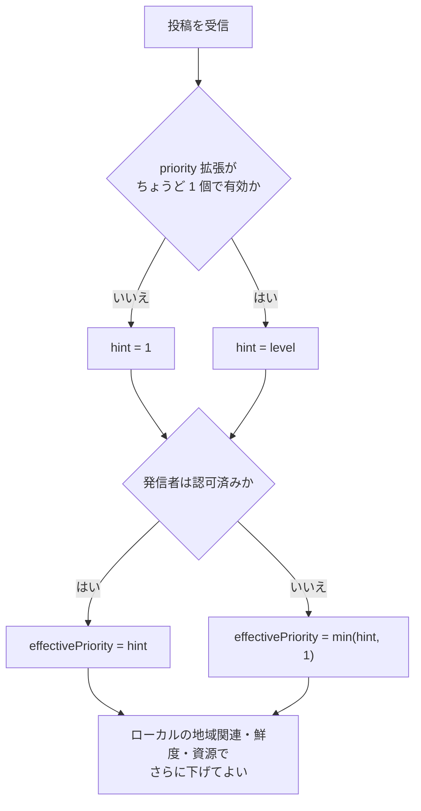

# 配送優先度ヒント

識別子: `dev.jisaku.mosimo.priority`

## 目的

本プロトコルは、著者が投稿に付ける配送優先度のヒントと、受信ノードがそれを用いて実効優先度を決める規則を定義する。メッシュの接触時交換やリレーの取得順で、緊急性の高い情報を先に運べるようにすることが目的である。

本書が保証するのは、著者の署名したヒントがそのまま保持されることと、受信ノードが認可されていない発信者のヒントによって優先度を引き上げられないことである。署名された `level` は著者の要求であり、受信ノードの実効優先度はローカルの信頼・地域関連・鮮度・資源状況で決まる。実効優先度は配送順序の決定にだけ用い、鍵署名・失効・配送期限・資源上限はそれぞれ独立に適用される。

## 前提

| 識別子 | 文書 | 依存する理由 |
|---|---|---|
| `dev.jisaku.mosimo` | [コア](../README.md) | 拡張の共通構造と運び方、同名フィールドの独立性 |
| `dev.jisaku.mosimo.attest.chain` | [署名チェーン](../attest/chain/README.md) | 発信者が `verified` であることと役割の確認。認可済み発信者のヒントだけを採用するため |
| `dev.jisaku.mosimo.attest.importer` | [転載サーバー](../attest/importer/README.md) | 受信者による転載サーバーの認可。認可済み転載のヒントを採用するため |
| `dev.jisaku.mosimo.pds` | [PDS](../pds/README.md) | リレーの `MOSIMO-REQ` による実効優先度順の取得 |

## 1. 型

```ts
type PriorityExtension = {
  $type: "dev.jisaku.mosimo.priority";
  level: 0 | 1 | 2 | 3;
};
```

| `level` | 名称 | 用途 |
|---|---|---|
| `0` | bulk | 急がない情報 |
| `1` | normal | 既定。拡張がない投稿はこの値として扱う |
| `2` | important | 重要な情報 |
| `3` | urgent | 緊急の情報 |

正規の定義は [`lexicon.json`](lexicon.json) である。

## 2. 実効優先度

受信ノードは次の規則で実効優先度を決める。

```text
hint = 有効な priority 拡張がちょうど 1 個 ? level : 1
effectivePriority = 発信者が認可済み ? hint : min(hint, 1)
```

「認可済み」とは、投稿の[署名チェーン](../attest/chain/README.md)の検証結果が `verified` であること、または[転載サーバー](../attest/importer/README.md)の受信者認可を通ったことである。どの役割の鍵にヒントどおりの実効優先度を認めるかは実装の方針であり、`public-information` と `import` の役割に限る、といった絞り込みをしてよい。



- `priority` 拡張が複数ある、または `level` が不正な投稿のヒントは採用せず `level 1` とする。より高い値へ修復してはならない。修復は著者が署名していない優先度を与えることになるためである。
- 受信者は実効優先度をさらに下げてよい。組織名、自己署名の証明、外部形式の値、独自型内の同名フィールドだけから引き上げてはならない。これらは署名チェーンによる認可を経ていないためである。
- 実効優先度を署名済みイベントへ書き戻してはならない。実効優先度は受信ノードごとの判断であり、書き戻すと署名が無効になるためである。
- `level 3` にも帯域・保存量の上限を適用する。優先度は資源上限の解除ではなく、上限内での順序の決定である。具体的なメッシュのスケジューリングと公平性は受信ノードのローカルな方針である。

## 3. Nostr 上の表現

[コア §7.3](../README.md#73-自己完結した拡張タグ)の自己完結した拡張タグで運ぶ。

```text
["mosimo:ext:dev.jisaku.mosimo.priority", B64(C({level}))]
```

`C` は atproto deterministic CBOR、`B64` は padding なしの通常 Base64 である。リレーが実効優先度順に保存済みイベントを返す任意機能は [PDS](../pds/README.md) の `MOSIMO-REQ` に従う。リレーは自身のルート鍵・失効状態・ローカル選択で実効優先度を評価し、受信者はリレーの順序を信用して自身の認可検証を省略してはならない。リレーの評価は受信者の信頼の起点と一致しないためである。

## 参照

- [NIP-01: Basic protocol flow](https://github.com/nostr-protocol/nips/blob/master/01.md)
