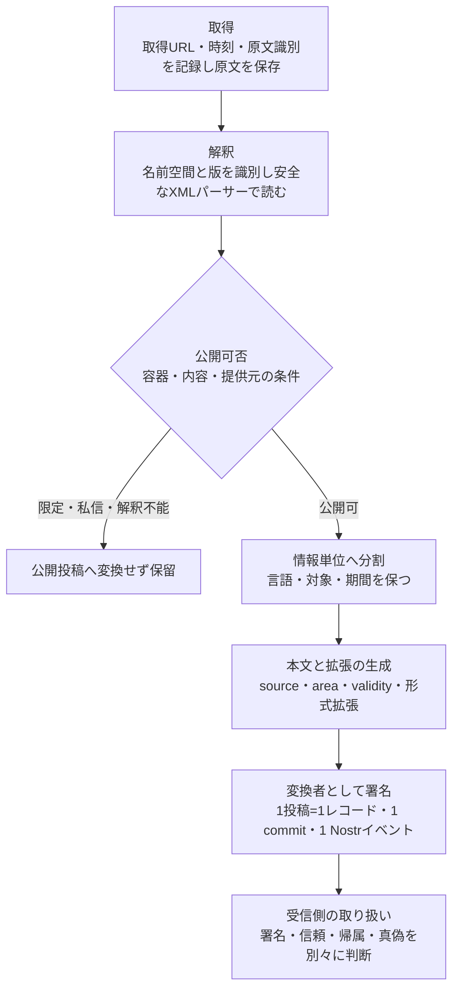
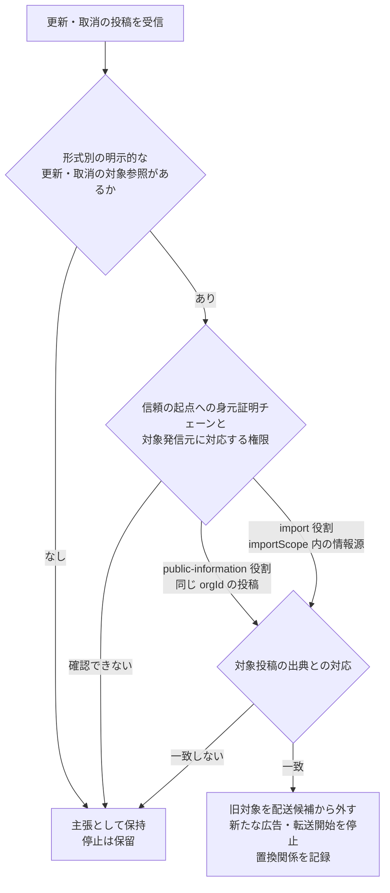

# 公的情報の取り込み

識別子: `dev.jisaku.mosimo.public`

## 目的

本プロトコルは、CAP・EDXL-DE・気象庁防災情報 XML などの公的情報を、人が読める本文と任意の構造化拡張を持つ共通投稿へ変換し、インターネットからメッシュへ持ち込む方式を定義する。定義する範囲は、取り込みサーバーへの信頼モデル、署名付きイベントの識別と区別した配送同値性、検証後の重複抑制、更新・取消による旧版の拡散停止、原文の保存と投稿への参照、出典拡張 `source`、形式ごとの投稿単位、既存 BSAF 投稿の AppView 統合である。形式ごとのフィールド対応は [CAP](cap/README.md)、[EDXL-DE](edxl/README.md)、[気象庁 XML](jma/README.md)、[BSAF](bsaf/README.md) に分ける。

保証するのは、信頼する変換者が規定の規則で変換した情報を、誰が持ち運んでも出典と変換経路を追跡でき、検証後に同じ元情報として扱えることである。保証しないのは、変換結果が原文全体を損失なく運んでいること、原文の参照先がオフライン中や将来にわたって到達できること、取り込みサーバーの署名が発表機関自身の署名に相当すること、置換の停止が未対応端末や未接触端末まで即時に及ぶこと、送信済みデータの回収、本文が同じという理由だけの個人投稿の統合である。

## 前提

| 識別子 | 文書 | 依存する理由 |
|---|---|---|
| `dev.jisaku.mosimo` | [../README.md](../README.md) | 投稿単位（1 投稿＝1 レコード・1 commit・1 Nostr イベント）、`Timestamp`、座標・距離の整数表現、拡張の open union と自己完結タグ、配送期限 |
| `dev.jisaku.mosimo.geo` | [../geo/README.md](../geo/README.md) | 影響範囲 `#area` と、原領域全体を覆う Geohash 近似 |
| `dev.jisaku.mosimo.validity` | [../validity/README.md](../validity/README.md) | 情報の有効期間 |
| `dev.jisaku.mosimo.annotation` | [../annotation/README.md](../annotation/README.md) | 対象投稿が判明した場合の訂正・補足の参照 |
| `dev.jisaku.mosimo.attest.chain` | [../attest/chain/README.md](../attest/chain/README.md) | 発表機関自身の発信と `public-information` 役割による更新・取消の認可 |
| `dev.jisaku.mosimo.attest.importer` | [../attest/importer/README.md](../attest/importer/README.md#3-受信者の認可) | 取り込みサーバーの認証（`import` 役割）と、受信者による自動投入の認可 |
| `dev.jisaku.mosimo.mesh` | [../mesh/README.md](../mesh/README.md) | 配送候補の広告・転送、配送期限・hop・資源上限 |

## 1. 信頼モデル

### 1.1 参加者

| 参加者 | 責務 | 署名が意味すること |
|---|---|---|
| 発表機関 | 原情報を発表する | 原情報自体の真正性。機関が本プロトコルで直接発信する場合は §1.3 |
| 取り込みサーバー（変換者） | 原情報を取得・保存し、規定の規則で共通投稿へ変換して自身の鍵で署名する | 「どこから得た何を、どの規則で変換したか」の証言 |
| 中継者 | 署名済み投稿を保持し、別の参加者へ届ける | 中継によって著者にはならない |
| 受信者 | 信頼する変換者を選び、検証した投稿を表示・メッシュ投入する | 自身の信頼設定とローカル選択 |

取得・変換・配布・原発表の四つの責務は、同じサーバーが担っても区別して記録する。取り込みサーバーの署名を発表機関自身の署名として表示してはならない。HTTPS による取得はサーバー認証と通信保護を提供するだけで、持ち運んだ本文を後からオフラインの第三者が検証できる発表機関の署名とは異なるためである。

### 1.2 取り込みサーバーへの信頼

インターネットから取得した情報は、情報源を特定でき、規定の変換によって誰が持ち込んでも元情報の同値性を判定できる取り込み方式を経てメッシュへ投入する。この方式を経ない無条件の投入は禁止する。出典を判定できない情報は検証も重複抑制もできず、限られたメッシュの帯域・保存枠を占有するためである。

受信者は複数の取り込みサーバーから信頼する対象を選ぶ。既定では信頼する 1 者の有効な署名で受理でき、複数者の一致は追加の確認とする。信頼済みの 1 者が侵害されると誤情報を受理し得るため、受信者はより厳格な方針（複数者の一致を必須とする等）を採用できる。

取り込みサーバーの認証は [`dev.jisaku.mosimo.attest.importer`](../attest/importer/README.md#3-受信者の認可) に従う。受信者は、信頼の起点へつながる身元証明チェーンの末端が `import` 役割と `organization` を持つことと、自身がローカルで選択した情報源に該当することを確認してからメッシュへ自動投入する。単なる DID の allowlist や、受信した証明からのルート自動採用で代用してはならない。受信データからルートを追加すると、侵害された 1 者が信頼の起点そのものを差し替えられるためである。

中継者を変換者として信頼する必要はない。誰でも、信頼する変換者の署名を維持したまま情報を持ち運べる。

### 1.3 発表機関自身による発信

発表機関が自らの鍵で署名・発信する場合、機関鍵は [`dev.jisaku.mosimo.attest.chain`](../attest/chain/README.md) の身元証明チェーンで認証し、末端は `public-information` 役割と `organization` を持つ。この役割は、同じ `organization.orgId` を持つ検証済みチェーンの投稿に対する更新・取消で旧版の拡散停止を認可する（§9）。

機関自身が秘密鍵を生成・管理し、公式経路で公開鍵を告知することを推奨する。第三者が秘密鍵を配布する構成は、鍵の所有と発表の責任が分離し、失効時に誰が発表者であったかを確定できなくなるため避けるべきである。

## 2. 入力形式と処理の流れ

### 2.1 入力形式の役割

| 入力 | 原情報の構造 | 取り込み側の責務 | 形式拡張 |
|---|---|---|---|
| CAP 1.2 | `alert` と複数の `info`。各 `info` に言語・指示・期間・複数 `area`・`resource` | 発表単位と、言語・対象ごとの情報単位を分けて読む | [`dev.jisaku.mosimo.public.cap`](cap/README.md) |
| EDXL-DE 1.0 | `EDXLDistribution` に配布メタデータと複数 `contentObject` | 配布容器を開き、各内容を対応する形式の処理へ渡す | [`dev.jisaku.mosimo.public.edxl`](edxl/README.md) |
| 気象庁 XML | `Report` の `Control`・`Head`・情報種別ごとの `Body` | 共通ヘッダに加え、電文別の意味・更新規則を読む | [`dev.jisaku.mosimo.public.jma`](jma/README.md) 以下 |
| BSAF v1 | 既存 `app.bsky.feed.post` の本文、`tags`、`langs` と Bot 定義 JSON | AppView が原投稿を保持し、表示・検索用の索引を追加する（§11） | [`dev.jisaku.mosimo.public.bsaf`](bsaf/README.md) |

EDXL（Emergency Data Exchange Language）は緊急情報交換の仕様群であり、DE（Distribution Element）はその配布容器である。DE に CAP を内包できるが、全ての EDXL 内容を CAP として解析してはならない。DE は任意の XML・非 XML 内容を運ぶため、名前空間を識別せずに CAP とみなすと無関係な文書を警報として投入するためである。

### 2.2 処理の流れ



1. **取得する。** 公式配信元等の許可した入力経路から取得し、取得 URL・取得時刻・原文識別情報を記録する。URL の掲載だけでは公式性を証明できない。
2. **入力を解釈する。** 名前空間と形式の版を識別し、安全な XML パーサーで読む。外部実体・DTD・外部参照の無条件取得は禁止し、サイズ・展開量・処理時間を制限する。外部参照の自動取得は取り込みサーバーを任意のネットワーク要求へ誘導し、展開量の無制限は資源枯渇を招くためである。
3. **公開可否を決める。** 容器・内容・提供元の条件を併せて評価する（§2.3）。
4. **意味のある情報単位に分ける。** DE の各内容、CAP の言語・対象・期間の違いを保ち、選択箇所と変換規則の版を記録する（§4）。
5. **本文と拡張を生成する。** 本文だけでも種別、発表元、対象、主要な指示、訂正・取消が分かるようにする。原時刻は UTC へ変換し、元表記や不確実性は形式拡張に残す。期間・領域が不明なら省略する。
6. **変換者として新規発信する。** 配送期限を確定し、変換者自身のレコードと署名付きイベントを生成する。`source`・`area`・`validity` と形式拡張は、それぞれ[コア](../README.md)の自己完結タグで独立して運ぶ。PDS は各形式の意味を知らなくても元の拡張オブジェクトへ戻せる。
7. **受信側で取り扱いを決める。** 署名の有効性、変換者への信頼、機関への帰属、内容の真偽を別々に扱う。§7 の条件を満たした原情報同値性に限って配送重複を抑制する。

### 2.3 公開可否と運用種別

容器・内容・提供元の条件を併せて評価し、限定配布・私信・解釈不能な制限を持つ内容は公開投稿へ変換してはならない。本プロトコルは公開情報のみを対象とし、一度メッシュへ投入した情報を回収する手段を持たないためである。制限の意味が分からない場合は公開投入を保留する。

訓練・試験・内部制御情報は実災害情報と区別し、実情報用の自動投入から外す。訓練・試験の投入は明示的に有効化した別の運用で扱う。

### 2.4 変換投稿の時刻

| 項目 | 意味 |
|---|---|
| `created_at` | 変換者が新規投稿を作成した時刻 |
| `exp` | 運用者が投稿時に絶対時刻として確定する配送期限。原情報の `expires` 等とは別に決める |
| `source.retrievedAt` | 取得時刻 |
| 形式拡張内の原時刻 | 原発表時刻・現象発生時刻・容器送信時刻。原表記を保持する |

配送期限から情報の有効期間を補ってはならない。配送期限は配送の打ち切り時刻であり、情報がいつの状況として有効かとは独立に運用者が決めるためである。

## 3. 原文の保存とメッシュへの変換

取り込み側は取得した原文を保存し、メッシュには人が読める本文と形式別に規定した構造化項目を含む署名付き投稿を配送する。投稿は原文全量の同梱なしで完結し、中継者は原文を取得・保存・解析せずに保持・配送できる。

- 投稿は原文を参照できる情報（`source.retrievedFrom`、`source.links`）を持ち、必要に応じて原文ハッシュ（`source.originalDigest`）を付ける。
- 本文だけでも主要な警報内容・指示・更新取消が分かるようにする。更新・取消の対象参照、対象地域・期間等の重要な適用条件を省略して意味を変えてはならない。本文は形式拡張に非対応の端末が利用する唯一の情報であり、適用条件を失うと別地域・別期間の利用者が自分への指示と誤読するためである。
- 原文ハッシュは原文バイト列の照合用である。ハッシュだけでは発表機関の真正性や意味的同値性を証明できない。
- サイズ削減は署名前の変換規則で行う。中継時に署名済み本文や拡張を削ってサイズ上限に収めてはならない。署名が壊れ、受信者が改変と区別できなくなるためである。

## 4. 投稿単位

### 4.1 CAP・EDXL-DE の投稿単位

CAP は各 `info` の意味を解釈した情報単位ごとに投稿を生成する。EDXL-DE は配布容器として扱い、各 `contentObject` とその内包文書を取り出し、それぞれの公開可否を評価して対応する形式の変換規則へ渡す。一つの DE に複数の CAP があれば、それぞれについて CAP の投稿単位を適用する。

| 投稿の項目 | 対応する情報単位から取り出す内容 |
|---|---|
| 本文 | 警報内容・主要な指示。原発表元、更新・取消の区別も示す |
| 原情報の識別 | CAP の発信者・電文 ID・発表時刻と、選択した `info` の識別情報 |
| `area` | 当該情報単位の影響範囲。変換できない場合は省略する |
| `validity` | 当該情報単位の有効期間。配送期限や別の `info` の期間で補わない |
| 原形式の情報 | CAP の状態・更新種別・緊急性・強度・確実性等（[CAP 拡張](cap/README.md)） |
| 容器の出典 | EDXL に内包されていた場合の配布元・配布 ID 等。CAP の発表者とは別に保持する（`source.containers`、[EDXL-DE 拡張](edxl/README.md)） |

生成された各投稿は独立した 1 レコード・1 commit・1 Nostr イベントとする。異なる言語・対象・期間を一つの本文・共通領域・共通期間へ混ぜてはならない。混ぜると、ある言語・対象の利用者が別の対象向けの期間や領域を自分に適用されるものとして読むためである。同一言語の後続 `info` が先行情報を拡張する場合は、その意味を解釈したうえで投稿化する。

`info` を持たない CAP の取消電文は、取消であることが本文だけでも分かり、取消対象の原情報参照を持つ通知投稿を 1 件生成する。対象未取得でも参照を保持する。EDXL の容器単位の取消は内包 CAP の取消とは別の層であり、置き換えてはならない（[EDXL-DE 拡張 §7](edxl/README.md#7-容器の更新取消と内包情報)）。

PDF 等の添付参照は関連リンク（`source.links`）として扱う。添付本体の自動配送や、添付の存在だけによる別の警報投稿の生成は行わない。

この分割により、情報単位ごとに影響範囲・期間を使って表示・配送順位を判断できる。異言語・異なる対象の投稿は、一件の配送をもって全件配送済みとは扱わない。

### 4.2 気象庁 XML の投稿単位

気象庁 XML は地域別の単独で読める投稿を基本とし、府県予報区等を基本単位、サイズ超過時だけ細分区域までとする。各投稿は必要な管理情報・震源・重要な共通文を自己完結して持つ。詳細は [気象庁 XML 共通 §6](jma/README.md#6-地域別投稿の原則) に定める。

## 5. 出典拡張 `source`

### 5.1 型

```ts
type SourceRef = {
  format: string;       // 形式と版。例: "cap-1.2"、"edxl-de-1.0"、"jma-xml-1.3"
  senderId: string;     // 原形式における発信者の識別子
  messageId: string;    // 原形式における電文・投稿の識別子
  sentAt?: Timestamp;   // 原形式の発表・送信時刻を UTC へ変換した値
  revision?: string;    // 原形式が持つ版・情報番号等。大小比較規則は形式別
  part?: string;        // 文書内の内容・言語等の選択箇所
};

type Digest = { algorithm: string; value: Bytes };

type SourceExtension = {
  $type: "dev.jisaku.mosimo.public#source";
  document: SourceRef;           // 本文・構造化情報の直接の出典
  containers?: SourceRef[];      // 外側から内側の配布容器。内容の著者とは別
  retrievedFrom: string;         // 実際の取得 URL
  retrievedAt: Timestamp;
  converter: string;             // 変換者の DID 等
  conversion: { rule: string; revision: string };
  originalDigest?: Digest;       // 取得した原文全体のバイト列のハッシュ
  links?: { url: string; mediaType?: string }[];
};
```

Lexicon は [lexicon.json](lexicon.json) に置く。

### 5.2 フィールドの意味

`source` は「どこから得た何を、誰がどの規則で変換したか」の主張であり、公的機関の認証結果を格納する真偽フラグではない。

| フィールド | 意味 |
|---|---|
| `document` | 本文と構造化情報の直接の出典。CAP なら `sender`・`identifier`・`sent`、気象庁 XML なら取得 URL・発表官署・`Serial` |
| `containers` | 外側から内側の順に並べた配布容器。EDXL-DE の `distributionID`・`senderID`・`dateTimeSent` |
| `retrievedFrom`・`retrievedAt` | 実際の取得 URL と取得時刻 |
| `converter` | 変換者の識別子。署名鍵との対応は投稿の署名と身元証明チェーンで確認する。自己申告だけでは署名との対応は成立しない |
| `conversion` | 変換規則の名称と版。配送同値キーの候補要素（§7） |
| `originalDigest` | §5.3 |
| `links` | 原文の保存先、添付、`web` 等の関連リンク |

`part` は文書内の選択位置を示す説明用の値である。`contentObject[0]` 等はゼロ始まりのローカル表記であり、容器内の位置は同じ内容でも変わり得るため、原情報 ID の代用にしてはならない。

### 5.3 原文ダイジェスト

`originalDigest` の対象は、取得した原文ファイルの全バイト列である。XML を再直列化したバイト列や、改行・文字コード・属性順序の違いを吸収する正規化ハッシュとは別物である。気象庁 XML については [気象庁 XML 共通 §9](jma/README.md#9-原文の保存とハッシュ) に HTTP の符号化解除を含むバイト境界と SHA-256 を定める。他形式のバイト境界とアルゴリズムの登録は未確定事項である。

atproto JSON では `Bytes` を標準の bytes 表現 `{"algorithm":"sha-256","value":{"$bytes":"..."}}` で表し、CBOR 内では byte string とする。

### 5.4 Nostr タグ

```text
タグ名: mosimo:ext:dev.jisaku.mosimo.public#source
タグ値: $type 以外の全フィールドの atproto deterministic CBOR を通常 Base64・padding なしで符号化
```

メッシュ用 CBOR への変換は[コア](../README.md)の共通規則に従う。

## 6. 形式拡張の独立性と部分対応

CAP・EDXL 等の形式の機能は、[コア](../README.md)の拡張モデルに従う独立した型として定義する。公式仕様の改訂や全クライアントの更新を待たず、第三者が独立した名前空間で型と対応クライアントの動作を定義できる。全ての原形式の項目を一つの汎用型へ集約する義務はない。

| 立場 | 扱い |
|---|---|
| 形式拡張に対応するクライアント | 形式固有の意味と動作を利用する。型の識別と機能の解釈は、その型自身で完結し、無関係な拡張の存在に依存しない |
| 取り込み側 | 本文だけでも主要な指示・更新取消を伝える。意味を正しく表現できる場合は共通の `area`・`validity` を併用し、形式拡張に非対応の端末にも利用可能な情報を提供する |
| 中継側 | 理解できる本文・拡張だけを利用して表示や配送を判断する。CAP に非対応でも、対応する `area` を使って地域別の配送順位を調整できる。理解しない形式拡張も改変せず保持・中継する |
| 固有拡張の対応クライアント | 独自の処理を実装できるが、その機能の採用と信頼はローカル方針で決める。署名検証・配送期限・サイズ・保存量等の制約は維持する |

未知型のフィールド名から原形式の詳細を推測してはならない。独立した型の同名フィールドは互いに別の意味を持つためである。共通拡張へ無理に当てはめる変換や、全形式への同じ組合せの必須化も行わない。原形式の意味を保てない変換は、非対応端末に誤った領域・期間を与えるためである。

気象庁 XML の共通管理情報は、別の必須拡張へ分離せず各形式拡張内に保持する。各投稿が他の投稿を取得せずに解釈できるようにするためである。

## 7. 配送同値性

署名付きイベント自身の ID と、同じ元情報の配送を抑制するための配送同値キーを分離する。

- 異なる投入者の Nostr event ID と署名は別物として保持する。atproto の commit とリポジトリ状態も投入者ごとに異なり得る。
- 検証済みの元情報が同値なら、配送上は例外的に同じグループとして扱い、冗長な配送を抑制する。
- 異なるイベントを合成して、元の著者署名があるかのように扱ってはならない。合成されたオブジェクトには対応する署名がなく、受信者が検証できないためである。
- 通常の個人投稿に、本文が同じという理由だけでこの例外を適用してはならない。別の著者による同文の投稿は別の証言であり、片方を抑制すると著者の署名付き発言が届かなくなるためである。

配送同値キーの候補となる要素は、正規化規則の版（`source.conversion`）、情報源 ID（`source.document.senderId`）、原情報 ID・版（`source.document.messageId`・`revision`）、正規化内容のハッシュである。ハッシュ対象のバイト列・フィールド、キー形式、代表イベントの選択は未確定事項である。

| 別々に評価する対象 | 理由 |
|---|---|
| 原文バイト列のハッシュ | 同じバイト列の照合に限る。別の容器から得た同じ CAP はハッシュが異なり得る |
| 原電文の識別 | 原情報 ID が同じでも内容差・版差・訂正・取消がある |
| 選択した言語・対象 | 同じ電文から生成した異言語・異なる対象の投稿は別の配送対象 |
| 変換結果の同値性 | 変換規則の版が違えば本文・拡張が違う |

訂正・取消・内容の相違を同じ対象として潰してはならない。内容が違う場合は、原情報 ID が同じであっても別の対象として扱う。同じ CAP が異なる DE に内包されていても、内包元の容器や公開条件の違いは保持する。容器 ID・配列位置だけで内包情報の同値性を決めてはならない。容器内の位置は内容の同一性を示さないためである。

## 8. 検証と重複抑制

例外的な重複排除は、信頼する情報源・変換者に基づき、データの検証後に適用する。自己申告のキーや未検証の inventory 広告だけで配送済みとしてはならない。未検証の広告を根拠に配送を止めると、偽の広告で正当な情報の配送を妨害できるためである。

受信者は最低限イベント ID で重複を抑止する。異なる変換者が同じ原情報を変換した場合、それぞれ別の署名付き投稿である。

原情報の内容が同値であっても、異なる投入者の署名済み commit・適用元 commit CID・レコード・repository path はそれぞれ保持する。メッシュ上の本文配送の重複抑制と、各リポジトリの完全な同期を両立する方法は未確定事項である。

再取得・再バンドルを配送期限の延長理由にしてはならない。古い原文の再取得で配送期間を繰り返し延ばすと、配送期限による打ち切りが機能しなくなるためである。

## 9. 更新による置換と旧版の拡散停止

### 9.1 単独で読める新規投稿

更新後の内容は、取り込み側が本文・領域・期間・適用条件を含む単独で読める新規投稿として生成・署名する。差分だけを配送して受信側に旧投稿の取得を要求する方式は禁止する。メッシュでは旧投稿が届いていない端末が多数あり、差分では意味を復元できないためである。更新後の内容を確定できない場合は、旧版を推測で混ぜて完全な最新版を作ったことにしてはならない。

取消は「この警報は取り消された」という現在の通知として伝える。取消通知の配送期限は通知自身について確定し、先行警報の終了時刻をコピーしてはならない。取消が旧警報と同時に配送を終えると、取消を知らない端末に旧警報だけが残るためである。先行電文への参照は、先行投稿が未取得でも保持する。

### 9.2 認可



旧版の拡散を止める認可は、一般の取り込み受理とは分ける。各受信者が事前に保持する信頼の起点への身元証明チェーンと、対象の発信元に対応する権限範囲を必要とする。

| 経路 | 認可の根拠 | 文書 |
|---|---|---|
| 発表機関自身の発信 | 末端が `public-information` 役割と `organization` を持ち、対象が同じ `organization.orgId` の検証済み投稿 | [../attest/chain/README.md](../attest/chain/README.md) |
| 取り込みサーバー経由 | 末端が `import` 役割・`importScope`・`organization` を持ち、原情報の続報・訂正・取消を転載した投稿が受信者のローカル選択内で認可されたとき、同じ情報源の旧版 | [../attest/importer/README.md](../attest/importer/README.md#3-受信者の認可) |

取り込みサーバーを単に信頼する設定、投稿の Nostr 署名の正しさ、原形式の発信元の自己申告（CAP の `sender` 等）だけでは認可してはならない。これらは誰でも生成でき、任意の第三者が公的警報の拡散を止められるためである。認可を確認できない場合は、更新の主張と未確認状態を保持し、旧情報の拡散停止は保留する。

### 9.3 停止の範囲と記録

形式ごとに定める明示的な更新・取消の対象と、§9.2 の認可を確認した端末は、対象の旧情報を新たな配送候補から外し、広告・転送開始を停止する。到着順・本文一致・自己申告の新しい時刻だけで置換を決めてはならない。遅延の大きいメッシュでは到着順と発表順が一致しないためである。

対象未取得の場合も認可済みの参照を記録し、旧版が後から到着したときの再拡散を防ぐ。

| 形式 | 停止の対象 | 文書 |
|---|---|---|
| CAP `Update`／`Cancel` | `references` が明示する原電文から生成された投稿群。同じ旧原電文の言語・対象別投稿を含む。新電文だけに基づいて新しい情報単位を発行する | [CAP 拡張 §6.1](cap/README.md#61-原電文単位の置換) |
| EDXL-DE `Cancel` | 対象容器由来の投稿だけ。同じ内包 CAP を別の容器や直接配信から取り込んだ別投稿には及ばない。配布の撤回として表示する | [EDXL-DE 拡張 §7.1](edxl/README.md#71-容器由来の投稿の取消) |
| EDXL-DE `Update` | 新容器の内容だけで投稿群を再発行し、明示的に参照された旧容器由来の投稿群を停止する。旧容器だけにあった内容の欠落は配布対象から外れたことだけを示す | [EDXL-DE 拡張 §7.2](edxl/README.md#72-新容器の内容による再発行) |
| 気象庁 XML | 同じ独立した情報単位の旧版 | [気象庁 XML 共通 §5](jma/README.md#5-独立した情報単位と続報訂正取消) |

任意の投稿が自己申告した出典の文字列一致だけで、別の投稿まで公式の置換対象にしてはならない。対象投稿の原情報への対応を確認して適用する。

この停止は配送上の扱いであり、旧投稿・署名・atproto の履歴の削除や改変ではない。更新・取消の新投稿自体は独立した配送対象とし、旧対象と一緒に停止してはならない。新投稿が止まると置換の事実そのものが届かなくなるためである。通常の配送期限・hop・ローカル資源上限は引き続き適用する。一般の原情報同値性による重複抑制（§7）とも区別する。機関の取消通知を変換者が伝えることは、他者の投稿を NIP-09 で削除する権限とは別である。

本プロトコル内の対象投稿が判明した場合は [注釈](../annotation/README.md) の参照と関連付ける。原情報から派生した投稿への対応索引は取り込み側・AppView で持つ。原電文 ID を Nostr event ID や at-URI の代わりに使ってはならない。原電文 ID は投稿の識別子ではなく、同じ原電文から複数の投稿が生成されるためである。

## 10. 共通領域への近似と変換不能時の扱い

CAP の多角形、気象庁等の地域コードは、そのまま共通 `area` の Geohash ではない。取り込み側が原領域と必要な境界資料を解釈できる場合、元領域全体を覆う Geohash セルの和集合へ近似できる（[影響範囲](../geo/README.md)）。

- 近似は `area` 自体に明示し、元の地域名・コード等は本文や形式拡張に保持する。近似セルに含まれるだけでは厳密な警報対象ではない。
- 中継者はセルの領域を配送順位に利用できる。中継者は行政境界資料や CAP 等の解析なしに、セルだけで判断できる。
- セル数を減らす場合も粗いセルで全体を覆う。一部を切り捨てると、対象地域の一部で配送順位が下がるためである。
- 元領域の一部だけしか解決できず全体を覆えない場合は、共通 `area` を省略して地域不明とし、形式拡張側に領域情報を保持する。一部の円だけを完全な元領域として発行したり、地域名から推測した中心点や震源を使った便宜的な円に置き換えたりしてはならない。実際には対象でない地域へ配送を集中させ、対象内の地域を外すためである。
- 高度条件を無視した二次元表示では、原情報の適用条件を失ったと誤認させないよう、高度条件を本文と形式拡張に残す。

EDXL-DE の `targetArea` は配布対象であり、近似変換によって内包警報の影響範囲へ置き換えてはならない。BSAF の `target:` も必ずしも地理的範囲ではない。

## 11. AppView 統合

AppView は、本プロトコルの投稿と、既存 BSAF 投稿を別入力として収集し、一覧・地図表示で併置する。既存 BSAF 投稿の収集は、本プロトコルへの取り込み（メッシュ投入）とは独立であり、メッシュ投入は [BSAF 拡張](bsaf/README.md) の明示的な選択によってのみ開始する。

### 11.1 BSAF の別入力

```ts
type BsafAppViewInput = {
  authorDid: string;
  atUri: string;
  cid: string;
  record: object; // 取得した app.bsky.feed.post。書き換えない
  retrievedFrom: string;
  retrievedAt: Timestamp;
  botDefinitionUrl?: string;
  botDefinitionRetrievedAt?: Timestamp;
};
```

これは AppView 内部の収集データであり、投稿 Lexicon ではない。表示用の派生索引は元の `record` と分離して次の情報を持つ。

| BSAF 入力 | 派生索引の型・用途 | 混同しないもの |
|---|---|---|
| `bsaf:v1` | 対応する規約版 | 本プロトコルの版 |
| `type:` | 文字列。情報種別 | 防災以外の種別も存在する |
| `value:` | 文字列。規模・程度 | 数値、配送優先度 |
| `time:` | 原イベント時刻の文字列 | 投稿の `created_at`・有効期間・配送期限 |
| `target:` | 文字列。対象コード | Geohash・緯度経度 |
| `source:` | 文字列。原情報源の識別 | 発信 Bot の DID、機関の署名 |
| `text`・`langs` | 本文と原投稿の言語配列 | 自動翻訳・要約 |
| Bot 定義の `filters` | `type`・`value`・`target` の選択肢と表示ラベル | タグ値の数値化 |

処理は、既存投稿の取得 → 元レコードの保持 → 対応版のタグ解釈 → Bot 定義と照合した表示用索引 → 本プロトコルの投稿と併置した一覧・地図表示、の順とする。索引は派生データであり、元投稿の署名対象フィールドを補修・書換えしてはならない。原レコード、著者 DID、at-URI、取得したレコードの CID、本文と `source:` による出典を保持する。at-URI はレコードの場所、CID は取得した内容の識別であり、同じ at-URI を再取得して内容が変わった場合は別の内容として扱う。

`target:` から正確な境界を推測してはならない。境界への対応資料がなければ地図上では領域不明とし、本文・タグ値は表示する。`source:jma` や Bot 定義の名称だけでは気象庁公式 Bot や機関署名とは認定できない。

異なる Bot 間の `type + value + time + target` による重複折りたたみは表示規則である。この組は原電文 ID・内容ハッシュ・真正性を含まないため、§7 の配送同値キーや §9 の取消判定へ流用してはならない。折りたたんでも各原投稿・著者・CID・出典を保持する。

BSAF から Nostr・メッシュへの再配信、タグ・言語・原投稿参照の型、BSAF 形式での別途公開は [BSAF 拡張](bsaf/README.md) に定める。

## 12. 変換例: EDXL-DE に内包された CAP

架空の公開配信から取得した DE 1.0 XML の要点を、解析後の JSON で示す。EDXL の正式 JSON 表現ではない。`combinedConfidentiality` は DE 1.0 付録 A の要素名を用いる。

```json
{
  "EDXLDistribution": {
    "distributionID": "distribution-001",
    "senderID": "dispatch@example.org",
    "dateTimeSent": "2026-10-17T12:00:00+09:00",
    "distributionStatus": "Actual",
    "distributionType": "Report",
    "combinedConfidentiality": "UNCLASSIFIED AND NOT SENSITIVE",
    "targetArea": [{ "country": "JP" }],
    "contentObject": [
      {
        "contentDescription": "例市の避難情報",
        "confidentiality": "UNCLASSIFIED AND NOT SENSITIVE",
        "xmlContent": {
          "embeddedXMLContent": [
            {
              "alert": {
                "namespace": "urn:oasis:names:tc:emergency:cap:1.2",
                "identifier": "alert-001",
                "sender": "alerts@example.org",
                "sent": "2026-10-17T12:00:00+09:00",
                "status": "Actual",
                "msgType": "Alert",
                "scope": "Public",
                "info": [
                  {
                    "language": "ja",
                    "category": ["Safety"],
                    "event": "避難情報",
                    "urgency": "Immediate",
                    "severity": "Severe",
                    "certainty": "Observed",
                    "effective": "2026-10-17T12:00:00+09:00",
                    "expires": "2026-10-17T15:00:00+09:00",
                    "senderName": "例市",
                    "headline": "例地区の避難情報",
                    "instruction": "例地区では指定避難所へ避難してください。",
                    "area": [{ "areaDesc": "例地区", "circle": "35.0,139.0 2.5" }]
                  }
                ]
              }
            }
          ]
        }
      },
      {
        "contentDescription": "避難所案内PDF",
        "nonXMLContent": { "mimeType": "application/pdf", "uri": "https://example.org/shelters.pdf" }
      }
    ]
  }
}
```

提供元の公開配信プロファイルにより、容器全体と両内容の公開再配布が可能と判断できたものとする。CAP の `info[0]` から一件の共通投稿を生成する。PDF は関連リンクとして記録する。

```json
{
  "$type": "dev.jisaku.mosimo.post",
  "text": "【例市・避難情報】例地区では指定避難所へ避難してください。\n発表: 2026-10-17 12:00 JST\n情報の有効期間: 12:00〜15:00 JST\n出典: 例市（配布: dispatch@example.org）。取り込みサーバーによる変換。\n避難所案内: https://example.org/shelters.pdf",
  "exp": "2026-10-17T04:00:00Z",
  "ext": [
    {
      "$type": "dev.jisaku.mosimo.public#source",
      "document": {
        "format": "cap-1.2",
        "senderId": "alerts@example.org",
        "messageId": "alert-001",
        "sentAt": "2026-10-17T03:00:00Z",
        "part": "info[0]"
      },
      "containers": [
        {
          "format": "edxl-de-1.0",
          "senderId": "dispatch@example.org",
          "messageId": "distribution-001",
          "sentAt": "2026-10-17T03:00:00Z",
          "part": "contentObject[0]/xmlContent/embeddedXMLContent[0]"
        }
      ],
      "retrievedFrom": "https://example.org/distributions/001.xml",
      "retrievedAt": "2026-10-17T03:00:05Z",
      "converter": "did:example:ingester",
      "conversion": { "rule": "example-de-cap-text", "revision": "a" },
      "links": [{ "url": "https://example.org/shelters.pdf", "mediaType": "application/pdf" }]
    },
    {
      "$type": "dev.jisaku.mosimo.public.cap",
      "message": { "sender": "alerts@example.org", "identifier": "alert-001", "sent": "2026-10-17T12:00:00+09:00" },
      "status": "Actual",
      "msgType": "Alert",
      "scope": "Public",
      "references": [],
      "info": {
        "index": 0,
        "language": "ja",
        "categories": ["Safety"],
        "event": "避難情報",
        "urgency": "Immediate",
        "severity": "Severe",
        "certainty": "Observed",
        "effective": "2026-10-17T12:00:00+09:00",
        "expires": "2026-10-17T15:00:00+09:00",
        "senderName": "例市",
        "headline": "例地区の避難情報",
        "instruction": "例地区では指定避難所へ避難してください。",
        "areas": [{ "areaDesc": "例地区", "circles": ["35.0,139.0 2.5"] }]
      }
    },
    {
      "$type": "dev.jisaku.mosimo.public.edxl",
      "distribution": { "distributionID": "distribution-001", "senderID": "dispatch@example.org", "dateTimeSent": "2026-10-17T12:00:00+09:00" },
      "distributionStatus": "Actual",
      "distributionType": "Report",
      "combinedConfidentiality": "UNCLASSIFIED AND NOT SENSITIVE",
      "references": [],
      "targetAreas": [{ "countries": ["JP"] }],
      "content": { "index": 0, "embeddedXMLIndex": 0, "documentIndex": 0, "contentDescription": "例市の避難情報", "confidentiality": "UNCLASSIFIED AND NOT SENSITIVE" }
    },
    {
      "$type": "dev.jisaku.mosimo.geo#area",
      "regions": [{ "shape": "circle", "lat": 35000000, "lon": 139000000, "r": 2500000 }]
    },
    {
      "$type": "dev.jisaku.mosimo.validity",
      "from": "2026-10-17T03:00:00Z",
      "until": "2026-10-17T06:00:00Z"
    }
  ]
}
```

| 入力・判断 | 出力・処理 |
|---|---|
| DE の送信者・配布 ID・送信時刻 | `source.containers[0]`。CAP 発表者とは別に保持 |
| `contentObject[0]` 内の CAP | `source.document` と `cap.message`。取得経路と CAP 自身の識別を分ける |
| CAP の `info[0]` | 日本語の本文と、その情報単位の期間・領域 |
| DE の `targetArea.country = JP` | `edxl.targetAreas` に配布意図として保持。警報の影響範囲ではない |
| CAP の `scope = Public` と提供元プロファイル | 公開可と判断した内容のみ投稿生成 |
| `headline`・`instruction`・`senderName` | 単独で読める本文と、原情報の意味を持つ CAP 拡張 |
| `sent`、DE の `dateTimeSent` | UTC 変換した値を `source` に、原表記を形式拡張に保持 |
| 取得・投稿生成 | `retrievedAt = 03:00:05Z`、`created_at = 03:00:10Z` |
| `effective`・`expires` | `validity` の `03:00:00Z`〜`06:00:00Z` |
| 運用者の配送判断 | `exp = 04:00:00Z`。内容の終了時刻とは独立 |
| 座標 `35.0,139.0`、半径 `2.5` km | `lat = 35000000`、`lon = 139000000`、`r = 2500000`。CAP 文字列も形式拡張に保持 |
| `contentObject[1]` の PDF 参照 | 本文・出典の関連リンク |
| `references` なし | 新規発表として空配列 |
| 生成された一件の `Post` | 1 レコード・1 commit・1 Nostr `kind: 1`。`content` に `text` |

別の `contentObject` にもう一つの CAP があれば、それも独立に公開可否を評価して情報単位ごとに投稿を生成する。取り込み側には、どの内容を投稿化し、どの内容をリンク扱い・非対応・制限ありとして保留したかを記録する。`did:example:ingester`、URL、変換規則名、期限は例示である。

## 未確定事項

- 信頼リストの発行・更新・失効方式と、既定の取り込みサーバーの運用主体。
- 原情報の真正性の追加確認方式: 接続可能な受信者による公式情報との照合、独立した複数サーバーの取得結果一致、TLS 取得証明等。採用時は証明者・検証者の信頼仮定と通信量を確認する。
- 原形式の発信元識別子（CAP `sender`、気象庁の発表官署等）と、身元証明チェーンの `organization.orgId`・`importScope` との対応。
- 配送同値キーのハッシュ対象バイト列・フィールド、キー形式、アルゴリズム、代表イベントの選択、追加署名の取得、代表イベントへの削除要求、保持・追放。
- 置換記録の保持期限・資源上限、失効や相反する更新を受けた場合の再評価、原情報参照から派生投稿への索引の具体形式。
- メッシュ上の本文配送の重複抑制と、各リポジトリの完全な同期の両立方法。再バンドルによる配送期限・配送枠のリセットを防ぐ規則。
- 原文の具体的な保存場所・保持期間・参照形式、CAP・EDXL-DE の原文ハッシュのバイト境界とアルゴリズム、取得の証言と変換の証言を結び付ける形式。
- `source` の各フィールドのサイズ上限、`format` の登録値、`part` の符号化。
- 変換規則の公開方法、本文の決定的生成規則、言語選択。
- `exp` の形式別の既定期間。
- EDXL-DE の自由記述の機密区分・宛先・役割・組織固有プロファイルから公開可否を決める運用。限定内容を取り除いた再編集の可否。
- 共通領域近似の具体的なアルゴリズム・精度・セル数・境界資料の版。

## 参照

- [atproto Data Model](https://atproto.com/specs/data-model) — 浮動小数点数の不許可、整数、bytes の JSON 表現
- [OASIS Common Alerting Protocol Version 1.2, OASIS Standard, 2010-07-01](https://docs.oasis-open.org/emergency/cap/v1.2/CAP-v1.2-os.html)
- [OASIS EDXL Distribution Element Version 1.0, OASIS Standard, 2006-05-01](https://docs.oasis-open.org/emergency/edxl-de/v1.0/EDXL-DE_Spec_v1.0.pdf)
- [気象庁防災情報 XML 情報提供ページ](https://xml.kishou.go.jp/)
- [気象庁 XML 形式電文の公開（PULL 型）](https://xml.kishou.go.jp/xmlpull.html)
- [気象庁 XML 技術資料一覧](https://xml.kishou.go.jp/tec_material.html)、[XML フォーマット Ver.1.3 本文（2022-12-09 版）](https://xml.kishou.go.jp/jmaxml_20221209_format_v1_3.pdf)
- [気象庁 XML スキーマ一式（2024-10-31 版）](https://xml.kishou.go.jp/jmaxml_20241031_Schema(xsd).zip)
- [Bluesky Structured Alert Feed 日本語仕様（commit a658ba0）](https://github.com/osprey74/bsaf-protocol/blob/a658ba0af36dfb011192540f7b669fd52901ba37/docs/bsaf-spec-ja.md)
