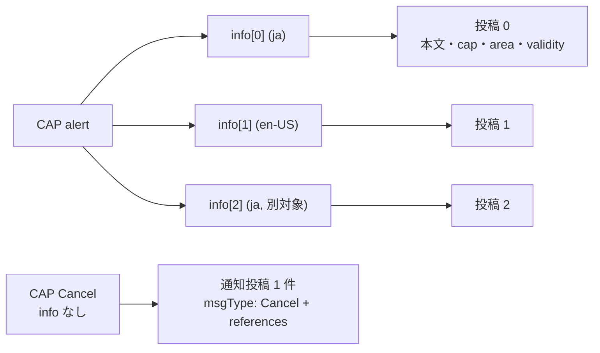

# CAP 1.2 拡張

識別子: `dev.jisaku.mosimo.public.cap`

## 目的

本プロトコルは、OASIS CAP 1.2（XML 名前空間 `urn:oasis:names:tc:emergency:cap:1.2`）の原情報の意味を保持する拡張と、人が読める基本投稿・共通拡張への対応を定義する。定義する範囲は、原電文・選択した情報単位・更新取消参照・CAP 固有の語彙を保持する型、情報単位ごとの投稿化、共通の影響範囲・有効期間への投影、更新・取消による原電文単位の置換、配送での利用である。

保証するのは、この型だけで CAP の形式・版を識別でき、選択した情報単位の指示・対象・期間・語彙を原表記のまま利用できることである。保証しないのは、CAP XML の完全復元、すべての国・組織の CAP プロファイルへの対応、同一言語で対象が重なる複数 `info` を常に独立した投稿へ分けられることである。

## 前提

| 識別子 | 文書 | 依存する理由 |
|---|---|---|
| `dev.jisaku.mosimo` | [../../README.md](../../README.md) | 投稿単位、`Timestamp`、座標・距離の整数表現、拡張の自己完結タグ、32 KiB 上限 |
| `dev.jisaku.mosimo.public` | [../README.md](../README.md) | 取り込みの信頼モデル、原文保存、出典 `#source`、更新による置換の認可、配送同値性 |
| `dev.jisaku.mosimo.geo` | [../../geo/README.md](../../geo/README.md) | 影響範囲 `#area` と全体を覆う近似 |
| `dev.jisaku.mosimo.validity` | [../../validity/README.md](../../validity/README.md) | 情報の有効期間 |

## 1. 役割分担

| 拡張 | 担当 |
|---|---|
| `dev.jisaku.mosimo.public.cap` | 原電文、選択した情報単位、更新取消参照、CAP 固有の語彙 |
| `dev.jisaku.mosimo.public#source` | 取得 URL・取得時刻・変換規則・外側の配布容器の追跡 |
| `dev.jisaku.mosimo.geo#area` | 共通の二次元の領域判定と配送順位に利用できる影響範囲 |
| `dev.jisaku.mosimo.validity` | 共通の内容有効期間 |

CAP 拡張は原形式の条件を残し、共通拡張は CAP 非対応端末にも利用できる表現を提供する。CAP の版と変換規則の改訂は別であり、非互換な拡張変更には新しい `$type` を用いる。本型は `source`・EDXL 拡張・オンラインのスキーマ取得がなくても解釈できる。

## 2. データ型

`integer` は atproto データモデルの整数とする。XML の数値・日時の原表記を保持する項目は文字列である。

```ts
type CapReference = {
  sender: string;
  identifier: string;
  sent: string; // CAP 原文のオフセット付き日時。共通 Timestamp ではない
};

type CapValue = { valueName: string; value: string };

type CapArea = {
  areaDesc: string;
  polygons?: string[]; // WGS 84 の座標列。原文字列を保持
  circles?: string[];  // "緯度,経度 半径km" の原文字列
  geocodes?: CapValue[];
  altitude?: string;   // 原単位の feet
  ceiling?: string;
};

type CapResource = {
  resourceDesc: string;
  mimeType: string;
  size?: string;       // 原形式の整数の文字列表記
  uri?: string;
  digest?: string;     // CAP の resource digest（SHA-1）。原文ハッシュではない
};

type CapInfo = {
  index: integer;      // 元 CAP の全 info を文書順に数えたゼロ始まり位置
  language?: string;
  categories: string[];
  event: string;
  responseTypes?: string[];
  urgency: string;
  severity: string;
  certainty: string;
  audience?: string;
  eventCodes?: CapValue[];
  effective?: string;
  onset?: string;
  expires?: string;
  senderName?: string;
  headline?: string;
  description?: string;
  instruction?: string;
  web?: string;
  contact?: string;
  parameters?: CapValue[];
  resources?: CapResource[];
  areas?: CapArea[];
};

type CapExtension = {
  $type: "dev.jisaku.mosimo.public.cap";
  message: CapReference;
  status: string;
  msgType: string;
  scope: string;
  references: CapReference[];
  source?: string;     // CAP alert/source。共通 source 拡張ではない
  restriction?: string;
  addresses?: string;  // CAP の引用符付きリストを含む原文字列
  codes?: string[];
  note?: string;
  incidents?: string;  // CAP の引用符付きリストを含む原文字列
  info?: CapInfo;
};
```

| CAP 1.2 | 拡張内の配置 |
|---|---|
| `alert/sender`・`identifier`・`sent` | `message` |
| `alert/references`（`sender,identifier,sent` の組の列） | `references`。組ごとに三項目へ分解した配列 |
| `alert/source` | `source`（文字列） |
| `category`・`responseType`・`eventCode`・`parameter`・`resource`・`area` | それぞれ複数形の配列。文書内の出現順を保つ |
| `polygon`・`circle`・`geocode` | `polygons`・`circles`・`geocodes` |
| `altitude`・`ceiling` | 原単位 feet の文字列。整数ミリメートルへ読み替えない |
| `resource/derefUri` の添付本体、XML 署名本体 | 拡張へ格納しない |

`info.index` は元文書内の選択位置であり、別電文の同一性や配送同値性のキーとして単独で使ってはならない。別電文で同じ位置に別の内容が置かれ得るためである。

CAP のテキストは XML パーサーが返す文字列を保持する。省略された任意項目は省略し、存在する空文字列と区別する。複数回出現する項目は出現順を保つ配列とし、`valueName` をキーにした辞書へ潰してはならない。CAP では同じ `valueName` が複数回現れ得るためである。既知型の未知フィールドも保持する。

`language` が省略または空の場合、CAP 対応クライアントは CAP の既定値 `en-US` として解釈する。元の省略・空文字列はそのまま保持し、原文で明示されたかどうかを区別できるようにする。

CAP の resource `digest` は CAP 1.2 が定める SHA-1 の値であり、`source.originalDigest` とは別物である。発表機関の認証には使えない。

## 3. 語彙と自動投入

文字列は CAP の値と大文字小文字を保持し、共通の列挙値へ読み替えない。

| 項目 | CAP 1.2 の値 |
|---|---|
| `status` | `Actual`、`Exercise`、`System`、`Test`、`Draft` |
| `msgType` | `Alert`、`Update`、`Cancel`、`Ack`、`Error` |
| `scope` | `Public`、`Restricted`、`Private` |
| `urgency` | `Immediate`、`Expected`、`Future`、`Past`、`Unknown` |
| `severity` | `Extreme`、`Severe`、`Moderate`、`Minor`、`Unknown` |
| `certainty` | `Observed`、`Likely`、`Possible`、`Unlikely`、`Unknown` |

`Very Likely` の互換処理は CAP の意味解釈に従うが、署名対象の文字列を `Likely` へ書き換えてはならない。未知・空の値を最上位の強度や `Actual` として扱ってはならない。欠落を最も強い値で埋めると、根拠のない情報が最優先で配送されるためである。

実災害向けの自動投入は、信頼設定と提供元の公開再配布条件を確認したうえで、既定では `Actual`・`Public` の `Alert`／`Update`／`Cancel` を対象とする。`Ack`／`Error` はメッシュ転送の受理応答ではない。訓練・試験は明示的に有効化した別の運用で扱う。

`scope: Public` は無制限の対象への一般配布、`Restricted` は業務上必要な利用者への配布、`Private` は指定アドレスへの配布である。後二者を地域絞り込みだけで公開配送してはならず、限定内容を `scope: Public` に変えて投入してもならない。本プロトコルは公開情報のみを運び、投入後に回収できないためである。外側の容器（EDXL 等）により強い制限があれば、内側が `Public` でも公開してはならない。容器の制限は CAP 拡張に複製されず、取り込み時にだけ評価できるためである。

## 4. 投稿単位と本文



通常は選択した `info` 一つを `info` に格納し、選択した情報単位の主要な指示・対象・期間が単独で分かる基本本文を生成する。元電文の他の言語・対象の情報を、選択した情報単位の指示として混ぜてはならない。

本文は、発表／更新／取消の区別、発表元、標題（なければ `event`）、対象地域・対象者、`description`・`instruction`、重要な期間・高度条件を伝え、変換者による転載であることを示す。`responseType` だけから具体的な避難先等を創作してはならず、本文を一律に切り詰めて指示や適用条件を落としてもならない。

同一言語の対象が重なる `info` は、CAP の規則により後続が先行情報を拡張することがある（上書きではない）。原情報の意味を独立して表せない場合は、機械的に切り出して投入してはならず、取り込み側で保留する。中継端末は原 CAP を取得できず、不足した文脈を補えないためである。

`info` がない取消では `info` を省略し、`msgType: Cancel` と `references` を持つ通知投稿を 1 件生成する。取得済みの対象だけへ参照を絞らず、未取得の対象も保持する。`info` のない通常警報について、架空の領域・指示・強度を補って投稿化してはならない。

## 5. 共通拡張への対応

### 5.1 時刻と validity

| 入力 | 出力・意味 |
|---|---|
| `message.sent` | 原発表時刻。投稿の `created_at` とは別 |
| `info.effective` | UTC に変換して `validity.from` の候補 |
| `effective` が省略 | CAP の規則で `sent` を有効開始として用いる |
| `info.expires` | UTC に変換して `validity.until` の候補 |
| `expires` が省略 | 終了不明。`until` を省略する |
| `info.onset` | 現象の開始。`from`・投稿時刻とは別 |

存在する空値・解釈不能な値を、省略に対する既定値で埋めてはならない。共通型へ変換できない端点は不明として扱う。原表記は CAP 拡張に残す。CAP 1.2 の時刻表記は数値オフセットを要求し UTC を `-00:00` とするため、共通型の `Z` 表記を CAP 原文へ書き戻してはならない。

`exp` は投稿作成時に運用者が別に確定する。取消通知には、取り消す警報の古い有効終了を配送期限として流用してはならない。取消が旧警報の終了と同時に配送を終えると、取消を知らない端末に旧警報だけが残るためである。未来に有効になる情報も、配送自体を開始時刻まで待たせる必要はない。

### 5.2 領域と area

選択した情報単位の全 `area` と、その各要素の和集合を対象として扱う。CAP の円の中心は WGS 84、半径は km であり、共通表現では座標を 100 万分の 1 度、半径をミリメートルへ変換する。円の半径 0 を拡大して警報対象を作ってはならない。

多角形・解決済み地域コードは[影響範囲](../../geo/README.md)の全体を覆う Geohash 近似を利用できる。元領域全体を扱えなければ共通 `area` を省略する。`areaDesc` だけから位置を推測してはならず、`geocode` の `valueName` が示すコード体系を無視してもならない。

共通 `area` は二次元の配送判断用であり、CAP の `altitude`・`ceiling` を消去する根拠ではない。高度条件は原形式側と本文に残す。

## 6. 更新・取消の関係

CAP の原情報参照は `sender`・`identifier`・`sent` の組で扱う。時刻を照合する場合は表記ではなく時点を比較し、受信した署名対象文字列は書き換えない。電文 ID だけの一致や、同じ事案を示す `incidents` だけで更新対象・同一電文と扱ってはならない。`identifier` は `sender` の中で一意であり、`incidents` は電文の同一性ではなく事案の関連付けであるためである。

`Update`／`Cancel` は元電文を参照する新しい通知として保持する。更新は差分ではなく更新後の内容だけで読める投稿として生成し、新電文にない旧内容を推測で引き継がない。`AllClear` という応答種別、警報期間の終了、誤発表の取消、NIP-09 による投稿削除は別の意味である。元電文の参照を at-URI・Nostr event ID として流用してはならない。

### 6.1 原電文単位の置換

`Update`／`Cancel` の `references` が明示する原電文から生成された投稿群を置換対象とする。対象は旧原電文の各言語・各情報単位の投稿を含む。明示的な更新関係のない後着電文を最新版として上書き採用してはならない。

認可は [公的情報の取り込み §9.2](../README.md#92-認可) に従う。身元証明チェーンで証明された発信元・用途・対象範囲と、CAP の原発信元・対象関係を対応付ける。投稿の Nostr 署名だけ、CAP の `sender` の自己申告だけ、取り込みサーバーへの一般的な信頼だけで認可してはならない。いずれも第三者が任意に作れるためである。

認可済みの置換を確認した端末は、旧対象を配送候補から外し、新たな広告・転送の開始を停止する。対象が未取得でも置換関係を記録し、後着した旧版の再拡散を抑える。停止の対象は、対象投稿の出典（`source.document`）が参照された原電文と対応することを確認した投稿に限る。

認可を確認できない場合は、更新の主張と未確認状態を保持し、旧情報の拡散停止は保留する。更新・取消通知自体は通常の上限内で配送を続ける。

この置換は後続の CAP 電文によるものであり、一つの電文内の同一言語の `info` を後勝ちで上書きする規則ではない。

## 7. 配送と部分実装

| 対応範囲 | 利用可能な処理 |
|---|---|
| 基本投稿のみ | 本文表示、署名・配送期限・サイズ・資源上限に従う保持転送 |
| 共通 area／validity | 原形式を知らずに地域別の配送順位や有効期間の表示を調整 |
| CAP 拡張 | CAP の語彙・対象参照・指示・適用条件を利用した専用の表示や処理 |

CAP 対応端末は、信頼する情報に対し緊急性・強度・確実性を配送順位の追加要因にできる。これらを共通の単一優先度へ機械的に変換したり、未信頼の `Extreme` 等に無制限の帯域・保存枠を与えたりしてはならない。自己申告の強度で資源を獲得できると、偽の最上位警報で帯域を占有できるためである。

`validity` の終了と配送期限満了は区別する。終了済みという理由だけで取消通知等を廃棄してはならない。CAP 非対応端末は署名対象の拡張をそのまま保持する。未知拡張から `severity` 等のフィールド名だけを拾って動作してはならない。独立した型の同名フィールドは別の意味を持つためである。受信だけを根拠とするサイレン作動等の副作用は、利用者・運用者の信頼と権限設定に従う。

## 8. Nostr・CBOR への配置

```text
タグ名: mosimo:ext:dev.jisaku.mosimo.public.cap
タグ値: $type 以外の全フィールドの atproto deterministic CBOR を通常 Base64・padding なしで符号化
```

メッシュでは[コア](../../README.md)の共通規則でタグ値を生バイト列にする。`message`・`info` の文字列を中継時に正規化してはならない。署名が壊れるためである。イベント全体の 32 KiB 上限に CAP 拡張も含む。

CAP 拡張の例は [公的情報の取り込み §12](../README.md#12-変換例-edxl-de-に内包された-cap) に示す。

## 未確定事項

- 同一言語・対象重複の複数 `info` の拡張関係を、各投稿の単独解釈を維持してどう表すか。
- 情報単位一つでも 32 KiB に収まらない場合の扱い。署名後の削除や指示の黙示的な切捨ては認めない。
- 本文の決定的生成、CAP 固有の値が空の場合や組織別プロファイルの扱い、変換規則の識別と公開。
- 領域の座標の丸めと円の距離モデル、近似区分・セル上限、有効期間の境界の包含。
- 参照から投稿への索引、置換記録の保持・容量、相反する更新の処理。
- 各フィールドの文字数・要素数上限と Lexicon JSON。上限が確定するまで Lexicon は置かない。

## 参照

- [OASIS Common Alerting Protocol Version 1.2, OASIS Standard, 2010-07-01](https://docs.oasis-open.org/emergency/cap/v1.2/CAP-v1.2-os.html) — §3.2.1〜§3.2.4、§3.3
