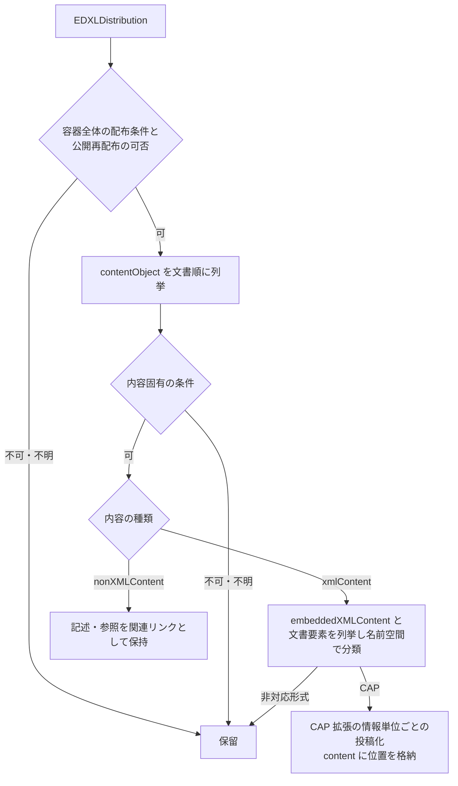
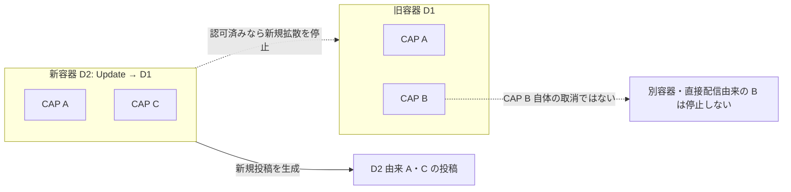

# EDXL-DE 1.0 拡張

識別子: `dev.jisaku.mosimo.public.edxl`

## 目的

本プロトコルは、OASIS EDXL Distribution Element 1.0（XML 名前空間 `urn:oasis:names:tc:emergency:EDXL:DE:1.0`）の配布容器を開き、内包内容ごとに形式と公開可否を判断して投稿化する手順と、配布者・配布意図・選択した内容の容器内の位置を保持する拡張を定義する。容器送信者、内包文書の発表者、取得・変換して投稿する著者の三者を区別する。

保証するのは、この型だけで DE 1.0 とその配布メタデータを識別でき、内包 CAP の発表者・原電文参照・警報対象を置き換えずに容器の文脈を保持できることである。保証しないのは、EDXL 仕様群全体や DE 2.0 への対応、DE 原 XML 全量の配送、内包された非 XML 内容の本体配送、容器の取消が内包警報の撤回を意味すること、機密区分の記載による暗号化や漏えい防止である。

## 前提

| 識別子 | 文書 | 依存する理由 |
|---|---|---|
| `dev.jisaku.mosimo` | [../../README.md](../../README.md) | 投稿単位、拡張の自己完結タグ、32 KiB 上限 |
| `dev.jisaku.mosimo.public` | [../README.md](../README.md) | 公開可否の判断、出典 `#source` の `containers`、更新による置換の認可 |
| `dev.jisaku.mosimo.public.cap` | [../cap/README.md](../cap/README.md) | 内包 CAP の情報単位ごとの投稿化と CAP 自身の更新・取消 |

## 1. 役割分担

| 拡張 | 担当 |
|---|---|
| `dev.jisaku.mosimo.public.edxl` | 配布者、配布意図、配布の更新・取消参照、選択した内容の容器内の位置と内容固有の条件 |
| `dev.jisaku.mosimo.public.cap` | 内包 CAP の警報の意味 |
| `dev.jisaku.mosimo.public#source` | 取得経路・変換規則・容器の参照（`containers`） |

CAP から生成した投稿には、CAP 拡張と本拡張を独立した拡張として併用できる。CAP に対応していて DE に非対応の端末、またはその逆の部分実装を許容する。出典追跡だけが目的なら `source.containers` の利用で足り、本拡張の同梱は任意である。同梱しない場合も、取り込み時の配布制約（§4）は同じく適用する。

## 2. データ型

XML の数値・日時の原表記は文字列で保持する。`integer` は atproto の整数であり、選択位置は 0 以上とする。

```ts
type EdxlDistributionReference = {
  distributionID: string;
  senderID: string;
  dateTimeSent: string; // 原形式の日時。共通 Timestamp ではない
};

type EdxlValueList = {
  valueListUrn: string;
  values: string[];
};

type EdxlExplicitAddress = {
  scheme: string;
  values: string[];
};

type EdxlTargetArea = {
  circles?: string[];
  polygons?: string[];
  countries?: string[];
  subdivisions?: string[];
  locCodesUN?: string[];
};

type EdxlNonXmlReference = {
  mimeType: string;
  size?: string;
  digest?: string;
  uri?: string;
};

type EdxlSelectedContent = {
  index: integer;                 // contentObject のゼロ始まり位置
  embeddedXMLIndex?: integer;    // embeddedXMLContent のゼロ始まり位置
  documentIndex?: integer;       // その中の文書要素のゼロ始まり位置
  contentDescription?: string;
  contentKeywords?: EdxlValueList[];
  incidentID?: string;
  incidentDescription?: string;
  originatorRoles?: EdxlValueList[];
  consumerRoles?: EdxlValueList[];
  confidentiality?: string;
  nonXMLContent?: EdxlNonXmlReference;
};

type EdxlDeExtension = {
  $type: "dev.jisaku.mosimo.public.edxl";
  distribution: EdxlDistributionReference;
  distributionStatus: string;
  distributionType: string;
  combinedConfidentiality: string;
  language?: string;
  senderRoles?: EdxlValueList[];
  recipientRoles?: EdxlValueList[];
  keywords?: EdxlValueList[];
  references: EdxlDistributionReference[];
  explicitAddresses?: EdxlExplicitAddress[];
  targetAreas?: EdxlTargetArea[];
  content?: EdxlSelectedContent;
};
```

| 原 DE の項目 | 拡張内の配置 |
|---|---|
| `distributionID`・`senderID`・`dateTimeSent` | `distribution` |
| `distributionReference`（並びは `distributionID,senderID,dateTimeSent`） | `references`。三項目へ分解した配列 |
| `senderRole`／`recipientRole`／`keyword` | `senderRoles`／`recipientRoles`／`keywords` |
| `valueListUrn` と複数の `value` | `EdxlValueList.valueListUrn` と `values` |
| `explicitAddressScheme` と複数の `explicitAddressValue` | `scheme` と `values` |
| `targetArea` 内の `circle`／`polygon`／`country`／`subdivision`／`locCodeUN` | `circles`／`polygons`／`countries`／`subdivisions`／`locCodesUN` |
| 内容の `contentKeyword`／`originatorRole`／`consumerRole` | `contentKeywords`／`originatorRoles`／`consumerRoles` |

DE の参照順 `distributionID,senderID,dateTimeSent` は CAP の `sender,identifier,sent` と異なる。曖昧・解析不能な参照を推測で補完して置換対象にしてはならない。

内容を選択した投稿では `content` を含める。容器単位の取消通知では `content` を省略する（§7.1）。`content` の省略を「すべての内包警報の取消」と解釈してはならない。

複数回出現する項目と値は配列で順序を保ち、同じ URN や scheme をキーにした辞書へ統合してはならない。同じ URN が複数回現れ得るためである。省略と空文字列を区別する。`combinedConfidentiality` は付録 A のスキーマの綴りを採る。本文のデータ辞書に現れる `combindedConfidentiality` の綴りは入力プロファイルで受け付ける表記として扱い、wire フィールドは `combinedConfidentiality` の一つとする。

## 3. 内容の選択と投稿化



1. 容器全体の配布条件と公開再配布の可否を評価する。
2. `contentObject` を文書順に列挙し、その内容固有の条件も評価する。
3. `xmlContent/embeddedXMLContent` の各容器と、その中の各文書要素を列挙する。名前空間と形式を識別して、対応する変換処理へ渡す。DE 1.0 では一つの XML 容器内に複数の内包 XML を持ち得る。
4. CAP 等から投稿を作る際に、元の内容位置と必要な配布メタデータを本拡張へ格納する。位置は原 DE 内の位置であり、別の DE に移った同じ CAP の同一性を示すものではない。
5. 取り込み・変換者が通常の投稿として署名する。中継者が既存の署名付き CAP 投稿へ本拡張を後付けしてはならない。署名が壊れるためである。

XML 内包文書を選択した場合、`embeddedXMLIndex` と `documentIndex` を対で持ち、`nonXMLContent` は同じ選択に付けない。非 XML 内容を選択した場合は両インデックスを省略し、`nonXMLContent` に参照情報を持つ。`keyXMLContent` は抜粋・識別用の内容であり、それだけを完全な原文として独立警報へ変換してはならない。対応する完全な内容を取得できず意味を確定できない場合は保留する。

`nonXMLContent` は、内容の型を明確に扱う変換プロファイルがない限り、記述・参照を関連リンクとして扱う。`contentData` の Base64 の本体を本拡張へコピーしてはならず、参照先を自動取得・実行・配送してもならない。任意のバイナリを署名付き投稿に載せると資源上限と安全性を損なうためである。リンクの表示と、その取得が安全・可能・許可済みであることは別である。

非対応の形式、意味に影響する未知の内容固有拡張を、CAP に似ているという理由で警報として扱ってはならない。入れ子の DE や特定分野の XML への対応は、専用の取り込みプロファイルで定義する。

## 4. 公開条件と信頼

機密区分は自由な文字列を含むため、`combinedConfidentiality` や内容の `confidentiality` を共通の真偽値へ変換してはならない。`UNCLASSIFIED AND NOT SENSITIVE` や `Unclassified` の表記だけから無条件の公開許可を導いてもならない。提供元の配信プロファイル・利用条件と、容器と内容の条件を併せて判断する。制約の意味が不明な場合は公開投入を保留する。容器全体に制限がある場合、個別内容の区分だけを見て取り出し公開してはならない。

明示宛先・受信者の役割・内容の対象者の指定があれば、それが公開可能な選択条件か、公開してはならない制限かを区別する。本プロトコルは公開情報のみを扱うため、公開可否は署名前の取り込みで判断する。限定情報を取り込んでから中継端末の対応状況に期待して保護する構成は禁止する。非対応端末は本拡張を無視して通常どおり中継するため、保護が成立しないからである。

`senderRole`・`originatorRole` は原形式上の申告であり、証明書の代わりではない。容器に記載された送信者と投稿の署名者を同一視してはならない。取り込みサーバーの署名は取得・変換の主張であり、配布元や内包情報の発表者自身の署名を再現するものではない。

## 5. 配送での利用と部分実装

`targetArea` は配布意図を示す地域であり、内包警報の影響範囲ではない。対応端末は、配布プロファイルとローカル方針の範囲で、その地域へ届く転送を優先できる。内包内容の共通 `area` をこの値で上書き・統合したり、共通の発信地点 `origin` に置き換えたりしてはならない。受信者の所在地を絞る情報と、災害の影響範囲は別の概念であるためである。

- 複数の `targetArea` の意味は DE が定める地域の和集合として読む。
- 国・行政区分・UN の地域コードは Geohash ではない。コード体系と境界を解決できなければ配布地域の判定は不明とする。
- 原 DE の円・多角形の表記は本拡張内に保持する。DE のデータ辞書の円の表記説明と例には差があるため、CAP 用の円パーサーをそのまま流用してはならず、入力プロファイルで受け付ける表記を定める。
- 配布地域や役割の申告だけで帯域・保存枠を優遇する権限は得られない。信頼と資源上限を別に適用する。
- 配布意図の範囲外への中継やゲートウェイへの搬出を一律に禁止するものではない。機密保護はこの best-effort な地域選択に依存させてはならない。

基本対応端末は本文と配送期限等だけを利用できる。CAP 対応端末は CAP 拡張の警報内容を、共通領域対応端末は `area` を利用する。DE の役割・地域・配布種別に非対応でも、未知拡張を保持して通常の上限内で中継できる。未知の URN の役割を端末権限や認証済みの所属と推測してはならない。

DE の `dateTimeSent` は容器の送信時刻であり、CAP の発表時刻・投稿の作成時刻・内容の有効開始・配送期限へコピーしてはならない。容器の送信時刻は内容の時刻とは独立であるためである。`distributionStatus` と `distributionType` は原語彙を保持し、`Actual` や `Report` だけで内包内容も実災害向けの公開警報であると判定してはならない。

## 6. Nostr・CBOR への配置

```text
タグ名: mosimo:ext:dev.jisaku.mosimo.public.edxl
タグ値: $type 以外の全フィールドの atproto deterministic CBOR を通常 Base64・padding なしで符号化
```

メッシュでは[コア](../../README.md)の共通規則で値を生バイト列にする。イベントの 32 KiB 上限に本拡張も含む。拡張の例は [公的情報の取り込み §12](../README.md#12-変換例-edxl-de-に内包された-cap) に示す。その例の `countries: ["JP"]` は配布地域であり、同梱する CAP の警報対象が日本全国であるという意味ではない。

## 7. 容器の更新・取消と内包情報

`distributionType: Update`／`Cancel` と `references` は、参照された配布容器への更新・取消を示す。内包 CAP の `msgType: Update`／`Cancel` と `references` は、CAP 原電文への更新・取消を示す。この二つの層を混同してはならない。

内包 CAP 自身の認可済み更新・取消による旧版拡散停止は [CAP 拡張 §6.1](../cap/README.md#61-原電文単位の置換) に従う。同じ CAP が別の DE や直接の公式経路でも配布されている場合、ある DE の取消だけで CAP 自身を無効とし、別の出典に基づく投稿まで停止してはならない。容器の取消は配布の撤回であり、発表機関による警報の撤回ではないためである。同じ署名付き投稿を別リレーや別無線経路から受信しただけでは、別の出典に基づく新しい投稿にはならない。

CAP の `AllClear`、情報の有効期間終了、DE の `Ack`、メッシュ配送の保存受理は互いに別である。DE の `Ack` を Bundle 配送完了や最終利用者の受領証として扱ってはならない。

### 7.1 容器由来の投稿の取消

公開可能な DE の取消を取り込んだ場合、対象容器への参照を持つ独立した通知投稿を 1 件生成する。通常の基本投稿と同じ 1 レコード・1 commit・1 Nostr イベントとし、専用の別イベント種別や削除要求へ変換してはならない。取消は配布の撤回という新しい情報であり、他者の投稿の削除ではないためである。

- `distribution` は今回の取消電文自身の識別とし、取り消す古い容器の識別へ置き換えない。
- `distributionType` は `Cancel`、`references` は取消対象の DE 原参照を持つ。対象未取得でも参照を保持する。対象を確定できない参照から推測で拡散停止の範囲を作ってはならない。
- 容器単位の通知なので `content` は省略する。内包 CAP の `Cancel` を捏造した CAP 拡張を付けてはならない。
- 本文には配布元、取り消された配布容器、配布の取消であることを示す。配布の撤回であって内包警報自体の取消とは別であることも伝え、旧投稿を取得しなくても通知の意味が分かるようにする。
- 投稿作成時に通知自身の配送期限を確定し、旧投稿の期限や内包警報の有効終了を流用してはならない。取消通知自身も公開可否の判断を経て発行する。

対応端末は、[公的情報の取り込み §9.2](../README.md#92-認可) の認可（信頼の起点への身元証明チェーンと、対象容器の配布元に対応する取消権限）を確認できた場合に限り、参照された容器由来の投稿の新たな広告・転送開始を停止する。対象投稿についても、確認できた容器の由来との対応（`source.containers`）を必要とし、本文や出典の自己申告の文字列一致だけで対象を広げない。取消対象を単に参照している別の通知まで止めてはならない。

認可済みの対象容器を記録し、旧対象が後着しても再拡散を抑える。一つの容器から生成された言語・内容別の投稿群は対象となるが、同じ CAP を別の DE や直接の公式配信から取り込んだ別投稿は、この容器の取消だけでは止めない。

容器の取消は配布を撤回した状態として表示し、発表機関が警報を撤回したという表示や NIP-09 による削除に置き換えない。旧投稿の署名・履歴は保持し、取消通知自身は独立した配送候補として扱う。認可を確認できない場合は停止を保留する。

### 7.2 新容器の内容による再発行

公開可能な `distributionType: Update` の DE を取り込んだ場合、新容器に含まれる内容だけを各形式の処理へ渡し、単独で読める新しい投稿群を生成する。旧容器との差分だけの配送や、新容器にない旧内容の引き継ぎは禁止する。差分では旧容器を持たない端末が意味を復元できず、引き継ぎは配布者が外した内容を配布中として見せるためである。

各投稿の本拡張は、`distribution` に新容器自身の識別、`distributionType` に `Update`、`references` に原 DE の更新対象参照、`content` に新容器内で選択した内容の位置を保持する。内包 CAP の識別や `msgType` は CAP 自身の値を保持し、DE が `Update` であることだけを理由に CAP も `Update` に書き換えてはならない。本文・共通領域・有効期間・配送期限は新しい内容に基づいて定める。

対応端末は、§7.1 と同じ認可境界（信頼の起点へのチェーン、対象容器の配布元に対応する更新権限、対象投稿の容器由来との対応）を確認できた場合に限り、明示的に参照された旧容器由来の投稿群の新たな広告・転送開始を停止する。対象未着でも認可済みの更新対象を記録し、旧投稿の後着時に再拡散を抑える。全ての新投稿が到着することを停止の条件にはしないが、一部の到着をもって新容器の全内容を受領したとも扱わない。

新容器由来の投稿群は、それぞれ独立した配送候補とする。旧容器への更新参照を持つことだけで、新投稿自身を旧対象として止めてはならない。停止は参照された旧容器由来の投稿に限り、別の容器・直接の公式配信から取り込んだ別投稿には及ばない。旧署名・履歴は保持する。



旧容器 D1 に CAP A・B、新容器 D2 に A・C が含まれ、D2 が D1 を更新する場合、新規投稿は D2 の A・C から生成する。認可を確認した端末は D1 由来の A・B の新規拡散を止めるが、CAP B 自体を取り消したり、B の危険が解消したと表示したりしてはならない。旧容器だけにあった内容の欠落は、配布者が配布対象から外したことだけを示すためである。内包 CAP 自身が旧 CAP を参照する `Update`／`Cancel` であれば、その認可と効果は CAP 拡張 §6.1 に従って別に適用する。

## 未確定事項

- 出典索引、更新・取消記録の保持期限・容量、相反更新、内容を選択しない容器単位の更新通知、新容器の全内容を表す受領・完了通知。
- 配布元・国別・組織別の機密区分・役割 URN・宛先 scheme の意味を固定する取り込みプロファイル。
- DE 1.0 の本文と付録スキーマの表記差、参照の厳密な分解、地域判定、入れ子の取り込み範囲。
- DE と内包内容の信頼の対応、証明の用途・範囲の符号化、内容の配送同値性、サイズ超過時の扱い。
- 各フィールドの文字数・要素数上限と Lexicon JSON。上限が確定するまで Lexicon は置かない。

## 参照

- [OASIS Emergency Data Exchange Language Distribution Element Version 1.0, OASIS Standard, 2006-05-01](https://docs.oasis-open.org/emergency/edxl-de/v1.0/EDXL-DE_Spec_v1.0.pdf) — §3.2、付録 A
