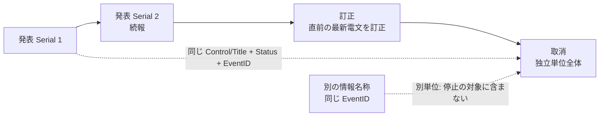

# 気象庁防災情報 XML 共通

識別子: `dev.jisaku.mosimo.public.jma`

## 目的

本プロトコルは、気象庁防災情報 XML を本プロトコルの投稿へ変換する際に、電文種別に共通する事項を定義する。定義する範囲は、電文の構造と取得経路、管理部・ヘッダ部を保持する共通型、運用種別（通常・訓練・試験）の扱い、独立した情報単位と続報・訂正・取消の関係、地域別の単独で読める投稿への分割の原則と署名前の明示付き省略、時刻の曖昧さ、原文の保存とハッシュ、名称文字列の安全な解釈である。電文種別ごとの型と対応は、[緊急地震速報](eew/README.md)、[地震観測情報](earthquake/README.md)、[気象防災情報](weather/README.md)に定める。

保証するのは、各電文種別の拡張が共通の管理情報を同じ型で保持し、各投稿が他の投稿や原 XML を取得せずに解釈できることである。保証しないのは、気象庁 XML の全種別・全要素への対応、原 XML の完全復元、取得経路の提供、気象庁自身による投稿への署名である。共通型の共有は型定義の共有であり、投稿間・拡張間の実行時依存ではない。

## 前提

| 識別子 | 文書 | 依存する理由 |
|---|---|---|
| `dev.jisaku.mosimo` | [../../README.md](../../README.md) | 投稿単位、`Timestamp`、拡張の自己完結タグ、32 KiB 上限 |
| `dev.jisaku.mosimo.public` | [../README.md](../README.md) | 取り込みの信頼モデル、原文保存、出典 `#source`、更新による置換の認可、共通領域への近似 |
| `dev.jisaku.mosimo.geo` | [../../geo/README.md](../../geo/README.md) | 影響範囲 `#area`、発信地点 `#origin` との区別 |
| `dev.jisaku.mosimo.validity` | [../../validity/README.md](../../validity/README.md) | 情報の有効期間 |

## 1. 対象と電文の構造

気象庁防災情報 XML は `Report` の下に管理部 `Control`、ヘッダ部 `Head`、情報種別ごとの `Body` を持つ。名前空間は管理部 `http://xml.kishou.go.jp/jmaxml1/`、ヘッダ部 `http://xml.kishou.go.jp/jmaxml1/informationBasis1/`、`Body` は地震津波・気象・火山等の分野ごとに異なる（気象は `http://xml.kishou.go.jp/jmaxml1/body/meteorology1/`）。本文書の相対位置は `Report` 基準、接頭辞省略で表記し、実装は名前空間 URI とローカル名で照合する。

| 電文種別 | 文書 | 対象電文 |
|---|---|---|
| 緊急地震速報 | [eew/README.md](eew/README.md) | VXSE43、VXSE44 |
| 地震観測情報 | [earthquake/README.md](earthquake/README.md) | VXSE51、VXSE52、VXSE53、VXSE62 |
| 気象防災情報 | [weather/README.md](weather/README.md) | 警報・注意報、土砂災害警戒情報、竜巻注意情報、記録的短時間大雨、指定河川洪水予報、台風、線状降水帯、顕著な大雪、気象情報・解説 |

電文名やファイル名だけで意味を決めず、`Control/Title`・`InfoKind`・`InfoKindVersion` と本文構造を照合する。ヘッダだけで全電文の指示・更新関係を確定できないため、`Body` の意味は電文種別ごとに読む。

## 2. 取得経路

公式 PULL 型配信は Atom の一覧から個々の XML 電文を取得する経路を提供する。取り込み側は公開元の利用条件・負荷制限に従い、既取得電文の再取得を抑える。URL の推測取得や公開サーバーへの過剰なポーリングは禁止する。公開元の提供継続を損ない、他の利用者の取得も妨げるためである。

Atom の更新・掲載順を、電文の改訂順や現象の発生順と同一視してはならない。配信の停止・遅延があり、掲載順が発表順と一致しないことがあるためである。最新判定は §5 の `Control/DateTime` で行う。

公開 PULL 型配信で提供されない電文（緊急地震速報等）は、対応する別の配信経路・利用条件を取り込み側で確保する。対象は各電文種別の文書に示す。

公式情報提供ページでは電文ごとの署名と検証用公開鍵の案内は確認できていない。取り込み側の署名は取得・変換の証言であり、気象庁自身の署名として表示してはならない（[公的情報の取り込み §1](../README.md#1-信頼モデル)）。

## 3. 管理情報の共通型

XML の日時・数量・コード・階級は原文字列を保持する。共通の UTC `Timestamp` や整数座標とは別である。`integer` は atproto の整数とする。

### 3.1 原値とコード

```ts
type JmaValue = {
  value: string;
  type?: string;
  unit?: string;
  description?: string;
  condition?: string;
  nil?: boolean;
};
type JmaCode = { value: string; type?: string };
type JmaNamedCode = { name: string; code: JmaCode };
```

`JmaValue.value` は XML 要素の文字列値、他の項目は対応する属性とする。`xsi:nil="true"` または `"1"` は `nil: true` として保持し、省略・空文字列・nil・`NaN` を区別する。任意項目は原要素がなければ省略する。コードの `type` は原属性、または `CodeDefine/Type` の適用先に対応するコード体系とする。先頭ゼロを含めて保持する。桁数や値だけでコード体系を推定してはならない。別体系に同じ桁数のコードが存在するためである。

### 3.2 管理部・ヘッダ部

```ts
type JmaMessage = {
  control: {
    title: string;
    dateTime: string;
    status: string;
    editorialOffice: string;
    publishingOffice: string;
  };
  head: {
    title: string;
    reportDateTime: string;
    targetDateTime?: JmaValue;
    validDateTime?: JmaValue;
    eventID: string;
    infoType: string;
    serial: string;
    infoKind: string;
    infoKindVersion: string;
    headline?: string;
  };
};
```

| 原 XML | 配置 | 意味 |
|---|---|---|
| `Control/Title` | `control.title` | 情報名称 |
| `Control/DateTime` | `control.dateTime` | 管理部時刻。同種情報の最新判定に用いる |
| `Control/Status` | `control.status` | 運用種別（§4） |
| `Control/EditorialOffice`・`PublishingOffice` | `control.editorialOffice`・`publishingOffice` | 編集官署・発表官署 |
| `Head/Title` | `head.title` | 標題。`Control/Title` と区別する |
| `Head/ReportDateTime` | `head.reportDateTime` | 原発表時刻 |
| `Head/TargetDateTime`・`ValidDateTime` | `head.targetDateTime`・`validDateTime` | 基点時刻・失効時刻（§7） |
| `Head/EventID`・`Serial`・`InfoType`・`InfoKind`・`InfoKindVersion` | 同名 camelCase | 現象識別・情報番号・発表／訂正／取消・情報種別・スキーマ運用上の版 |
| `Head/Headline/Text` | `head.headline` | 見出し文 |

`serial` は空文字列を含め原文字列のまま保持する。`InfoKindVersion` は気象庁の原形式の版であり、本拡張や変換規則の版ではない。各電文種別の拡張は `message: JmaMessage` を自身の内部に持ち、他の拡張を参照せずに解釈できる。

### 3.3 震源

地震関連の電文（緊急地震速報・地震観測情報）が共有する震源の型である。

```ts
type JmaHypocenter = {
  name: string;
  code?: JmaCode;
  coordinates?: JmaValue[];   // ISO 6709 の原文字列と説明
  detailedName?: string;
  detailedCode?: JmaCode;
  nameFromMark?: string;
  markCode?: JmaCode;
  direction?: string;
  distance?: JmaValue;
  source?: string;            // Hypocenter/Source。震源決定機関。出典拡張ではない
};
type JmaEarthquake = {
  originTime?: JmaValue;
  arrivalTime?: JmaValue;
  condition?: string;
  hypocenter?: JmaHypocenter;
  magnitude?: JmaValue;
};
```

`Body/Earthquake` の `OriginTime`・`ArrivalTime`・`Condition`、`Hypocenter/Area/Name`・`Code`・`jmx_eb:Coordinate`、`jmx_eb:Magnitude` を対応するフィールドへ格納する。「ごく浅い」、深さ不明、700 km 以上、震源要素不明を、精密な点や確定した深さへ読み替えてはならない。マグニチュードの `NaN`・`condition: "不明"`・`description` は区別して保持し、「Ｍ８を超える巨大地震」を数値 8 や通常の欠測と同一視してはならない。

震源は影響範囲でも発信地点でもない。`hypocenter` を `origin` や任意半径の共通 `area` へ自動変換してはならない（§8）。

## 4. 運用種別と公開取り込み

`Control/Status` は通常・訓練・試験等の運用種別である。原値を保持して本文にも表示し、訓練・試験の電文を実災害向けの自動投入から外す。訓練情報を通常の実災害情報へ書き換えてはならない。運用種別ごとの自動投入条件は電文種別ごとに定める。

`Head/InfoType` は発表・訂正・取消を表す。電文全体の `InfoType` と、地域・現象ごとの状態（気象の `Kind/Status`、地震の `Revise`）は独立であり、片方から他方を導いてはならない。

公開再配布条件と取得経路の利用条件に従い、取得した原電文を出典（§9）と対応付ける。

## 5. 独立した情報単位と続報・訂正・取消

### 5.1 原電文の運用

公式解説資料が定める地震関連電文の規則は次のとおりである。

- 「独立した情報単位」は **`Control/Title` + `Control/Status` + `Head/EventID`** で区別する。編集官署の切替があり得るため、`EditorialOffice`・`PublishingOffice` はこのキーに含めない。
- 同種の最新情報の検索には **`Control/DateTime`** を用いる。`Serial` の大小、取得順、Atom の掲載順、Nostr 時刻、投稿の `created_at` で代用してはならない。
- `InfoType: 発表` には続報も含まれる。続報を CAP の `Update` へ書き換えない。
- `訂正` はその独立単位で直前に発表されている `Control/DateTime` が最も新しい電文の訂正である。任意の過去版を `Serial` で指定する操作ではない。
- `取消` は独立単位全体の取消である。直前の 1 通だけ、ある観測点だけ、同じ地震に関する全種類の電文を取り消すものではない。
- 取消では番号は更新されず、訂正では訂正対象の最新情報の番号が記載される。したがって番号の一致だけで同じ電文と判定してはならない。

`EventID` は地震発生時刻の証明ではなく、同じ物理的地震でも番号が一貫しない場合がある。`EventID` が同じでも、情報名称が異なれば別単位である。警報と予報、震度速報と震源・震度情報はそれぞれ別の情報名称であり、片方の取消や後続をもう片方へ広げてはならない。

気象電文では `EventID` が空の例もあり、地域・現象・予報区域・官署・原種別の版を含む系列判定は電文別の解説を確認して定める必要がある。地震のキーを全気象電文へ無条件に移植してはならない。

### 5.2 投稿と配送への反映



発表・続報・訂正・取消は、それぞれ単独で読める新しい投稿として生成し、既存の署名付き投稿を編集してはならない。取消投稿は今回の管理部・ヘッダ部と取消理由を持ち、旧予測・旧観測値を現在の値として再掲してはならない。配送期限も今回の通知自身について確定する。

原情報の関係を旧投稿の新規拡散停止へ反映する場合は、[公的情報の取り込み §9](../README.md#9-更新による置換と旧版の拡散停止) の認可境界に従う。認可済みの続報・訂正では同じ独立単位の旧版の新たな広告・転送開始を停止し、認可済みの取消では当該独立単位の旧情報全体の新規拡散を停止する。対象未着の場合も関係を記録し、後着旧版を抑止する。

地域別に分割された旧投稿群も原情報の対象関係に含める。選択位置の一致した 1 地域だけへ取消対象を狭めてはならず、逆に選択位置の一致だけで別電文・別種別へ停止を広げてもならない。選択位置は原電文内の位置であり、地域の恒久的な識別子ではないためである。地域別の新投稿 1 件の到着を、新電文の全地域の受領とは扱わない。

同じ `EventID` の自己申告、取得 URL の文字列一致、取り込みサーバーへの一般的な信頼、Nostr 署名だけでは他者の投稿を停止してはならない。認可できない関係は主張として保持し、停止は保留する。震度の下方修正や新しい観測の追加は、地震そのものの取消や危険の解消ではない。

## 6. 地域別投稿の原則

### 6.1 単独で読める地域別投稿

地域別に必要な共通文脈を持つ、単独で読める投稿を基本とする。1 地域の投稿は 1 レコード・1 commit・1 Nostr イベントで完結し、全体投稿や別地域の投稿を取得してから組み立てる断片にしてはならない。メッシュでは他の投稿の到着が保証されないためである。管理部・ヘッダ部、原電文に存在する震源と精度、主要な共通文・注意事項・条件をそれぞれの投稿内に保持する。

地域別にすることは、取り込み側が署名前に行う意味上の分割である。中継者が署名済みイベントを分解・縮約することは禁止する。署名が壊れるためである。

原電文全体の最大値・見出しと、選択地域の値・対象を区別する。地域別投稿を原電文全体の受領・再現と扱ってはならず、届かない地域や掲載のない地域を安全と表示してもならない。掲載がないことは、観測・予測が掲載されていないことだけを示すためである。

### 6.2 粒度と選択位置

過度の細分化は地域の関係・共通条件を失うため、それらを保てる適度な単位を使う。地震関連では府県予報区（`Pref`）を基本とし、32 KiB に収まらない場合だけ原 `Pref/Area` の細分区域まで分ける。市町村・観測点や任意の地理メッシュへ分割してはならない。

```ts
// 位置は原電文内の同名兄弟要素をゼロ始まりで数えた値
type JmaSelection =
  | { kind: "whole" }
  | { kind: "region"; path: integer[] };

type JmaNationalOverview = { prefectures: JmaNamedCode[] };
type JmaReduction = { omitted: string[] };
```

`path` は `[原 Pref の位置]`（府県単位）または `[原 Pref の位置, その Pref 内の原 Area の位置]`（細分区域）とする。空配列や 3 要素以上は用いない。位置は原 XML の同名兄弟要素をゼロ始まりで数えた値であり、抽出後の配列位置や別電文の地域識別子ではない。異なる電文の `path` の一致は、同一地域・同一投稿・更新関係の根拠にしてはならない。

取消や、地域階層を持たない情報は `selection: { kind: "whole" }` として 1 投稿で伝える。気象防災情報の選択は地域名・コードで表す別の形を用いる（[気象防災情報 §5](weather/README.md#5-投稿単位本文領域と上限)）。

### 6.3 全国概況

原電文に該当する府県一覧がある場合、各地域投稿に小さな `nationalOverview` を併記する。`prefectures` は原電文に掲載された府県の名称・コード体系・コードの一覧とし、同じ体系・コードの重複は初出順でまとめる。原電文に一覧がなければ推測で作らない。

この一覧は「原電文に掲載された府県等」の概況であり、被害の発生、全住民への警報、掲載されない地域の安全を表さない。基本本文にも一覧を簡潔に示す。共通 `area` は選択地域のままとし、全国概況で配送地域を広げてはならない。

### 6.4 署名前のサイズ調整と明示付き省略

32 KiB 上限は本文・署名・タグ・commit 等を含むメッシュ payload 全体に適用し、省略の告知や `reduction` も含めて測る。

1. 府県単位で、詳細を省略しない完成 payload 長を見積もる。収まるものはそのまま投稿する。
2. 超過する府県は細分区域へ分け、各区域でもまず省略なしで見積もる。
3. 超過する最小単位に限り、低優先の詳細をカテゴリー全体で順に除き、各段階で見積もり直す。収まった段階で省略を止める。`whole` にはこの省略だけを適用する。
4. 許容された省略後も最小単位が超過する場合は、その投稿化を保留する。重要文の切断、原文リンクだけへの置換、複数イベントの継ぎ合わせで成功扱いにしてはならない。

| `omitted` の値 | 選択範囲内で省略した項目 |
|---|---|
| `periodSpectra` | 観測点の `sva`・`svaPerPeriod`（地震観測情報） |
| `periodClasses` | 観測点の `lgIntPerPeriod`（地震観測情報） |
| `stationDetails` | 個別観測点の `stations` 全体。上位の最大値・条件は保持（地震観測情報） |
| `headlineDetails` | `headlineInformation` の構造化一覧。重要な警報対象・条件は本文に保持（緊急地震速報） |
| `nationalOverview` | 全国概況の構造と本文の対応一覧。原文に一覧がない場合とは区別 |

省略は `reduction.omitted` と本文の両方に明示する。本文には要約であることと、実際に省略した全カテゴリーの意味を読みやすい言葉で示す。一部の高い値の地点だけを残した標本や、黙った件数切捨ては禁止する。受信者が省略を欠測・原情報の不存在・値 0 と誤読するためである。省略がなければ `reduction` を省略し、少なくとも 1 カテゴリーを省いた場合にだけ空でない `omitted` を付ける。各カテゴリーの適用順と対応項目は電文種別ごとに定める。

運用種別、原電文識別、訂正・取消とその対象、震源の主要値と精度・仮定条件、選択地域の予測・観測値と条件、重要な指示、原文参照・ハッシュ、基本投稿の必須項目・署名・commit はサイズ対策で削除してはならない。

## 7. 時刻

| 原項目 | 意味 |
|---|---|
| `Control/DateTime` | 管理部時刻。同種情報の最新判定に利用 |
| `Head/ReportDateTime` | 原情報の発表時刻 |
| `Head/TargetDateTime`・`TargetDTDubious` | 基点とその曖昧さ。nil・曖昧さを保持する |
| `Head/TargetDuration` | 原基点に関する期間。電文別の意味を確認せず内容の寿命にしない |
| `Head/ValidDateTime` | 原失効時刻。対象種別の定義と原状態を確認できる場合だけ共通 `validity.until` の候補 |
| 内容部の時刻 | 発生・検知・予測・実況・予報の時刻。電文種別ごとに意味が異なる |
| 投稿の `created_at` | 変換投稿の作成時刻 |
| 投稿の `exp` | 投稿作成時に別途確定する配送期限 |

原日時は原文字列で保持し、共通 `validity` には意味が確定できた端点だけを UTC `Timestamp` へ変換して載せる。曖昧な現象発生時刻を精密な `Timestamp` として表してはならない。基点時刻と期間から有効期間を構成してよいかは電文の意味による。「継続中」を無限の有効期間として、また期間欠落を解除として扱ってはならない。共通有効期間の欠落は不明を意味する。

訂正・取消・解除の通知の配送期限は通知自身について確定する。古い原文の再取得で配送期限を繰り返し延ばしてはならない。

## 8. 領域

地域・地点名と `Code` は原値と体系を保持する。行政区域・予報区等のコードは Geohash 文字列ではない。共通 `area` は、コード体系と版に対応する境界を解決でき、選択した全対象を覆える場合だけ、[公的情報の取り込み §10](../README.md#10-共通領域への近似と変換不能時の扱い) の全体を覆う近似で付ける。解決できた一部だけを載せてはならず、全体を解決できなければ `area` を省略して、地域名・コード・値を形式拡張と本文に残す。

地域別投稿では選択した地域全体を共通領域の対象とし、文脈として残した全国見出し・他地域の記述・`nationalOverview` で範囲を拡大してはならない。震源、河川観測所、台風中心、予報円は影響範囲ではない。官署・震源・台風中心を発信地点 `origin` に転記してはならない。発信地点は著者端末の位置であり、原情報の対象地点とは別の概念であるためである。

## 9. 原文の保存とハッシュ

取り込み側は取得した原 XML 全体を保存し、各投稿に `source` を付ける。

| `source` のフィールド | 気象庁 XML での値 |
|---|---|
| `document.format` | 気象庁 XML の形式名と版 |
| `document.messageId` | 取得電文の絶対 URL 等の追跡用識別子 |
| `document.senderId` | 原 `PublishingOffice` の文字列 |
| `document.revision` | 原 `Serial` がある場合の原値 |
| `document.sentAt` | `Head/ReportDateTime` を UTC へ変換した値 |
| `retrievedFrom`・`retrievedAt` | 取得 URL と取得時刻 |
| `links` | 保存原文への参照 |
| `originalDigest` | 下記 |

`originalDigest` は、HTTP の transfer coding・content coding を解除した XML エンティティの全バイト列に対する SHA-256（32 bytes）とし、文字コード変換・BOM 除去・改行変換・XML 再直列化の**前**に計算する。保存対象も同じバイト列である。原 URL を取得し直して別内容になった場合はハッシュ・取得時刻を別に記録する。

URL・`EventID`・`Serial` のいずれも単独では全球一意の電文 ID や更新系列にならない。発表官署・情報種別・現象識別・情報番号・発表時刻をどう組み合わせるかは §5 と電文種別ごとの規則に従う。

## 10. 文字列の安全な解釈

名称は構造化フィールドの文字列として扱い、改行・空白・タブ・区切り記号をプロトコル上の構造区切りとして解釈してはならない。`ReduceName` 等を含む名称に改行があるだけで、正常に構造を読める原電文や投稿全体の処理を失敗させてはならない。XML パーサー・JSON/CBOR の文字列として解釈し、行分割・正規表現による擬似 XML 解析や名称の完全一致だけによるコード判定に依存してはならない。名称には任意の文字が含まれ得るためである。

原文字列は署名対象の拡張に保持する。1 行の表示・音声通知・外部配信 API の名称欄には派生した表示用文字列を用い、CR・LF・TAB・Unicode の行／段落区切りを空白に置き換え、連続する表示用空白を整理できる。指示本文全体の改行は保つ。出力先の正式なエスケープ・長さ・文字種制約に従い、ログや CSV 等へ文字列連結で埋め込んではならない。整形は派生表示に限り、元の署名付きフィールドを書き換えてはならない。

名称を整形しても出力先に渡せない場合、対応するコードと固定したコード表による名称を利用できる。解決できなければ「震央名を表示できません」等の代替表示とし、名称だけの問題で他の警報内容まで失わせない。コードが未知・名称と不一致の場合に推測で既知の地域を割り当ててはならない。

取り込み側は XML の byte 数・深さ・要素数・処理時間を制限し、外部実体・DTD・外部スキーマの自動取得を無効化する。

## 11. Nostr タグとサイズ上限

各電文種別の拡張は、通常の基本投稿の `ext` に配置し、自己完結タグ `mosimo:ext:<$type>` で運ぶ。値は `$type` を除く全フィールドの atproto deterministic CBOR を通常 Base64・padding なしで表し、メッシュでは生バイト列にする。専用の Nostr kind・BPv7 の必須独自ブロック・巨大 XML 添付方式を追加してはならない。拡張の追加だけで基本版やメッシュ符号化版を上げないためである。

32 KiB の上限は本文・commit 等を含むイベント CBOR 全体に適用する。取り込み側は §6 の分割と明示付き省略を用い、それでも上限内で必要な意味を保てない投稿は保留する。

未知の拡張・既知型内の未知フィールドは保持する。未知の XML 要素まで汎用 XML バッグとして運ぶ方式は採らず、意味に影響する未対応構造は取り込み側で扱いを保留して型の追加・改訂を検討する。未知の内容を削って既存型に収まったことにしてはならない。

## 未確定事項

- 気象電文の独立した情報単位の系列キーと取消対象の確定規則。
- 対象となる `InfoKindVersion`・コード表・辞書の固定版と、未知版の扱い。
- 続報・訂正・取消を配送停止へ対応付ける具体規則、投稿間参照、出典索引、欠落履歴・同時刻競合・取消後再発表、停止記録の保持。
- 運用種別ごとの自動投入条件、訓練・試験の投入・表示・通知条件。
- 境界データの版と共通 `area` への投影方法。
- 配送期限の種別ごとの既定値。
- 決定的な本文生成と要約の定型。
- 各電文種別の正式 Lexicon と項目別資源上限。

## 参照

- [気象庁防災情報 XML 情報提供ページ](https://xml.kishou.go.jp/)
- [気象庁 XML 形式電文の公開（PULL 型）](https://xml.kishou.go.jp/xmlpull.html)
- [気象庁 XML 技術資料一覧](https://xml.kishou.go.jp/tec_material.html)、[XML フォーマット Ver.1.3 本文（2022-12-09 版）](https://xml.kishou.go.jp/jmaxml_20221209_format_v1_3.pdf)
- [気象庁 XML スキーマ一式（2024-10-31 版）](https://xml.kishou.go.jp/jmaxml_20241031_Schema(xsd).zip) — `jmx.xsd`・`jmx_ib.xsd`・`jmx_mete.xsd`
- [気象庁 電文毎の解説資料セット（2026-10-09 公開セット）](https://xml.kishou.go.jp/jmaxml_20261009_Manual(pdf).zip) — 「地震火山関連_解説資料.pdf」共通部Ⅰ、共通別紙ア・イ・ウ
- [気象庁 公式サンプル XML 一式（2026-09-17 セット）](https://xml.kishou.go.jp/jmaxml_20260917_Samples.zip)
- [公開 XML 電文一覧（2026-08-06 現在）](https://xml.kishou.go.jp/xmllist.pdf)
