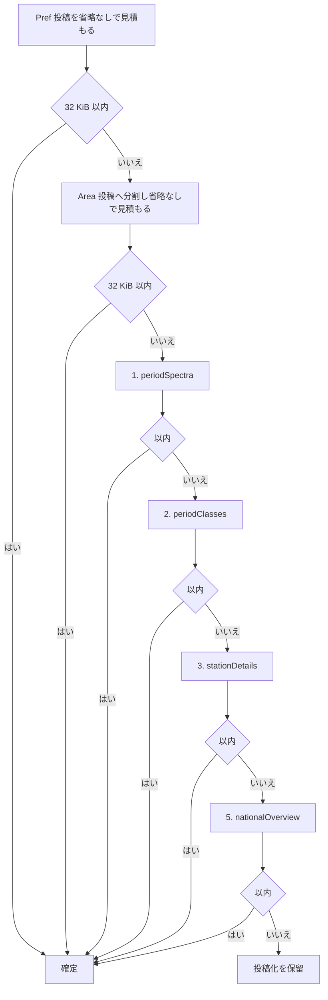
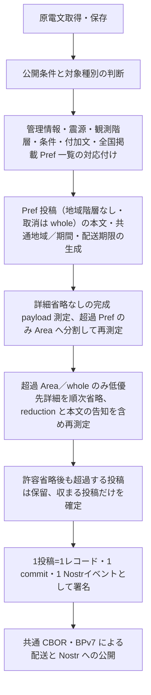

# 気象庁 地震観測情報 拡張

識別子: `dev.jisaku.mosimo.public.jma.earthquake`

## 目的

本プロトコルは、気象庁防災情報 XML の地震観測情報（震度速報、震源に関する情報、震源・震度に関する情報、長周期地震動に関する観測情報）を本プロトコルの投稿へ変換する拡張を定義する。定義する範囲は、管理情報・震源・観測階層・長周期地震動・付加文を保持する型、府県を基本とし超過時だけ細分区域へ分ける地域別投稿、サイズ判定と低優先詳細の明示付き省略、原電文の同一性と続報・訂正・取消、共通領域・時刻への対応である。

保証するのは、この型だけで対象電文の管理部・ヘッダ部・観測内容を解釈でき、観測震度を予測震度と区別して保持できることである。保証しないのは、津波警報・注意報、津波観測、推計震度分布図、地震回数、火山情報への対応、原 XML の完全復元、検証アルゴリズム・適合性判定・テストベクトルである。

## 前提

| 識別子 | 文書 | 依存する理由 |
|---|---|---|
| `dev.jisaku.mosimo` | [../../../README.md](../../../README.md) | 投稿単位、`Timestamp`、拡張の自己完結タグ、32 KiB 上限 |
| `dev.jisaku.mosimo.public` | [../../README.md](../../README.md) | 取り込みの信頼モデル、出典 `#source`、更新による置換の認可 |
| `dev.jisaku.mosimo.public.jma` | [../README.md](../README.md) | 共通型 `JmaMessage`・`JmaValue`・`JmaCode`・`JmaNamedCode`・`JmaEarthquake`・`JmaHypocenter`・`JmaSelection`・`JmaNationalOverview`・`JmaReduction`、独立した情報単位、地域別投稿の原則、時刻、原文ハッシュ |
| `dev.jisaku.mosimo.geo` | [../../../geo/README.md](../../../geo/README.md) | 影響範囲 `#area` |
| `dev.jisaku.mosimo.validity` | [../../../validity/README.md](../../../validity/README.md) | 情報の有効期間 |

## 1. 適用範囲と役割分担

| `Control/Title` | 対象とする内容 | 主な電文名 |
|---|---|---|
| `震度速報` | 都道府県・地域別の観測最大震度 | VXSE51 |
| `震源に関する情報` | 発生・発現時刻、震源、マグニチュード、付加文 | VXSE52 |
| `震源・震度に関する情報` | 震源と都道府県・地域・市町村・観測点別の震度 | VXSE53 |
| `長周期地震動に関する観測情報` | 震源、震度、長周期地震動階級、周期別観測値 | VXSE62 |

| 拡張 | 担当 |
|---|---|
| `dev.jisaku.mosimo.public.jma.earthquake` | 原電文の管理情報、震源、観測階層、付加文、発表・訂正・取消の意味 |
| `dev.jisaku.mosimo.public#source` | 取得 URL、取得時刻、原文参照、変換者・変換規則 |
| `dev.jisaku.mosimo.geo#area` | 原情報の対象範囲を適切に表現できる場合の共通の地域別配送判断 |
| `dev.jisaku.mosimo.validity` | 原情報から確定できる内容有効期間 |

## 2. データ型

### 2.1 共通情報と震源

`message: JmaMessage` と `earthquake: JmaEarthquake` は共通型を用いる。`Hypocenter/Area/DetailedName`・`DetailedCode`・`NameFromMark`・`MarkCode`・`Direction`・`Distance` は観測情報で現れる震源項目であり、原電文に存在する項目だけを保持する。`Hypocenter/Source` は震源決定機関である。

### 2.2 震度速報と詳細震度

```ts
type JmaQuickIntensityArea = JmaNamedCode & { maxInt: string };
type JmaQuickIntensityPref = JmaNamedCode & { maxInt: string; areas: JmaQuickIntensityArea[] };
type JmaQuickIntensityObservation = { maxInt: string; prefs: JmaQuickIntensityPref[] };

type JmaIntensityStation = JmaNamedCode & { int: string; revise?: string };
type JmaIntensityCity = JmaNamedCode & {
  maxInt?: string;
  condition?: string;
  revise?: string;
  stations?: JmaIntensityStation[];
};
type JmaIntensityArea = JmaNamedCode & { maxInt?: string; revise?: string; cities: JmaIntensityCity[] };
type JmaIntensityPref = JmaNamedCode & { maxInt?: string; revise?: string; areas: JmaIntensityArea[] };
type JmaIntensityObservation = { maxInt: string; prefs: JmaIntensityPref[] };
```

`Body/Intensity/Observation` の `Pref`・`Area`・`City`・`IntensityStation` を、それぞれ `prefs`・`areas`・`cities`・`stations` に対応付ける。震度速報は都道府県と地域までであり、架空の市町村・観測点を補わない。詳細震度は市町村と観測点までの親子関係を保持する。

`CodeDefine/Type` が各相対位置に指定する体系を対応する `JmaCode.type` に反映する。都道府県等、細分区域、市町村等、震度観測点のコードを区別する。

震度は `1`・`2`・`3`・`4`・`5-`・`5+`・`6-`・`6+`・`7` 等の原語彙を保持する。震度速報で掲載される震度は 3 以上である。詳細震度では未入電により都道府県・地域・市町村の `MaxInt` がない場合があり、市町村の `Condition`、観測点の `Int` に「震度５弱以上未入電」が現れる。これを震度 0、確定した震度５弱、観測点の不存在に置き換えてはならない。掲載のない地域の震度も 0 ではない。

`Revise` の「追加」「上方修正」「下方修正」は各階層の更新説明として保持する。`Head/InfoType` の「訂正」や、投稿の更新権限とは別の意味である。観測点名の「＊」と、それを説明する付加文も保持する。

### 2.3 長周期地震動

```ts
type JmaPeriodValue = JmaValue & { periodicBand: string; periodUnit: string };
type JmaLongPeriodStation = JmaNamedCode & {
  int: string;
  lgInt: string;
  lgIntPerPeriod?: JmaPeriodValue[];
  sva?: JmaValue;
  svaPerPeriod?: JmaPeriodValue[];
  revise?: string;
};
type JmaLongPeriodArea = JmaNamedCode & { maxInt?: string; maxLgInt: string; revise?: string; stations?: JmaLongPeriodStation[] };
type JmaLongPeriodPref = JmaNamedCode & { maxInt?: string; maxLgInt: string; revise?: string; areas: JmaLongPeriodArea[] };
type JmaLongPeriodObservation = { maxInt: string; maxLgInt: string; lgCategory: string; prefs: JmaLongPeriodPref[] };
```

長周期地震動の階層は `Pref/Area/IntensityStation` とし、通常の詳細震度の `City` を持たない。観測点のコード体系は「長周期地震動観測点」であり、「震度観測点」とは別である。解説資料の一部の説明・例には市町村や `City` への言及があるが、`CodeDefine`、観測点要素の定義位置、公式サンプルの実構造に従う。

- `MaxLgInt`／`LgInt`: 最大長周期地震動階級／観測点の階級。震度と別の尺度であり、`0` は欠測ではない。
- `LgIntPerPeriod`: 周期別階級。XML 属性 `PeriodicBand`・`PeriodUnit` を `periodicBand`・`periodUnit` に対応付ける。
- `Sva`: 絶対速度応答スペクトルの 1.6 秒から 7.8 秒までの周期帯の最大値。
- `SvaPerPeriod`: 指定周期帯の絶対速度応答スペクトルの最大値。`unit` と周期帯を値とともに保持する。

周期別階級と周期別スペクトル値は別々の配列とし、配列位置だけで対応を決めてはならない。周期帯・単位を伴う値として保持し、スペクトルから独自に階級を再計算してはならない。気象庁以外の観測点ではスペクトル値の小数第一位が 0 となる運用があり、文字列の小数桁だけから精度を推定してはならない。

`LgCategory` は震度と長周期地震動階級の観測状況の分類であり、配送優先度ではない。

| 原値 | 原情報の分類 |
|---|---|
| `1` | 全国の最大階級が 2 以下で、階級 1 以上の全地域の最大震度が５弱以上 |
| `2` | 全国の最大階級が 2 以下で、階級 1 以上の地域に最大震度 4 以下の地域がある |
| `3` | 全国の最大階級が 3 以上で、階級 3 以上の全地域の最大震度が５弱以上 |
| `4` | 全国の最大階級が 3 以上で、階級 3 以上の地域に最大震度 4 以下の地域がある |

### 2.4 内容部と拡張全体

```ts
type JmaFixedComment = { text: string; code: JmaCode };
type JmaEarthquakeComments = {
  forecastComment?: JmaFixedComment;
  varComment?: JmaFixedComment;
  freeFormComment?: string;
  uri?: string;
};
type JmaEarthquakeBody = {
  earthquake?: JmaEarthquake;
  observation?: JmaQuickIntensityObservation | JmaIntensityObservation | JmaLongPeriodObservation;
  text?: string;
  comments?: JmaEarthquakeComments;
};
type JmaEarthquakeExtension = {
  $type: "dev.jisaku.mosimo.public.jma.earthquake";
  message: JmaMessage;
  selection: JmaSelection;
  nationalOverview?: JmaNationalOverview;
  reduction?: JmaReduction;
  body: JmaEarthquakeBody;
};
```

`observation` の意味は `message.control.title` に従い、フィールド名の類似だけから判定してはならない。震源に関する情報は `observation` を持たず、震度速報は `earthquake` を持たない。震源・震度に関する情報で国内の観測震度がなければ `observation` は省略される。取消では原電文の `Body/Text` 等を保持し、旧電文から震源・観測・付加文を引き継がない。

`Body/Text` は `body.text`、付加文は `body.comments` に配置する。`ForecastComment`・`VarComment` の `Text` と `Code` を一組として保持し、`code.type` に `codeType` を対応付ける。`Code` が空白区切りの複数コードでも `code.value` に原文字列を保持し、全文と各コードの一対一対応を創作してはならない。長周期地震動の `Comments/URI` は参考リンクであり、取得必須の観測本体ではない。

`stations`・`lgIntPerPeriod`・`sva`・`svaPerPeriod` の任意化は §4 の明示的な省略を表現するためである。原電文と選択範囲に存在し、省略対象でない観測点・周期別値は全件保持する。フィールドの不在は `selection` と `reduction.omitted` を併せて解釈する。

`nationalOverview.prefectures` は、抽出前の原電文の `Body/Intensity/Observation/Pref` に全国で掲載された都道府県等の名称・コードの一覧とする。同じ原電文から生成する各地域投稿には、明示的に省略する投稿を除き、選択地域だけに絞らない同じ一覧を同梱する。Pref のない原電文・取消へ旧一覧や推定した県を補わない。

## 3. 地域別の投稿単位と本文

### 3.1 選択位置と格納

地域別投稿の原則は [気象庁 XML 共通 §6](../README.md#6-地域別投稿の原則) に従う。`Body/Intensity/Observation/Pref` ごとの投稿を基本とし、32 KiB を超える Pref だけを配下の `Area` ごとへ分ける。収まる Pref はそのまま投稿し、超過する Pref は詳細の省略より前に分割する。Area より小さい市町村・観測点・周期帯へ分割してはならない。

- Pref 投稿では `body.observation.prefs` に選択 Pref を 1 件、その `areas` に当該 Pref の全 Area を保持する。
- Area 投稿では選択 Pref を 1 件、その `areas` に選択 Area を 1 件保持する。
- 震度速報は最大震度、震源・震度情報は全市町村・観測点、長周期地震動情報は全観測点・周期別値を、選択範囲内でまず省略なく対応付ける。祖先の名称・コード・最大値・更新説明と、地域内の未入電等の条件も保持する。
- `observation` 直下の `maxInt`・`maxLgInt`・`lgCategory` と親 Pref の最大値は原電文・親階層の文脈であり、選択地域だけの値へ再計算してはならない。選択 Pref の値は `prefs[0]`、選択 Area の値は `prefs[0].areas[0]` として区別する。

例えば `selection: { kind: "region", path: [1] }` は原電文の 2 番目の Pref 全体、`path: [1, 3]` はその Pref 内の 4 番目の Area を示す。

震源に関する情報、観測階層を持たない情報、取消通知は `selection: { kind: "whole" }` として 1 投稿にする。

### 3.2 本文

基本本文は、本拡張を知らない端末でも少なくとも次を把握できるようにする。

- 気象庁発表情報の取得・変換者による転載であること、情報名称、原発表時刻。
- 通常・訓練・試験等の運用種別と、発表・訂正・取消の区別。
- 発表されている範囲で、発生時刻、震央地名、深さの説明、マグニチュードと不明条件。
- 最大震度・最大長周期地震動階級、観測地域、未入電など解釈に重要な条件。
- 見出し、本文、津波への言及、注意事項、自由付加文、取消理由等の重要な文章。

本文は XML やコード列だけで構成してはならない。本拡張を知らない端末は本文だけを読むためである。要約を全地点の詳細一覧と表示したり、掲載されない地域が安全であると表現したりしてはならない。「今後の情報に注意」「津波の心配なし」「津波の有無は調査中」を一律の文へ置換してはならない。これらは異なる行動を求める文であるためである。

本文には選択した Pref または Area の範囲を明示する。`nationalOverview` を保持する場合は、全国で原電文に掲載された都道府県等も、選択地域とは別の一覧として読める形で示す。

詳細を省略した投稿の本文には、要約であることと、実際に省略した全カテゴリーの意味を読みやすい言葉で必ず明示する。例えば「容量上限のため、応答スペクトル値・周期別階級・個別観測点の詳細を省略。地域の最大値と未入電等の条件は保持」とする。全国一覧を省略した場合も「全国の掲載都道府県一覧を省略」と伝える。

## 4. サイズ判定と低優先詳細の省略



| 順序 | `reduction.omitted` | 省略する対応項目と範囲 |
|---|---|---|
| 1 | `periodSpectra` | 選択投稿内の全観測点の `sva` と `svaPerPeriod` |
| 2 | `periodClasses` | 選択投稿内の全観測点の `lgIntPerPeriod` |
| 3 | `stationDetails` | 詳細震度の全 City、長周期地震動の全 Area から個別観測点の `stations` 全体。市町村・Area・Pref とその最大値・条件・更新説明は残す |
| 4 | `headlineDetails` | 本拡張では `Head/Headline/Information` の構造化詳細を対応付けていないため省略対象なし。重要な見出し文を削る許可ではない |
| 5 | `nationalOverview` | 同梱した全国の `nationalOverview` 全体と、それに対応する本文の一覧。選択地域の名称・コードは残す |

`periodSpectra`・`periodClasses`・`stationDetails` はその投稿の選択範囲内の対応フィールド**すべて**に適用し、観測点や周期帯を一部だけ抽出してはならない。実際に省略したカテゴリーだけを列挙し、後段で `stations` 全体も除いた場合でも、それ以前に省略した周期詳細のカテゴリーは記録に残す。原電文に存在しない項目や、元々対応付けていない構造は省略実績に数えない。`stationDetails` の後は、未入電・更新等の重要な条件を本文等にも保持する。保持できなければ投稿化を保留する。`whole` にはこの省略手順だけを適用する。

原情報に存在する原電文全体・選択 Pref・Area・City の観測最大値、`lgCategory`、条件と重要な文章、主要なマグニチュード・震源座標とその説明・条件、運用種別、発表・訂正・取消とその対象関係・参照、必要な出典追跡、指示・注意事項は、この省略で落としてはならない。共通 `source` が任意であることは、保持した追跡情報を容量のために削る許可ではない。

## 5. 原電文の同一性と更新・訂正・取消

独立した情報単位は [気象庁 XML 共通 §5](../README.md#5-独立した情報単位と続報訂正取消) の `Control/Title` + `Control/Status` + `Head/EventID` で区別する。`EventID` が同じでも、震度速報、震源に関する情報、震源・震度に関する情報、長周期地震動に関する観測情報は別単位である。後続の震源・震度情報だけで震度速報や震源情報の取消・自動置換を導いてはならない。

この独立単位のキーは一連の情報の関連付けであり、個々の電文、投稿、at-URI、Nostr event ID の識別子ではない。同一時刻の競合、欠落した履歴、取消後の再発表等の境界で、受信順による確定した更新関係を創作してはならない。

発表・続報・訂正・取消は単独で読める新しい投稿として生成し、配送への反映と認可は共通文書 §5.2 に従う。

## 6. 共通領域と時刻

### 6.1 領域

観測情報に記載された地域・市町村・観測点と、震源位置を区別する。震源・震央を共通 `area` の中心とし、任意の半径を付けて影響範囲を作ってはならない。震源を共通 `origin` へ転記してはならない。

共通 `area` を付ける場合は、地域別投稿が選択した地域の領域全体を覆う表現とする。全体を扱えなければ `area` を省略して、地域名・コード・観測値を本拡張と本文に残す。観測点の位置だけから市町村全体の揺れを確定したり、ある地域の最大震度・最大階級をその地域の全地点の観測値として扱ったりしてはならない。全国一覧から全国の幾何領域を生成して `area` に追加してはならない。

### 6.2 時刻

| 項目 | 意味 |
|---|---|
| `Control/DateTime` | 管理部の発表時刻。同種情報の最新判定に利用 |
| `Head/ReportDateTime` | 原情報の発表時刻 |
| `Head/TargetDateTime` | 原情報の基点時刻 |
| `Earthquake/OriginTime` | 地震発生時刻 |
| `Earthquake/ArrivalTime` | 電文の定義に従う地震発現・検知時刻 |
| 投稿の `created_at` | 変換投稿の作成時刻 |
| 投稿の `exp` | 投稿作成時に別途確定する配送期限 |

国外地震などで `ArrivalTime` に発生時刻が記載される運用を、独立した観測による検知の証拠と表示してはならない。観測時刻・基点時刻・原発表時刻を一律に `validity.from` へコピーしてはならず、固定時間後を内容の失効時刻としてもならない。原情報から意味を確定できる端点だけを共通 `validity` の候補とする。

## 7. 公開取り込みと配送

公開再配布条件と取得経路の利用条件に従い、公式 PULL 型配信等から得た原電文を出典と対応付ける。管理部の通常・訓練・試験等を保持して表示し、訓練情報を通常の実災害情報へ書き換えない。

本拡張は自己完結タグ `mosimo:ext:dev.jisaku.mosimo.public.jma.earthquake` で運ぶ。基本対応端末は本文表示と通常の署名・期限・資源上限に従う保持転送を行える。共通領域対応端末は同梱された `area` を利用でき、地震観測情報対応端末は原電文の種別、観測階層、未入電、長周期地震動の値を利用できる。

観測震度・長周期地震動階級・付加文のコードを、共通の単一優先度や自動避難命令へ変換してはならない。専用の表示・通知・配送順位は端末と利用者・運用者の方針に従い、高い値の自己申告だけで帯域・保存枠・端末権限は得られない。

## 8. 処理の流れ



周期帯の属性は本拡張固有の `JmaPeriodValue` に置き、共通の `JmaValue` へ汎用 XML 属性辞書を追加してはならない。

## 未確定事項

- Pref を基本、超過時だけ Area へ分ける `selection` と全国一覧の具体化、カテゴリー単位の省略と完成 payload の測定の実装詳細。
- 読める本文の要約範囲、観測一覧との区別、重要文と条件・全国文脈を保つ生成規則の定型。
- 原電文の続報・訂正・取消を配送停止へ反映する規則、投稿間参照・出典索引、欠落・同時刻競合・取消後の再発表と後着旧版の扱い。
- 共通 `area` に対応付ける観測階層、境界コード表の版、原情報全体を覆えない場合の運用。
- 運用種別ごとの取り込み条件、共通有効期間の対応、配送期限の既定方針。
- 採用する原形式・コード表の版、未対応の原 XML 要素・将来の語彙追加への対応範囲。
- 正式 Lexicon と資源上限。

## 参照

- [気象庁 電文毎の解説資料セット（2026-10-09 公開セット）](https://xml.kishou.go.jp/jmaxml_20261009_Manual(pdf).zip) — 「地震火山関連_解説資料.pdf」（令和 7 年 12 月）。p.10: InfoType・Serial と最新判定、p.48: 独立した情報単位、p.58: 取消運用、pp.124–126: 震度速報、pp.127–130: 震源に関する情報、pp.131–140: 震源・震度に関する情報、pp.147–156: 長周期地震動に関する観測情報
- [気象庁 公式サンプル XML 一式（2026-09-17 セット）](https://xml.kishou.go.jp/jmaxml_20260917_Samples.zip) — `32-35_01_01_100806_VXSE51.xml`、`32-35_01_02_240613_VXSE52.xml`、`32-35_01_03_240613_VXSE53.xml`、`78_01_01_240613_VXSE62.xml`
- [気象庁防災情報 XML 情報提供ページ](https://xml.kishou.go.jp/)、[PULL 型情報提供](https://xml.kishou.go.jp/xmlpull.html)
