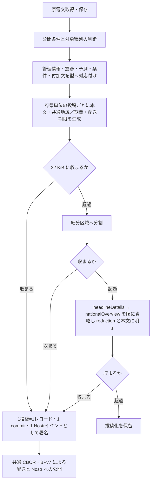

# 気象庁 緊急地震速報 拡張

識別子: `dev.jisaku.mosimo.public.jma.eew`

## 目的

本プロトコルは、気象庁防災情報 XML の `緊急地震速報（警報）`（VXSE43）と `緊急地震速報（予報）`（VXSE44）を本プロトコルの投稿へ変換する拡張を定義する。定義する範囲は、原電文の管理部・ヘッダ部・震源と精度・予測・警報対象・付加文を保持する型、府県予報区を基本とする地域別の単独で読める投稿、本文、続報・訂正・取消、時刻と即時通知の境界、取得経路の制約である。

保証するのは、この型だけで対象電文の種別・震源・予測値・状態を解釈でき、各投稿が他の投稿や共通ヘッダ拡張を取得せずに読めることである。保証しないのは、`緊急地震速報（地震動予報）`（VXSE45）・リアルタイム震度電文・配信テスト専用電文・津波警報への対応、取得経路の提供、即時到達や揺れ前到達、既存の緊急警報手段の代替、検証アルゴリズム・適合試験・テストベクトルである。観測震度・観測長周期地震動は [地震観測情報](../earthquake/README.md) が扱う。

## 前提

| 識別子 | 文書 | 依存する理由 |
|---|---|---|
| `dev.jisaku.mosimo` | [../../../README.md](../../../README.md) | 投稿単位、`Timestamp`、拡張の自己完結タグ、32 KiB 上限 |
| `dev.jisaku.mosimo.public` | [../../README.md](../../README.md) | 取り込みの信頼モデル、出典 `#source`、更新による置換の認可 |
| `dev.jisaku.mosimo.public.jma` | [../README.md](../README.md) | 共通型 `JmaMessage`・`JmaValue`・`JmaCode`・`JmaNamedCode`・`JmaEarthquake`・`JmaHypocenter`・`JmaSelection`・`JmaNationalOverview`・`JmaReduction`、独立した情報単位、地域別投稿の原則、時刻、原文ハッシュ、文字列の安全な解釈 |
| `dev.jisaku.mosimo.geo` | [../../../geo/README.md](../../../geo/README.md) | 影響範囲 `#area` |
| `dev.jisaku.mosimo.validity` | [../../../validity/README.md](../../../validity/README.md) | 情報の有効期間 |

## 1. 役割分担

| 拡張 | 担当 |
|---|---|
| `dev.jisaku.mosimo.public.jma.eew` | 原電文の種別・震源・予測値・状態 |
| `dev.jisaku.mosimo.public#source` | 原文参照、取得 URL・取得時刻・変換者・変換規則 |
| `dev.jisaku.mosimo.geo#area` | 共通の配送判断用の地域表現 |
| `dev.jisaku.mosimo.validity` | 意味を確定できる内容有効期間。予測到達時刻や配送期限の別名ではない |

本拡張の基本表示は `source`・`area`・`validity` がなくても行える。

## 2. データ型

### 2.1 震源と精度

```ts
type JmaAccuracyValue = { value: string; rank: string; rank2?: string };
type JmaEewEarthquake = JmaEarthquake & {
  hypocenter?: JmaHypocenter & {
    reduceName?: string;
    reduceCode?: JmaCode;
    landOrSea?: string;
    accuracy?: {
      epicenter: JmaAccuracyValue;
      depth: JmaAccuracyValue;
      magnitudeCalculation: JmaAccuracyValue;
      numberOfMagnitudeCalculation: string;
    };
  };
};
```

| 原 XML（`Body/Earthquake` 以下） | 配置と意味 |
|---|---|
| `OriginTime`・`ArrivalTime`・`Condition` | `originTime`・`arrivalTime`・`condition`。地震発生・検知時刻と震源要素の補足 |
| `Hypocenter/Area/Name`・`Code`・`jmx_eb:Coordinate` | `hypocenter.name`・`code`・`coordinates`。ISO 6709 座標の原文字列と説明 |
| `Hypocenter/Area/ReduceName`・`ReduceCode`・`LandOrSea` | 同名の camelCase 項目 |
| `Hypocenter/Accuracy` | `hypocenter.accuracy`。値・rank・rank2・使用観測点数を保持 |
| `jmx_eb:Magnitude` | `magnitude`。種別・条件・説明を伴う値 |

`condition: "仮定震源要素"` は重要な条件である。PLUM 法等の仮定による位置・深さ・マグニチュードを通常の確定震源として表示してはならない。`accuracy` の `NaN` とランクを落とさず、ランクの大きさだけで独自の信頼スコアを作らない。部内利用・変更可能とされるランク値から独自の警報判断を行わない。地域の到達時刻と `earthquake.arrivalTime` は別の項目である。

### 2.2 予測と警報対象

```ts
type JmaForecastRange = { from: string; to: string };
type JmaEewArea = JmaNamedCode & {
  category: JmaNamedCode;
  forecastInt: JmaForecastRange;
  forecastLgInt?: JmaForecastRange;
  arrivalTime?: JmaValue;
  condition?: string;
};
type JmaEewPref = JmaNamedCode & { areas: JmaEewArea[] };
type JmaEewForecast = {
  forecastInt: JmaForecastRange;
  forecastLgInt?: JmaForecastRange;
  appendix?: {
    maxIntChange?: string;
    maxLgIntChange?: string;
    maxIntChangeReason: string;
  };
  prefs?: JmaEewPref[];
};
type JmaEewHeadlineInformation = {
  type: string;
  items: {
    kind: JmaNamedCode;
    lastKind: JmaNamedCode;
    codeType: string;
    areas: JmaNamedCode[];
  }[];
};
type JmaEewExtension = {
  $type: "dev.jisaku.mosimo.public.jma.eew";
  message: JmaMessage;
  selection: JmaSelection;
  nationalOverview?: JmaNationalOverview;
  reduction?: JmaReduction;
  headlineInformation?: JmaEewHeadlineInformation[];
  body: {
    earthquake?: JmaEewEarthquake;
    forecast?: JmaEewForecast;
    text?: string;
    warningComment?: { text: string; code: JmaCode };
    nextAdvisory?: string;
  };
};
```

| 原 XML | 配置 |
|---|---|
| `Head/Headline/Information` | `headlineInformation`。`type`、`Item` 配列、`Kind`・`LastKind`、`Areas/@codeType` と地域 |
| `Body/Intensity/Forecast` | `body.forecast` |
| `ForecastInt/From,To`・`ForecastLgInt/From,To` | 原階級の上下限。全国の最大値と地域の最大値を区別 |
| `Forecast/Appendix` | `forecast.appendix`。変化量区分と変化理由 |
| `Forecast/Pref/Area/Category/Kind` | `forecast.prefs[].areas[].category` |
| `Forecast/Pref/Area/ArrivalTime,Condition` | 地域別の `arrivalTime`・`condition` |
| `Body/Text`・`NextAdvisory` | `body.text`・`nextAdvisory` |
| `Body/Comments/WarningComment/Text,Code` と `@codeType` | `body.warningComment`。`code.type` に体系を保持 |

XML の繰り返しは文書順の配列にする。同じ府県が複数の `Pref` として現れても、コードをキーにした辞書へまとめてはならない。予測部の `CodeDefine` は各コードの適用位置に従って `code.type` に反映する。見出しの地域コード体系と本文の府県・地域コードは別に保持する。

`forecastInt` の `5-`・`5+` 等は原階級、上限の `over` は「程度以上」であり、算術値や無限大へ置換してはならない。`不明` は震度 0 ではない。長周期地震動階級は震度とは別尺度である。予測や地域一覧が存在しないケースもあり、架空の予測・地域を補ってはならない。見出しの警報対象と本文の予測値の掲載範囲は役割が異なるため、同じ集合へ潰してはならない。

地域の `category.code` は警報／予報だけでなく、主要動の到達状況・PLUM 法による予測かを示す。PLUM 法では `arrivalTime` が「その階級震度を初めて予測した時刻」を表すため、すべての値を未来の到達予想時刻としてカウントダウンに使ってはならない。`condition: "既に主要動到達と推測"` と到達時刻の欠落も、その条件のまま保持する。

`nextAdvisory` は原文の次回発表予定である。「この情報をもって、緊急地震速報：最終報とします。」は当該地震 ID での速報発表の終了を表す。警報の取消・危険の解消・配信成功を表すフラグに変換してはならない。

## 3. 地域別の投稿単位

地域別投稿の原則は [気象庁 XML 共通 §6](../README.md#6-地域別投稿の原則) に従う。本拡張では次のとおり具体化する。

- `selection.kind` は `region`、`path` は `[原 Pref の位置]`（府県単位）または `[原 Pref の位置, その Pref 内の原 Area の位置]`（細分区域）とする。緊急地震速報の `Pref` は府県予報区であり、行政上の都道府県と常に一対一とは限らない。
- `body.forecast.prefs` は選択した Pref だけを 1 件保持する。府県単位ではその原 Pref の全 Area、細分区域単位では選択した Area だけを保持し、親の名称・コード、地域の予測・カテゴリー・到達条件を残す。
- 原電文の最大値・変化情報・見出しは原電文全体の文脈であり、選択範囲だけの値へ再計算・改名してはならない。
- 取消や、地域別予測を持たない最大予測値だけの情報は `selection: { kind: "whole" }` として 1 投稿で伝える。

例えば `selection: { kind: "region", path: [2] }` は原電文の 3 番目の Pref 全体、`path: [2, 0]` はその最初の Area である。抽出後はいずれも `prefs[0]` 内に格納する。

`nationalOverview.prefectures` は原電文の予測部に掲載された府県予報区の一覧とする。サイズ超過時の省略候補は `headlineDetails`、次に必要なら `nationalOverview` の順とする。重要な対象・指示・適用条件をそれらだけが表す場合は、本文へ意味を残せることを確認してから省略する。

## 4. 本文

本文には、取得・変換者による気象庁情報の転載であること、警報／予報、原発表時刻、通常／訓練／試験、情報番号、訂正／取消、対象地域、予測階級と条件、主要な指示を明示する。必要に応じて仮定震源・既到達・予測手法による時刻の意味・最終報も伝える。コード列だけで本文を代替してはならない。未知拡張の端末は本文だけで通知の趣旨を把握するためである。

本文には選択地域を明示し、原電文全体の最大値を掲載する場合は「原電文全体」、地域の値はその地域の予測と分かるようにする。取消電文では今回の管理情報・ヘッダ・取消本文を保持し、旧予測を現在の予測として引き継がない。

### 4.1 M9.9 の表示

数値として 9.9 のマグニチュードを表示する場合、本拡張では「M9.9 以上」とする。これは本プロトコル独自の上限値を想定した表示方針であり、気象庁 XML 仕様の定義として「以上」を付与したものではない。気象庁の 2026-10-16 の報道発表も「9.9 と過大に推定」と説明しており、真の規模の下限を示した発表ではない。原 `value`・`type`・`condition`・`description` はそのまま保持し、機関が「以上」と発表したとの表示や、変換後の値への置換をしてはならない。

詳細表示では「本拡張では上限値として表示。原配信値は 9.9」と分かるようにする。`NaN`、不明、仮定条件、原文の説明を優先して併記し、名称や説明文の文字列中の「9.9」を機械的に置換してはならない。この表示方針は本拡張の表示に限り、地震観測情報や他のマグニチュード種別、数値の再計算、予測震度の引上げ、配送優先権の根拠に適用してはならない。

## 5. 続報・訂正・取消

独立した情報単位は [気象庁 XML 共通 §5](../README.md#5-独立した情報単位と続報訂正取消) の `Control/Title` + `Control/Status` + `Head/EventID` で区別する。警報と予報は別の情報名称であり、片方の取消を同じ地震 ID のもう片方や地震観測情報へ広げてはならない。

続報・訂正・取消は新しい署名付き投稿として発行する。配送への反映と認可は共通文書 §5.2 に従う。

## 6. 地域・時刻と即時通知

- 震源は影響範囲でも投稿者の端末位置でもない。`hypocenter` を `origin` や任意半径の共通 `area` へ変換してはならない。
- コード体系と境界を解決できる地域について、投稿の対象全体を覆う共通 `area` を提供できる。地域別投稿では選択地域全体を対象とし、文脈として残した全国見出し・他地域の記述で範囲を拡大してはならない。
- 原発表時刻、管理部時刻、発生・検知時刻、地域の予測時刻、投稿の作成時刻、配送期限を区別する。`ArrivalTime` を `validity.until` や `exp` にコピーしてはならない。
- 遅着した情報を受信時点からの新たな揺れの予告として扱ってはならない。過去の情報の閲覧・保存と、即時の音声・振動・カウントダウン等を分離する。時刻・地域・予測手法を解釈できない場合に残り秒数を創作してはならず、配送期限内であることだけを即時警報の条件にしてはならない。遅着した情報で揺れを予告すると誤報となるためである。

## 7. 取得と配送

気象庁の公開 PULL 型の電文一覧は、緊急地震速報等が公開されないことを明記している。対象の緊急地震速報は公開 Atom から取得できるものとして設計してはならず、対応する別の配信経路・契約・公開再配布条件を取り込み側で確保する。公開 PULL の高頻度 Atom は毎分更新で停止・遅延もあり、それを頻繁にポーリングしても対象電文を取得できるわけではない。

本拡張は自己完結タグ `mosimo:ext:dev.jisaku.mosimo.public.jma.eew` で運ぶ。32 KiB の上限は本文・commit 等を含むイベント CBOR 全体に適用し、取り込み側は §3 の分割・明示付き省略を用いる。非対応端末は本文と配送期限で通常の中継・表示ができる。対応端末は予測・地域・時刻等を利用できるが、原文にない独自の予測や公的警報を発表したことにはならない。

## 8. 処理の流れ



受信側は本文だけの表示、拡張を利用した詳細表示、認可を伴う旧版拡散停止、即時警報動作を別の能力として扱う。

## 未確定事項

- 府県を基本、細分区域までの追加分割と `selection`・`reduction` の具体化、フィールド上限、本文生成の詳細。
- 対象となる `InfoKindVersion` とコード表・辞書の固定版、コード別の時刻解釈、未知版の扱い。
- 決定的な本文生成と、訓練・試験の投入・表示・通知条件。
- 同一独立単位内の更新を新規拡散停止へ対応付ける具体規則、投稿間参照、索引・保持・相反更新。
- 即時通知の鮮度の閾値、時計不明・時計ずれ、重複通知、続報での再通知、取消の通知方法、権限・利用条件に応じた配信経路。
- 共通 `area` への対象の投影、境界データと近似区分。
- 正式 Lexicon と資源上限。

## 参照

- [気象庁 電文毎の解説資料セット（2026-10-09 公開セット）](https://xml.kishou.go.jp/jmaxml_20261009_Manual(pdf).zip) — 「地震火山関連_解説資料.pdf」共通部Ⅰ、共通別紙ア・イ・ウ、Ⅱ.21
- [気象庁 公式サンプル XML 一式（2026-09-17 セット）](https://xml.kishou.go.jp/jmaxml_20260917_Samples.zip) — VXSE43・VXSE44
- [気象庁 XML 技術資料一覧](https://xml.kishou.go.jp/tec_material.html)
- [気象庁 XML 形式電文の公開（PULL 型）](https://xml.kishou.go.jp/xmlpull.html)
- [公開 XML 電文一覧（2026-08-06 現在）](https://xml.kishou.go.jp/xmllist.pdf)
- [気象庁 2026-10-16 発表の緊急地震速報について（第 2 報）](https://www.jma.go.jp/jma/press/2610/16c/202610161730.html)
